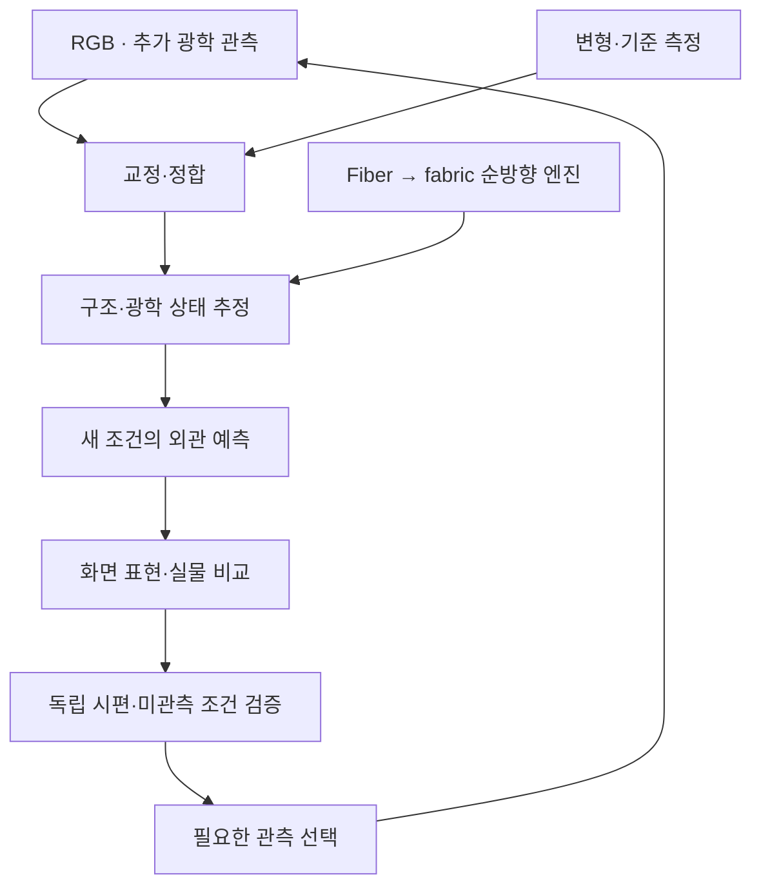

# 직물 외관 재현을 위한 다중 규모 광학 모델링과 메타광학 계측

**Multiscale Textile Appearance Modeling and Meta-Optical Sensing**

온라인 의류 사진에서 예상한 **시각적 재질감과 실제 원단을 보았을 때의 차이**를 줄이는 연구입니다. 섬유와 원사의 구조를 광학 반응에 연결해 현재 원단을 복원하고, **촬영하지 않은 조명·관찰각·역광에서 어떻게 보일지 예측**하는 것을 목표로 합니다. 그 예측에 추가 각도·분광·편광 측정이 필요한지 검증한 뒤, 유용한 관측을 효율적으로 얻는 메타광학 계측계를 연구합니다.

이 저장소는 **연구 목적·설계, fiber → ply → yarn → weave → fabric 시뮬레이션, 광학·관측 모델, 실험 자료와 리뷰 기록**을 함께 관리합니다. 시뮬레이터는 전체 연구의 기반 모듈입니다. 메타표면의 추가 가치와 실제 원단 외관 정확성은 각각 실험으로 입증할 연구 가설입니다.

**연구 저장소:** [Phill-lms/textile-appearance-research](https://github.com/Phill-lms/textile-appearance-research) · **연구 의도와 결정의 기준 문서:** [연구헌장](docs/RESEARCH_CHARTER_KO.md) · **수학·실험 설계:** [연구 설계](docs/RESEARCH_DESIGN_KO.md)

## 연구 목표와 현재 상태

| 연구 항목 | 목표 | 검증된 범위와 남은 일 |
| --- | --- | --- |
| **공간 텍스처** | 직조·실·미세 구조를 실제 크기에 맞게 기록·표현 | 명시적 섬유 기하 생성과 sampling 검사 구현. 실측 고해상도 RGB와의 정합·복원 검증 필요 |
| **색·광택·비침** | 다른 광원·시점에서도 맞는 반사·투과 외관 예측 | 합성 물성의 개별 섬유 광선추적과 분광 관측 구현. 실물의 광학 물성·광원·카메라 교정 필요 |
| **구조와 변형** | 원사·직조의 상태 변화가 광학 반응에 미치는 영향 설명 | v0.3에서 제한된 원사 높이 평형과 섬유 재생성 연결. 물질좌표 운반과 본격적인 접촉·변형 역학은 후속 개발 |
| **역추정과 관측 선택** | 좋은 다중조명 RGB에 무엇을 더 측정해야 하는지 판단 | 순방향 모델과 정보량 기반 실험 설계 마련. 실제 inverse fitting·RGB 대비 추가 정보 이득은 미검증 |
| **메타광학 계측** | 제한된 시간·광량·검출기에서 유용한 채널 확보 | 이상적 광학·검출 진단 보존. 제작 소자의 효율·혼선과 전체 시스템 이점은 미검증 |
| **사용자에게 전달되는 재질감** | 같은 화면 조건에서 실물 시편 판단 개선 | 조명 회전·확대·역광 비교와 시편 매칭 평가를 설계. 실측·사용자 검증은 후속 |
| **촉감·염색·퇴색** | 속성별 기준 측정 또는 공정 모델과 연결 | 촉감의 포괄적 예측은 후속 연구. **염색·퇴색은 현재 개발 범위에서 보류** |

**검증된 기준 릴리스는 [v0.3.0](https://github.com/Phill-lms/textile-appearance-research/releases/tag/v0.3.0)입니다.** 이 버전에서 전체 **239개 테스트**와 실제 **536회 분광 렌더링**을 완료했습니다. 이것은 합성 시편과 선언한 모델에 대한 구현·수치 검증이며, 실크·코튼·큐프라·린넨의 실측 외관을 재현했다는 의미가 아닙니다. v0.4의 추가 개발과 그 검증 결과는 v0.3 기록과 구분해 관리합니다.

## 앞선 논의에서 유지하는 연구 방향

**4K 또는 더 높은 해상도의 촬영은 유효한 방법이며 강한 비교군입니다.** 공간적인 디테일이 부족한 문제와, 한 촬영 조건으로 다른 조명·시점의 반응을 예측하기 어려운 문제를 나누어 평가합니다. 비교군에는 적절한 배율·MTF·노출·색 교정을 갖춘 고해상도 다중조명 RGB를 포함합니다.

**VIS는 화면에 전달할 색과 외관을 직접 검증하는 기준 대역입니다.** IR은 보유한 메타표면·렌즈 연구와 연결할 보조 후보입니다. IR 채널이 구조·재료의 어떤 불확실성을 줄이고, 그 정보가 VIS 외관 예측에 실제로 도움이 되는지 확인합니다. 각도·파장·편광의 우선순위도 목표 오차를 줄이는 정도로 정합니다.

**실크·코튼·큐프라·린넨·혼방은 고정된 외관 프리셋으로 두지 않습니다.** 섬유의 단면·직경·광학 응답, 원사의 꼬임·잔털, 직조·가공 상태를 분리하고 측정 출처를 기록합니다. 혼방은 구성 섬유의 재료 ID와 배치를 유지합니다. 보송하게 보이는 외관, 광택, 비침은 마찰·압축감·접촉 냉감과 다른 목표이며, 촉감까지 확대할 때는 해당 속성의 기준 측정이 필요합니다.

첫 연구의 범위는 작은 원단 패치의 **방향성 광택·직조 대비·비침과 미관측 조건의 외관 오차**에 둡니다. 메타표면은 기존 렌즈·격자·편광자와 비교해 같은 정확도의 획득 시간, 전체 시스템 크기, 광량·픽셀 효율 중 무엇을 개선하는지 검증합니다. 광학계와 역모델을 연결했다는 구성만으로 독창성이나 소자 필요성을 주장하지 않습니다. 이 판단의 선행연구와 판정 기준은 [연구 설계](docs/RESEARCH_DESIGN_KO.md)와 [문헌 검토](notes/literature_engine_v3.md)에 있습니다.

## 전체 연구 모듈

아래는 처음 논의한 계측·재현 연구의 모듈입니다. **R-M 번호는 연구 모듈**, 코드의 H/K/O/V/C/Q는 구현 모듈입니다. v0.1 보고서의 M1–M9는 별도의 과거 소프트웨어 번호 체계이므로 혼용하지 않습니다. 대화에서 역할이 확정되지 않은 M3은 임의로 복원하지 않고, IR 확장은 **R-IR**로 명시했습니다.

| 연구 모듈 | 역할과 연결 |
| --- | --- |
| **R-M1 고해상도 RGB** | 직조·실·잔털의 위치를 기록하고, 강한 다중조명 RGB 비교군을 구성 |
| **R-M2 각도·분광·편광 / 메타광학** | 추가 관측의 정보 가치를 먼저 평가하고, 선택된 채널을 기존 광학·메타광학으로 구현 |
| **R-IR 보조 적외선 관측** | VIS만으로 남는 모호성을 줄이는 조건에서 IR 관측을 결합하는 신규 확장 경로 |
| **R-M4 통제된 변형 관측** | 굽힘·장력·드레이프에 따른 구조 변화를 관찰하고 역학 입력을 제한 |
| **R-M5 교정·정합** | 공간 위치·단위·광원·각도·파장·편광·노출과 관측 불확실성을 연결 |
| **R-M6 구조·광학 추정** | 계층 순방향 엔진을 이용해 외관 예측에 필요한 상태와 불확실성을 추정 |
| **R-M7 사용자 표현** | 확대·조명 회전·역광 전환을 같은 화면 조건에서 제공 |
| **R-M8 기준 측정** | 구조·분광 R/T·방향성 반응·필요한 역학 물성의 실제 기준값 확보 |
| **R-M9 독립 검증** | 미관측 조명·원단 시편, RGB 비교군, 모델 오차와 사용자 판단을 평가 |



이 그림은 **전체 연구의 설계 관계**입니다. 모든 실물 계측·역추정·사용자 평가가 이미 연결되어 실행된다는 뜻은 아닙니다. 모듈별 입력·출력·구현 상태·완료 조건은 [연구헌장](docs/RESEARCH_CHARTER_KO.md#4-전체-연구-모듈과-구현-모듈의-대응)에 있습니다.

## 시뮬레이션 엔진: low level → high level


그림은 저장된 기하의 진단용 중심선입니다. 구조를 보기 위해 선 두께·축 비율을 조정했으며, 물리적 치수는 좌표·반지름 배열로 확인합니다.

| 계층 / 모듈 | 현재 계산하는 내용 | 다음 검증 또는 확장 |
| --- | --- | --- |
| **Constituent / fiber** | 재료 ID, scalar 복소 굴절률, 원형 단면과 명시적 중심선 | 실측 스펙트럼, 비원형 단면·표면·이방성 |
| **Ply / yarn — H1** | 부모 호길이와 local frame에 따른 꼬임·배치·migration·loop | 같은 섬유의 물질좌표 운반, ply 내부 역학 |
| **Weave / network — K1** | binary draft, lift-plan, 경·위사 교차, 유효 인장·굽힘에 의한 높이 평형 | multilayer topology, 3D rod, 마찰·압착·접촉 |
| **Fabric patch — V1** | 유한 패치 생성, sampling과 다른 fiber 사이의 간격 검사 | 자기접촉, 변형 보존량, 전체 의류 drape |
| **공통 광학 입력 — O1** | 동일 기하·재료·단위·출처를 `OpticalScene`으로 전달 | 새 물성·단면의 adapter와 유효범위 |
| **국소 광학 — O2** | 허용된 평행 원형 bundle의 실제 2D Maxwell / ray | 국소 해를 3D ply·fabric으로 올리는 정규화·회절·coherence 모델 |
| **3D 광학 — O3** | 명시적 fiber의 파장별 path tracing | 실측 scattering, 편광·wave correction과 검증 |
| **광학 축약 — O4** | 투영 면적 밀도와 계층별 SGGX fitting | 차폐·다중 산란을 포함한 fabric BSDF 및 실제 영상 오차 |
| **관측·검증 — C1 / Q1** | 분광 radiance, CIE 적분, seed 통계, 근사·수렴 검사 | 실물 카메라·디스플레이 교정, 역문제와 관측 선택 |

기하·scene 길이는 **mm**, 파장은 **vacuum nm**, 기존 2D solver 길이는 **μm**이며 adapter에서 변환합니다. 비간섭 성분은 강도로, coherent field는 복소 진폭으로 결합합니다. 국소 파동 해·직접 투과·공극 회절을 중복 에너지로 더하지 않습니다. 방향별 투영 면적이나 SGGX fitting 오차를 완전한 cloth BSDF 또는 실물 정확성으로 해석하지 않습니다. API와 물리 계약은 [ARCHITECTURE.md](docs/ARCHITECTURE.md), [optical_bridge.md](notes/optical_bridge.md)에 있습니다.

## 검증된 v0.3 결과

v0.3은 **원사 높이 평형 → 섬유 재생성 → 계층 광학 통계·실제 분광 관측**을 연결한 합성 실험입니다.

| 실험 | 실제 결과 | 해석 범위 |
| --- | --- | --- |
| 42-fiber 평직의 축소 평형 | 초과 에너지 −70.05%; 경사 crimp 0.7000→0.1225%, 위사 0.7000→1.3667% | 선언한 유효 강성·경계·작은 기울기 굽힘 모델의 결과 |
| 84-fiber, 2-ply 능직 | 평형 원사에 다중 ply 기하 연결 | ply 내부 응력·sliding을 계산한 결과는 아님 |
| 전체 SGGX 1개 → 경·위사 2개 | 초기 방향별 투영 통계 RMSE 3.5727→0.2198% | 동일 기하의 통계 축약 성능; BSDF·영상 오차가 아님 |
| 536회 실제 분광 렌더 | 2상태·3조명·17파장·4seed의 408회 + 중간 파장 128회 | 64×64, 32 spp, 합성 물성의 scalar path tracing |
| 6500 K Planck 반사 0° / 90° | 평균 Y 변화 +37.04% / −32.37% | 해당 기하·조명에서 방향별 반응 차이 |
| 같은 광원의 투과 45° | +0.64%, paired 95% 구간이 0 포함 | 현재 Monte Carlo 예산에서 변화 미분리 |

6500 K Planck 광원은 D65가 아닙니다. 통계 구간은 4개 seed의 렌더링 불확실성이며 실물·모델·교정 오차를 포함하지 않습니다. v0.3은 평형 후 fiber를 재생성하므로 전체 부피 proxy가 +0.04424% 변했습니다. 이 비교를 같은 섬유의 물질점을 보존한 변형 또는 접선 변화 하나의 효과로 해석하지 않습니다.

**v0.3 전체 테스트는 239개, failures/errors/skips 모두 0입니다.** [v0.3 태그에 고정한 검증 summary](https://github.com/Phill-lms/textile-appearance-research/blob/v0.3.0/data/final_test_summary.json), [저장 결과 재검산](data/engine_v3_final_artifact_audit/run_manifest.json), [독립 리뷰](notes/review_engine_v3.md)에 입력·소스 hash와 실패 후 수정 근거를 보존합니다. 새 코드의 검증 수치와 과거 버전의 수치는 해당 source와 run을 구분해서 읽어야 합니다.

상세 수치·그림·수학은 [v0.3 한국어 보고서](report/fabric_engine_v3_report_ko.pdf), [역학 유도](notes/weave_mechanics_v3.md), [광학 유도](notes/optical_scale_v3.md), [릴리스 기록](docs/RELEASE_V0_3.md)에 있습니다. 이전 README의 상세 결과 표와 실행 설명도 [v0.3 태그의 README](https://github.com/Phill-lms/textile-appearance-research/blob/v0.3.0/README.md)에 보존되어 있습니다.

## 가장 가까운 연구 질문과 다음 개발

> **강한 다중조명 RGB에서 남는 원사 구조와 섬유 산란·흡수의 모호성을, 소수의 추가 관측으로 줄일 수 있는가? 그 이득은 기하·광학 모델이 틀린 경우와 새로운 원단에서도 유지되는가?**

현재 순방향 엔진의 가장 가까운 보완은 **섬유 물질좌표를 유지하는 변형 연결**입니다. 이후 계층 축약을 실제 radiance·BSDF에 대해 검증하고, 실측 원단으로 물성과 관측계를 보정합니다. 추가 채널은 같은 획득 시간·광량·픽셀 조건에서 평가하며, 같은 원단의 인접 패치가 학습과 평가에 섞이지 않도록 합니다.

이득이 확인된 채널을 기존 광학과 메타광학으로 각각 구현하고 relay·mount·detector를 포함한 전체 시스템으로 비교합니다. 실제 제품의 모든 촉감을 예측하거나 새 염료·퇴색 공정을 시뮬레이션하는 것은 별도 기준 측정과 모델을 요구하는 후속 과제입니다. 구체적인 진행·중단 조건은 [연구 설계 §7–8](docs/RESEARCH_DESIGN_KO.md#7-가장-유망한-다음-연구-질문)을 따릅니다.

## 재현과 실행

저장소 루트에서 실행합니다. v0.3 검증 환경은 Python 3.12.14, NumPy 2.3.5, SciPy 1.17.0, Mitsuba 3.9.1 / Dr.Jit 1.5.0, LLVM CPU였습니다. [requirements.txt](requirements.txt)와 [환경 기록](data/environment.json)을 참고하세요.

```bash
python -m venv .venv
source .venv/bin/activate
python -m pip install -r requirements.txt

# 실제 명령·단계·경로 확인; 계산이나 파일 생성을 하지 않음
python run_engine_v3.py --dry-run

# 저장된 v0.3 실험을 독립 재검산; 536회 영상 재렌더 없이 실행
python run_engine_v3.py --stages verify --output scratch_runs/v3_audit

# 새 원사 평형·광학 통계·검산; 새 분광 실험 렌더 생략
python run_engine_v3.py --stages mechanics optics verify \
  --no-render --output scratch_runs/v3_no_render

# 새 v0.3 전체 실험과 테스트; 기본 536회 fiber 렌더 포함
OPENBLAS_NUM_THREADS=1 OMP_NUM_THREADS=1 \
  python run_engine_v3.py --output scratch_runs/v3_full

# 현재 체크아웃의 전체 테스트와 source별 검증 기록
python validate_all.py
```

`--output`은 새 폴더 또는 빈 폴더여야 합니다. v3 단계의 실제 의존 순서는 `mechanics optics verify tests`이고, 생략한 상위 단계 입력은 `--input-data`(기본 `data/`)에서 읽습니다. `--no-render`는 광학 실험의 새 렌더를 생략하며, 따로 선택한 tests의 작은 renderer 검사까지 생략하는 옵션은 아닙니다. 실행한 작업·실패·생략·원시 결과는 각 `run_manifest.json`을 기준으로 확인합니다.

기존 실행 경로도 유지합니다.

```bash
# Fiber–ply–yarn–fabric 기하 한 구성
python -m textile_sim.hierarchy \
  --config examples/hierarchy/twill_two_ply.json \
  --out scratch_runs/twill_two_ply

# v0.2의 5개 기하·refinement·광학 specimen·tests
python run_engine_v2.py --stages geometry refinement optics tests \
  --output scratch_runs/v2_reproduction

# v0.1 광학·카메라·이상적 meta 실험 계획
python run_all.py --dry-run
```

`run_engine_v2.py`와 `run_all.py`의 단계명은 v3와 다릅니다. 기존 전용 driver의 기본 출력 경로를 사용하면 추적 중인 결과가 갱신될 수 있으므로 새 실험은 별도의 출력 폴더를 사용합니다. 과거 수치가 새 소스로 자동 재실행된 것으로 표시되지 않도록 run별 source·config·seed·budget을 보존합니다.

## 문서와 연구 기록

| 읽을 목적 | 문서 |
| --- | --- |
| **왜 이 연구를 하는가 / 대화의 결정을 어떻게 반영했는가** | [연구헌장과 요구사항 매핑](docs/RESEARCH_CHARTER_KO.md) |
| **어떤 가설을 어떤 비교로 검증하는가** | [연구 설계](docs/RESEARCH_DESIGN_KO.md) |
| **어떤 데이터·API·수학을 사용하는가** | [Architecture](docs/ARCHITECTURE.md), [계층 기하](notes/hierarchy_design.md), [광학 연결](notes/optical_bridge.md) |
| **v0.3의 실제 구현·실험·검증** | [22쪽 한국어 보고서](report/fabric_engine_v3_report_ko.pdf), [릴리스 설명](docs/RELEASE_V0_3.md), [독립 리뷰](notes/review_engine_v3.md) |
| **어떤 논문·코드를 어디까지 확인했는가** | [v3 문헌·인용 관계](notes/literature_engine_v3.md), [v2 문헌·라이선스](notes/literature_engine_v2.md), [ray–wave 검토](notes/ray_wave_literature.md) |
| **과거 결과와 변경 이유** | [작업 로그](docs/WORK_LOG.md), [CHANGELOG](CHANGELOG.md), [v0.2 보고서](report/fabric_engine_v2_report_ko.pdf), [v0.1 설명](docs/baseline_v0.1.md) |

## 선행연구·코드 출처·버전 관리

직조 설계에는 [Weavecraft](https://www.cs.cornell.edu/projects/weavecraft/)와 [Leaf의 원사 수준 직물 설계](https://graphics.stanford.edu/projects/yarnsim/), 외관·관측에는 [Tang의 반사·투과 capture](https://arxiv.org/abs/2406.19398), [FabricGen](https://lxtyin.ac.cn/projects/fabricgen/), [fiber-level capture](https://www.rendering-zixuan.com/paper_pages/FiberFabric/), [Yu의 ray–wave model](https://doi.org/10.1145/3763359)을 참고합니다. [SGGX](https://research.nvidia.com/labs/rtr/publication/heitz2015sggx/), [SpongeCake](https://wangningbei.github.io/2022/SpongeCake.html), [직물 SGGX fitting](https://doi.org/10.26599/CVM.2025.9450445)은 계층 광학의 직접 선행연구입니다. 이 논문들을 참고한 사실과 원 논문 전체 방법의 재현은 구분합니다.

첨부 논문, 논문의 참고문헌, 확인된 후속 인용, 관련 연구와 공식 GitHub의 확인 깊이는 문헌 ledger에 기록합니다. 웹사이트 template의 GitHub 링크를 method code로 취급하지 않으며 확인하지 못한 후속 인용을 만들어 넣지 않습니다. Tang 공식 코드·TexGen의 확인 commit과 라이선스는 [v2 source audit](notes/literature_engine_v2.md#7-source-and-license-audit)에 있습니다.

새 코드·문서는 사용자 지시에 따라 AI의 도움을 받아 설계·작성·검증했습니다. 제3자 파일은 [NOTICE](references/NOTICE.md)와 원 라이선스를 유지하며 이 연구 저장소 자체에 별도의 오픈소스 라이선스를 부여하지 않았습니다. 소프트웨어 인용은 [CITATION.cff](CITATION.cff)의 메타데이터와 정확한 tag·commit을 사용하고, 원 논문 방법은 해당 논문도 인용합니다.

저장소의 이전 이름은 `textile-optics-engine`입니다. 연구 전체를 설명하도록 현재 제목과 주소를 정리했으며, 과거 태그·commit·실험·논문 첨부의 provenance는 당시 기록으로 보존합니다. v0.1·v0.2·v0.3은 각 버전의 근거이고, 새로운 구현이나 실험의 완료 여부는 해당 버전의 검증 기록으로 판단합니다.
