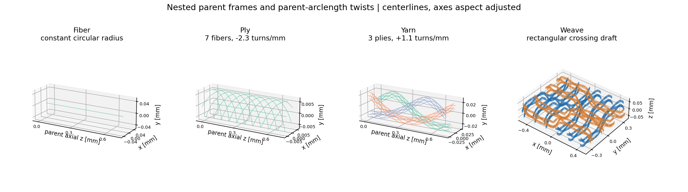
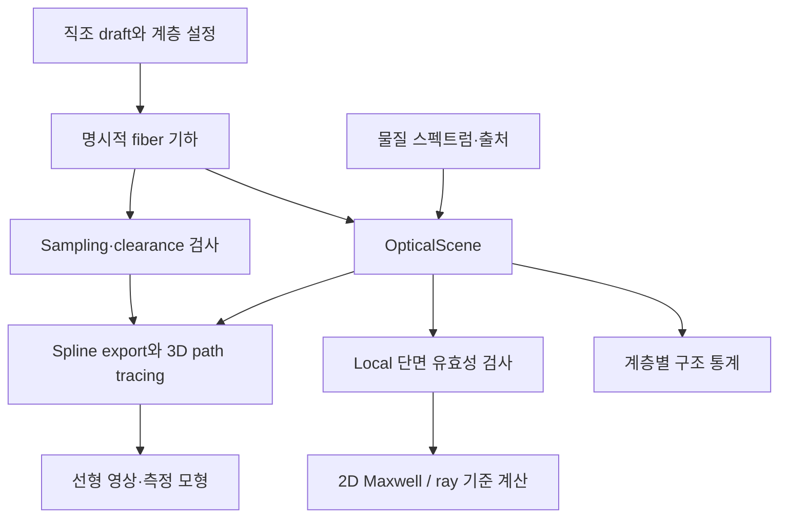
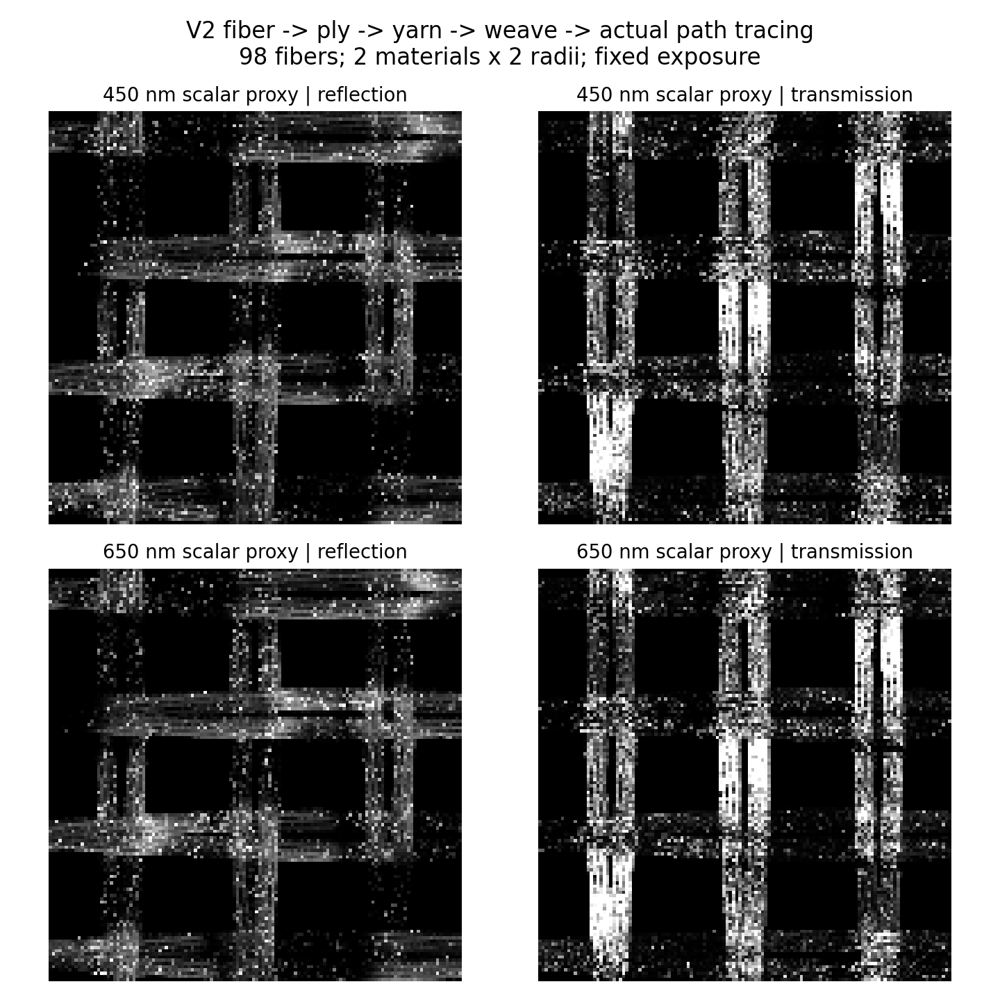

# Textile Optics Engine

**섬유 → ply → yarn → 직조 → 원단을 명시적으로 설계하고, 같은 기하·재료 정보를 파동·광선·렌더링 엔진으로 전달하는 연구용 시뮬레이터입니다.**

연구 목적은 제품 사진에서 잘 드러나지 않는 원단의 방향성 광택, 미세 구조, 비침을 설명하고, 다른 조명·관찰각에서 어떻게 보일지 예측하는 것입니다. 고해상도 RGB를 출발점으로 삼고, 이후 각도·분광·편광 측정과 메타광학이 어떤 추가 정보를 주는지 검증할 수 있는 forward model을 만듭니다. **염색·퇴색은 현재 범위에서 제외했습니다.**

현재 배포 버전은 [**0.2.0**](https://github.com/Phill-lms/textile-optics-engine/releases/tag/v0.2.0)입니다. 이전 시뮬레이션과 수치 결과는 [v0.1.0-baseline](https://github.com/Phill-lms/textile-optics-engine/releases/tag/v0.1.0-baseline)으로 보존했고, 새 계층·광학 연결 모듈을 추가했습니다. 이 코드는 통제된 합성 입력의 연구 프로토타입이며, 실크·코튼·큐프라·린넨의 실측 외관을 검증한 제품은 아닙니다. 저장소: [Phill-lms/textile-optics-engine](https://github.com/Phill-lms/textile-optics-engine).

## 먼저 볼 문서

| 문서 | 읽을 이유 |
| --- | --- |
| [v0.2 한국어 기술 보고서 — 22쪽](report/fabric_engine_v2_report_ko.pdf) | 계층 수학·광학 연결·실행 결과·검증을 그림과 함께 정리한 완성 보고서 |
| [연구 목적·가설·실험 설계](docs/RESEARCH_DESIGN_KO.md) | 원래 제품 재질감 문제에서 현재 엔진까지의 연결과 다음 연구의 판정 기준 |
| [아키텍처와 인터페이스](docs/ARCHITECTURE.md) | 계층별 객체, 단위, 실제 호출 경로, 파일 형식, 확장 지점 |
| [계층 기하의 수학·구현](notes/hierarchy_design.md) | local frame, twist, migration, loop, draft, sampling, clearance |
| [광학 연결의 수학·구현](notes/optical_bridge.md) | 재료 스펙트럼, 단면 유효성, 파동·광선·Mitsuba 변환과 실제 결과 |
| [문헌·공식 코드 검토](notes/literature_engine_v2.md) | 두 첨부 논문과 관련 연구의 검토 깊이, 코드·라이선스 확인 범위 |
| [독립 리뷰](notes/review_engine_v2.md) | 발견·수정한 결함, 수학 검산, 실제 solver를 통과한 독립 테스트 |
| [작업 로그](docs/WORK_LOG.md), [변경 기록](CHANGELOG.md), [배포 검증](data/repository_release_audit.json) | 날짜별 실제 작업, 보존된 baseline과 버전별 변경 |
| [v0.1 원본 설명](docs/baseline_v0.1.md), [기존 상세 PDF](report/textile_optical_simulation_report_ko.pdf) | 먼저 구현했던 wave/ray/camera/meta 모듈과 이전 실행 결과 |

## 이번 버전에서 실제로 만든 것



그림은 저장된 수치 기하를 그린 진단용 중심선입니다. 구조를 보기 위해 선 두께·축 비율을 조정했으므로, 실제 섬유 직경과 치수는 좌표·반지름 배열을 기준으로 해석해야 합니다.

| 기능 | 실제 API / 모듈 | 현재 범위 |
| --- | --- | --- |
| 직조 설계 | `WeaveDraft`, `weave_draft.py` | 임의의 직사각형 binary draft, 평직·능직·수자직·basket, float 진단, lift-plan 변환 |
| Fiber / ply / yarn | `FiberSpec`, `PlySpec`, `YarnSpec`, `build_yarn()` | 원형 fiber, 부모 호길이 기준 twist, 명시적 부모·재료 ID |
| 원단 기하 | `FabricSpec`, `build_hierarchy()` | 경·위사 pitch, `C2` crimp, bounded migration/waviness/loop, adaptive sampling |
| 기하 검증·저장 | `audit_clearance()`, `save_hierarchy()`, `load_hierarchy()` | 다른 fiber 사이 연속 polyline capsule 검사, 버전 JSON + pickle 없는 NPZ |
| 광학 공통 입력 | `MaterialSpectrum`, `OpticalScene`, `from_hierarchy()` | mm/nm 단위, 수동 복소 굴절률, source/status, fiber별 재료 보존 |
| 2D 파동·광선 연결 | `extract_bundle_section()`, `wave_inputs()`, `ray_inputs()` | 평행·직선·원형 조건을 검사한 local bundle을 기존 solver에 실제 전달 |
| 3D 렌더 연결 | `export_mitsuba()`, `render_optical_scene()` | 재료·반지름별 곡선 그룹, spline·float32 오차 보고, 실제 Mitsuba path tracing |
| 구조 통계 | `orientation_statistics()`, `microstructure_statistics()` | 길이/부피 가중 tangent tensor, 비차폐 측면 투영 면적; BSDF로 자동 해석하지 않음 |

### 실제 연결 구조



Mitsuba 경로는 실제 3D 개별 fiber를 추적합니다. 2D Maxwell 경로는 허용된 local 평행 원통의 해입니다. 두 계산을 같은 scene·재료에서 시작하게 했지만, **2D 산란을 임의의 3D cloth BSDF로 올리는 모델은 아직 구현하지 않았습니다.**

## 실제 실행 결과

### 계층 기하 5개 구성

| 저장된 예제 | 구성 | Fiber 수 | 정점 수 | 다른 fiber 사이 간격 하한 |
| --- | --- | ---: | ---: | ---: |
| [plain_single_ply](examples/hierarchy/plain_single_ply.json) | 1 ply × 19 fibers | 190 | 26,638 | 1.927 μm |
| [twill_two_ply](examples/hierarchy/twill_two_ply.json) | 2 plies × 7 fibers | 140 | 39,116 | 1.765 μm |
| [basket_rectangular_three_ply](examples/hierarchy/basket_rectangular_three_ply.json) | 3 plies × 7 fibers, 4×6 draft | 210 | 58,674 | 2.465 μm |
| [twill_migration_waviness](examples/hierarchy/twill_migration_waviness.json) | 2-ply + migration + waviness | 140 | 39,116 | 1.522 μm |
| [twill_loop_excursions](examples/hierarchy/twill_loop_excursions.json) | 위 구성 + 기존 fiber의 loop | 140 | 78,092 | 1.527 μm |

모두 실제 생성 곡선의 연속 capsule 검사를 통과했습니다. 이 표의 서로 다른 구조들은 기능 실행 예제이며, 모든 변수를 고정한 재질 효과 비교 실험은 아닙니다. 세 twill 구성은 교차 중심 거리를 64 μm로 유지했습니다. 정확한 수치와 입력 hash는 [data/hierarchy_v2](data/hierarchy_v2)에 있습니다.

5개 구성 모두 실제 채택된 sampling에서 출발해 1/2/4배로 재생성했습니다. 예를 들어 plain의 연속 refinement 간 최대 위치 차이는 약 **0.137 → 0.0389 μm**로 줄었습니다. 이것은 두 생성 polyline 사이의 차이이며, 계산하지 않은 연속 극한에 대한 절대 오차 인증은 아닙니다. [Refinement 수치](data/hierarchy_v2/sampling_refinement_metrics.json), [그림](figures/hierarchy_v2/sampling_refinement.png).

### 광학 엔진 연결



**98 fibers, 14 plies, 7 yarns**의 원단에서 두 합성 물질 × 두 반지름을 유지한 4개 optical group을 렌더링했습니다. 450/650 nm, reflection/transmission의 4개 영상은 실제 Mitsuba 출력입니다. 128×128, 64 spp의 단일 파장 scalar proxy이며, 디스플레이에 보이는 실제 재료의 분광색을 재현한 영상은 아닙니다.

- 별도의 7-fiber 직선 보정 yarn에서 **3파장 × Ez/Hz = 6조건**의 실제 Maxwell/ray 계산을 실행했습니다.
- 98-fiber 원단의 원본 간격 하한은 **2 μm**, spline·float32 위치/반지름 오차를 차감한 저장 기하의 간격 하한은 **1.91769 μm**였습니다.
- 이 기하 전송과 수치는 별도의 리뷰에서 다시 읽고 계산했습니다. [실험 metrics](data/optical_bridge_v2/optical_bridge_metrics.json), [독립 리뷰](notes/review_engine_v2.md).

정량 분석에는 `*_linear.npy`, `*.npz`, JSON을 사용합니다. PNG는 표시용입니다. `mean_linear`는 지정 조명·카메라의 영상 평균 radiance이며, 반구 반사율/투과율로 더할 수 없습니다. Monte Carlo 잡음과 파장별 다른 seed를 고려하지 않고 작은 영상 차이를 물리 효과로 주장하면 안 됩니다.

## 빠른 실행

저장소 루트에서 실행합니다. 검증 환경은 Python 3.12.14, NumPy 2.3.5, SciPy 1.17.0, Mitsuba 3.9.1 / Dr.Jit 1.5.0, LLVM CPU였습니다. [requirements.txt](requirements.txt)와 [환경 기록](data/environment.json)을 참고하세요.

```bash
python -m venv .venv
source .venv/bin/activate
python -m pip install -r requirements.txt

# 전체 단위·물리 회귀 테스트와 machine-readable 결과
python validate_all.py

# 새 v2 전체 실험: 5개 geometry, 실제 refinement, optical specimen, tests
python run_engine_v2.py \
  --stages geometry refinement optics tests \
  --output scratch_runs/v2_first_run

# 새 계층 기하 한 구성: 생성 + 기본 clearance 검사
python -m textile_sim.hierarchy \
  --config examples/hierarchy/twill_two_ply.json \
  --out scratch_runs/twill_two_ply

# 계층 기하 → 재료별 3D 렌더 + 보정 yarn의 2D wave/ray
python run_optical_bridge_experiments.py --output scratch_runs/optical_bridge
```

Unified runner의 `--output`은 새 폴더 또는 빈 폴더여야 합니다. `--dry-run`은 쓰기 없이 계획을 출력하고, `--no-render`는 optical experiment의 네 영상을 생략합니다. 선택한 tests의 작은 renderer integration checks는 실행됩니다. `run_manifest.json`에 명령·로그·입출력 hash·환경·종료 코드를 남깁니다. Optics 단계는 별도의 98-fiber specimen을 사용하며, geometry 5개를 모두 자동 렌더링하지 않습니다.

광학 전용 실험의 기본값은 128×128, 64 spp이며 `--resolution`, `--spp`로 바꿀 수 있습니다. 전용 driver의 `--skip-render`는 3D 렌더만 생략합니다. 위 예제는 추적된 기준 데이터를 보존하도록 `scratch_runs/`에 씁니다. 개별 driver를 기본 출력 경로로 실행하면 해당 결과 파일이 갱신됩니다.

### Python API 예제

```python
import json
from pathlib import Path
from textile_sim.hierarchy import FabricSpec, build_hierarchy, audit_clearance
from textile_sim.optical_scene import MaterialSpectrum, from_hierarchy

spec = FabricSpec.from_dict(json.loads(
    Path("examples/hierarchy/twill_two_ply.json").read_text()
))
geometry = build_hierarchy(spec)
audit = audit_clearance(geometry)
if not audit["certified_separated"]:
    raise RuntimeError(audit)

# 코드 경로 검증용 합성 상수. 특정 실물 섬유의 측정값이 아니다.
materials = (
    MaterialSpectrum.from_absorption(
        "synthetic_A", [400, 700], 1.50, 2.0,
        source="README synthetic example: n and absorption in 1/mm"),
    MaterialSpectrum.from_absorption(
        "synthetic_B", [400, 700], 1.63, 12.0,
        source="README synthetic example: n and absorption in 1/mm"),
)
scene = from_hierarchy(geometry, materials)
scene.save("scratch_runs/example_scene.json")
print(geometry.summary())
print(scene.sha256)
```

`build_yarn()`는 사용자 지정 중심선 위의 단독 원사를 만들고, `build_hierarchy()`는 직조 설정에서 유한 원단 패치를 만듭니다. Stand-alone yarn은 전달된 중심선의 sampling을 자동 보증하지 않으므로, 고주파 twist를 넣을 때 충분한 점이 필요합니다.

### 기존 optical / camera / meta 실험

```bash
# 실행할 단계와 명령 확인
python run_all.py --dry-run

# 기존 Maxwell·ray·동일 기하 비교·Gaussian beam
python run_all.py --stages wave ray match beam

# 검출 채널, 분포 압축, 공극 회절, 이상적 meta pupil
python run_all.py --stages measurement surrogate aperture meta

# 기존 3개 직조 렌더·카메라와 렌더 물리 검증
python run_all.py --stages fabric render-checks
```

`run_all.py`는 기존 실험 단계의 실행기입니다. 새 hierarchy/optical bridge는 `run_engine_v2.py` 또는 위의 전용 명령으로 실행합니다. 기존 실행기의 stdout/stderr·종료 코드·시간은 `data/reproduction_logs/`에 기록됩니다. 더 자세한 기존 명령과 파라미터는 [v0.1 설명](docs/baseline_v0.1.md)에 보존했습니다.

## 검증 상태와 물리 계약

최종 통합 검증은 **181 tests, failures/errors/skips 모두 0**입니다. 2026-10-11 실행의 **권위 있는 기록**은 [data/final_test_summary.json](data/final_test_summary.json)이며, 테스트 수, 실제 Python 버전과 소스 hash를 포함합니다. 별도 리뷰 시점의 새 모듈 59개 테스트도 모두 통과했으며, 여기에는 analytic helix, 프레임, 충돌 반례, 단위 변환, 실제 solver 실행, 1.7배 길이/파장 similarity 등이 포함됩니다.

새 runner로 geometry/refinement/optics를 재현한 11개 명령과 52개 artifact hash는 [재현 manifest](data/engine_v2_reproduction/run_manifest.json), 별도 전체 tests 실행은 [test reproduction summary](data/engine_v2_test_reproduction/tests/test_summary.json)에 있습니다. 이 재현 run은 optical experiment render를 생략했고, 위의 4개 기준 렌더는 optical driver에서 별도로 실행했습니다. GitHub Actions workflow는 수동 실행용으로 준비했으며 원격 실행 성공을 주장하지 않습니다.

반드시 지킬 경계는 다음과 같습니다.

1. 기하/scene 길이는 **mm**, 파장은 **vacuum nm**, 기존 2D solver 길이는 **μm**입니다. Adapter가 명시적으로 변환합니다.
2. 파동 convention은 `exp(-iωt)`, passive `n+iκ`입니다. `μa = 4πκ/λ`에서 단위를 맞추고, hair shader에는 반지름으로 정규화된 흡수를 전달합니다.
3. 비간섭 광원·파장은 강도를 합산하고, coherent angular spectrum은 복소 진폭을 합산합니다.
4. 직접 투과·산란·공극 회절을 중복 에너지로 더하지 않습니다. 기존 aperture 모듈은 별도 진단입니다.
5. Different-fiber clearance는 원형 polyline capsule 기하의 조건입니다. 자기접촉·접촉력·기계적 평형은 별도 문제입니다.
6. Draft의 반복과 전체 미시기하의 seamless tiling은 다릅니다. 현재 완전한 fiber phase closure는 보증하지 않습니다.

## 다음 연구로 남긴 부분

실측 원단 fitting, 방적·제직 역학, 압착/비원형 단면, birefringence, 3D wave transport, 2D→3D aggregate scattering kernel, spectral color/display calibration, 실제 metaelement 효율과 사용자 지각 검증은 아직 완료되지 않았습니다. 구체적 모듈 경계와 진행 조건은 [연구 설계](docs/RESEARCH_DESIGN_KO.md)에 있습니다.

가장 가까운 연구 질문은 **같은 미시기하를 기준으로, 어느 local/aggregate 광학 근사가 어떤 조명·각도에서 실패하는지 정량화하는 것**입니다. 그 오차와 식별 모호성이 확인된 뒤 강한 다중조명 RGB 대비 추가 관측의 가치를 평가합니다.

## 문헌, 코드 출처와 버전 관리

FabricGen CVPR 2026과 Tang 2024의 첨부 PDF는 전체를 읽었습니다. Weavecraft, TexGen, procedural yarn, ply/multi-scale appearance, fiber capture, Yu ray–wave를 연결한 **범위가 명시된 문헌 검토**를 제공합니다. 일부 큰 관련 PDF는 reader 제한으로 전문 확인이 안 되어 프로젝트/선택 절의 확인으로 표시했습니다. 공식 코드 확인과 소프트웨어 실행 여부도 구분했습니다. [문헌 및 라이선스 표](notes/literature_engine_v2.md).

이 작업의 새 시뮬레이션 코드·문서는 사용자 지시에 따라 AI의 도움을 받아 설계·작성·검증했습니다. 참조 논문의 방법·성과를 자체 성과로 표시하지 않으며, 외부 method code를 실행하거나 복사하지 않은 경우 이를 명시했습니다. `references/`의 기존 Mitsuba 참조 소스에는 원 라이선스와 [NOTICE](references/NOTICE.md)를 유지합니다. 이 연구 저장소 자체에 별도의 오픈소스 라이선스를 부여하지 않았습니다.

- 보존된 로컬 기준: tag `v0.1.0-baseline`, commit `27462377e72c8134502e5978895b11a134614f0e`. 원격 commit 대응은 작업 로그에서 확인합니다.
- 현재 변경: [CHANGELOG](CHANGELOG.md), [작업 로그](docs/WORK_LOG.md).
- 소프트웨어 인용 메타데이터: [CITATION.cff](CITATION.cff). 논문 방법을 사용할 때는 해당 원 논문도 인용합니다.
- 새 결과를 비교할 때는 source commit, 입력 JSON/hash, seed, sampling/solver budget과 선형 데이터를 함께 기록합니다.
