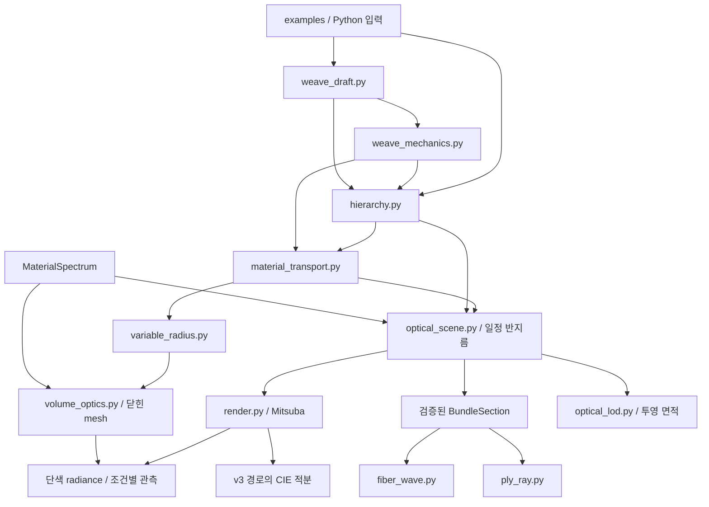

# 아키텍처와 데이터 계약

구현 아키텍처 v0.5. 이 문서는 **직물 외관 재현을 위한 다중 규모 광학 모델링과 메타광학 계측** 연구에서 실제 구현된 경로와 확장 경계를 설명한다. 연구 목적·모듈의 기준은 [연구헌장](RESEARCH_CHARTER_KO.md)과 [연구 설계](RESEARCH_DESIGN_KO.md), 계층·기존 광학 유도는 [hierarchy_design.md](../notes/hierarchy_design.md)와 [optical_bridge.md](../notes/optical_bridge.md)에 있다. v3의 추가 수학은 [weave_mechanics_v3.md](../notes/weave_mechanics_v3.md)와 [optical_scale_v3.md](../notes/optical_scale_v3.md), v4의 물질좌표 계약은 [material_transport_v4.md](../notes/material_transport_v4.md)에 있다. v5의 새 계약은 [가변 반지름 기하](../notes/variable_radius_geometry_v5.md), [광학 경로의 소스 검토](../notes/variable_radius_optics_source_audit_v5.md), [독립 광학 oracle](../notes/volume_optics_validation_v5.md), [독립 리뷰](../notes/review_variable_radius_v5.md)를 따른다. API 구현과 원단 radiance의 수렴 판정은 별개다. 최신 배치·테스트·판정은 [작업 로그](WORK_LOG.md)와 각 실행 manifest에 기록한다.

## 1. 설계 원칙

**Geometry는 개별 fiber와 부모 관계를 생성하고, optical scene은 그 geometry에 물질과 단위를 연결한다. Backend는 자신이 계산할 수 있는 geometry만 받아들인다.**

이 분리는 다음 문제를 방지한다.

- 물질 이름을 기하 생성기의 숨은 굴절률 상수로 바꾸는 것.
- 보간 polyline을 renderer의 B-spline control point와 같은 것으로 취급하는 것.
- 기울어진 3D fiber의 단면을 검사 없이 원형 2D cylinder로 넣는 것.
- 방향 tensor나 투영 면적을 보정 없이 BSDF/SGGX/opacity로 해석하는 것.
- 합성 파라미터가 실측 물질 상수처럼 저장되는 것.

## 2. 패키지와 실행 계층



`run_engine_v5.py`는 **같은 물질좌표 pose의 두 반지름 상태 → 닫힌 삼각망 → dielectric/흡수 관측 → 독립 검산 → 전체 tests**를 연결한다. 실제 실험은 `run_variable_radius_experiments.py`, 원시 결과의 재검산은 `verify_variable_radius_artifacts_v5.py`가 담당한다. 두 radius 상태 모두 같은 새 광학 모델을 사용한다. v4 hair renderer와 v5 dielectric 결과의 차이를 곧바로 반지름 효과로 해석하지 않는다.

`run_engine_v4.py`는 기존 부모 곡선의 두 상태를 받아 experiment, verify, tests를 연결한다. 실제 실험은 `run_material_transport_experiments.py`, 저장 원시 배열의 독립 재검산은 `verify_material_transport_artifacts_v4.py`가 담당한다. v4는 원사 평형을 다시 풀지 않으며, 명시된 기존 initial/relaxed 곡선에 material-coordinate 대응을 부여한다. `run_engine_v3.py`는 mechanics, optics, verify, tests를 순서대로 실행하고 입력·출력·로그 hash를 남긴다. `run_engine_v2.py`의 geometry, refinement, optics, tests 단계는 기존 계층 실험의 독립 실행 경로로 유지한다. `run_all.py`는 보존된 v0.1 optical/camera/meta 실험을 재실행한다. Runner가 기존의 서로 다른 물리 backend를 하나의 검증된 3D wave solver로 합치지는 않는다.

| 경로 | 역할 |
| --- | --- |
| `textile_sim/weave_draft.py` | 직조 위상·lift-plan·주기 crossing 높이 |
| `textile_sim/hierarchy.py` | explicit fiber/ply/yarn/fabric, sampling·clearance, 저장 |
| `textile_sim/weave_mechanics.py` | 축소 원사 높이 평형, 제약·KKT·identity, fiber 계층 재구성 |
| `textile_sim/material_transport.py` | 고정 reference의 yarn→ply→fiber 물질좌표 운반, frame·strain·선분 부피 proxy·엄격한 optical export |
| `textile_sim/variable_radius.py` | 선분 radius→연속 정점 radius, 재분배 오차·총 frustum 적분, RMF 고리·닫힌 triangle mesh와 실제 부피 |
| `textile_sim/volume_optics.py` | 검산한 float32/uint32 mesh, geometric normal, real dielectric+inverse-mm 순수 흡수, scene handle/metadata binding |
| `textile_sim/optical_lod.py` | 계층 투영 통계, SGGX projected-area fitting, CIE·Planck 적분, paired MC 통계 |
| `textile_sim/optical_scene.py` | 재료/scene schema, renderer·2D adapter, 통계 |
| `textile_sim/fiber_wave*.py` | 원형 cylinder/cluster의 2D electromagnetic reference와 beam |
| `textile_sim/ply_ray.py` | local bundle의 incoherent Fresnel/Beer 경로 추적 |
| `textile_sim/render.py` | 기존 Mitsuba rig, fiber path tracing, 표시 변환 |
| `textile_sim/camera.py`, `meta_optics.py`, `angular_measurement.py` | 보존된 관측·이상적 위상 pupil·검출 실험 |
| `examples/mechanics/` | 42-fiber optical pair와 84-fiber multi-ply 평형 설정 |
| `data/mechanics_v3/`, `data/optical_v3/` | 평형·sweep·수렴, raw 파장/seed radiance, optical metrics, CIE 출처 |
| `data/material_transport_v4/` | 두 반지름 모드의 원시 material labels·strain, 세 기하 상태, 공통 rig의 108회 단색 radiance |
| `data/variable_radius_v5/` | 두 radius 상태의 profile·renderer buffer·scene metadata·단색 radiance·반지름/단면 분할 비교; 완료 상태는 해당 manifest로 판정 |
| `data/validation_v5/` | 단순 광학 oracle, 원시 자료 재검산, 수치 민감도와 실행별 evidence |
| `examples/hierarchy/` | 실행된 5개 입력 JSON과 geometry 진단 plotter |
| `tests/` | analytic/numerical/regression/integration 검사 |
| `data/hierarchy_v2/`, `data/optical_bridge_v2/` | 추적된 기준 geometry, 선형 배열, 측정량, manifests |
| `figures/hierarchy_v2/` | 저장된 기하·refinement의 진단 그림 |
| `notes/`, `docs/`, `report/` | 유도·문헌·독립 리뷰·설계·실행 보고서 |
| `references/` | 출처와 라이선스를 유지한 참조 자료, 제공된 PDF의 provenance |


## 3. Geometry API

### 3.1 Topology

`WeaveDraft(matrix, name)`의 `matrix[i][j]`는 **weft pick i와 warp end j**의 교차 순서다. 값 1은 warp over를 뜻한다. 행·열 반복 길이가 달라도 된다.

| API | 의미 |
| --- | --- |
| `plain()`, `twill(over, under, step)`, `basket(warp_group, weft_group)`, `satin(repeat, step)` | 기본 draft 생성 |
| `crossing(warp_index, weft_index)` | 음수 padding을 포함한 주기 조회 |
| `expanded(weft_count, warp_count)` | 원하는 개수로 repeat 전개 |
| `diagnostics()` | 반복 축 길이, 최대 cyclic float, unbound yarn |
| `transposed()` | family 교환: `1 - matrix.T` |
| `to_liftplan()`, `from_liftplan()` | 동일 column을 그룹화한 exact lift-plan 변환 |

Binary draft는 유한 두께의 제직 가능성이나 loom 제약을 인증하지 않는다. 여러 물리적 층과 3D 연결을 갖는 Weavecraft형 block은 새로운 topology schema가 필요한 확장이다.

### 3.2 Hierarchy specifications

| 객체 | 주요 필드 | 단위·의미 |
| --- | --- | --- |
| `FiberSpec` | `id`, `material_id`, `radius_mm`, `offset_mm`, migration/loop 설정 | ply의 local 단면 내 fiber |
| `PlySpec` | `id`, `fibers`, `offset_mm`, `fiber_twist_per_mm`, phase | yarn 단면 내 ply와 그 fiber twist |
| `YarnSpec` | `id`, `plies`, `ply_twist_per_mm`, phase | yarn 중심선 주위의 ply twist |
| `FabricSpec` | draft, warp/weft yarn, count/pitch, crossing gap, crimp share, waviness, sampling, seed | 유한 planar weave 패치 |

모든 geometric length는 **mm**다. Twist는 부모의 실제 polyline 호길이 1 mm당 signed turn이다. 양의 부호는 진행 tangent에 대한 오른손 회전이며, 관찰방향에 의존하는 S/Z 표기를 암묵적으로 부여하지 않는다.

`FiberSpec`는 동일 단면의 보수적 packing bound를 만족해야 한다. Migration은 중심축을 통과할 수 없고, 중심 fiber에는 radial direction이 정의되지 않는다. Loop는 기존 fiber의 outward excursion으로 구현한다. Loop가 fiber 수를 늘리지는 않지만 path length와 cylinder-volume proxy는 바뀔 수 있다.

### 3.3 Generation and validation

```python
geometry = build_yarn(yarn_spec, centerline_mm, seed=..., initial_normal=...)
geometry = build_hierarchy(fabric_spec)
diagnostics = audit_clearance(geometry)
refinement = compare_sampling_refinement(fabric_spec, factors=(1, 2, 4))
```

`build_yarn()`는 입력 중심선의 점들을 그대로 사용한다. `build_hierarchy()`는 최대 segment 길이, tangent turn, parent twist/migration phase step 조건을 만족하도록 생성 sampling을 늘린다. 생성 자체와 clearance 검사는 분리되어 있으며, CLI와 unified runner가 clearance를 기본 gate로 수행한다.

`compare_sampling_refinement()`는 요청한 nominal count가 아니라 **실제 adaptive baseline에서 채택된 sampling**을 기준으로 1/2/4배의 서로 다른 geometry를 만든다. Max parameter-matched distance, RMS distance, total-length 변화, tangent-tensor 변화를 기록한다. 이것은 생성된 두 polyline의 비교이며 무한 정밀도 geometry의 절대 오차 bound는 아니다.

`audit_clearance()`는 다른 fiber의 모든 polyline segment capsule에 대해 보수적 broad phase와 segment distance를 사용한다. `batch_size`, `max_candidate_pairs`는 양의 정수다. Budget이 부족하면 검사하지 않은 geometry를 통과시킬 수 없고, 오류를 반환한다. Same-fiber self-contact와 mechanical contact force는 검사 범위 밖이다.

### 3.4 Runtime output

`HierarchyGeometry`는 다음을 보존한다.

| 데이터 | 내용 |
| --- | --- |
| `fiber_records` | `FiberCurve` tuple; points, radii, fiber/ply/yarn/material ID, family와 index |
| `yarns`, `plies` | 부모 중심선 dictionary |
| `spec` | 생성에 사용한 입력과 단위 |
| `metadata` | sampling, scope, schema, draft 진단; 생성 경로에 따른 kinematic 또는 reduced-equilibrium 상태 |
| `curve_basis` | 항상 `polyline` |

Fiber 좌표와 radius 배열은 immutable bytes를 backing storage로 사용한다. Parent dictionary와 spec까지 암호학적 불변 객체인 것은 아니다. Optical scene을 만들거나 저장할 때 그 시점의 데이터를 명시적으로 snapshot한다.

### 3.5 Material-coordinate transport

v3의 재생성은 현재 parent 호길이에서 twist를 다시 평가한다. v4의 새 경로는 최초 reference의 fiber labels와 parent correspondence를 고정하고, 같은 지점의 3차원 local offset을 지정한 새 parent frame으로 운반한다.

```python
reference = bind_material_reference(
    geometry,
    yarn_initial_normals={yarn_id: prescribed_director for yarn_id in geometry.yarns},
    correspondence="shared_vertex_indices",
)
state = transport_material_reference(
    reference,
    prescribed_yarn_points,
    yarn_initial_normals=target_directors,
    deformed_parent_coordinates_mm=original_parent_labels,
    radius_mode="constant_reference",
)
save_material_transport(output_directory, state)
transported_geometry = state.to_hierarchy()
new_clearance = audit_clearance(transported_geometry)
```

`prescribed_director`, `target_directors`와 `original_parent_labels`는 호출자가 공급해야 한다. 같은 점 개수만으로 물리적 대응을 추론하지 않는다. Reference binding은 부모와 자식이 동일한 생성 vertex index를 공유하는 계층에 한정된다. 새 parent sampling을 늘릴 수 있지만 원래 material-coordinate domain과 명시적 labels를 유지해야 한다.

| 객체 / 항목 | 계약 |
| --- | --- |
| `FramedCurve` | 열린 polyline, 엄격히 증가하는 material coordinates, 명시적 시작 director; 위치는 선형, frame은 RMF sample 사이 SO(3) 보간 |
| `MaterialReference` | reference fiber·ply·yarn, 고정 material labels, 부모 연결, 정규화한 spec과 source metadata; 수치 배열은 immutable |
| `TransportedFiber` | reference/target 위치, 원래 fiber/parent labels, 현재 호길이, 선분 stretch·strain·radius·cylinder volume |
| `MaterialTransportState` | reference와 연결된 ID·부모·모드·기하 대응을 생성 시 검증; 일치하지 않는 교체 또는 혼합 state 거부 |
| `constant_reference` | 원래 원형 radius 유지. 기존 광학 adapter 사용 가능; 국소·전체 부피 proxy 변화는 그대로 보고 |
| `incompressible_segments` | `r_e = r_0 / sqrt(lambda_e)`로 각 선분 cylinder proxy 유지. 기존 constant-radius adapter의 export는 계속 거부; v5의 별도 연속 radius/closed-mesh 경로 사용 |
| `save_material_transport()` | non-pickle NPZ, raw array layout와 byte SHA, reference/state SHA. 기존 파일 덮어쓰기 거부 |

이 운반은 선언한 no-slip kinematics다. 자유로운 material twist field, fiber stress, 마찰·sliding·접촉 평형, 3D incompressibility를 풀지 않는다. 변형 후 labels가 유지되는 것과 fiber가 비신장인 것은 별개다. 실제 초기 형상에서 정의한 strain은 stress-free natural length 기준의 탄성 strain이 아니다. Radius 보정은 선분 원기둥 부피 proxy만 보존하고, 접합부·곡률·중첩·단면 변형을 포함한 전체 fiber 부피 또는 질량의 물리적 보존을 인증하지 않는다.

기존 reference 또는 v3 평형의 clearance 진단은 운반된 기하에 상속하지 않는다. 새 polyline audit와 optical B-spline/float32 변위 한계를 다시 계산한 뒤에만 렌더한다. v4의 세 파장 비교는 단색 radiance 진단이며, 세 파장으로 색 재현을 완료했다고 해석하지 않는다.

### 3.6 v5 연속 반지름과 닫힌 기하

```python
from textile_sim.variable_radius import (
    profiles_from_transport, build_tapered_tube,
    save_variable_radius_profiles, save_tapered_tube,
)

profiles = profiles_from_transport(state)
meshes = tuple(build_tapered_tube(p, radial_segments=32,
                                 initial_normal=chosen_normal)
               for p in profiles)
save_variable_radius_profiles(output / "profiles", profiles)
save_tapered_tube(output / "one_fiber", meshes[0])
```

`chosen_normal`은 해당 fiber tangent와 평행하지 않은 명시적 frame seed다. None이면 결정적인 Cartesian-axis 규칙을 사용한다. 원래 입력 seed를 저장하고, 실제 투영·정규화된 normal은 `mesh.frames`에서 확인한다. 저장/복원 때 projected normal을 반복 정규화하여 좌표가 조금씩 달라지는 경로를 방지했다.

| 객체 / API | 계약 |
| --- | --- |
| `VariableRadiusFiber` | 현재 점·원래 fiber/parent labels·선분 radius·fiber/yarn/ply/material/family/index/kind·출처 보존. 모든 수치 배열은 immutable |
| `profiles_from_transport(state)` | v4 state hash와 reference hash, 원래 radius mode와 대응 가정을 provenance에 추가 |
| `node_radius_mm` | 길이 가중 정점 단면적을 만든 뒤 한 섬유의 총 frustum 적분을 맞춘 양의 radius |
| `segment_relative_volume_error` | 연속 radius가 각 원래 물질 선분에 재분배한 부피 오차 |
| `TaperedTubeMesh` | RMF 고리와 양 끝 cap, outward triangle winding, signed volume·표면적·frame·법선 |
| `vertices_mm`, `faces` | 원래 float64/int64 기하. 실제 renderer용 float32/uint32 buffer는 별도 검사·저장 |
| `save_*` / `load_*` | nonpickle NPZ+JSON, byte hash와 semantic hash, source에서 profile/mesh 재계산, 기존 파일 덮어쓰기 거부 |

세 종류의 부피를 구분한다. 현재 선분 길이를 \(\ell_e\), 선분 radius를 \(r_e\), 연속 표현의 정점 radius를 \(\rho_i\)라 하면

\[
V_e^{\rm cyl}=\pi r_e^2\ell_e,
\qquad
V_e^{\rm frustum}=\frac{\pi\ell_e}{3}
(\rho_i^2+\rho_i\rho_{i+1}+\rho_{i+1}^2).
\]

내부 정점의 임시 radius는 \(\widetilde\rho_i^2=(\ell_{i-1}r_{i-1}^2+\ell_i r_i^2)/(\ell_{i-1}+\ell_i)\)이며, 끝점은 인접 선분 값을 사용한다. 그 후

\[
\rho_i=q\widetilde\rho_i,
\qquad
q=\sqrt{\frac{\sum_e V_e^{\rm cyl}}
{\sum_e V_e^{\rm frustum}(\widetilde\rho)}}
\]

를 적용한다. 이 식은 **각 fiber의 총 직선 frustum 적분**을 보존한다. 개별 물질 선분의 부피나 굽은 fiber의 실제 부피·질량을 보존하는 구성식은 아니다.

닫힌 삼각망의 세 번째 부피는 별도로

\[
V_{\rm mesh}=\frac16\sum_f(\mathbf v_{f0}-\mathbf o)\cdot
[(\mathbf v_{f1}-\mathbf o)\times(\mathbf v_{f2}-\mathbf o)]
\]

로 계산한다. 수치 원점 \(\mathbf o\)를 정점 평균으로 옮겨 큰 world translation의 상쇄 오차를 줄인다. 실제 mesh를 다시 확대하여 이 값을 앞선 부피에 맞추지는 않는다. 같은 buffer를 float32로 바꾼 뒤의 부피도 별도 기록한다. 직선 원뿔대의 정N각형 단면 factor \(N\sin(2\pi/N)/(2\pi)\)를 분리한 잔차는 굽힘·ring 배치·축방향 sampling 진단이다.

닫힌 edge incidence, 반대 winding, Euler characteristic 2와 양의 signed volume은 topology·국소 방향 검사다. **동일 섬유의 자기 교차 없음**을 증명하지 않으므로 `self_intersection_tested=False`를 유지한다.

## 4. OpticalScene API

### 4.1 Material contract

`MaterialSpectrum`은 최소 두 개의 증가하는 vacuum wavelength sample과 `n_real`, `kappa`, `source`, `data_status`를 받는다. 데이터 상태는 `synthetic`, `measured`, `literature` 중 하나다. `at(wavelength_nm)`는 주어진 구간 안에서만 선형 보간하며 범위 밖 외삽을 거부한다.

```python
m = MaterialSpectrum.from_absorption(
    material_id="synthetic_A",
    wavelength_nm=[400, 700],
    n_real=1.50,
    absorption_per_mm=2.0,
    source="synthetic verification fixture",
)
```

복소 굴절률 convention은 \(n+i\kappa\), time convention은 \(e^{-i\omega t}\)다. \(\mu_a=4\pi\kappa/\lambda\)의 intensity absorption을 사용한다. 이 스펙트럼 표가 Kramers–Kronig consistency, birefringence 또는 어떤 실물의 측정 정확도를 자동으로 보장하지는 않는다.

### 4.2 Scene construction and identity

```python
scene = from_hierarchy(geometry, materials, background_n=1.0)
scene.save(path)
restored = OpticalScene.load(path)
```

Scene은 fiber ID 중복, 정의되지 않은 재료, 잘못된 단위/schema, ply의 여러 yarn 부모, yarn의 서로 다른 family 같은 일관성 위반을 거부한다. `scene.sha256`은 geometry와 material/provenance가 포함된 canonical JSON의 content hash다. 저장 파일에는 이 hash를 포함하며 load에서 비교한다.

이 절의 hierarchy→`OpticalScene` adapter는 constant-radius circular fiber를 요구한다. v5의 variable-radius 처리는 §4.5의 별도 closed-mesh adapter를 사용한다. 비원형 단면은 데이터형의 선언만으로 지원되는 물리가 되지 않으며 추가 계약이 필요하다.

### 4.3 3D renderer adapter

```python
manifest = export_mitsuba(
    scene, output_directory, wavelength_nm=550,
    max_smoothing_error_mm=chosen_budget,
)
image, info = render_optical_scene(output_directory, render_config)
```

Material/radius 조합별로 `.curves`를 분리한다. Input은 polyline이므로 cubic B-spline control로 변환하며, smoothing bound와 float32 control/radius quantization bound를 기록한다. 허용 오차는 caller가 명시적으로 정한다. 기존 source clearance가 있으면 이를 차감해 저장된 spline tube의 geometric separation을 검사할 수 있다.

Pinned Mitsuba 3.9.1 hair shader의 absorption은 radius-normalized이며, `sigma_a = μa_per_mm × radius_mm`로 전달한다. Fresnel에 실수 굴절률을 쓰는 약흡수 근사, roughness, `scale_tilt=0`과 single-wavelength scalar proxy mode를 manifest에 연결한다. 이 adapter의 한 호출은 한 파장의 scalar 계산이다. v3 전용 driver는 같은 rig에서 실제 파장별 호출을 반복하고, 별도 `optical_lod.py`의 CIE 적분으로 XYZ를 계산한다. Hair 모델 자체가 full-wave 또는 polarization solver로 바뀌는 것은 아니다.

Exporter는 모든 optical parameter를 먼저 검사한 다음 파일을 쓴다. Manifest와 curve file 각각의 hash를 보존한다. 렌더 입력을 바꾸고 기존 scene identity를 그대로 쓰는 경로는 검사에서 실패한다.

### 4.4 Local bundle adapter

```python
section = extract_bundle_section(
    scene, plane_origin_mm, plane_normal,
    fiber_ids=selected_ids,
    tolerance=BundleTolerance(mode="strict"),
)
wave_kwargs = wave_inputs(section, scene, wavelength_nm)
ray_kwargs = ray_inputs(section, scene, wavelength_nm)
```

| 검사 | 이유 |
| --- | --- |
| 선택한 모든 fiber의 단일 centerline crossing | 일부 fiber를 조용히 빼고 다른 구조를 계산하지 않기 위해 |
| 원형 intrinsic cross-section | 현 2D solver의 전제 |
| 충분한 local axial support | 끝점만 보고 무한 bundle로 보내지 않기 위해 |
| 작은 tilt·tangent change·centerline deviation | 기울어진/굽은 fiber를 원형 직선으로 오해하지 않기 위해 |
| 양의 circular clearance | 겹치는 원통을 허용된 입력으로 보내지 않기 위해 |
| scene hash 일치 | 다른 geometry/material 버전에서 추출한 slice 혼용 방지 |

`strict`는 매우 작은 수치 tolerance에서 직선·평행을 요구한다. `local_parallel`은 caller가 선언한 근사 기준을 적용하고 그 사실을 diagnostics에 남긴다. 기울기 \(\beta\)에서 circle의 평면 절단은 장반경 \(a/|\cos\beta|\)의 ellipse가 되므로, 이를 보고한다. 어느 mode도 local window 밖을 포함한 전체 fabric의 3D wave 동치를 보장하지 않는다.

`wave_inputs`는 위치·반지름을 μm로, wavelength를 host-medium wavelength로, index를 host 대비 상대 complex index로 바꾼다. `ray_inputs`는 real `n_fiber`, `n_host`, `absorption_um_inv`를 전달한다. 서로 다른 backend의 absorption 규약을 하나의 숫자로 혼용하지 않는다.

### 4.5 v5 closed mesh와 체적 흡수 adapter

```python
from textile_sim.volume_optics import build_volume_scene, render_volume_scene

handle, metadata = build_volume_scene(
    meshes, materials, wavelength_nm=550.0,
    config=render_config, bounds_mm=common_bounds_mm,
    background_n=1.0, max_kappa_ratio=0.01,
)
rgb_scalar, observation = render_volume_scene(
    handle, metadata, seed=chosen_seed, spp=chosen_spp,
)
```

`meshes`는 `TaperedTubeMesh`의 sequence다. 각 fiber는 자신의 material ID와 별도의 경계 mesh를 유지한다. 참조된 모든 재료가 있어야 하며, 쓰이지 않는 재료를 조용히 섞지 않는다. `common_bounds_mm`는 비교할 모든 상태의 기하를 포함하는 같은 관측 범위다. Scene마다 별도 자동 framing을 사용하면 같은 pixel이 다른 실제 영역을 보게 되므로 v5 비교 driver는 공통 범위를 사용한다.

실제 backend는 `mi.Mesh(..., has_vertex_normals=False)`이며, 정점 float32·면 index uint32를 메모리로 전달한다. Triangle winding·퇴화·닫힘·양의 부피와 최대 양자화 변위를 검사한다. Tapered fiber의 실제 법선에는 축방향 성분이 있으므로 방사 방향을 shading normal로 대체하지 않는다.

광학 경계는 각 평평한 삼각형 위의 매끄러운 `dielectric`, 내부는 균질한 **순수 흡수**다.

\[
\mu_a(\lambda_0)=\frac{4\pi\kappa(\lambda_0)}{\lambda_0},
\quad [\lambda_0]={\rm mm},\qquad
\sigma_t=\mu_a\ [{\rm mm}^{-1}],\quad\mathrm{albedo}=0.
\]

`volpath`가 경계 반사·굴절과 내부 매질의 경로를 계산한다. 현재 근사는 실수 굴절률의 Fresnel과 \(\kappa\)로부터 얻은 Beer 흡수를 연결하며, 허용 \(\kappa/n\)을 명시한다. v4 hair shader의 radius-normalized \(\mu_a r\) 값을 여기 전달하면 단위가 틀린다. 이 경로에는 거칠기 BSDF, 복굴절, 편광, 회절, coherent interference가 들어 있지 않다. 관련된 공식 소스와 기존 curve 경로를 채택하지 않은 이유는 [광학 소스 검토](../notes/variable_radius_optics_source_audit_v5.md)에 있다.

`VolumeSceneHandle.scene_sha256`는 기하·재료·rig·budget의 metadata에 결합된다. `render_volume_scene()`은 metadata를 다시 hash하고 handle과 대조하므로 다른 scene의 유효한 metadata를 섞을 수 없다. 외부 `mi.traverse`로 backend를 임의 수정하는 사용법은 지원 범위 밖이다.

한 호출은 한 파장의 scalar radiance를 gray RGB backend에서 계산한다. 세 채널이 일치하는지 확인한 뒤 실험 driver는 channel 0을 저장한다. RGB 세 채널을 세 파장이나 독립 표본으로 세지 않는다. V5의 450/550/650 nm 비교는 CIE 색 재현의 완료를 뜻하지 않는다.

**장면별 간격 gate:** 각 원래 중심선 chord를 해당 fiber의 최대 새 node radius로 감싼 capsule은 고리 사이와 cap의 삼각형을 포함한다. 실험 driver는 이 기하로 **서로 다른 fiber**의 최소 간격 하한 \(d_{\min}\)을 다시 구한다. 최대 float32 정점 변위가 \(\delta\)이면 \(d_{\min}-2\delta>0\)를 요구한다. 이 하한은 해당 source/profile/buffer에만 유효하며, `build_volume_scene()` 자체가 모든 호출자의 자기 교차나 매질 경계 배치를 인증하는 것은 아니다. Same-fiber self-intersection와 실제 contact mechanics는 남은 gate다.

## 5. 물리량과 집계

| 값 | 단위 / 의미 | 함께 기록할 조건 |
| --- | --- | --- |
| Centerline / radius | mm | 실제 curve basis, sampling |
| Wavelength in scene | vacuum nm | host index, spectral domain |
| Wave cross-section | μm in the 2D infinite-cylinder model | polarization, wavelength, incident mode, truncation |
| Ray energy fraction | 무차원 incident-power 분배 | beam, seed, ray 수, residual |
| Camera `mean_linear` | 특정 rig의 평균 radiance | illumination, exposure convention, spp |
| Tangent tensor | 무차원, trace 1 | 길이/부피 weight, group |
| Cylinder-volume sum | mm³ | segment union의 joint/overlap 보정 제외 |
| Linear-radius frustum integral | mm³ | 직선 선분의 정확한 반지름 적분; per-fiber 총합 보존·local 재분배 별도 |
| Closed triangle signed volume | mm³ | 실제 mesh 및 float32 mesh의 값을 분리; 자기 교차가 없어야 실제 고체 부피 해석 가능 |
| Lateral projected-area sum | mm² | endcap·차폐·multiple scattering 제외 |

`microstructure_statistics`는 polyline/circle에 대해 geometry statistics를 계산하고, B-spline control polygon을 실제 geometry로 집계하지 않는다. 통계는 material/family/yarn/ply별로 추적된다. 이 통계 함수가 자동 SGGX matrix나 optical depth를 산출하지는 않는다. v3의 별도 `projected_area_density()`와 `fit_sggx_projected_area()`가 명시적 공통 부피·방향 집합을 받아 축약한다. §9에서 정의한 비차폐 통계의 유효범위가 적용된다.

## 6. 저장 형식과 provenance

| Artifact | Schema / contract | 재현에 필요한 짝 |
| --- | --- | --- |
| `hierarchy_geometry.json` | `textile-hierarchy/2.0` | `hierarchy_geometry.npz` hash, IDs, spec |
| `hierarchy_geometry.npz` | numeric ragged arrays, `allow_pickle=False` | offsets와 provenance record 수 |
| Optical scene JSON | `textile.optical_scene/2.0` | embedded spectra, fibers, content hash |
| Mitsuba `manifest.json` | `textile.mitsuba_export/2.0` | per-group curves, BSDF, conversion bounds, file hashes |
| Microstructure JSON | `textile.microstructure/2.0` | scene hash와 direction list |
| Mechanics JSON / NPZ | `textile.reduced_weave_mechanics/3.0` | spec·height identity, equilibrium diagnostics, actual fiber geometry |
| Optical scale metrics / radiance NPZ | `textile.optical_scale/3.0` | pair·source hash, wavelength/seed axis, observer·source·display contract |
| v2 Unified `run_manifest.json` | `textile-engine-v2-run/1.0` | stage commands, exits, logs, input/output hashes, environment |
| v5 radius JSON / NPZ | `textile.variable_radius_profile/5.0` | 원래 두 물질좌표, source segment radius, 재구성 규칙·node radius·local volume error |
| v5 단일 tube JSON / NPZ | `textile.tapered_tube_mesh/5.0` | 원래 RMF seed, profile identity, 원시 mesh·normals·실제 부피 |
| v5 renderer buffer JSON / NPZ | `variable_radius_mesh_buffers_v5.0` | float32 mm 정점·uint32 faces, profile/mesh hash·양자화·장면별 간격 하한 |
| v5 volume scene JSON | `textile.closed_mesh_volume_optics/5.0` | material spectrum·단위·경계/흡수 mapping·rig·기하 buffer identity |
| v5 experiment / optics JSON | `variable_radius_experiment_v5.0`, `variable_radius_optics_experiment_v5.0` | source/input/output hash, 실제 render 행·단색 radiance NPZ·명시적 축·paired 비교 |
| v5 verification / run JSON | `variable_radius_artifact_verification_v5.0`, `textile-engine-v5-run/1.0` | 독립 재검산·선택된 원래 mechanics 재구성, stage별 실행/검증 횟수·오류·해시 변화 |

NPZ와 scene JSON은 precision/units를 정량 검산하는 기준이다. PNG에는 display encoding과 plot 설정이 포함된다. 원 데이터의 provenance를 확인하지 않고 그림의 선 폭이나 밝기를 물리량으로 해석하지 않는다.

## 7. 실행·실패·로그

### v5 실행 계약

```bash
# 현재 명령·입력 경로·216회 기본 예산을 쓰기 없이 확인
python run_engine_v5.py --dry-run

# 새 geometry/profile/buffer 계산과 원래 mechanics까지 재검산, 광학 렌더 0회
python run_engine_v5.py --stages experiment verify --no-render \
  --output scratch_runs/v5_geometry

# 저장된 canonical 결과 검증; 같은 input-data의 원래 mechanics pair 자동 전달
python run_engine_v5.py --stages verify \
  --output scratch_runs/v5_audit

# 다른 곳에 있는 원래 mechanics pair를 명시
python run_engine_v5.py --stages verify --input-data data \
  --source-input data/mechanics_v3/optical_pair \
  --output scratch_runs/v5_audit_explicit

# 전체 새 실험 → 검증 → 전체 테스트
python run_engine_v5.py --radial-segments 16 32 64 \
  --wavelengths 450 550 650 --resolution 64 --spp 64 \
  --replicates 4 --max-render-count 216 \
  --output scratch_runs/v5_complete
```

단계는 요청 순서와 관계없이 `experiment → verify → tests`다. 기본 실험은 두 radius 상태 × 세 조명 × 세 단면 분할 × 세 파장 × 네 seed = **216회**다. 이는 기본 명령의 예정 횟수이며 실제 완료 횟수는 manifest에서 확인한다. Raw scalar array 축은 `(radial_segments, state, light, wavelength_nm, seed, row, column)`이다. 각 render record는 이 다섯 조건의 한 조합이며 `actual_render_count=1`이다. Runner는 모든 조합의 중복·누락, array index, 개별 횟수·총계와 raw hash를 확인한다.

통합 runner의 입력 루트는 `--input-data`다. 실제 하위 명령은 다음 계약을 사용한다.

- Producer: `run_variable_radius_experiments.py --input-pair PAIR --output OUT`.
- Verifier: `verify_variable_radius_artifacts_v5.py --input ARTIFACT --output OUT [--source-input PAIR]`.

새 experiment와 verify를 함께 선택하면 기본적으로 producer에 사용한 원래 mechanics pair를 verifier에 전달한다. Verify만 선택한 경우 기본 pair가 있으면 자동으로 전달하며, `--source-input`은 명시적인 override다. Override한 자료도 저장 산출물의 원본과 일치해야 검증을 통과한다. 명시한 경로가 없으면 출력 생성 전에 실패한다. 다른 저장 archive에 기본 pair가 없으면 `unavailable_default`를 명시하고 내부 산출물 검증을 진행한다. 이 경우 원래 material map까지 재구성했다고 표시하지 않는다.

원본 pair가 선택되면 해당 파일을 read-only hash 범위에 포함하고, 두 pose의 JSON/NPZ 네 파일을 대조해 v4 map을 다시 적용한다. Verifier는 원래 reference와 두 radius state hash를 보고해야 한다. Runner는 실제 성공한 재구성을 `source_input_reconstruction_verified`로 기록한다. Current producer code hash 검사와 외부 원본 데이터 재검산은 별도 gate다.

`--no-render`는 실험의 광학 영상만 생략한다. `tests`를 함께 선택하면 작은 renderer oracle가 실행될 수 있다. Test worker는 `validate_all.py`와 같은 전체 discovery를 격리 출력에서 실행하고 source 전후 hash를 저장한다. 실패·오류·skip이 있는 suite는 통과하지 못한다. Source/input drift, 누락된 산출물, NPZ·reference 불일치가 있으면 뒤 단계의 성공을 주장하지 않는다. 부분 render가 실패했을 때 runner의 실제 새 render 수는 알 수 없는 값 `null`로 남으며, 저장 결과를 검증한 횟수는 새 실행 횟수와 구분한다.

Producer는 저장한 NPZ와 이를 참조하는 중첩 manifest의 hash 및 ZIP CRC를 완료 gate에서 재검사한다. 파일 기록이 끝났다는 이유만으로 기존 byte hash가 올바르다고 가정하지 않는다. 과거 배치를 새로운 결과에 섞지 않고 해당 source·seed·manifest로 보존한다.

### v3 실행 계약

```bash
python run_engine_v3.py --dry-run

# 저장된 기준 결과의 재검산
python run_engine_v3.py --stages verify --output scratch_runs/v3_verify

# 현재 기준 기하를 읽어 export·투영 축약을 새로 계산
python run_engine_v3.py --stages optics verify --no-render \
  --output scratch_runs/v3_projection

# mechanics부터 시작하는 전체 재계산
OPENBLAS_NUM_THREADS=1 OMP_NUM_THREADS=1 \
  python run_engine_v3.py --output scratch_runs/v3_complete
```

단계 순서는 `mechanics → optics → verify → tests`다. 사용자가 고른 단계가 선행 출력을 만들지 않는 경우 `--input-data`(기본 `data/`)가 그 입력을 제공한다. 새 mechanics를 실행하면 optics는 그 run의 새 pair를 사용한다. `--no-render`는 export·SGGX·observer 준비만 수행하며 render를 생략했다고 기록한다. Tests를 고르면 작은 실제 renderer 검사는 별도로 실행될 수 있다. 저장된 536개 기준 렌더의 존재와 새 no-render run에서의 렌더 실행을 혼동하지 않는다.

기본 분광 budget은 `--resolution 64 --spp 32 --replicates 4`다. 두 상태×세 조명×17파장의 408회와, 한 반사 조명의 실제 중간파장 128회를 합친 536회가 기본 fiber 렌더 수다. 별도 Lambertian benchmark가 있다. Budget을 바꾸면 동일한 오차·신뢰구간을 기대하지 않는다.

### 보존된 v2 실행 계약

```bash
# 쓰기 없이 실행 계획 확인
python run_engine_v2.py --stages geometry refinement optics tests --dry-run

# 새 폴더에 완전한 v2 실험과 테스트
python run_engine_v2.py \
  --stages geometry refinement optics tests \
  --output scratch_runs/engine_v2_001
```

Runner의 output은 새 폴더 또는 빈 폴더여야 한다. Geometry 단계는 5개 example과 clearance gate, refinement 단계는 실제 1/2/4배 mesh, optics 단계는 별도의 **98-fiber bridge specimen**을 실행한다. 다섯 geometry case 모두를 optical sweep으로 자동 렌더링하는 것은 아니다.

기본 stage는 geometry/optics/tests이며 refinement는 opt-in이다. `--no-render`는 optical experiment의 네 큰 영상을 생략한다. Tests를 선택했다면 작은 CPU renderer integration checks는 실행된다. 테스트는 전체 suite를 discover하고 실패·오류뿐 아니라 skip도 실패 gate로 취급한다. Legacy recorded evidence 일부를 검사하며 전체 baseline 광학 실험을 자동으로 다시 만들지는 않는다.

각 stage의 실제 명령, stdout/stderr, 종료 코드, 시간, output hash를 남긴다. 실패하면 다음 stage를 성공한 것처럼 처리하지 않고 미실행 목록을 manifest에 남긴다. 새 run의 테스트 요약은 해당 run의 `tests/` 아래에 있으며, 배포 기준 전체 suite 요약은 [data/final_test_summary.json](../data/final_test_summary.json)이다.

## 8. ReducedWeave mechanics API

### 8.1 모델과 자유도

`ReducedWeaveSpec`는 `WeaveDraft`, 경·위사 count/pitch/envelope radius, 독립 `YarnElasticity`, 요구 clearance, 최대 slope, crossing별 mesh, padding을 받는다. Geometry/mm, force/N, energy/N·mm다.

```python
problem = ReducedWeaveProblem(spec)
result = solve_equilibrium(problem)
initial = build_relaxed_hierarchy(
    problem, result.initial_heights_mm, warp_yarn, weft_yarn,
    subdivisions=6,
)
relaxed = build_relaxed_hierarchy(
    problem, result, warp_yarn, weft_yarn, subdivisions=6,
)
```

경사는 `(x_fixed, y, z(y))`, 위사는 `(x, y_fixed, z(x))`의 고정 평면 경로를 가진다. 최적화 변수는 내부 node의 `z`뿐이다. 실제 교차점 밖 padding 끝의 z를 0으로 고정하고 끝 회전은 고정하지 않는다. Simply-supported graph 근사를 쓰며, full 3D rod의 위치·material-frame twist·접촉 자유도가 없다.

각 family의 `YarnElasticity`는 `axial_stiffness_N = EA`, `bending_stiffness_N_mm2 = B`, `rest_fraction = r`, `source`, `data_status`를 갖는다. `r`은 projected 간격 `h`에 대한 rest length 비율이며 `0 < r ≤ 1`만 허용한다. 평평할 때의 engineering prestrain은 `1/r - 1`이다. 이 값은 fiber optical index 또는 `material_id`로부터 자동 유도하지 않는다.

### 8.2 에너지와 수치해

\[
\ell_k=\sqrt{h^2+(z_{k+1}-z_k)^2},\quad \ell_{0,k}=rh,
\]

\[
E_s=\sum_k\frac{EA}{2\ell_{0,k}}(\ell_k-\ell_{0,k})^2,
\qquad
E_b=\frac{B}{2h^3}\sum_k(z_{k+1}-2z_k+z_{k-1})^2.
\]

저장하는 에너지는 평평한 동일 grid의 상수 stretching energy를 뺀 excess energy다. Segment stretch는 정확한 polyline 길이를 쓰며 bending은 작은 기울기 근사다. 각 segment의 stretch Hessian은 `EA/l0 × (1 - l0*h²/l³) ≥ 0`이므로 허용 인장 범위의 energy와 linear constraints는 convex 문제를 정의한다.

`beam_energy_gradient_hessian()`은 analytic 에너지·gradient·Hessian을 반환한다. `solve_equilibrium()`은 초기 Hessian 기반 가역 preconditioning, analytic gradient, SciPy SLSQP를 사용한다. 가상의 regularization energy를 추가하지 않는다. 종료 후 독립 NNLS로 활성 제약의 비음수 반력을 추정하고 다음을 다시 계산한다.

| 평형 diagnostic | 의미 |
| --- | --- |
| Constraint violation | `Az ≥ b`의 위반, mm |
| Stationarity | `||∇E - Aᵀλ||∞`, N |
| Complementarity | 활성·비활성 제약의 상보성, N·mm |
| Energy change | 같은 spec과 상수 기준에서의 excess energy 변화 |
| Scale-normalized residual | stiffness/length similarity를 고려한 무차원 잔차 |

Dense matrix 구현은 작은 검증 패치를 위한 reference solver다. KKT가 작다는 것은 선언한 축소 모델의 수치 평형을 뜻하고, 실제 원단이나 더 정교한 rod 모델과의 일치를 뜻하지 않는다.

### 8.3 Envelope clearance의 전제

모든 edge에서 `|Δz| ≤ L h`를 제약한다. 교차의 부호를 `σ`라 하면

\[
\sigma(z_w-z_f)\ge(R_w+R_f+g)\sqrt{1+L_w^2+L_f^2}.
\]

Lipschitz와 Cauchy–Schwarz를 적용하면 교차점 밖에서도 cross-family 원사 중심선 거리에 하한을 준다. Same-family는 고정 transverse pitch를 검사한다. 이 제약은 실제 마찰 없는 접촉보다 보수적일 수 있고, multiplier는 실제 면적당 접촉압이 아니다.

Configured slope를 위반한 입력은 configured clearance certificate를 받을 수 없다. 실제 slope로 계산한 별도 bound와 구성된 bound를 diagnostics에서 구분한다. 원사 envelope 검사를 통과한 뒤에도 재구성된 개별 fiber의 capsule clearance를 검사한다.

### 8.4 결과 identity와 fiber 운반 계약

`WeaveEquilibrium`은 **전체 problem/spec SHA-256과 solved height SHA-256**에 결합된다. `build_relaxed_hierarchy()`는 이 둘을 확인하고 현재 problem·height로 KKT·feasibility·energy를 재계산한다. 같은 array 길이의 다른 stiffness 문제나 수정한 height에 기존 certificate를 재사용할 수 없다. 단순 height array를 전달한 초기 상태는 equilibrium으로 표시하지 않는다.

Bridge는 v2 `build_yarn()`과 같은 mechanical polyline을 세분화하여 사용한다. 원사/ply/fiber ID와 material ID를 유지하지만 **fiber의 material point를 추적하는 Lagrangian deformation이 아니다.** 새 부모 호길이당 twist로 fiber를 다시 생성하므로 total length, family별 길이 및 cylinder-volume proxy를 함께 기록한다. `fiber_material_points_conserved=False`가 명시적인 상태다.

실제 optical pair의 후속 binding 재검산은 [equilibrium_binding_audit.json](../data/mechanics_v3/optical_pair/equilibrium_binding_audit.json)에 있다. 과거 optical 입력 좌표를 조용히 바꾸지 않고 현재 코드의 결과 검사를 추가한 기록이다.

## 9. Optical LOD API와 통계의 유효범위

### 9.1 명시적 기준량

```python
areas = projected_area_density(
    scene, directions, volume_mm3, group_by="family",
)
fit, diagnostics = fit_sggx_projected_area(directions, target)
```

`areas`는 group ID를 키로 갖는 direction별 array dictionary이고, fitting은 `SGGXProjection`과 diagnostic dictionary를 반환한다. 지원 계층을 합칠 때 모두 **동일한 명시적 평균 부피**를 사용한다. 기준량은

\[
g(\omega)=\frac1V\sum_j2r_jL_j\sqrt{1-(t_j\!\cdot\!\omega)^2}
\quad[\mathrm{mm}^{-1}].
\]

이는 원통 선분의 비차폐 옆면 투영 면적 합이다. `g_all = sum(g_group)`가 성립하고, 선분을 같은 방향으로 쪼개도 변하지 않는다. 실제 투영 합집합·투과율·측정 소광계수·BSDF는 아니다. 끝면, joint 중복, 공간 상관, 차폐, 다중 산란 및 wave 효과를 생략한 기하 사전량이다.

### 9.2 SGGX 표현과 식별

`SGGXProjection`은 SPD 행렬 `S`의 제곱근 투영 `sqrt(ωᵀSω)`를 제공한다. Shape와 density를 이 행렬에 함께 넣었으므로 `S` 단위는 **mm⁻²**다. 별도 density를 가진 무차원 SGGX shape와 convention을 섞지 않는다.

Fitting은 weighted `[x²,y²,z²,2xy,2xz,2yz]` 설계 행렬의 rank 6을 요구한다. Log-Cholesky로 SPD를 유지하고 실제 `g`의 least-squares 오차를 최소화한다. `g²` fitting은 초기값 계산에만 사용한다. Rank·condition·SPD floor·train/held-out 오차를 diagnostics로 남긴다. 같은 방향 반복으로 낮은 residual을 얻어도 식별 가능한 fit으로 통과시키지 않는다.

이차 접선 모멘트만으로 `g`가 정해지지 않는 정확한 반례와 행렬을 단순 평균하면 projected-area mixture가 보존되지 않는 반례가 테스트에 있다. 이들은 기하 표현의 한계를 보이며 RGB 모호성이나 메타표면 우위를 직접 증명하지 않는다.

### 9.3 SGGX density·phase 수학의 범위

\[
D_S(m)=\frac{1}{\pi\sqrt{\det S}(m^TS^{-1}m)^2},
\quad
\sigma(\omega)=\sqrt{\omega^TS\omega}.
\]

`D`는 구면 적분이 1인 확률밀도가 아니다. Visible-normal PDF는 `(ω·m)_+D(m)/σ(ω)`로 정규화한다. 이상적인 양면 반사 microflake의 phase는 `D(h)/(4σ(ω_i))`이고, 양쪽 방향을 산란점 바깥으로 정의한다. 검증하는 reciprocity는

\[
\sigma(\omega_i)p(\omega_o\mid\omega_i)
=\sigma(\omega_o)p(\omega_i\mid\omega_o).
\]

SGGX phase의 정규화 테스트와 cloth BSDF 검증은 다르다. 현재 v3 영상은 여전히 개별 fiber hair BCSDF로 계산한다. Aggregate 광학 backend에는 방향별 mixture weight, albedo, 위치별 density, layer/occlusion, multiple scattering와 별도의 비교 실험이 추가로 필요하다.

## 10. 실제 분광 계산과 관측 API

### 10.1 Scalar 파장별 렌더

`run_multiscale_optics_v3.py`는 실제 v3 mechanics pair를 읽고 두 상태에 **같은 camera/light world transform, pixel scale, source radiance**를 사용한다. 380–780 nm, 25 nm 간격의 실제 17파장을 계산한다. `llvm_ad_rgb`의 세 채널은 동일 scalar 설정이며 그 일치를 검사한다. 같은 파장의 fresh scene과 cached scene 갱신의 일치를 실제 renderer로 테스트한다.

광학 재료별 `n(λ)`, `κ(λ)`에서 상대 실수 index와 `μa r`를 갱신한다. 합성 물질을 실크·코튼의 측정 상수로 부르지 않는다. 이 반복은 파장 의존 **광선 모델**이며 coherent interference, diffraction, polarization을 추가하지 않는다.

### 10.2 관측자 적분

```python
observer_nm, observer_xyz = load_cie1931()
spd = planck_relative(observer_nm, temperature_kelvin=6500)
weights, integration_diagnostics = spectral_xyz_weights(
    sample_wavelength_nm, observer_nm, observer_xyz, spd,
)
xyz = integrate_xyz(radiance, weights)
```

`radiance`의 마지막 축이 실제 계산 파장, `weights`의 shape가 `(wavelength_count, 3)`이며 결과 마지막 축은 XYZ다. 원래 sampled radiance를 파장에 대해 선형 보간한 후 CIE 1931 2° 공식 1 nm 표와 광원을 적분한다.

\[
(X,Y,Z)_x=
\frac{\int_{380}^{780}R_x(\lambda)E(\lambda)
(\bar x,\bar y,\bar z)\,d\lambda}
{\int_{380}^{780}E(\lambda)\bar y\,d\lambda}.
\]

단위 scalar 응답의 `Y=1` 정규화다. 3000 K/6500 K는 Planck 광원이며 D65가 아니다. 저장 PNG는 고정 노출 0.7, sRGB primary matrix, chromatic adaptation 없는 표시다. `*_radiance.npz`와 XYZ가 정량 기준이고, 화면 색을 실물 제품의 교정된 색이라고 주장하지 않는다.

공식 CIE 데이터와 metadata는 [data/optical_v3/cie](../data/optical_v3/cie/)에 원 출처·hash·CC BY-SA 4.0 조건과 함께 보존한다. 광원·관측자 범위 밖 weight의 작은 값이 미지의 material response까지 포함한 전체 색 오차 bound는 아니다.

### 10.3 실제 반복 단위와 오차 예산

| 오차 항목 | 현재 검사 | 남는 불확실성 |
| --- | --- | --- |
| Mechanics mesh | 4/8/16 mesh의 actual 높이·energy 비교 | continuum·실물 오차와 optical 민감도 |
| Curve export | spline+float32 변위 차감 후 양의 different-fiber gap | 영상 radiance 오차의 상한 |
| Monte Carlo | 4개 독립 seed, 상태·파장 사이 pairing, seed별 평균 XYZ의 t 구간 | 모델·교정·실물 표본 변동 |
| Spectral grid | 50/25 nm와 한 반사 방향의 실제 25/12.5 nm 비교 | 다른 방향의 fine-grid 수렴, MC와 discretization 분리 |
| Lighting rig | Lambertian reference와 독립 finite-area quadrature | hair 모델의 scattering 정확도 |
| 계층 축약 | 같은 기하 1,200개 held-out 방향의 projected-area RMSE | 새로운 원단 일반화, BSDF·영상 오차 |

픽셀이나 파장을 독립 표본처럼 수천 개 세지 않는다. `paired_mean_interval()`은 각 seed에서 먼저 평균 radiance를 분광 적분한 관측값의 before/after 차이를 쓴다. 4개 seed의 95% 구간이 0을 포함하면 해당 변화는 그 수치 예산에서 분리되지 않았다고 보고한다.

## 11. 확장할 때 유지할 경계


| 추가 연구 | 필요한 확장 | 기존 API에서 유지할 것 |
| --- | --- | --- |
| 3D textile mechanics 확장 | finite-rotation rod, 현재의 prescribed 운반을 구성식·contact/friction·압착·경계 교정과 연결 | fiber/ply/yarn IDs, 단위, 상태·오차 provenance |
| 비원형·복굴절 fiber | explicit section/orientation tensor, constitutive dispersion, 대응 solver | circle 전용 adapter의 엄격한 거부 |
| Multi-layer weaving / knitting | richer topology와 connectivity, repeat/boundary conditions | topology와 geometry·appearance 분리 |
| Local→3D optical aggregation | angular/polarization/wavelength kernel과 normalization, fitting/validation set | ray/wave 기준 geometry와 물리량 계약 |
| Real-fabric inverse capture | calibrated observations, parameter prior, uncertainty, held-out condition | source/status, scene version, synthetic/measured 구분 |
| Metasurface channel design | actual Jones/efficiency/crosstalk model, fabrication constraints | 검출 photon budget과 강한 conventional baseline |
| Product visualization | garment shape, 실측 source/camera/display 교정, controlled interaction | 렌더 획득 효과와 표현 UI 효과를 분리한 평가 |

구조·단위·물리량의 계약을 먼저 확장하고, 그 계약을 검증하는 독립 기준 문제를 추가한 다음 새 결과를 저장한다. 데이터 필드를 하나 늘리는 것과 해당 물리 현상을 구현·검증한 것은 구별한다.

## 12. v5에서 추가된 수치 판정 경계

**기하 부피의 수렴은 광학 radiance의 수렴을 보장하지 않는다.** Smooth dielectric을 flat triangle로 근사하면 단면 분할 변화가 법선·specular 경로를 바꾼다. V5 최종 216회에서 16/32/64각형의 mesh/frustum 부피 차이는 약 −2.55389%/−0.64480%/−0.16407%로 감소했지만, 32→64 분할의 R0 radiance는 두 상태·세 파장에서 약 25.70~31.56% 감소했다. 또한 64각형의 variable−constant radius 비교 9조건 모두 pointwise 95%와 Bonferroni 구간에 0이 포함됐다. 따라서 현재 API 연결을 radiance 수렴 또는 반지름 상태 식별 성공으로 기록하지 않는다. 수치·구간의 전체 범위는 [실험 보고](../notes/variable_radius_v5_experiment.md), [원시 optical metrics](../data/variable_radius_v5/optics/optical_metrics.json), [독립 리뷰](../notes/review_variable_radius_v5.md)를 따른다.

최종 배치는 아홉 NPZ의 CRC·중첩 hash와 source/input 불변 검사를 통과했다. 독립 검산은 원래 mechanics 네 파일에서 물질좌표를 재구성하고 252개 fiber mesh·54개 scene metadata·216개 영상 기록·77개 출력 파일을 대조했다. 전체 suite는 **391 tests, failures/errors/skips 0, source 변경 0**이며, repo 밖 작업 디렉터리의 `experiment verify --no-render`도 0회로 통과했다. 이 통과는 구현·저장·재현 계약에 관한 판정이다. [원본을 포함한 검산](../data/validation_v5/independent_review/verification_summary.json), [전체 테스트](../data/final_test_summary.json), [no-render 통합](../data/validation_v5/no_render_integration/run_manifest.json).

오차 gate는 다음과 같이 분리한다.

| gate | 실제 비교 | 통과가 뜻하지 않는 것 |
| --- | --- | --- |
| Radius 표현 | 원래 원통 proxy, 선분별 재분배, 총 frustum 적분 | 물리적 국소 비압축성·질량 보존 |
| Mesh 기하 | 단면 N과 축 sampling을 독립적으로 변경, 실제 volume·normal·buffer 비교 | radiance 오차의 상한 |
| 매질 배치 | 해당 두 radius 상태의 서로 다른 fiber capsule 하한과 float32 변위 | 같은 fiber의 자기 관통·물리적 contact 해 |
| 경계·흡수 | Beer와 dielectric furnace, 내부 출사, 단위 계수 | 일반 원단의 scattering 또는 실물 BSDF |
| Renderer 수치 척도 | 길이·광원·camera 스케일과 inverse-length 흡수, 원점과 ray offset 민감도 | full-wave scale invariance |
| Radiance | 같은 shader·rig·wavelength의 N/축 sampling 변화, seed별 paired 구간 | 미측정 원단 일반화나 지각 개선 |

독립 광학 oracle의 단위 상사 비교에서 검출된 작은 잔차를 pinned source의 surface-ray offset과 연결해 검토했다. 시작점 이동에는 \(\epsilon_{\rm ray}(1+\|\mathbf p\|_\infty)\mathbf n\) 형태의 절대 척도가 있으므로, 물리적으로 같은 무차원 optical depth라도 좌표 단위와 원점에 대한 수치 민감도가 남을 수 있다. 모든 길이를 a배 하고 \(\mu_a\)를 1/a배 할 때 source·camera geometry도 함께 맞춰 검사하며, 이 결과를 단순 단위 환산 오류와 구분한다. 소스 hash·실제 교차 질의는 [광학 oracle 기록](../notes/volume_optics_validation_v5.md)에 남긴다.

별도의 550 nm·64각형 척도 1/10/100 비교는 두 상태·세 조명·네 seed에서 **72회**를 실행하고 source 불변·CRC 검사를 통과했다. 전체 18개 척도 쌍의 Bonferroni 구간에는 0이 포함됐다. 척도 10→100의 여섯 점추정은 −4.242%~+3.303%이고 pointwise 구간도 모두 0을 포함한다. 이 결과로 동등성이나 수렴을 인증하지 않으며, 원점·경계 offset·표본 예산의 추가 검증이 남는다. 파라미터를 바꾼 수치 proxy와 원래 물리적 mm 자료도 구분해 저장한다. [척도 민감도 metrics](../data/validation_v5/volume_scale_sensitivity/sensitivity_metrics.json), [실행 manifest](../data/validation_v5/volume_scale_sensitivity/experiment_manifest.json).

작은 반지름 차이를 물리적 효과로 추정하거나 계측 채널을 최적화하려면, 먼저 그 신호보다 geometry·facet normal·ray offset·Monte Carlo 오차가 충분히 작은지 보여야 한다. 이 조건이 충족되기 전에는 계층/광학 adapter의 유효범위를 넓히거나 추가 해상도·표본을 선택하는 연구로 해석한다.
