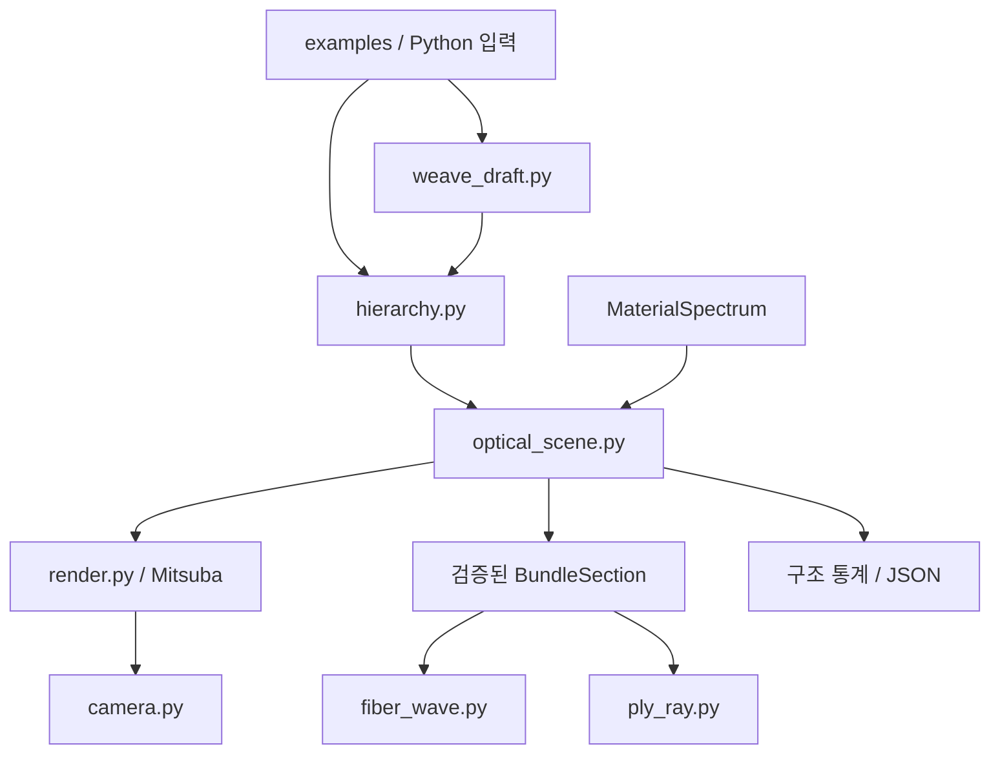
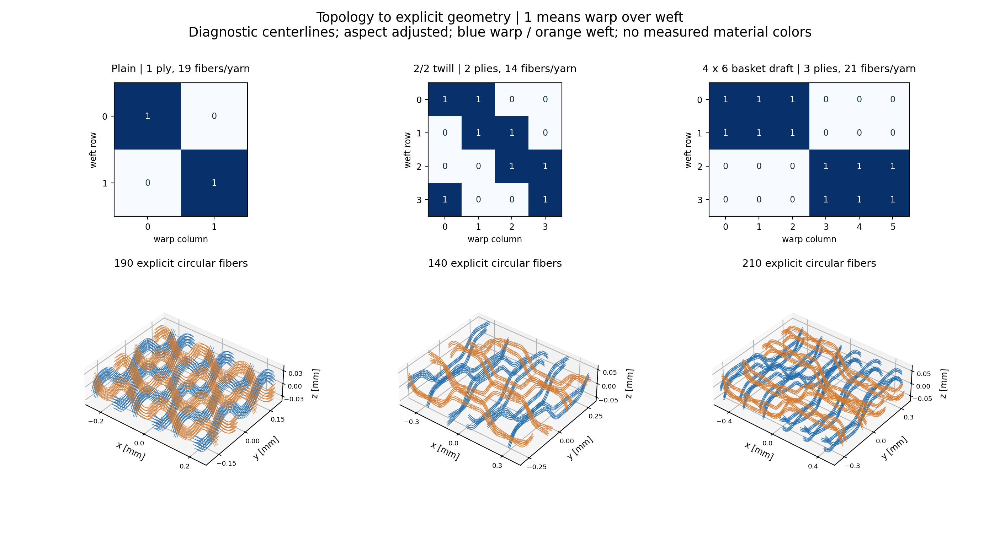

# 아키텍처와 데이터 계약

버전 0.2.0. 이 문서는 실제 구현된 경로와 확장을 위해 남겨 둔 경계를 설명한다. 수학적 연구 목적은 [RESEARCH_DESIGN_KO.md](RESEARCH_DESIGN_KO.md), 세부 유도는 [hierarchy_design.md](../notes/hierarchy_design.md)와 [optical_bridge.md](../notes/optical_bridge.md)에 있다.

## 1. 설계 원칙

**Geometry는 개별 fiber와 부모 관계를 생성하고, optical scene은 그 geometry에 물질과 단위를 연결한다. Backend는 자신이 계산할 수 있는 geometry만 받아들인다.**

이 분리는 다음 문제를 방지한다.

- 물질 이름을 기하 생성기의 숨은 굴절률 상수로 바꾸는 것.
- 보간 polyline을 renderer의 B-spline control point와 같은 것으로 취급하는 것.
- 기울어진 3D fiber의 단면을 검사 없이 원형 2D cylinder로 넣는 것.
- 방향 tensor나 투영 면적을 보정 없이 BSDF/SGGX/opacity로 해석하는 것.
- 합성 파라미터가 실측 물질 상수처럼 저장되는 것.

## 2. 패키지와 실행 계층



`run_engine_v2.py`는 geometry, refinement, optics, tests를 순서대로 실행하고 입력·출력·로그 hash를 남긴다. `run_all.py`는 보존된 v0.1 optical/camera/meta 실험을 재실행한다. Runner가 기존의 서로 다른 물리 backend를 하나의 검증된 3D wave solver로 합치지는 않는다.

| 경로 | 역할 |
| --- | --- |
| `textile_sim/weave_draft.py` | 직조 위상·lift-plan·주기 crossing 높이 |
| `textile_sim/hierarchy.py` | explicit fiber/ply/yarn/fabric, sampling·clearance, 저장 |
| `textile_sim/optical_scene.py` | 재료/scene schema, renderer·2D adapter, 통계 |
| `textile_sim/fiber_wave*.py` | 원형 cylinder/cluster의 2D electromagnetic reference와 beam |
| `textile_sim/ply_ray.py` | local bundle의 incoherent Fresnel/Beer 경로 추적 |
| `textile_sim/render.py` | 기존 Mitsuba rig, fiber path tracing, 표시 변환 |
| `textile_sim/camera.py`, `meta_optics.py`, `angular_measurement.py` | 보존된 관측·이상적 위상 pupil·검출 실험 |
| `examples/hierarchy/` | 실행된 5개 입력 JSON과 geometry 진단 plotter |
| `tests/` | analytic/numerical/regression/integration 검사 |
| `data/hierarchy_v2/`, `data/optical_bridge_v2/` | 추적된 기준 geometry, 선형 배열, 측정량, manifests |
| `figures/hierarchy_v2/` | 저장된 기하·refinement의 진단 그림 |
| `notes/`, `docs/`, `report/` | 유도·문헌·독립 리뷰·설계·실행 보고서 |
| `references/` | 출처와 라이선스를 유지한 참조 자료, 제공된 PDF의 provenance |



## 3. Geometry API

### 3.1 Topology

`WeaveDraft(matrix, name)`의 `matrix[i][j]`는 **weft pick i와 warp end j**의 교차 순서다. 값 1은 warp over를 뜻한다. 행·열 반복 길이가 달라도 된다.

| API | 의미 |
| --- | --- |
| `plain()`, `twill(over, under, step)`, `basket(warp_group, weft_group)`, `satin(repeat, step)` | 기본 draft 생성 |
| `crossing(warp_index, weft_index)` | 음수 padding을 포함한 주기 조회 |
| `expanded(weft_count, warp_count)` | 원하는 개수로 repeat 전개 |
| `diagnostics()` | 반복 축 길이, 최대 cyclic float, unbound yarn |
| `transposed()` | family 교환: `1 - matrix.T` |
| `to_liftplan()`, `from_liftplan()` | 동일 column을 그룹화한 exact lift-plan 변환 |

Binary draft는 유한 두께의 제직 가능성이나 loom 제약을 인증하지 않는다. 여러 물리적 층과 3D 연결을 갖는 Weavecraft형 block은 새로운 topology schema가 필요한 확장이다.

### 3.2 Hierarchy specifications

| 객체 | 주요 필드 | 단위·의미 |
| --- | --- | --- |
| `FiberSpec` | `id`, `material_id`, `radius_mm`, `offset_mm`, migration/loop 설정 | ply의 local 단면 내 fiber |
| `PlySpec` | `id`, `fibers`, `offset_mm`, `fiber_twist_per_mm`, phase | yarn 단면 내 ply와 그 fiber twist |
| `YarnSpec` | `id`, `plies`, `ply_twist_per_mm`, phase | yarn 중심선 주위의 ply twist |
| `FabricSpec` | draft, warp/weft yarn, count/pitch, crossing gap, crimp share, waviness, sampling, seed | 유한 planar weave 패치 |

모든 geometric length는 **mm**다. Twist는 부모의 실제 polyline 호길이 1 mm당 signed turn이다. 양의 부호는 진행 tangent에 대한 오른손 회전이며, 관찰방향에 의존하는 S/Z 표기를 암묵적으로 부여하지 않는다.

`FiberSpec`는 동일 단면의 보수적 packing bound를 만족해야 한다. Migration은 중심축을 통과할 수 없고, 중심 fiber에는 radial direction이 정의되지 않는다. Loop는 기존 fiber의 outward excursion으로 구현한다. Loop가 fiber 수를 늘리지는 않지만 path length와 cylinder-volume proxy는 바뀔 수 있다.

### 3.3 Generation and validation

```python
geometry = build_yarn(yarn_spec, centerline_mm, seed=..., initial_normal=...)
geometry = build_hierarchy(fabric_spec)
diagnostics = audit_clearance(geometry)
refinement = compare_sampling_refinement(fabric_spec, factors=(1, 2, 4))
```

`build_yarn()`는 입력 중심선의 점들을 그대로 사용한다. `build_hierarchy()`는 최대 segment 길이, tangent turn, parent twist/migration phase step 조건을 만족하도록 생성 sampling을 늘린다. 생성 자체와 clearance 검사는 분리되어 있으며, CLI와 unified runner가 clearance를 기본 gate로 수행한다.

`compare_sampling_refinement()`는 요청한 nominal count가 아니라 **실제 adaptive baseline에서 채택된 sampling**을 기준으로 1/2/4배의 서로 다른 geometry를 만든다. Max parameter-matched distance, RMS distance, total-length 변화, tangent-tensor 변화를 기록한다. 이것은 생성된 두 polyline의 비교이며 무한 정밀도 geometry의 절대 오차 bound는 아니다.

`audit_clearance()`는 다른 fiber의 모든 polyline segment capsule에 대해 보수적 broad phase와 segment distance를 사용한다. `batch_size`, `max_candidate_pairs`는 양의 정수다. Budget이 부족하면 검사하지 않은 geometry를 통과시킬 수 없고, 오류를 반환한다. Same-fiber self-contact와 mechanical contact force는 검사 범위 밖이다.

### 3.4 Runtime output

`HierarchyGeometry`는 다음을 보존한다.

| 데이터 | 내용 |
| --- | --- |
| `fiber_records` | `FiberCurve` tuple; points, radii, fiber/ply/yarn/material ID, family와 index |
| `yarns`, `plies` | 부모 중심선 dictionary |
| `spec` | 생성에 사용한 입력과 단위 |
| `metadata` | sampling, scope, schema, draft 진단, finite/nonmechanical 상태 |
| `curve_basis` | 항상 `polyline` |

Fiber 좌표와 radius 배열은 immutable bytes를 backing storage로 사용한다. Parent dictionary와 spec까지 암호학적 불변 객체인 것은 아니다. Optical scene을 만들거나 저장할 때 그 시점의 데이터를 명시적으로 snapshot한다.

## 4. OpticalScene API

### 4.1 Material contract

`MaterialSpectrum`은 최소 두 개의 증가하는 vacuum wavelength sample과 `n_real`, `kappa`, `source`, `data_status`를 받는다. 데이터 상태는 `synthetic`, `measured`, `literature` 중 하나다. `at(wavelength_nm)`는 주어진 구간 안에서만 선형 보간하며 범위 밖 외삽을 거부한다.

```python
m = MaterialSpectrum.from_absorption(
    material_id="synthetic_A",
    wavelength_nm=[400, 700],
    n_real=1.50,
    absorption_per_mm=2.0,
    source="synthetic verification fixture",
)
```

복소 굴절률 convention은 \(n+i\kappa\), time convention은 \(e^{-i\omega t}\)다. \(\mu_a=4\pi\kappa/\lambda\)의 intensity absorption을 사용한다. 이 스펙트럼 표가 Kramers–Kronig consistency, birefringence 또는 어떤 실물의 측정 정확도를 자동으로 보장하지는 않는다.

### 4.2 Scene construction and identity

```python
scene = from_hierarchy(geometry, materials, background_n=1.0)
scene.save(path)
restored = OpticalScene.load(path)
```

Scene은 fiber ID 중복, 정의되지 않은 재료, 잘못된 단위/schema, ply의 여러 yarn 부모, yarn의 서로 다른 family 같은 일관성 위반을 거부한다. `scene.sha256`은 geometry와 material/provenance가 포함된 canonical JSON의 content hash다. 저장 파일에는 이 hash를 포함하며 load에서 비교한다.

Current hierarchy adapter는 constant-radius circular fiber를 요구한다. Variable radius나 비원형 단면은 데이터형의 선언만으로 지원되는 물리가 되지 않으며, 별도 adapter가 필요하다.

### 4.3 3D renderer adapter

```python
manifest = export_mitsuba(
    scene, output_directory, wavelength_nm=550,
    max_smoothing_error_mm=chosen_budget,
)
image, info = render_optical_scene(output_directory, render_config)
```

Material/radius 조합별로 `.curves`를 분리한다. Input은 polyline이므로 cubic B-spline control로 변환하며, smoothing bound와 float32 control/radius quantization bound를 기록한다. 허용 오차는 caller가 명시적으로 정한다. 기존 source clearance가 있으면 이를 차감해 저장된 spline tube의 geometric separation을 검사할 수 있다.

Pinned Mitsuba 3.9.1 hair shader의 absorption은 radius-normalized이며, `sigma_a = μa_per_mm × radius_mm`로 전달한다. Fresnel에 실수 굴절률을 쓰는 약흡수 근사, roughness, `scale_tilt=0`과 single-wavelength scalar proxy mode를 manifest에 연결한다. 전체 spectrum을 XYZ/RGB 색으로 적분한 backend는 아니다.

Exporter는 모든 optical parameter를 먼저 검사한 다음 파일을 쓴다. Manifest와 curve file 각각의 hash를 보존한다. 렌더 입력을 바꾸고 기존 scene identity를 그대로 쓰는 경로는 검사에서 실패한다.

### 4.4 Local bundle adapter

```python
section = extract_bundle_section(
    scene, plane_origin_mm, plane_normal,
    fiber_ids=selected_ids,
    tolerance=BundleTolerance(mode="strict"),
)
wave_kwargs = wave_inputs(section, scene, wavelength_nm)
ray_kwargs = ray_inputs(section, scene, wavelength_nm)
```

| 검사 | 이유 |
| --- | --- |
| 선택한 모든 fiber의 단일 centerline crossing | 일부 fiber를 조용히 빼고 다른 구조를 계산하지 않기 위해 |
| 원형 intrinsic cross-section | 현 2D solver의 전제 |
| 충분한 local axial support | 끝점만 보고 무한 bundle로 보내지 않기 위해 |
| 작은 tilt·tangent change·centerline deviation | 기울어진/굽은 fiber를 원형 직선으로 오해하지 않기 위해 |
| 양의 circular clearance | 겹치는 원통을 허용된 입력으로 보내지 않기 위해 |
| scene hash 일치 | 다른 geometry/material 버전에서 추출한 slice 혼용 방지 |

`strict`는 매우 작은 수치 tolerance에서 직선·평행을 요구한다. `local_parallel`은 caller가 선언한 근사 기준을 적용하고 그 사실을 diagnostics에 남긴다. 기울기 \(\beta\)에서 circle의 평면 절단은 장반경 \(a/|\cos\beta|\)의 ellipse가 되므로, 이를 보고한다. 어느 mode도 local window 밖을 포함한 전체 fabric의 3D wave 동치를 보장하지 않는다.

`wave_inputs`는 위치·반지름을 μm로, wavelength를 host-medium wavelength로, index를 host 대비 상대 complex index로 바꾼다. `ray_inputs`는 real `n_fiber`, `n_host`, `absorption_um_inv`를 전달한다. 서로 다른 backend의 absorption 규약을 하나의 숫자로 혼용하지 않는다.

## 5. 물리량과 집계

| 값 | 단위 / 의미 | 함께 기록할 조건 |
| --- | --- | --- |
| Centerline / radius | mm | 실제 curve basis, sampling |
| Wavelength in scene | vacuum nm | host index, spectral domain |
| Wave cross-section | μm in the 2D infinite-cylinder model | polarization, wavelength, incident mode, truncation |
| Ray energy fraction | 무차원 incident-power 분배 | beam, seed, ray 수, residual |
| Camera `mean_linear` | 특정 rig의 평균 radiance | illumination, exposure convention, spp |
| Tangent tensor | 무차원, trace 1 | 길이/부피 weight, group |
| Cylinder-volume sum | mm³ | segment union의 joint/overlap 보정 제외 |
| Lateral projected-area sum | mm² | endcap·차폐·multiple scattering 제외 |

`microstructure_statistics`는 polyline/circle에 대해 geometry statistics를 계산하고, B-spline control polygon을 실제 geometry로 집계하지 않는다. 통계는 material/family/yarn/ply별로 추적된다. 자동 SGGX matrix나 optical depth를 산출하지 않는다.

## 6. 저장 형식과 provenance

| Artifact | Schema / contract | 재현에 필요한 짝 |
| --- | --- | --- |
| `hierarchy_geometry.json` | `textile-hierarchy/2.0` | `hierarchy_geometry.npz` hash, IDs, spec |
| `hierarchy_geometry.npz` | numeric ragged arrays, `allow_pickle=False` | offsets와 provenance record 수 |
| Optical scene JSON | `textile.optical_scene/2.0` | embedded spectra, fibers, content hash |
| Mitsuba `manifest.json` | `textile.mitsuba_export/2.0` | per-group curves, BSDF, conversion bounds, file hashes |
| Microstructure JSON | `textile.microstructure/2.0` | scene hash와 direction list |
| Unified `run_manifest.json` | `textile-engine-v2-run/1.0` | stage commands, exits, logs, input/output hashes, environment |

NPZ와 scene JSON은 precision/units를 정량 검산하는 기준이다. PNG에는 display encoding과 plot 설정이 포함된다. 원 데이터의 provenance를 확인하지 않고 그림의 선 폭이나 밝기를 물리량으로 해석하지 않는다.

## 7. 실행·실패·로그

```bash
# 쓰기 없이 실행 계획 확인
python run_engine_v2.py --stages geometry refinement optics tests --dry-run

# 새 폴더에 완전한 v2 실험과 테스트
python run_engine_v2.py \
  --stages geometry refinement optics tests \
  --output scratch_runs/engine_v2_001
```

Runner의 output은 새 폴더 또는 빈 폴더여야 한다. Geometry 단계는 5개 example과 clearance gate, refinement 단계는 실제 1/2/4배 mesh, optics 단계는 별도의 **98-fiber bridge specimen**을 실행한다. 다섯 geometry case 모두를 optical sweep으로 자동 렌더링하는 것은 아니다.

기본 stage는 geometry/optics/tests이며 refinement는 opt-in이다. `--no-render`는 optical experiment의 네 큰 영상을 생략한다. Tests를 선택했다면 작은 CPU renderer integration checks는 실행된다. 테스트는 전체 suite를 discover하고 실패·오류뿐 아니라 skip도 실패 gate로 취급한다. Legacy recorded evidence 일부를 검사하며 전체 baseline 광학 실험을 자동으로 다시 만들지는 않는다.

각 stage의 실제 명령, stdout/stderr, 종료 코드, 시간, output hash를 남긴다. 실패하면 다음 stage를 성공한 것처럼 처리하지 않고 미실행 목록을 manifest에 남긴다. 새 run의 테스트 요약은 해당 run의 `tests/` 아래에 있으며, 배포 기준 전체 suite 요약은 [data/final_test_summary.json](../data/final_test_summary.json)이다.

## 8. 확장할 때 유지할 경계

| 추가 연구 | 필요한 확장 | 기존 API에서 유지할 것 |
| --- | --- | --- |
| 실제 textile mechanics | rest length, bending/stretch/twist energy, contact/friction, boundary conditions | fiber/ply/yarn IDs, 단위, 상태·오차 provenance |
| 비원형·복굴절 fiber | explicit section/orientation tensor, constitutive dispersion, 대응 solver | circle 전용 adapter의 엄격한 거부 |
| Multi-layer weaving / knitting | richer topology와 connectivity, repeat/boundary conditions | topology와 geometry·appearance 분리 |
| Local→3D optical aggregation | angular/polarization/wavelength kernel과 normalization, fitting/validation set | ray/wave 기준 geometry와 물리량 계약 |
| Real-fabric inverse capture | calibrated observations, parameter prior, uncertainty, held-out condition | source/status, scene version, synthetic/measured 구분 |
| Metasurface channel design | actual Jones/efficiency/crosstalk model, fabrication constraints | 검출 photon budget과 강한 conventional baseline |
| Product visualization | garment shape, spectral color/display calibration, controlled interaction | 렌더 획득 효과와 표현 UI 효과를 분리한 평가 |

구조·단위·물리량의 계약을 먼저 확장하고, 그 계약을 검증하는 독립 기준 문제를 추가한 다음 새 결과를 저장한다. 데이터 필드를 하나 늘리는 것과 해당 물리 현상을 구현·검증한 것은 구별한다.
