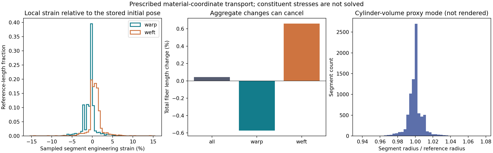

# v0.4 — 기준 물질좌표를 유지하는 섬유 운반

**직물 외관 재현을 위한 다중 규모 광학 모델링과 메타광학 계측**  
**Multiscale Textile Appearance Modeling and Meta-Optical Sensing**

**완료한 것:** 기준 물질좌표를 유지하는 transport 모듈, 세 기하 상태의 **실제 monochromatic 렌더 108회**, **전체 297개 테스트**와 저장된 raw 자료의 독립 검산. 최종 실험 driver는 19.681초에 완료됐고 input/source hash가 변하지 않았다. 이전 기준은 [v0.3.0](https://github.com/Phill-lms/textile-appearance-research/releases/tag/v0.3.0)이다. [실행 manifest](../data/material_transport_v4/experiment_manifest.json), [전체 테스트](../data/final_test_summary.json), [최종 artifact 검산](../data/validation_v4/final_artifact_audit/run_manifest.json). 실제 GitHub 게시 tag·commit·tree의 확인은 [작업 로그](WORK_LOG.md)에 기록한다.

**이번 결과의 핵심은 국소 변형을 추적할 수 있게 된 것이다.** 전체 길이·부피 proxy 변화는 +0.044%지만 일부 선분은 약 ±14% 변했다. 새 transport와 기존 재생성의 광학 차이는 9조건 중 8조건에서 현재 Monte Carlo budget으로 분리되지 않았다. 실물 외관 정확도가 개선됐다는 결론을 내리지 않는다.

## 왜 필요한 변경인가?

v0.3은 원사 높이 평형 후 새로운 부모 경로 위에 fiber를 다시 생성했다. 이 경로는 직조와 부모 ID를 유지하지만 현재 호길이에서 꼬임·배치를 재평가하므로 **동일 fiber의 물질점이 이동한 결과**는 아니다. 구조 변화가 광학 반응에 미치는 영향을 해석하려면 재생성과 같은 기준 표본의 운반을 분리해야 한다.

v0.4는 **최초 fiber–ply–yarn 상태를 기준으로 고정하고, 명시한 부모 좌표와 frame을 따라 같은 fiber 정점을 운반**하는 모듈을 추가한다. 목적은 원단의 구조 변화와 광학 관측을 연결하는 데 필요한 상태 대응을 명확히 하는 것이다. 기준 초기 pose는 stress-free 자연 길이 상태라고 가정하지 않는다. 본격적인 섬유 역학이나 실물 외관의 정확성은 별도 검증 대상이다.

## 추가한 구현

| API / 자료 | 역할 |
| --- | --- |
| `FramedCurve` | Reference material-coordinate knot와 초기 director를 갖는 parent 곡선. 위치 선형 보간·SO(3) frame 보간 |
| `bind_material_reference()` | 최초 geometry의 공유 정점 대응을 명시적으로 선언하고 좌표·부모·재료·frame을 고정 |
| `transport_framed_points()` | 같은 parent label에서 3성분 local offset을 운반하는 기본 map |
| `transport_material_reference()` | Yarn → ply → fiber 순서로 기준에서 새 pose를 계산 |
| `MaterialTransportState` | 고정 material label, current 기하, strain·segment radius·부피 proxy와 상태 hash |
| `to_hierarchy()` | Constant-radius 상태를 기존 기하·광학 경로로 전달. 과거 clearance와 mechanics 진단은 상속하지 않음 |
| `save_material_transport()` | Reference/current 배열·frame·strain·부피를 non-pickle NPZ와 hash 연결 JSON으로 보존 |

구현: [material_transport.py](../textile_sim/material_transport.py). Schema는 `textile.material_transport/4.0`이고 길이는 mm다. 수학·호출 예·실험 설계는 [material_transport_v4_experiment.md](../notes/material_transport_v4_experiment.md)에 있다.

## v0.3 재생성과의 차이

Reference parent 위치·frame을 \(p_0,B_0\), reference fiber 점을 \(X_i\), parent material label을 \(\xi_i\)라 하면

\[
q_i=B_0(\xi_i)^T[X_i-p_0(\xi_i)],\qquad
x_i=p_1(\xi_i)+B_1(\xi_i)q_i
\]

로 옮긴다. Reference fiber 자체의 호길이 label과 parent에 부착하는 좌표는 별도로 저장한다.

| 항목 | v0.3 재생성 | v0.4 transport |
| --- | --- | --- |
| 자식 fiber를 정하는 입력 | 현재 부모 경로와 생성 규격 | 최초 자식 위치·label·local offset과 최종 parent map |
| 꼬임 위상 | 현재 parent 호길이에서 generator 재평가 | Reference 물질점의 배치를 운반 |
| 같은 fiber ID의 의미 | 생성 component의 ID | 선언된 reference 정점·부모 label 대응을 함께 유지 |
| 길이·strain | 생성된 두 기하의 합계 변화 | Reference 선분별 current stretch·strain 기록 |
| Frame 방향 | 생성 규칙에 따른 frame | Reference/target yarn director를 명시하고 ply frame을 운반 |
| 동일 상태 재평가 | 새 생성 규칙의 실행 | 변형을 누적하지 않고 원래 reference에서 재계산 |
| 실물 변형의 정확성 | 미검증 | 여전히 미검증; correspondence는 kinematic 가정 |

정점 수·순서만 같다는 이유로 알려지지 않은 두 scan 사이의 물질 대응을 발견한 것으로 취급하지 않는다. 초기 frame 방향도 상태의 일부이며, centerline만으로 임의의 material twist를 결정할 수 없다.

## 물질점 추적과 부피 보존은 별도다

**물질점 추적은 같은 reference label을 유지하는 기능이다.** Fiber가 늘어나지 않는다거나 실제 질량을 보존한다는 의미는 아니다.

| 반지름 mode | 계산 | 광학 연결 |
| --- | --- | --- |
| `constant_reference` | 반지름을 고정하고 선분 길이·strain·부피 proxy 변화를 그대로 보고 | 기존 constant-radius 광학 경로 사용 가능, 새 clearance·export 검사 필요 |
| `incompressible_segments` | \(r_e=r_0/\sqrt{\lambda_e}\)로 선분 원통 proxy \(\pi r_e^2\ell_e\)를 보존 | 현재 variable-radius adapter가 없어 **export 차단** |

두 번째 mode의 proxy는 구부러진 tube 전체의 정확한 부피가 아니다. Joint·끝단·겹침·단면 압착·밀도·3D constitutive law를 계산하지 않으므로 실제 질량·비압축성을 인증하지 않는다. **실행한 광학 비교의 transported 상태는 constant_reference mode**다. Proxy 보존 상태를 생성·저장하고 부적절한 optical export가 실제 거부되는지도 확인했다.

## 검증 설계

구현 테스트와 독립 리뷰는 다음 조건을 검사했다. 최종 전체 suite는 **297개, failures/errors/skips 모두 0**, 19.256124534초다. 신규 58개는 구현 17개·독립 수학 18개·artifact 7개·runner 16개로 구성되며, 기존 239개와 합쳐 검증했다. [실제 source별 검증 summary](../data/final_test_summary.json).

- Identity와 공동 강체 변환에서 모든 reference 정점·label·길이·frame 관계 유지.
- 해석적인 helix stretch에서 고정 material phase와 유한 chord 길이 검산.
- 비균일 stretch의 선분 반지름·부피 proxy 및 단위의 세제곱 scaling.
- 서로 다른 target mesh의 명시적 material knot와 범위 밖 query 거부.
- Full local offset의 표본점 역변환, 동시 frame gauge 변경과 director 변화의 구분.
- 원호 보간의 analytic sagitta와 refinement.
- 다른 reference·parent·radius mode·거짓 fiber pose를 state에 끼워 넣는 오용 거부.
- 과거 clearance를 새 geometry에 상속하지 않고 immutable 배열·hash·non-pickle 저장 검증.

근거: [구현 테스트](../tests/test_material_transport.py), [독립 테스트](../tests/test_material_transport_review.py), [독립 리뷰와 primary sources](../notes/review_material_transport_v4.md).

저장된 결과의 별도 검증에는 [artifact 테스트 7개](../tests/test_material_transport_artifacts_v4.py)를 추가했다. 그중 5개는 잘못된 값이나 구조를 넣고 **파일 hash·producer ledger도 재계산한 변조 입력**으로, 거짓 strain·improper frame·nonfinite radiance·만든 구간·누락 material label을 거부하는지 검사했다. [최종 재검산](../data/validation_v4/final_artifact_audit/verification/verification_summary.json)은 단순 checksum뿐 아니라 실제 배열의 의미를 다시 계산한다.

## 실제 3상태 광학 비교

같은 기준 geometry와 같은 최종 원사 경로에서 다음 상태를 비교한다.

1. **initial:** 최초 기하.
2. **regenerated:** 최종 부모 호길이로 fiber를 재생성한 기하.
3. **transported:** 최초 물질좌표를 유지해 운반한 기하, 반지름 고정.

**3상태 × 3조명 × 3파장 × 4seed = 108회 monochromatic 렌더**를 실제 실행했다. 파장은 450/550/650 nm, 영상은 64×64, 32 spp다. Seed는 9,203 / 22,782 / 36,361 / 49,940이고 세 상태의 공통 union bounds와 같은 관측 rig를 사용했다.

R0/R90은 XY 평면으로부터 elevation 40°, azimuth 0°/90°인 반사 조명이고, T45는 아래쪽에서 elevation 55°, azimuth 45°인 투과 조명이다. View는 orthographic 정면이며 광원은 angular half-width 7°의 유한 직사각형이다. 조명 고도는 법선 기준 입사각과 다르다. 실제 설정·재료·export·배열 hash는 [optical metrics](../data/material_transport_v4/optics/optical_metrics.json)에 있다.

기본 driver는 `transported−initial`, `transported−regenerated`의 선형 radiance 차이를 보고한다. 같은 조건의 seed별 차이로 평균과 paired 구간을 계산하며 픽셀·파장을 독립 표본으로 늘리지 않는다. 세 단색광 결과를 실측 RGB 색이나 완전한 분광 적분으로 표시하지 않는다.

`transported−regenerated`에서 차이가 발견돼도 그것은 **두 기하 전달 모델의 차이**다. 실측 원단을 비교하기 전에는 transported가 더 정확하다는 결론이나 강한 RGB 대비 추가 관측의 이득을 주장할 수 없다.

### 실제 기하 결과

| 항목 | 실제 값 |
| --- | ---: |
| Fiber / 정점 / 선분 | 42 / 8,106 / 8,064 |
| Initial → transported 총 fiber 길이 | 40.6111653 → 40.6291254 mm |
| 전체 길이·constant-radius 부피 proxy 변화 | +0.0442244% |
| 경사 / 위사 길이 변화 | −0.5733227% / +0.6617715% |
| Segment engineering strain 범위 | −14.03198% ~ +14.12013% |
| Reference 길이 가중 strain RMS | 1.72821% |
| Regenerated와 transported 정점 차이 RMS / 최대 | 0.077344 / 0.208708 µm |
| Incompressible-segment 부피 proxy 최대 상대 오차 | 6.66×10⁻¹⁶ |

**합계에서 압축과 신장이 상쇄되므로 총 길이 변화가 작다는 이유로 비신장성을 주장할 수 없다.** 현재 큰 국소 strain이 실제 섬유에 물리적으로 허용되는지, parent/fiber sampling이나 frame 근사에 얼마나 의존하는지 추가 검증해야 한다. [기하 metrics](../data/material_transport_v4/geometry_metrics.json).



### 실제 광학 결과

550 nm의 transported 상태는 initial 대비 다음 변화를 보였다.

| 조명 | 평균 radiance 변화 | 절대 차이의 pointwise paired 95% 구간 |
| --- | ---: | --- |
| R0 | +45.82% | [+0.005357, +0.009972] |
| R90 | −32.18% | [−0.006155, −0.004939] |
| T45 | +2.82% | [−0.001085, +0.001618] |

반사 두 방향의 변화 부호가 다르고 투과 구간은 0을 포함한다. 이는 단색광 관측이며 v0.3의 광원/CIE Y 적분과 동일한 수치가 아니다.

**Transported−regenerated의 9개 조명·파장 조건 중 8개의 95% 구간은 0을 포함**했다. R90/450 nm만 평균 +6.94%, 절대 구간 [+0.000166, +0.001569]로 양수였다. 네 seed의 **pointwise** 구간이며 다중비교 보정을 적용하지 않았으므로 전체적인 차이·우위의 증거로 제시하지 않는다. 실물 정확성·모델 불확실성은 이 Monte Carlo 구간에 포함되지 않는다.

그림의 백분율 구간은 **절대 차이의 신뢰구간을 관측된 baseline 평균으로 나눈 표시**다. 분모의 추정 불확실성을 반영한 모집단 radiance 비율의 신뢰구간이 아니다. 통계 판단과 표의 구간은 절대 paired 차이를 기준으로 한다.

완전한 9조건 표, 기하·export 간격, SGGX 투영 통계와 원시 배열 경로는 [실험 보고](../notes/material_transport_v4_experiment.md#9-실제-결과)에 있다. **이번 optical fixture에서 새 transport가 기존 generator보다 외관 예측을 개선했다고 입증하지 못했다.** 확보한 성과는 선언된 물질점 대응과 국소 strain·부피 가정·광학 입력을 추적할 수 있는 기반이다.

## 검증·게시 상태

| 항목 | 확인된 상태 | 근거 |
| --- | --- | --- |
| Transport 구현 | 소스·계약·구현/독립 검사 완료 | [구현 계약](../notes/material_transport_v4.md), [독립 리뷰](../notes/review_material_transport_v4.md) |
| 합성 기하 비교 | 실행 완료, 세 상태의 새 clearance·export 확인 | [geometry metrics](../data/material_transport_v4/geometry_metrics.json) |
| 실제 광학 비교 | **108회 완료**, source/input unchanged | [manifest](../data/material_transport_v4/experiment_manifest.json), [raw 배열](../data/material_transport_v4/optics/spectral_radiance.npz), [metrics](../data/material_transport_v4/optics/optical_metrics.json) |
| 새 no-render 재현 | **passed**, experiment 6.7903초·verify 4.0629초, 전체 10.8773초, 새 렌더 0회·source/input drift 없음 | [새 입력부터 실행한 manifest](../data/validation_v4/no_render_integration/run_manifest.json) |
| 최종 artifact audit | **passed**, 저장된 108회 검산·새 렌더 0회, 전체 3.5941초·source/input drift 없음 | [final audit manifest](../data/validation_v4/final_artifact_audit/run_manifest.json) |
| 전체 suite | **297 tests, 0 failures/errors/skips**, 19.2561초 | [최종 summary](../data/final_test_summary.json), [전체 log](../data/final_tests.log) |
| GitHub 게시 기록 | 실제 게시 후 확인한 tag·commit·tree를 작업 로그에 기록 | [WORK_LOG](WORK_LOG.md) |

v0.3의 239개 테스트와 536회 분광 렌더는 [그 tag의 증거](https://github.com/Phill-lms/textile-appearance-research/blob/v0.3.0/data/final_test_summary.json)로 유지하며 v0.4의 실행 횟수에 더해 표시하지 않는다.

### Pilot과 최종 실행

초기 pilot 108회 이후 그림의 seed 수 표기, strain histogram의 실제 범위, 구간 표시 의미를 고치고 최종 108회를 재실행했다. 최종 canonical 실행 시간은 **2026-10-11 13:36:24.185987–13:36:43.867250 UTC, 19.681288638초**다. 개발 중 수행한 호출은 합계 216회지만 **두 실행의 raw radiance가 byte 단위로 같고 seed도 같아 독립 표본은 여전히 4개**다.

[Pilot checkpoint](../data/validation_v4/pilot_checkpoint/checkpoint.json)는 byte가 같은 29개 파일을 최종 경로의 hash에 연결하고, 달라진 그림·metrics 3개와 원래 manifest·producer source를 보존한다. Pilot의 28.534초를 최종 실행 시간으로 사용하거나 두 실행을 8-seed 실험으로 합치지 않는다.

## 재현 명령

저장소 루트에서 새 출력 폴더를 지정한다.

```bash
# 108회 기본 광학 실험과 기하 진단
OPENBLAS_NUM_THREADS=1 OMP_NUM_THREADS=1 \
  python run_material_transport_experiments.py \
  --output scratch_runs/v4_transport

# 새 렌더 없이 물질좌표·부피 proxy·export 확인
python run_material_transport_experiments.py --no-render \
  --output scratch_runs/v4_transport_no_render

# Unified runner: 저장된 최종 자료를 검산
python run_engine_v4.py --stages verify --output scratch_runs/v4_audit

# Unified runner: 새 experiment → verify → tests
OPENBLAS_NUM_THREADS=1 OMP_NUM_THREADS=1 \
  python run_engine_v4.py --output scratch_runs/v4_full
```

기본 보존 경로 `data/material_transport_v4`에는 이미 결과가 있으므로 새 실험에 그대로 사용하면 overwrite 거부가 발생한다. 시작·종료 시 입력과 numerical source의 hash를 비교한다. Partial render 실패는 완료한 batch와 미확인 부분을 구분하며 계획한 횟수를 성공한 횟수로 쓰지 않는다.

`verify`는 저장된 수치를 다시 계산하며 새 광학 실험을 실행한 것으로 세지 않는다. `--no-render`는 experiment의 렌더를 생략하는 옵션이고 별도로 선택한 tests의 작은 renderer 통합 검사까지 생략하는 옵션은 아니다. Runner의 실제 단계·소스·입출력·종료 상태는 각 `run_manifest.json`에 남긴다.

## 연구 범위와 다음 단계

이번 변경은 **측정 가능한 외관을 예측할 순방향 기반에서, 구조 상태의 대응을 명시하는 단계**다. Fiber stress·slip·contact·압착·full 3D rod dynamics, torque로 정해지는 twist, 실제 원단 물성, 전체 fabric ray–wave BSDF는 계속 별도 과제다. 새 메타표면을 제작하거나 RGB보다 좋은 계측을 입증한 단계도 아니다.

다음 광학 연결은 variable-radius state를 정보 손실 없이 다루는 geometry/renderer adapter와 그 근사 검증이다. 이어서 계층 축약의 실제 radiance·BSDF 오차, 실측 작은 패치의 물성·관측 교정, 추가 각도·파장·편광/IR의 정보 가치를 검증한다. 연구 목적·모듈·완료 gate는 [연구헌장](RESEARCH_CHARTER_KO.md)과 [연구 설계](RESEARCH_DESIGN_KO.md)에 유지한다. 염색·퇴색은 현재 범위에서 보류한다.
