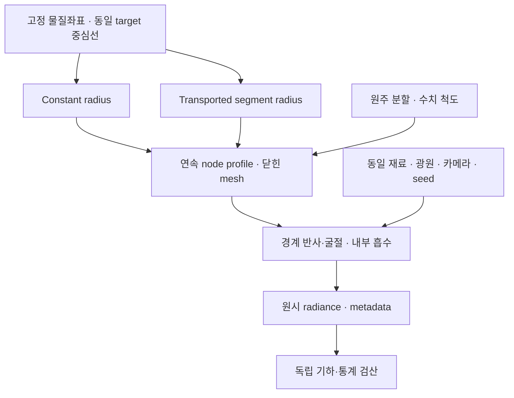

# v0.5 — 가변 반지름 섬유의 광학 연결과 수치 오차 검증

**직물 외관 재현을 위한 다중 규모 광학 모델링과 메타광학 계측**

**Multiscale Textile Appearance Modeling and Meta-Optical Sensing**

검증 기준일: **2026-10-12 KST / 2026-10-11 UTC**.

**v0.5는 같은 섬유의 물질점·반지름 변화를 닫힌 3D 표면의 반사·굴절·내부 흡수 계산에 연결했다.** 최종 반지름·원주 분할 실험 216회, 해석적 광학 oracle 32회, renderer 길이 척도 감도 실험 72회를 실제 실행했고, **전체 391개 테스트가 실패·오류·생략 없이 통과**했다. 원시 배열·기하·통계는 별도의 검산으로 확인했다. [최종 실험 manifest](../data/variable_radius_v5/experiment_manifest.json), [전체 테스트 summary](../data/validation_v5/final_artifact_and_tests/tests/test_summary.json), [최종 통합 검산 기록](../data/validation_v5/final_artifact_and_tests/run_manifest.json).

**반지름 효과의 검출과 광택의 수치 수렴은 아직 해결되지 않았다.** 원주 분할을 바꾸면 부피 오차는 줄지만 평균 radiance가 크게 달라졌고, 가장 높은 분할에서 반지름 차이의 9개 신뢰구간은 모두 0을 포함했다. 이번 결과는 실물 원단 재현 정확도가 개선됐다는 증거가 아니다. 순방향 엔진에서 어디까지 계산·검증했으며 다음에 어떤 오차를 줄여야 하는지 확인한 연구 결과다. [실험 분석](../notes/variable_radius_v5_experiment.md), [독립 리뷰](../notes/review_variable_radius_v5.md).

이 문서는 검증한 수치와 코드·자료의 역할을 정리한다. 확인한 로컬·원격 코드·데이터 checkpoint는 아래에 기록하며, **최종 릴리스 문서와 원격 commit·tree·tag의 게시 확인은 [작업 로그](WORK_LOG.md)의 최종 기록을 기준으로 한다.** 코드·자료 checkpoint와 최종 릴리스 게시 상태를 구분한다.

## 1. 원래 연구 목적과 이번 단계의 위치

출발점은 온라인 의류 사진에서 예상한 재질감과 실제 원단을 보았을 때의 차이다. 공간적인 디테일을 확보하면서, 조명이나 시점을 움직였을 때 바뀌는 광택·직조 대비·비침도 예측해야 한다. **4K 이상의 고해상도 촬영은 유효한 비교군**이며 배율·MTF·노출·색 교정과 다중조명 조건을 갖춘 RGB 시스템으로 평가한다. 해상도 향상과 추가 각도·파장·편광 측정이 해결하는 문제를 구분한다. 연구 요구와 결정의 전체 매핑은 [연구헌장](RESEARCH_CHARTER_KO.md), 가설과 판정 기준은 [연구 설계](RESEARCH_DESIGN_KO.md)에 있다.

VIS는 화면에 전달할 색과 외관을 검증하는 기준 대역이다. 사용자의 IR 메타표면·렌즈 연구는 보조 관측의 후보로 연결한다. IR이 어떤 구조·물성의 모호성을 줄이는지, 그 정보가 VIS 외관 예측에 도움이 되는지를 먼저 검증해야 한다. 유용한 관측을 찾은 다음 같은 시간·광량·픽셀·전체 시스템 크기에서 기존 광학과 메타광학을 비교한다. 이번 v0.5는 그러한 관측 최적화에 쓰일 **순방향 모델의 연결과 수치 오차**를 다룬다. 실제 소자 제작이나 RGB 대비 정보 이득을 검증한 단계는 아니다. [연구 설계](RESEARCH_DESIGN_KO.md), [현재 상태](STATUS_KO.md).

실크·코튼·큐프라·린넨·혼방은 외관 프리셋으로 고정하지 않는다. 구성 섬유의 재료 ID, 단면·직경·광학 물성, 원사의 꼬임·잔털, 직조·가공 상태를 구분해야 한다. 현재 실험에는 출처가 명시된 **합성 물성 A/B**를 사용하며 실제 소재 이름을 붙이지 않는다. 염색·퇴색은 이번 범위에서 보류한다. 촉감은 마찰·압축감·굽힘·접촉 냉감 등 속성별 기준 측정이 필요한 후속 연구로 유지한다. [연구헌장](RESEARCH_CHARTER_KO.md), [실험 재료 입력](../data/variable_radius_v5/optics/synthetic_material_spectra.json).

### v0.4에서 남아 있던 연결 문제

v0.4는 기준 물질좌표와 부모 대응을 고정해 같은 fiber 점을 운반하고, 각 선분의 신장을 계산했다. `incompressible_segments` 상태에서는 원기둥 선분 부피 proxy를 보존하도록 반지름이 변하지만 기존 광학 adapter는 일정 반지름만 허용했다. 당시에는 가변 반지름을 평균값으로 바꾸지 않고 export를 거부했다. v0.5는 그 상태를 **연속 반지름 profile과 실제 닫힌 표면**으로 전달할 수 있게 한다. [v0.4 릴리스](RELEASE_V0_4.md), [물질좌표 모듈](../textile_sim/material_transport.py).

이번의 직접적인 연구 질문은 다음과 같다.

> 같은 물질점·중심선·재료·조명에서 반지름 모델을 바꾸면 광학 반응이 얼마나 달라지는가? 그 차이를 표면 분할 오차와 Monte Carlo 잡음에서 분리할 수 있는가?

## 2. 모듈 지도: 계층 기하에서 광학 관측까지

이 저장소의 기본 계층은 **constituent → fiber → ply → yarn → weave/network → fabric patch**다. 각 계층은 물질·부모 ID와 단위를 유지한다. 기하 생성, 원사 평형, 물질좌표 운반, 광학 계산은 서로 다른 역할이며 하나를 실행했다고 나머지의 물리적 정확성이 자동으로 보장되지는 않는다. [전체 구조](ARCHITECTURE.md), [계층 기하 설계](../notes/hierarchy_design.md), [광학 연결 계약](../notes/optical_bridge.md).

| 구현 모듈 | 입력 → 출력 | v0.5의 역할과 범위 |
|---|---|---|
| **H1: fiber / ply / yarn 기하** | 생성 규격·부모 경로 → 명시적 섬유·계층 ID | 기존 꼬임·배치·migration·loop 생성 유지; 실제 내부 응력·sliding은 미해결 |
| **K1: weave / 제한된 평형** | 직조 draft·lift plan·유효 강성 → 원사 높이 상태 | 기존 평직·능직 및 축소 평형 유지; full 3D rod·접촉·드레이프 해석은 후속 |
| **물질좌표 운반** | 고정 reference·target frame → 같은 점의 위치·strain·선분 반지름 | v0.4의 대응과 reference hash를 그대로 사용 |
| **V1: 연속 반지름·닫힌 표면** | `MaterialTransportState` → profile·tube mesh·기하 진단 | v0.5 신규: 선분/절점 반지름 구분, 세 부피 정의, 불변 배열·정확한 재로드 |
| **O1: 공통 광학 입력** | 기하·재료·단위·출처 → 광학 scene 계약 | 기존 `OpticalScene` 경로와 별도의 volume adapter 유지 |
| **O2: 국소 파동 / ray** | 허용된 평행 원형 bundle → 2D 국소 해 | 기존 Maxwell·ray 검증 유지; 이번 3D 표면에 자동으로 더하지 않음 |
| **O3: 3D 광학** | 닫힌 표면·실수 굴절률·흡수 → 단색 radiance | v0.5 신규: geometric face normal, dielectric 경계, pure absorption, `volpath` |
| **O4: 광학 축약** | 계층 기하 → 투영 면적·SGGX 통계 | 기존 진단 유지; 완전한 fabric BSDF나 차폐·다중 산란의 대체물이 아님 |
| **C1 / Q1: 관측·독립 검증** | 원시 영상·seed·metadata → 비교·구간·검산 | v0.5 신규: 반지름/분할/척도 비교, 외부 원본 재구성, 배열 의미 검산 |

이번에 실행한 연결은 다음과 같다. 이 그림은 가변 반지름 비교의 데이터 흐름이며, 전체 계측·역추정·사용자 평가가 완료됐다는 의미가 아니다.



### 새 API와 실행 경로

| 파일 / API | 계약 |
|---|---|
| [`VariableRadiusFiber`](../textile_sim/variable_radius.py) | 현재 중심선, 두 물질좌표, 선분 반지름, fiber/yarn/ply/material ID, provenance를 불변 상태로 보존 |
| `profiles_from_transport()` | 유효한 v0.4 state에서 profile tuple 생성; 원래 상태·reference hash 유지 |
| `build_tapered_tube()` | RMF ring과 cap을 갖는 닫힌 삼각형 mesh, 법선·부피·오차 진단 생성 |
| Profile / mesh 저장·재로드 | non-pickle NPZ와 JSON의 파일·semantic hash를 대조하고 파생 배열 재구성 |
| [`volume_optics.py`](../textile_sim/volume_optics.py) | 실제 float32 vertex / uint32 face 검사, material mapping, scene handle과 metadata 대응 |
| [`run_variable_radius_experiments.py`](../run_variable_radius_experiments.py) | 두 반지름 상태와 원주 분할을 비교하고 실제 raw image·scene·통계·ledger 보존 |
| [`verify_variable_radius_artifacts_v5.py`](../verify_variable_radius_artifacts_v5.py) | 저장 원시 배열의 기하·광학 metadata·통계를 독립 재계산 |
| [`run_engine_v5.py`](../run_engine_v5.py) | `experiment → verify → tests` 순서를 새 출력 폴더에서 실행, 입력·소스 변화 감시 |

구현과 유효범위의 전체 설명은 [기하 수학](../notes/variable_radius_geometry_v5.md), [광학 소스 감사](../notes/variable_radius_optics_source_audit_v5.md), [상세 실험 보고서](../notes/variable_radius_v5_experiment.md)에 있다.

## 3. 수학적 연결과 보존량의 의미

### 3.1 같은 물질점의 운반과 선분 반지름

Reference parent 위치·frame을 \(p_0,B_0\), reference fiber 점을 \(X_i\), 부모의 물질좌표를 \(\xi_i\)라 하면 v0.4의 기본 대응은

\[
q_i=B_0(\xi_i)^T[X_i-p_0(\xi_i)],\qquad
x_i=p_1(\xi_i)+B_1(\xi_i)q_i
\]

다. 새 부모의 현재 호길이에서 fiber를 다시 생성하는 대신, 처음 부여한 label과 local offset을 운반한다. 이는 **선언한 운동학적 대응**이며 실제 원단의 stress-free 기준이나 섬유 응력 평형을 추정한 결과는 아니다. [물질좌표 유도](../notes/material_transport_v4.md).

Reference와 현재 선분 길이가 \(\ell_{0,e},\ell_e\)일 때

\[
\lambda_e=\frac{\ell_e}{\ell_{0,e}},\qquad
r_e^{\rm seg}=\frac{r_{0,e}}{\sqrt{\lambda_e}}
\]

로 반지름을 정하면 \(\pi(r_e^{\rm seg})^2\ell_e\)라는 **선분 원기둥 proxy**가 유지된다. 이것만으로 굽은 실제 tube의 3D 체적·질량·밀도나 국소 비압축성이 증명되지는 않는다. [v0.4 실험 설명](../notes/material_transport_v4_experiment.md).

### 3.2 불연속 선분 반지름에서 연속 node 반지름으로

내부 node의 초기 반지름은 인접 선분 단면적을 현재 길이로 가중하여 정한다.

\[
\widetilde r_i^2=
\frac{\ell_{i-1}(r_{i-1}^{\rm seg})^2+
      \ell_i(r_i^{\rm seg})^2}
     {\ell_{i-1}+\ell_i}.
\]

끝 node에는 인접 선분 반지름을 쓴다. 한 직선 선분에서 반지름을 선형 보간하면 정확한 원뿔대 적분은

\[
V_e^{\rm frustum}
=\frac{\pi\ell_e}{3}
\left(r_e^2+r_er_{e+1}+r_{e+1}^2\right)
\]

이다. 섬유마다 하나의 양의 배율

\[
\gamma=
\sqrt{\frac{\sum_e\pi\ell_e(r_e^{\rm seg})^2}
{\sum_eV_e^{\rm frustum}(\widetilde r)}},
\qquad r_i=\gamma\widetilde r_i
\]

를 적용해 **그 섬유의 총 적분**을 맞춘다. 다른 섬유·재료 사이로 부피를 옮기지 않는다. 이 규칙은 명시적으로 선택한 재구성 근사이며, 실제 단면 구성식이나 유일한 최적해로 주장하지 않는다. [기하 모듈 §2](../notes/variable_radius_geometry_v5.md).

| 구분 | 계산하는 양 | 이번의 보존·검사 의미 |
|---|---|---|
| 선분 원기둥 proxy | \(\sum_e\pi\ell_e(r_e^{\rm seg})^2\) | v0.4 반지름 법칙의 선분별 보존 대상 |
| 연속 반지름 적분 | \(\sum_eV_e^{\rm frustum}\) | v0.5 배율이 섬유별 합계만 맞춤 |
| 실제 mesh signed volume | 닫힌 삼각형 표면의 체적 적분 | 굽힘·ring 배치·삼각화·cap을 포함한 다면체 진단 |

선분별 재분배는 \(\epsilon_e=V_e^{\rm frustum}/V_e^{\rm proxy}-1\)로 따로 저장한다. **섬유 전체 합계가 맞는 것과 모든 물질 선분의 부피가 보존되는 것은 다르다.** [실제 profile 진단](../data/validation_v5/development_geometry_review/actual_profile_review.json).

### 3.3 RMF 표면, 실제 법선과 부피

중심선의 rotation-minimizing frame을 \((\mathbf t_i,\mathbf n_{1i},\mathbf n_{2i})\)라 하면 M각형 ring은

\[
\mathbf v_{ij}=\mathbf p_i+r_i
\left[\mathbf n_{1i}\cos(2\pi j/M)
+\mathbf n_{2i}\sin(2\pi j/M)\right]
\]

로 구성한다. 인접 ring을 삼각형으로 연결하고 양끝에 outward cap을 둔다. 실제 surface normal은 triangle에서 계산한다. Taper가 있으면 법선에 축 방향 성분이 생기므로, 단순 방사 방향이나 보간한 shading normal로 바꾸지 않는다. 초기 normal seed는 입력 원형 그대로 보존한다. [RMF 원전](https://www.microsoft.com/en-us/research/publication/computation-rotation-minimizing-frames/), [기하 구현·검토](../notes/variable_radius_geometry_v5.md).

Signed volume은 정점 평균 등 수치 기준점 \(\mathbf o\)를 두고

\[
V_{\rm mesh}=\frac16\sum_f
(\mathbf v_{f0}-\mathbf o)\cdot
\big[(\mathbf v_{f1}-\mathbf o)\times(\mathbf v_{f2}-\mathbf o)\big]
\]

로 계산한다. 양의 부피, 모서리당 두 면의 반대 방향, 양의 triangle area, Euler characteristic 등을 검사한다. float32 변환 후의 삼각형 붕괴·반전·부피 변화와 최대 정점 변위도 별도로 검사한다. 다른 섬유 간격은 각 fiber의 최대 node 반지름으로 감싼 capsule bound에서 양쪽 양자화 변위를 차감한다. **같은 fiber의 전역 자기교차 부재는 이 검사로 인증하지 않는다.** [독립 기하 검사](../tests/test_variable_radius_review.py), [실험 geometry metrics](../data/variable_radius_v5/geometry_metrics.json).

## 4. 광학 모델 선택과 단위 계약

### 왜 가변 radius curve에 medium을 바로 붙이지 않았는가

Mitsuba **3.9.1 / `llvm_ad_rgb`**의 공식 문서·pinned source와 실제 runtime 교차를 확인했다. `bsplinecurve`는 control point별 반지름을 지원하지만 backface를 제거하므로, 내부에서 바깥으로 나가는 경계를 같은 방식으로 추적할 수 없다. 실제 probe에서도 curve 내부 광선의 교차는 false, 닫힌 cube 내부 광선은 true였다. 따라서 이번의 체적 경계 모델에는 닫힌 triangle mesh를 사용했다. [소스 감사와 runtime 기록](../notes/variable_radius_optics_source_audit_v5.md), [보존된 probe](../data/validation_v5/backend_source_audit/backend_probe.json).

기존 hair BCSDF는 내부 chord를 단위 반지름으로 정규화하므로 물리적 \(\mu_a\)를 쓸 때 shader 입력이 \(\mu_a r\)가 된다. 새 volume 모델은 실제 내부 경로 길이를 적분하므로 \(\mu_a\) 자체를 inverse scene unit으로 사용한다. 두 모델은 거칠기·국소 산란·출사점의 처리도 다르다. **v0.4 hair 영상과 v0.5 mesh 영상의 차이를 반지름 효과로 해석하지 않는다.** 이번 두 반지름 상태는 모두 같은 새 경계 모델로 비교했다. [Pinned hair source](https://github.com/mitsuba-renderer/mitsuba3/blob/478e193a183c21723f4a8251afc3ad29a8da4c5e/src/bsdfs/hair.cpp), [Pinned curve source](https://github.com/mitsuba-renderer/mitsuba3/blob/478e193a183c21723f4a8251afc3ad29a8da4c5e/src/shapes/bsplinecurve.cpp), [모델 선택 설명](../notes/variable_radius_optics_source_audit_v5.md).

### 실제 흡수 경로

물리 기하의 길이는 **mm**, 파장은 **vacuum nm**로 명시한다. Scalar material spectrum의 \(n(\lambda),\kappa(\lambda)\)에서

\[
\mu_a(\lambda)=
\frac{4\pi\kappa(\lambda)}{\lambda_{\rm nm}\,10^{-6}}
\quad[\mathrm{mm}^{-1}]
\]

를 계산한다. 표면은 실수 \(n\)의 dielectric Fresnel, 내부는

\[
\sigma_t=\mu_a,\qquad \mathrm{albedo}=0,\qquad
\sigma_s=0,\qquad T(d)=e^{-\mu_a d}
\]

의 pure absorption medium이며 `volpath`가 광로를 적분한다. 경계 사이의 반사·굴절과 내부 산란계수는 구분한다. 이번 내부 매질의 산란계수는 0이다. [Volume 구현](../textile_sim/volume_optics.py), [Pinned homogeneous medium](https://github.com/mitsuba-renderer/mitsuba3/blob/478e193a183c21723f4a8251afc3ad29a8da4c5e/src/media/homogeneous.cpp).

\(\kappa/n\le0.01\) 제한은 complex-index 경계 보정을 생략하는 현재 근사의 gate다. 일반적인 실측 오차 bound를 제공하는 조건은 아니다. 비원형 단면, material twist, 복굴절, 실제 표면 거칠기, 섬유 내부 구조, 파동 간섭·회절은 이번 scalar 경계 모델의 검증 범위 밖이다. 기존 hair용 roughness·legacy absorption·exposure 필드는 새 모델에서 적용하지 않으며 그 사실을 scene metadata에 남긴다. [광학 계약](../notes/variable_radius_optics_source_audit_v5.md), [실험 설명](../notes/variable_radius_v5_experiment.md).

## 5. 실제 실험과 통계 결과

### 5.1 실험 호출과 독립 반복을 구분한다

| 실험 | 실제 실행 조건 | 호출 수 | 시간 | 보존 근거 |
|---|---|---:|---:|---|
| 반지름·원주 분할 | 3분할 × 2상태 × 3조명 × 3파장 × 4 seeds, 64×64·64 spp | **216** | **202.188323 s** | [Manifest](../data/variable_radius_v5/experiment_manifest.json) |
| 해석적 광학 oracle | 8조건 × 4 seeds, 550 nm, 16×16·2048 spp | **32** | **9.465649 s** | [Manifest](../data/validation_v5/volume_physics/experiment_manifest.json) |
| 실제 fiber의 scene-scale 감도 | 3척도 × 2상태 × 3조명 × 4 seeds, 550 nm, M=64, 64×64·64 spp | **72** | **196.183671 s** | [Manifest](../data/validation_v5/volume_scale_sensitivity/experiment_manifest.json) |

합계는 **320번의 실제 render 호출**이다. 조건별 독립 반복은 4개 seed다. 72회 감도 실험의 S=1 조건 24개는 주 실험의 M=64·550 nm 조건과 겹치며, 저장 영상은 bitwise identical이었다. RGB 세 채널·픽셀·중복 실행을 추가 독립 표본으로 계산하지 않는다. 개발 중 거부한 첫 216회와 pilot, 테스트 내부의 작은 렌더는 위 세 실험의 최종 호출 표에 합산하지 않는다. [Scale 독립 감사의 canonical overlap](../data/validation_v5/independent_scale_audit/verification_summary.json).

각 seed 영상의 pixel mean 하나를 관측값으로 사용한다. 비교 조건에서 같은 seed끼리 차이 \(d_k\)를 만들고

\[
\bar d\pm t_{1-\alpha/2,\,K-1}\frac{s_d}{\sqrt K},
\qquad K=4
\]

를 계산한다. 주 실험에는 점별 95% 구간과 함께, 최고 분할의 반지름 비교 9조건 및 인접 분할 비교 36조건에 각각 Bonferroni 보정을 적용했다. 적은 seed의 Student-t 구간은 렌더 잡음에 관한 근사이며 실물·모델·교정 불확실성을 포함하지 않는다. 같은 seed를 썼어도 다른 mesh의 경로가 일대일로 대응하거나 분산이 반드시 감소한다고 가정하지 않는다. 상대 변화율은 baseline 평균으로 나눈 점추정이며 그 비율의 모집단 신뢰구간이 아니다. Baseline이 0이면 `null`로 기록한다. [원시 통계](../data/variable_radius_v5/optics/optical_metrics.json), [독립 검산기](../verify_variable_radius_artifacts_v5.py).

### 5.2 기하 결과: 전체 적분과 국소 오차

입력은 보존된 v0.3 optical pair에서 운반한 **42 fibers, 8,106 물질점, 8,064 선분**이다. 두 반지름 상태는 중심선·label·부모·재료 대응을 그대로 공유한다. [기하 결과](../data/variable_radius_v5/geometry_metrics.json).

| 항목 | 실제 값 | 해석 |
|---|---:|---|
| Reference 반지름 | 3 μm | 일정 반지름 비교군 |
| 가변 node 반지름 | 2.808323–3.235533 μm | 운반된 선분에서 재구성 |
| 섬유별 frustum 총량 상대 오차 | 최대 약 \(4.44\times10^{-16}\) | 전역 배율의 적분 일치 |
| 선분별 부피 재분배 | −3.96381%∼+3.80001% | 국소 보존을 강제하지 않은 결과 |
| 절대 재분배 오차 99백분위 | 1.74383% | 실제 질량·압축 물성 오차와 구별 |
| M=16 / 32 / 64의 mesh/frustum 차이 | 약 −2.55389% / −0.64480% / −0.16407% | 실제 닫힌 mesh의 원주 분할 진단 |

수치의 원시 근거는 [독립 profile 리뷰](../data/validation_v5/development_geometry_review/actual_profile_review.json)와 [최종 geometry metrics](../data/variable_radius_v5/geometry_metrics.json)에 있다.

### 5.3 광학 결과: 반지름 효과 미검출과 원주 분할의 영향

주 실험은 M=16/32/64, 파장 450/550/650 nm, seed 5723·22840·39957·57074를 사용했다. R0와 R90은 XY 평면으로부터 elevation 40°, azimuth 0°/90°의 반사 조명이다. T45는 아래쪽에서 elevation 55°, azimuth 45°의 투과 조명이다. 광원 angular half-width는 7°이며 공통 union bounds의 orthographic rig를 쓴다. 이 세 파장은 단색 진단이며 CIE 색 정확도를 주장하는 분광 적분 실험이 아니다. [광학 설정과 기록](../data/variable_radius_v5/optics/optical_metrics.json).

M=64에서 가변 반지름과 고정 반지름의 상대 평균 변화는 다음과 같다.

| 조명 | 450 nm | 550 nm | 650 nm | 구간 판정 |
|---|---:|---:|---:|---|
| R0 | −3.895% | +2.073% | −0.400% | 세 조건 모두 점별·Bonferroni 구간에 0 포함 |
| R90 | +2.646% | +0.327% | −2.751% | 세 조건 모두 점별·Bonferroni 구간에 0 포함 |
| T45 | −18.456% | −3.885% | +27.412% | 세 조건 모두 점별·Bonferroni 구간에 0 포함 |

**9개 조건 모두 반지름 효과를 현재 예산에서 분리하지 못했다.** 특히 T45처럼 작은 baseline에서 큰 상대 변화가 나와도 유의한 물리 효과로 표현하지 않는다. 인접 분할 비교 36개에서는 점별 구간 20개, Bonferroni 구간 34개가 0을 포함했다. 보정 후 0을 제외한 두 조건은 모두 **16→32 / R0 / 450 nm**였고 고정 반지름 +101.88%, 가변 반지름 +109.48%의 상대 변화였다. [독립 리뷰](../notes/review_variable_radius_v5.md), [원시 비교](../data/variable_radius_v5/optics/optical_metrics.json).

32→64의 R0 평균 radiance도 두 상태·세 파장에서 약 **25.7∼31.6%** 바뀌었다. 해당 보정 구간이 0을 포함한 것은 수렴 또는 동등성의 증명이 아니다. 부피와 법선의 수렴 속도는 다르다. 직선 정 M각형 단면의 부피 비는

\[
f_M=\frac{M\sin(2\pi/M)}{2\pi}
\]

지만, 원형 표면을 facet으로 대표할 때 법선 각도 간격의 절반은 \(\pi/M\)이다. M=16/32/64에서 각각 11.25°/5.625°/2.8125°이므로, 작은 부피 오차가 좁은 specular 경로의 수렴을 뜻하지 않는다. 이 직선 oracle 식을 굽은 tube 전체의 체적 보존 법칙으로 사용하지 않는다. [기하 유도](../notes/variable_radius_geometry_v5.md), [분할 결과 해석](../notes/variable_radius_v5_experiment.md).

### 5.4 물리 oracle: Beer 감쇠와 단위 상사의 한계

별도 32회는 다섯 optical depth \(\tau=0,0.25,0.75,1.5,3\), 무흡수 dielectric furnace, 8배 길이 상사, taper를 비교했다. Index-matched 직선 geometry에서 카메라 footprint가 모든 단면의 안쪽에 들어가도록 하여 \(e^{-\tau}\)를 해석적 기준으로 삼았다. 모든 조건이 선언된

\[
|\bar L-e^{-\tau}|\le
6\sqrt{\frac{e^{-\tau}(1-e^{-\tau})}{N_{\rm camera\ paths}}}+10^{-4}
\]

guard를 통과했다. 이 guard는 seed 신뢰구간과 다른 판정이다. 예를 들어 무흡수 furnace 평균의 약 \(7.36\times10^{-8}\) 양의 편향은 점별 구간에서 0과 분리됐지만 선언한 수치 허용량 안이었다. [물리 보고서](../notes/volume_optics_validation_v5.md), [실제 raw 통계](../data/validation_v5/volume_physics/validation_metrics.json).

길이를 8배 하고 흡수계수를 1/8배 하면 이상적 optical depth는 같지만, 실제 paired 차이는

\[
\Delta=-2.19400390\times10^{-5},\qquad
CI_{95\%}=[-3.13756757,-1.25044023]\times10^{-5}
\]

로 **0을 제외했다**. 따라서 정확한 수치적 단위 불변성을 통과했다고 기록하지 않는다. 설치 header와 실제 surface-ray 검사에서 offset의 기본 형태

\[
\mathbf p_{\rm ray}
=\mathbf p\pm\epsilon_{\rm ray}(1+\|\mathbf p\|_\infty)\mathbf n
\]

를 확인했다. \(\epsilon_{\rm ray}=1500\times2^{-24}\)의 기본 척도는 mm scene에서 약 0.0894 μm이며, 상수 1 항은 좌표와 함께 비례 확대되지 않는다. 별도 기록된 경로에 Beer 식을 적용한 예측 차이 \(-2.77288\times10^{-5}\)는 위 구간 안에 있다. 단순 cap 실험과 일치하는 설명이며 임의의 직물 영상 오차 전체의 원인을 입증한 것은 아니다. [Ray-offset 기록](../data/validation_v5/ray_offset_audit/ray_offset_audit.json), [설치 header와 수치 설명](../notes/volume_optics_validation_v5.md), [독립 산술 검산](../data/validation_v5/independent_physics_audit/verification_summary.json).

### 5.5 실제 fiber의 수치 척도 감도 72회

원래 물리적 profile과 물성은 유지하고, renderer에 넣는 수치만

\[
\mathbf x_{\rm numerical}=S\mathbf x_{\rm mm},\qquad
\sigma_{t,\rm numerical}=\frac{\mu_{a,\rm mm}}{S},
\qquad S\in\{1,10,100\}
\]

로 바꿨다. 카메라·광원도 함께 확대하여 이상적 \(\mu_a L\)와 무차원 관측 조건을 유지했다. Adapter 입력용으로 만든 \(\kappa/S\)는 수치 단위 표현이며 실제로 다른 섬유 물성을 측정하거나 바꾼 것이 아니다. 저장한 physical-mm 원본과 derived numerical buffer를 구분한다. [감도 driver](../run_volume_scale_sensitivity_v5.py), [감도 metadata](../data/validation_v5/volume_scale_sensitivity/sensitivity_metrics.json).

| S=10→100 상대 평균 변화 | R0 | R90 | T45 |
|---|---:|---:|---:|
| 고정 반지름 | +0.0419% | +0.9335% | −4.2421% |
| 가변 반지름 | −0.5902% | +3.3028% | +1.6535% |

이 여섯 비교의 점별 구간은 모두 0을 포함했다. **−4.24∼+3.30%라는 점추정 범위나 0 포함 여부만으로 수렴·동등성을 선언하지 않는다.** 사전에 정한 허용 오차 안에 구간 전체가 들어오는지 별도의 동등성 또는 오차 제한 기준으로 평가해야 한다. 같은 원주·축 표본을 사용했으므로 이 실험이 표면 분할 오차까지 해결하지도 않는다. [독립 scale 감사](../data/validation_v5/independent_scale_audit/verification_summary.json).

이 자료에는 수치 척도 비교 18개, 척도별 반지름 비교 9개, 반지름 효과의 척도 간 차이 9개를 합친 36개 contrast가 있다. 독립 감사는 72개 원시 영상, 252개 mesh, 18개 scene, 36개 통계를 확인했고 3개의 작은 backend scene을 재구성하여 실제 buffer·굴절률·medium 계수도 검사했다. **2,839개 내부 검산 조건의 통과는 2,839개의 별도 unit test 또는 새 렌더를 뜻하지 않는다.** 추가 render 호출은 0회였다. [감사 코드와 방법](../notes/volume_scale_sensitivity_v5_audit.md), [감사 JSON](../data/validation_v5/independent_scale_audit/verification_summary.json).

## 6. 검증 결과와 독립성의 범위

### 소프트웨어·통합 실행

| 검증 | 실제 결과 | 기록 |
|---|---|---|
| 현재 전체 suite | **391 tests, failures 0, errors 0, skipped 0**, 30.231310 s | [버전별 보존 summary](../data/validation_v5/final_artifact_and_tests/tests/test_summary.json), [실행 log](../data/validation_v5/final_artifact_and_tests/tests/tests.log) |
| 저장 자료 검산 + 전체 tests | 두 단계 PASS, 전체 76.524142 s, 시작·끝 source/input 변화 없음 | [Runner manifest](../data/validation_v5/final_artifact_and_tests/run_manifest.json) |
| 저장소 밖 cwd의 no-render 통합 | M=16·550 nm의 새 기하 → 외부 원본 재구성 검산, 두 단계 PASS, 39.999849 s, render 0회 | [통합 manifest](../data/validation_v5/no_render_integration/run_manifest.json) |

새 테스트는 해석적 원기둥·원뿔대 부피, cap 입출사, 실제 taper 법선, 강체 변환·단위 배율, 원호 세분, 불변 배열·잘못된 입력 거부, 저장 round-trip, volume material 계약, runner의 경로·예산·무결성 등을 포함한다. 독립 기하 검사는 13개, 산출물 검사는 8개이며 위 391개에 포함되어 있다. 수동 probe, 원시 채널 수, render 호출을 테스트 수에 더하지 않는다. [기하 독립 검사](../tests/test_variable_radius_review.py), [산출물 검사](../tests/test_variable_radius_artifacts_v5.py), [Volume 검사](../tests/test_volume_optics.py).

### 주 실험의 저장 배열 검산

최종 verifier는 **원본 hierarchy 4개 파일, 42 fibers × 2상태, 252개 mesh, 54개 scene metadata, 216개 scalar 이미지 record, 77개 출력 파일**을 확인했다. 원시 배열 축은 `[3,2,3,3,4,64,64]`이고 순서는 원주 분할·상태·조명·파장·seed·행·열이다. 외부 입력을 명시하여 v0.4 material map을 다시 적용하고 좌표·반지름·ID·state hash를 대조했다. [독립 감사 결과](../data/validation_v5/independent_review/verification_summary.json).

검산기는 experiment driver나 renderer를 import하지 않고, 원시 배열에서 부피·위상·정점 대응과 평균·paired 구간을 계산한다. 외부 원본 재구성에는 공통 v0.4 core를 사용하므로 완전히 독립된 두 번째 물질 운반 solver인 것은 아니다. 현재 소스 전체 hash 대조는 별도 runner가 담당한다. 원래 RGB buffer의 hash와 저장 scalar channel의 hash도 구분한다. 저장 자료의 일관성이 원래 실행 자체의 독립 인증을 뜻하지 않는다. [검산기](../verify_variable_radius_artifacts_v5.py), [독립성 설명](../notes/review_variable_radius_v5.md).

산출물 검사는 내부 해시·외부 ledger를 다시 맞춘 상태에서도 **잘못된 반지름 법칙, 이동된 renderer 정점, NaN radiance, 거짓 Bonferroni 구간, 중복 seed record, 잘린 ZIP**을 거부하도록 구성했다. 양성 fixture의 48개 채널은 합성 검사 배열이며 48회의 실제 렌더가 아니다. [Corruption tests](../tests/test_variable_radius_artifacts_v5.py).

### 물리 oracle의 추가 교차검산

별도 감사는 9개 출력 파일의 해시, 4개 NPZ CRC, `[8,4,16,16,3]` 배열과 32개 record의 hash, seed 평균·CI·guard를 재계산해 PASS했다. 설치된 `interaction.h`·`math.h`의 바이트도 source audit 기록과 같았다. 이 추가 검토에서 원격 source를 다시 가져오거나 원래 ray query를 재실행했다고 주장하지 않는다. 검산 코드와 적용 범위는 [독립 물리 감사](../data/validation_v5/independent_physics_audit/verification_summary.json), [재검산 스크립트](../data/validation_v5/independent_physics_audit/review_saved_physics.py)에 보존한다.

## 7. 발견한 결함, 수정과 실패 기록 보존

### 7.1 RMF 초기 seed의 정확한 재로드

초기 구현은 투영된 normal을 저장하고 로드 때 다시 투영·정규화했다. 미세한 부동소수점 차이 때문에 실제 42개 섬유 중 39개에서 정확한 배열 재구성이 실패했다. 입력 seed 원형을 불변 상태로 보존하고, 기본값은 RMF가 선택한 원래 Cartesian axis로 명시하도록 수정했다. 이후 실제 42개 round-trip과 독립 회귀 검사가 통과했다. 최초 실패 로그·관찰·수정 후 로그를 보존하며, 당시 소스의 완전한 pre-fix snapshot까지 있다고 주장하지 않는다. [개발 관찰](../data/validation_v5/development_geometry_review/seed_failure_observation.json), [개발 리뷰 자료](../data/validation_v5/development_geometry_review/checkpoint.json), [독립 리뷰](../notes/review_variable_radius_v5.md).

### 7.2 잘린 NPZ를 검산에서 발견하고 전체 실험 재실행

첫 no-render preflight와 첫 216회 실험에서 각각 한 mesh NPZ가 ZIP central directory/end marker를 갖추지 못한 상태로 관찰됐다. 앞서 저장한 nested hash와 실제 파일 hash가 달랐지만 마지막 outer ledger는 그 시점의 잘린 파일을 해시해 통과 상태로 남겼다. 독립 검산이 이 불일치를 거부했다. **원인은 미확정**이며 파일시스템·NumPy·특정 agent의 조작으로 귀속하지 않는다. Corruption fixture는 별도 임시 경로에서만 생성했다. [거부 근거](../data/validation_v5/serialization_rejection_216/rejection_audit.json).

Producer는 NPZ를 메모리에서 완성한 뒤 임시 파일에 write·flush·fsync하고 atomic replacement하도록 바꿨다. 저장 직후 배열을 다시 읽고 ZIP CRC를 확인하며, 최종 단계에서 모든 nested array hash와 바깥 ledger를 함께 확인한다. **실패한 자료를 고쳐서 PASS로 바꾸지 않고 216회 전체를 다시 실행했다.** 최종 실행은 9개 NPZ CRC와 9개 nested reference, 77개 출력 파일의 무결성 및 입력·소스 불변성을 통과했다. [최종 manifest](../data/variable_radius_v5/experiment_manifest.json), [최종 producer](../run_variable_radius_experiments.py).

첫 216회의 원래 driver·manifest·optical metrics·scalar raw·잘린 buffer·거부 판정은 [부분 거부 묶음](../data/validation_v5/serialization_rejection_216/rejection_audit.json)에 보존한다. **이 묶음은 모든 scene과 geometry를 포함하는 완전한 replay snapshot이 아니다.** 최종 정상 실행과 첫 실행의 scalar radiance NPZ hash는 동일하지만, 최초 mesh 저장 무결성 실패가 없어지는 것은 아니다. 같은 source model·seed의 같은 raw 결과가 반복됐다는 뜻이며 독립 seed 수를 늘리지 않는다.

### 7.3 입력 snapshot과 중복 raw의 출처

72회 척도 실험은 개발 중 확보한 여섯 입력 파일의 snapshot을 `volume_scale_sensitivity/inputs/`에 자체 보존한다. 당시 `optical_metrics.json` 전체 hash는 최종 주 실험의 metrics 파일과 다르다. 독립 감사는 그중 실제 사용한 union bounds·조명 설정·seeds가 최종 주 실험과 동일하고, profile·material 파일은 최종 canonical과 해시가 같음을 확인했다. 24개 S=1 raw와 84개 해당 mesh도 최종 주 실험과 bitwise identical이었다. 임시 원본 경로를 필수 실행 의존성으로 남기지 않고, 아래 재현 명령은 보존된 `inputs/`를 사용한다. [Scale manifest](../data/validation_v5/volume_scale_sensitivity/experiment_manifest.json), [독립 audit](../data/validation_v5/independent_scale_audit/verification_summary.json).

## 8. 버전과 원시 근거

### 코드·데이터 checkpoint

| 구분 | 확인한 식별자 | 의미 |
|---|---|---|
| 로컬 구현 commit | `802403c568a9f2a63b3167b7c1963dd0b2ca801e` | 가변 반지름·volume 광학·실험·검산 구현 |
| 로컬 자료 commit | `c2df0609a30d6e473971299b29ec3d4770fd1847` | 원시 실험·물리 oracle·독립 감사 보존 |
| 확인된 원격 코드 checkpoint | `b51131d17fd3e9ae59d7ab2669c8b3dd20dd50ae` | 원격 코드 게시 단계 |
| 확인된 원격 자료 checkpoint | `af2ce4d209b83b818186783719451b692408619e` | 원시 실험·검증 자료 게시 단계; 최종 릴리스 문서·tag는 별도 확인 |
| 최종 게시 commit / tree / tag | [작업 로그의 최종 확인](WORK_LOG.md) | 원격 실제 상태를 확인한 뒤 기록 |

로컬과 API로 생성한 원격 commit의 식별자를 같다고 가정하지 않는다. 실행 당시 source·input·output SHA-256은 각 manifest에 저장한다. 검증한 수치가 어떤 코드와 입력에서 나왔는지는 commit 번호 하나 대신 해당 run의 source ledger와 함께 읽는다.

### 핵심 파일 SHA-256

| 자료 | SHA-256 |
|---|---|
| [최종 주 실험 manifest](../data/variable_radius_v5/experiment_manifest.json) | `d11aaca4e7bdefd30db453da51ca9b159f3951a33313ab32e06e74ee08ddeb31` |
| [주 실험 scalar raw](../data/variable_radius_v5/optics/spectral_radiance.npz) | `7e677abb8d777bab68044033de22d114a279be11b79cc239af8afe18cf4f1728` |
| [물리 oracle raw](../data/validation_v5/volume_physics/scalar_radiance.npz) | `37655778302494fa866abde59522f75fe2d1846d7ab0139de4efb1e2fa9de159` |
| [척도 감도 raw](../data/validation_v5/volume_scale_sensitivity/scalar_radiance.npz) | `d00c0c8ea87d9b6d66f78d47fe08e1a44ea53504cb2332af02abbea267d39eea` |
| [391개 테스트 summary](../data/validation_v5/final_artifact_and_tests/tests/test_summary.json) | `1af1239871824544b4de27a0987bf254437c040f9a640f28c10afa5451a43e36` |

이 표는 핵심 파일의 식별용이며 전체 ledger를 대체하지 않는다. v0.3·v0.4의 수치·자료·실행 경로는 보존한다. 과거의 테스트 239개·297개와 렌더 536회·108회는 각각 해당 버전의 결과다. 현재 전체 테스트 수나 v0.5 표본으로 다시 세지 않는다. [v0.3 릴리스](RELEASE_V0_3.md), [v0.4 릴리스](RELEASE_V0_4.md), [변경 기록](../CHANGELOG.md).

## 9. 재현 명령

Python 3.12 환경에서 [requirements.txt](../requirements.txt)를 설치하고 저장소 루트에서 실행한다. 검증 runtime은 Python 3.12.14, NumPy 2.3.5, SciPy 1.17.0, Mitsuba 3.9.1 / `llvm_ad_rgb`였다. 아래 출력 경로는 **새 폴더 또는 빈 폴더**로 사용한다. 이미 보존된 결과를 덮어쓰는 실행은 거부한다. [환경·예산을 포함한 runner manifest](../data/validation_v5/final_artifact_and_tests/run_manifest.json).

### 9.1 실행 계획, 저장 자료 검산, no-render 통합

```bash
python -m venv .venv
source .venv/bin/activate
python -m pip install -r requirements.txt

# 실제 단계·경로·예산 확인; 수치 import·실행·파일 생성 없음
python run_engine_v5.py --dry-run

# 보존된 216개 영상과 원래 material pair 검산; 새 실험 렌더 0회
python run_engine_v5.py --stages verify \
  --source-input data/mechanics_v3/optical_pair \
  --output scratch_runs/v5_saved_audit

# 최종 no-render 통합과 같은 M=16, 550 nm의 기하 생성·검산
python run_engine_v5.py --stages experiment verify --no-render \
  --radial-segments 16 --wavelengths 550 \
  --output scratch_runs/v5_no_render_reproduction
```

Runner의 단계는 `experiment verify tests`다. `--input-data DIR`를 지정하면 experiment는 `DIR/mechanics_v3/optical_pair`를 사용하고, verify-only는 `DIR/variable_radius_v5`를 읽는다. 기본 원본 pair가 있으면 외부 원본까지 재구성한다. 원본이 없는 archive의 내부 검산과 외부 원본 검산은 결과에서 구분되며, 명시한 `--source-input`을 읽을 수 없으면 생략하지 않고 실패한다. 저장소 밖에서 실행할 때는 `run_engine_v5.py`의 절대 경로를 사용하면 된다. [Runner 도움말·구현](../run_engine_v5.py).

### 9.2 주 실험 216회와 전체 suite

```bash
OPENBLAS_NUM_THREADS=1 OMP_NUM_THREADS=1 \
python run_engine_v5.py \
  --radial-segments 16 32 64 --wavelengths 450 550 650 \
  --resolution 64 --spp 64 --replicates 4 --max-render-count 216 \
  --output scratch_runs/v5_full_reproduction

# 새 주 실험 렌더 없이 보존 자료 검산과 전체 suite 실행 (테스트의 작은 렌더 포함)
OPENBLAS_NUM_THREADS=1 OMP_NUM_THREADS=1 \
python run_engine_v5.py --stages verify tests \
  --output scratch_runs/v5_verification_and_tests
```

`--no-render`는 experiment의 광학 실행만 생략한다. Tests를 선택하면 작은 renderer 검사까지 생략되는 것은 아니다. 위 두 번째 명령도 새 주 실험 렌더는 0회지만 테스트의 작은 렌더가 있을 수 있다. 예산을 늘릴 때는 `--max-render-count`도 명시적으로 늘려야 한다. 실패한 부분 batch의 호출 수를 알 수 없으면 `null`로 기록하고 임의의 0으로 바꾸지 않는다. [Runner 계약](../run_engine_v5.py).

Runner 없이 원시 자료를 직접 검산하려면 다음과 같이 실행한다.

```bash
python verify_variable_radius_artifacts_v5.py \
  --input data/variable_radius_v5 \
  --source-input data/mechanics_v3/optical_pair \
  --output scratch_runs/v5_direct_artifact_audit
```

### 9.3 해석적 물리 oracle 32회

```bash
OPENBLAS_NUM_THREADS=1 OMP_NUM_THREADS=1 \
python run_volume_optics_validation_v5.py \
  --resolution 16 --spp 2048 --seeds 1187 9781 23417 45751 \
  --output scratch_runs/v5_physics_reproduction

# 저장 배열·seed 통계·해석 guard 재검산; 추가 렌더 0회
python data/validation_v5/independent_physics_audit/review_saved_physics.py \
  --input scratch_runs/v5_physics_reproduction \
  --ray-offset data/validation_v5/ray_offset_audit/ray_offset_audit.json \
  --output scratch_runs/v5_physics_reproduction_audit.json
```

두 번째 명령은 보존된 ray-offset 경로의 산술도 다시 확인하지만 원래 ray query를 재실행하지 않는다. 설치 header bytes까지 비교하려면 검산기의 `--headers-root`에 해당 환경의 `include/mitsuba` 디렉터리를 추가한다. 저장된 최종 감사에는 두 헤더 검사가 포함되어 있다. [재검산 코드](../data/validation_v5/independent_physics_audit/review_saved_physics.py), [원래 ray query 재현 appendix](../notes/volume_optics_validation_v5.md).

### 9.4 실제 fiber 척도 감도 72회

```bash
OPENBLAS_NUM_THREADS=1 OMP_NUM_THREADS=1 \
python run_volume_scale_sensitivity_v5.py \
  --input-run data/validation_v5/volume_scale_sensitivity/inputs \
  --scales 1 10 100 --resolution 64 --spp 64 \
  --output scratch_runs/v5_scale_reproduction
```

이 명령은 보존된 입력 snapshot을 사용하므로 당시 임시 입력 폴더가 필요 없다. Seed는 snapshot의 4개 값을 사용한다. 자체 원본 profiles/materials와 derived scale buffer·scene·raw·통계를 새 출력에 보존한다. 기본값으로 추적 중인 결과 경로를 덮어쓰려 하지 말고 `--output`을 지정한다. 72회에 대한 별도의 독립 감사 코드는 [scale audit 문서](../notes/volume_scale_sensitivity_v5_audit.md)에 완전히 수록되어 있다. 해당 코드는 명시된 canonical 경로를 검산하고 기존 감사 결과를 덮어쓰지 않도록 작성됐으므로, 재실행용 복사본에서 입력·출력 경로를 지정해 사용한다.

### 9.5 기존 계층·v0.3·v0.4 유지

```bash
# 기존 fiber → ply → yarn → weave 기하 생성
python -m textile_sim.hierarchy \
  --config examples/hierarchy/twill_two_ply.json \
  --out scratch_runs/v5_existing_hierarchy

# 보존된 이전 버전 결과를 재렌더 없이 검산
python run_engine_v4.py --stages verify --output scratch_runs/v4_saved_audit
python run_engine_v3.py --stages verify --output scratch_runs/v3_saved_audit
```

과거 결과를 현재 소스로 자동 재실행한 것처럼 표시하지 않는다. 새 체크아웃에서 수행하는 검산과 각 과거 tag에서 실행한 수치의 provenance를 구분한다. [재현 원칙](../README.md), [작업 로그](WORK_LOG.md).

## 10. 논문·공식 코드와 이번 기여의 경계

Weavecraft·원사 수준 설계, 반사·투과 capture, fiber-level appearance capture, 계층 통계 축약, ray–wave 모델은 전체 프로젝트의 선행연구다. 논문의 참고문헌·확인한 후속 인용·관련 코드·라이선스 및 확인 깊이는 기존 문헌 ledger에 보존한다. 단순히 논문 제목이나 GitHub 링크를 확인한 것과 원 방법을 재현한 것을 구분한다. [v2 문헌·코드 감사](../notes/literature_engine_v2.md), [v3 문헌·인용 관계](../notes/literature_engine_v3.md), [Ray–wave 검토](../notes/ray_wave_literature.md).

| 근거 | 이번에 사용하는 관계 | 이 릴리스에서 주장하지 않는 범위 |
|---|---|---|
| [Weavecraft](https://www.cs.cornell.edu/projects/weavecraft/)와 [yarn-level 설계](https://graphics.stanford.edu/projects/yarnsim/) | 계층 설계·직조 표현의 선행연구 | 원 시스템 UI·역학 전체 재현 |
| [반사·투과 capture](https://arxiv.org/abs/2406.19398), [fiber-level capture](https://www.rendering-zixuan.com/paper_pages/FiberFabric/) | 구조·외관 관측과 실측 비교 설계 | 임의 실물 원단의 정확한 inverse capture |
| [Yu 등의 Ray–Wave Hybrid Shading Model](https://doi.org/10.1145/3763359) | 반사·투과를 연결하는 직접 선행연구 | 논문 전체의 ray–wave 결합 재현·성능 달성 |
| [SGGX](https://research.nvidia.com/labs/rtr/publication/heitz2015sggx/) 및 직물 축약 | 계층별 투영 통계와 근사 연구 | 투영 fitting 오차를 완전한 cloth BSDF·영상 오차로 대체 |
| [RMF 원전](https://www.microsoft.com/en-us/research/publication/computation-rotation-minimizing-frames/) | 원형 ring의 frame 운반 | 전체 튜브·광학 파이프라인에 원 논문의 수렴 차수를 그대로 부여 |
| [Mitsuba 3.9.1 source audit](../notes/variable_radius_optics_source_audit_v5.md) | curve/hair/medium의 실제 단위·경계 계약 확인 | wheel 전체의 재현 빌드 인증 또는 실물 광학 정확성 |

Mitsuba tag에서 확인한 commit은 `478e193a183c21723f4a8251afc3ad29a8da4c5e`다. `hair.cpp`, `bsplinecurve.cpp`, `dielectric.cpp`, `homogeneous.cpp`의 blob과 실제 runtime probe를 기록했고, 설치된 두 header도 별도로 검사했다. 상세 소스 식별자·URL·probe의 실패 후 수정은 [공식 소스 감사](../notes/variable_radius_optics_source_audit_v5.md)에 있다.

국소 2D Maxwell 해, 이번 3D 경계 광학, 공극의 직접 투과·회절을 fabric 수준에 연결할 때는 광로·정규화·coherence·차폐·다중 산란의 계약이 필요하다. 같은 에너지를 두 모델에서 중복 합산하지 않아야 한다. 현재 릴리스는 이 결합을 끝낸 상태가 아니라, **반지름 상태가 사라지던 3D 광학 연결부를 구현하고 조건부 수치 검증을 수행한 상태**다. [광학 bridge](../notes/optical_bridge.md), [실험 범위](../notes/variable_radius_v5_experiment.md).

## 11. 다음 연구의 우선순위와 완료 기준

**가장 먼저 목표 재질 차이보다 작은 순방향 수치 오차를 확보한다.** 이번 결과에 근거한 연구 설계상의 판단이다. 수치 오차가 더 크면 관측 최적화가 원단의 구조·물성보다 mesh 분할이나 renderer offset에 민감한 채널을 선택할 수 있다. [분할·척도 결과](../notes/variable_radius_v5_experiment.md), [연구 설계](RESEARCH_DESIGN_KO.md).

1. **표면·renderer 오차 분리:** 원주와 축 방향 sampling, node 반지름 재구성, 좌표 원점·scene scale, ray offset, 광원 크기·Monte Carlo budget을 따로 바꾼다. Radiance·BSDF 또는 목표 재질 contrast에 대해 사전 허용 오차를 정하고 구간 전체가 그 안에 드는지 판단한다. 차이의 구간에 0이 포함된다는 이유만으로 수렴을 선언하지 않는다.
2. **국소 단면과 물리 범위 확대:** 현재 global volume scale과 국소 보존을 고려한 대안을 비교한다. 비원형 단면·material twist·표면층·복굴절 등은 목표 외관에 필요하다는 근거와 해당 기준 측정을 확보한 뒤 추가한다. Self-contact와 3D 접촉 역학도 독립 과제다.
3. **Fiber → fabric 광학 축약 검증:** 충분히 수렴한 explicit fiber를 기준으로 ply/yarn/fabric 축약이 실제 반사·투과·영상에서 만드는 오차를 측정한다. 국소 파동 보정은 에너지·coherence 계약이 성립하는 조건에서 결합한다.
4. **작은 실물 패치의 교정·검증:** 현미경 구조, 방향별 분광 반사·투과, 광원·카메라를 측정한다. 알려진 합성 재료의 결과와 실제 소재 이름별 성능을 분리하고, 미관측 조명·독립 시편에서 검증한다.
5. **RGB 대비 관측 이득과 메타광학 검증:** 같은 획득 시간·광량·픽셀에서 각도·분광·편광·IR의 추가 가치를 평가한다. 같은 원단의 인접 패치가 학습·평가에 섞이지 않도록 한다. 이득이 확인된 채널에 대해 기존 광학과 메타광학의 relay·mount·detector를 포함한 전체 시스템을 비교한다.
6. **사용자에게 전달되는 이득:** 같은 화면·상호작용 조건에서 광택·비침·실물 시편 매칭이 개선되는지 평가한다. 촉감·염색·퇴색은 각각 필요한 기준 측정과 공정 모델을 갖춘 후속 연구로 둔다.

완료한 구현·실험·리뷰와 남은 연구를 계속 분리하여 기록한다. 현재 연구 상태는 [STATUS_KO.md](STATUS_KO.md), 전체 연구 방향은 [연구헌장](RESEARCH_CHARTER_KO.md), 변경 이유와 최종 게시 확인은 [WORK_LOG.md](WORK_LOG.md)에 이어서 관리한다.
