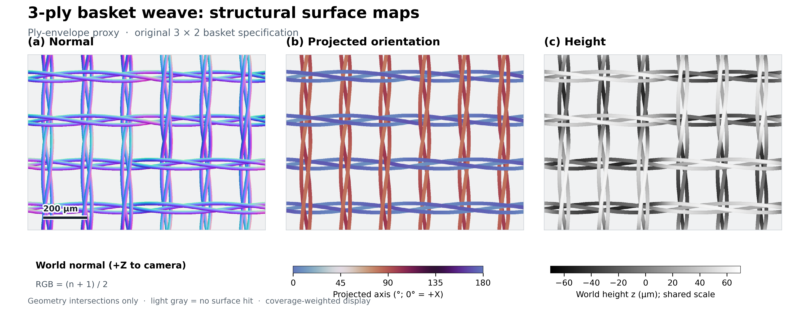
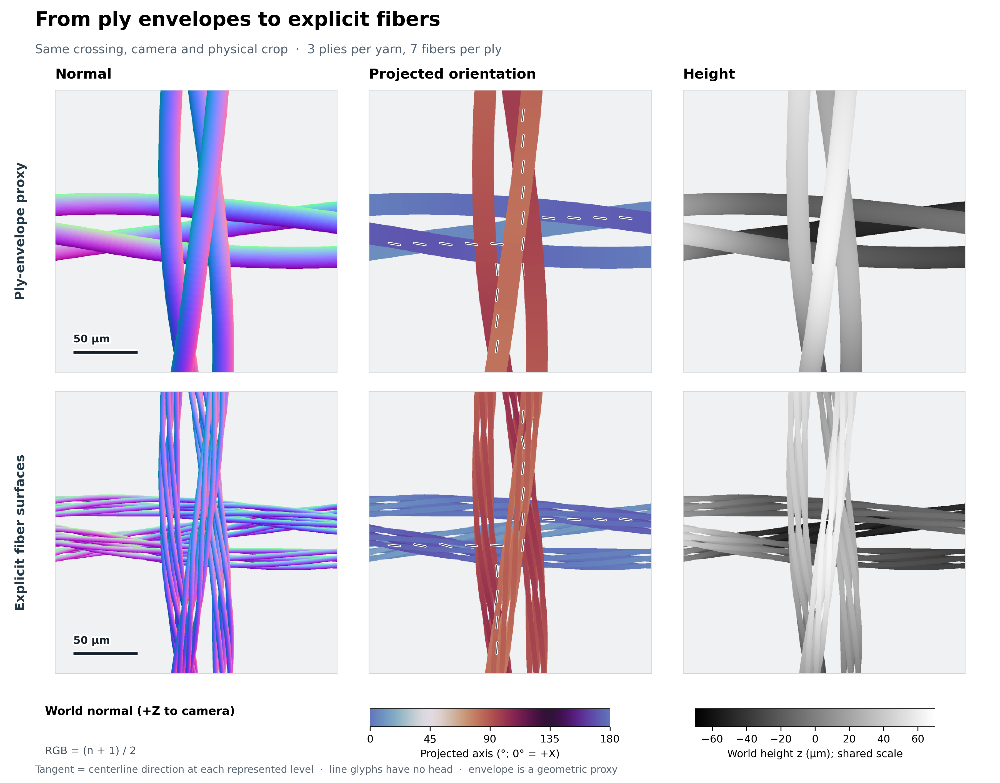
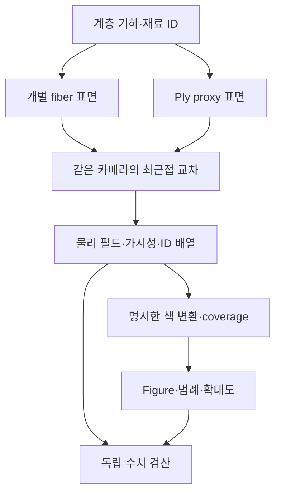

# v0.5.1 — 직물 구조맵과 논문용 figure

**연구: 직물 외관 재현을 위한 다중 규모 광학 모델링과 메타광학 계측**  
**2026-10-12 KST / 2026-10-11 UTC**

## 1. 이번 단계에서 완성한 것

현재 엔진의 fiber → ply → yarn → weave → fabric 기하를 **법선, 중심선 방향, 물리 높이, 가시성, 계층·재료 ID 지도**로 변환한다. 같은 위치의 ply proxy와 개별 fiber를 함께 보여주고, 수치 원본과 표시용 데이터를 분리해 보존한다. 이 자료로 논문형 3-panel 그림, 계층 비교, 재료 배치와 확대도를 생성한다.

사용자가 올린 그림은 **FabricGen: Microstructure-Aware Woven Fabric Generation, Fig. 5**의 3-ply basket normal/orientation/height 구성이다. 본문 §3은 UV 위의 \(\{\mathbf n,\mathbf t,h\}\), §5.1은 curved helix의 해석식을 정의한다. 본문·supplement·프로젝트에서 해당 의미를 확인하고 구성 형식을 참고했다. 이 저장소의 지도는 기존의 **명시적 3D 기하와 실제 삼각형 교차**에서 계산하므로, 논문의 해석적 UV 모델이나 supplementary의 동일 수치 재현으로 표시하지 않는다.

- [원 논문](https://arxiv.org/html/2603.07240v1) · [저자 프로젝트](https://lxtyin.ac.cn/projects/fabricgen/) · [공식 supplementary](https://lxtyin.ac.cn/projects/fabricgen/static/pdfs/CVPR26_FabricGen_suppl_revised.pdf)
- [사용자가 제공한 원본 figure](../references/user_provided/fabricgen_figure5_reference.png) · [출처·SHA-256](../references/user_provided/figure5_reference_provenance.json)
- [원리·표현 규약](VISUALIZATION_DESIGN_KO.md) · [수학·API·정밀도·저장 계약](../visualization/README.md)

염색·퇴색은 보류한다. 색깔로 보이는 normal/orientation/material 패널은 데이터 부호화이며 실제 염료 색이나 소재 식별 결과가 아니다. 앞선 **v0.5.0의 가변 반지름 광학 결과와 216/32/72회 실험은 그대로 보존**한다.

## 2. 산출물과 읽는 방법

| 사례 | 지도 | 그림 |
| --- | --- | --- |
| 기존 3×2 basket | 전체/교차 확대 × ply/fiber | normal·orientation·height 3-panel, 2×3 계층 비교, material ID·확대 위치·normal detail |
| 별도 compact 2×2 basket | 전체/교차 확대 × ply/fiber | 같은 3개 figure family를 새 설계와 별도 manifest로 출력 |

원본 사례의 파일은 [figures/structure_v5_1](../figures/structure_v5_1), 새 설계는 [compact](../figures/structure_v5_1/compact)에 있다. 각 figure를 PNG·PDF·SVG로 저장하며, 지도 배열과 metadata는 [data/structure_maps_v5_1](../data/structure_maps_v5_1)에 있다. Figure manifest가 개별 파일·배열의 해시, source·입력 spec, 카메라·crop·해상도·색상·물리 단위를 연결한다.





Ply proxy는 child fiber의 거리와 반지름으로 정한 외피 반지름을 부모 ply 중심선에 sweep한 **표현용 고체 표면**이다. 그 안을 실제 재료로 채웠다는 물리 모델이 아니며 child fiber 사이의 공극을 생략한다. Explicit fiber 지도는 같은 hierarchy의 개별 원형 섬유와 그 사이의 빈 공간을 보여준다. 두 행의 차이는 같은 물질을 정확히 축약했다는 증거가 아니라, 축약이 바꾸는 정보를 확인하기 위한 자료다.

PNG의 출력 크기와 300 dpi 설정은 문서에 배치할 크기를 정한다. PDF/SVG의 글자·범례·스케일바는 벡터지만 지도 패널에는 유한 해상도의 실제 표본을 넣는다. **DPI를 높이거나 SVG로 저장했다고 구조의 계산 해상도가 높아지지는 않는다.** 더 미세한 데이터가 필요하면 CLI의 지도 resolution·supersample·실제 mesh 분할을 명시적으로 바꾸어 새 실행을 만든다.

## 3. 구현 모듈



| 파일 | 역할 |
| --- | --- |
| [`structure_maps.py`](../visualization/structure_maps.py) | Float32 삼각형 표면, 직교 카메라, 실제 nearest-hit, 법선·접선·높이·ID, atomic NPZ/JSON |
| [`render_structure_figures.py`](../visualization/render_structure_figures.py) | 기존 시편의 공통 crop·표시 변환·세 figure family·PNG/PDF/SVG·manifest |
| [`render_compact_structure_figure.py`](../visualization/render_compact_structure_figure.py) | 별도 compact 입력과 제목을 적용하며 동일한 표시 계약을 재사용 |
| [`finalize_structure_figures.py`](../visualization/finalize_structure_figures.py) | 원본 generation provenance를 보존하고 기존 RGBA를 메모리 직렬화·container 검사·원자 저장·전체 바이트 검산으로 최종 출력 |
| [`review_structure_figures.py`](../visualization/review_structure_figures.py) | Producer 표시 함수를 호출하지 않고 저장한 좌표·벡터·범주·coverage·색상·파일을 검산 |
| [`validate_structure_release.py`](../visualization/validate_structure_release.py) | 현재 전체 unittest discovery와 core·visualization·test·example 소스 해시를 한 실행으로 기록 |

기존 `textile_sim`의 계층 생성과 v0.5 tube sweep을 소비하는 별도 경로다. 기존 광학 실험 driver·물성·원시 radiance를 새 figure를 위해 변경하지 않는다.

## 4. 물리값과 화면 색상의 계약

직교 카메라의 right/up/view를 \(\mathbf r,\mathbf u,\mathbf d\), 가로·세로 길이를 \(w,h\), 표본 수를 \(W,H\)라 하면 pixel-center ray의 시작점은 다음과 같다.

\[
\mathbf o_{ij}=\mathbf o+
\left(\frac{j+1/2}{W}-\frac12\right)w\mathbf r+
\left(\frac12-\frac{i+1/2}{H}\right)h\mathbf u.
\]

이 ray의 가장 가까운 표면 교차를 한 번 선택한 뒤 그 교차의 모든 필드를 함께 저장한다. 서로 다른 위치에서 normal·height·material을 따로 가져와 한 pixel로 조합하지 않는다.

| 필드 | 원본 | 표시 |
| --- | --- | --- |
| Normal | 실제 triangle의 unflipped world-space geometric normal \(\mathbf n_g\) | \(\mathbf c_n=(\mathbf n_g+1)/2\), 성분 순서는 XYZ→RGB; 광학 감마 없음 |
| Centerline tangent | 같은 triangle vertex의 해당 계층 tangent를 barycentric 보간 후 정규화 | \(\theta=\operatorname{atan2}(t_y,t_x)\bmod\pi\), 180° 주기 색상·headless glyph |
| Height | 실제 교차점 \(p_z\), mm | μm로 변환, 한 사례의 모든 표면·crop에 같은 범위 |
| Distance | Ray parameter와 실제 ray distance, mm | 높이와 별도 원본으로 보존 |
| Identity | Integer primitive/object/fiber/ply/yarn/material/family index | 정수 category 유지; category 간 수치 평균 없음 |

Miss의 물리 실수는 NaN, ID는 −1이며 `valid_mask`로 판별한다. Mixed-material ply는 전체 child material 목록을 보존하고 단일 material index를 꾸며내지 않는다. `world_smooth_normal`은 별도 표시용 보간 필드로 저장하며, 실제 geometric normal을 그 값으로 교체하지 않는다.

Pixel-center 물리값은 그대로 남겨두고 각 pixel을 \(s\times s\)로 나눈 실제 추가 ray에서 표시용 coverage를 계산한다. 표시색은 먼저 각 유효 sample을 색으로 변환한 뒤 평균한다. 표준 straight RGBA에 대해

\[
\alpha=\frac{N_{\rm hit}}{s^2},\qquad
\mathbf c=\frac{1}{N_{\rm hit}}\sum_{k\in\rm hit}\mathbf c_k,
\qquad
\mathbf c_{\rm shown}=\alpha\mathbf c+(1-\alpha)\mathbf b
\]

를 사용한다. Premultiplied RGB를 straight RGBA로 잘못 전달해 경계가 두 번 어두워지는 오류를 검사한다. 높이가 0인 배경을 섞거나 서로 반대인 방향 벡터를 평균해 가짜 표면·방향을 만들지 않는다.

## 5. Compact 설계와 기하 판정

| 파라미터 | 기존 시편 | 별도 compact 시편 |
| --- | --- | --- |
| Basket 구조 | 3×2 | 2×2 |
| Yarn / ply / fiber 수 | 10 / 30 / 210 | 16 / 48 / 336 |
| 가시 패치 | 1.08 × 0.80 mm | 0.64 × 0.64 mm |
| 경·위사 pitch | 180 / 200 μm | 80 / 80 μm |
| Ply 중심의 yarn 축으로부터 거리 | 21 μm | 14 μm |
| Ply twist | +1.1 turns/mm | +6 turns/mm |
| Fiber 반지름 / 각 ply의 fiber 수 | 2 μm / 7 | 동일 |
| Fiber twist | −2.3 turns/mm | 동일 |
| 명목 교차 envelope gap | 12 μm | 동일 |

Compact의 최종 hierarchy는 48 samples/crossing, 최대 fiber 선분 3.5911 μm, 최대 선분 turn 0.09621 rad로 기존 sampling gate를 통과했다. 서로 다른 curve의 capsule 검사에서 **fiber와 ply proxy 모두 전역 분리 하한 1 μm**를 확보했다. Broad phase가 남긴 후보의 최소 간격은 각각 2.4449/4.1221 μm이지만, 이 값을 전역 최소 간격으로 표시하지 않는다.

55 μm-pitch 후보는 sampling/refinement 예산 gate를 통과하지 못했다. 70 μm-pitch·6 μm-gap 후보는 different-fiber capsule의 음의 간격을 보여 분리 인증에 실패했다. 이는 실제 triangle 교차를 따로 증명한 결과가 아니므로 **capsule overlap과 실제 표면 침투를 동일시하지 않는다**. 채택·거부 조건, source hash, 실제 실행 결과는 [설계 감사](../examples/visualization/compact_three_ply_basket_design_audit.json)에 있다. Same-curve self-contact, 접촉력·마찰·압착과 역학 평형은 이 검사의 범위에 포함하지 않는다.

## 6. 검증과 실행 기록

**현재 전체 suite는 425 tests, 0 failures, 0 errors, 0 skips로 통과했다.** 실제 경과 시간은 24.814377603초이며, 실행 전후 87개 source 파일의 SHA-256이 같았다. 새 지도·표현·검산·publication의 34개 테스트와 기존 391개를 함께 실행한 수치다. 작은 광학 기준 문제가 포함된 테스트 함수 수이며, 그림 수·광선 수를 테스트 수에 더하지 않는다. 보강 전의 422-test·85-source 결과는 [별도 snapshot](../data/validation_v5_1/pre_publication_suite/test_summary.json)으로 보존한다.

| 최종 검증 | 확인한 결과 |
| --- | --- |
| 기존 사례 저장 데이터 | 4 maps, 104 arrays, 12 NPZ CRC, 9 figure files 통과 |
| Compact 저장 데이터 | 4 maps, 104 arrays, 12 NPZ CRC, 9 figure files 통과 |
| 지도 생성에 대응하는 교차 수 | 각각 7,129,600 / 8,192,000 primary rays; 조명 렌더 0회 |
| 독립 기하 oracle | 594 primary rays로 평면·가림·좌표 확인, 실행 source hash 보존 |
| 최종 figure 저장 | 18 files의 메모리 container 검사·atomic write·exact-byte readback·전체 해시 확인 |
| PDF 실제 확인 | 6개 PDF 모두 1 page parse·raster 성공. 필수 프로그램 의존성과 별도인 환경 QA |

최종 실행 수치와 파일 검산은 [현재 전체 suite](../data/validation_v5_1/final_suite/test_summary.json), [기존 사례 독립 검산](../data/validation_v5_1/independent_review/verification_summary.json), [compact 독립 검산](../data/validation_v5_1/compact_review/verification_summary.json)으로 연결한다. Figure producer와 독립 reader의 원본·표시 배열, 카메라·crop·단위·ID 일치 및 CRC/hash 검사 범위는 [리뷰 기록](../notes/review_structure_figures_v5_1.md)을 따른다.

별도 기하 oracle은 기울어진 평면의 해석적 normal·height, ray/세계좌표 정합, 두 층의 가림과 가장 가까운 물체 ID를 검사한다. 색 변환의 독립 반례는 높이/거리 혼동, image-Y 반전, float category, 이중 alpha를 거부해야 한다. 초기 개발 oracle은 당시 기록한 그대로 보존하고, 나중 source hash를 소급해서 붙이지 않는다.

이 실행의 primary ray 수는 기하 교차 질의 수다. **조명을 넣어 radiance를 계산한 횟수, 독립 Monte Carlo 반복 수, 실제 시편 수와 다르다.** 기존 v0.5의 320회 광학 호출은 기존 릴리스의 범위로 읽는다. 그림 레이아웃 수정 후 재실행하거나 같은 배열을 재표현한 것은 새 물리 증거로 합산하지 않는다.

### 저장 figure 검산에서 발견한 실패

첫 최종 canonical figure 묶음에서 `fabric_structure_hierarchy.pdf`의 실제 바이트가 manifest와 다름을 독립 reader가 검출했다. 기대 길이는 **566,866 bytes**, 관측 길이는 **433,871 bytes**였고 PDF 끝 표시와 유효한 페이지를 확인할 수 없었다. 다른 여덟 figure 파일은 당시 해시가 맞았고, 12개 NPZ의 CRC·물리 필드·색상 검산도 통과했다. 원인은 확정하지 않았다. 이 사실을 특정 라이브러리·파일시스템·작업자에게 귀속하지 않는다.

거부 당시 manifest와 잘린 PDF를 [rejected_figure_serialization](../data/validation_v5_1/rejected_figure_serialization/rejection_summary.json)에 보존했다. 같은 source의 plot-only 재구성으로 첫 PDF는 원래 완전한 바이트로 복원됐지만 후속 canonical SVG와 compact PDF에서도 잘림이 관측되어 각각 보존했다. 원인을 추정하지 않고 새 publication adapter에서 **BytesIO 완성 → container 검사 → flush/fsync·atomic replacement → exact-byte readback**을 수행하도록 보강했다. 원 generation manifest와 map·encoding·producer source는 그대로 보존하고 새 publication source·레이아웃 수정·최종 파일 검사만 별도 provenance로 연결했다.

이 과정에서 geometry query나 radiance 실험은 추가하지 않았다. 첫 실패 감사에서 후속 기하 oracle은 아직 호출되지 않았으므로 그 실행의 새 광선 수는0이다. 마지막 독립 감사와 PDF page 확인에서 최종18개 accepted figure는 모두 통과했다. [최종 publication 기록](../data/validation_v5_1/figure_finalization/publication_checks.json)과 위 독립 summary가 최종 파일의 근거다. 개발 중 잘린 파일은 accepted figure 집합에 포함하지 않는다.

전체 PDF 페이지 판독·rasterization, PNG decode 및 SVG XML 검사는 [최종 container/page QA](../data/validation_v5_1/figure_finalization/page_container_qa.json)에 기록했다. [독립 육안 검토](../data/validation_v5_1/independent_review/visual_review.json)와 [게시 전 파일 해시 대조](../data/validation_v5_1/release_packaging_audit.json)도 별도로 보존한다.

## 7. 재현

저장소 루트에서 `requirements.txt`에 맞춘 환경을 사용한다. 기본 결과를 덮어쓰지 않도록 새 경로로 출력한다.

```bash
# 기존 시편: 실제 기하 교차 → 물리 배열 → 세 종류 figure
python -m visualization.render_structure_figures \
  --data-dir scratch_runs/structure/data \
  --figure-dir scratch_runs/structure/figures \
  --resolution 640 --supersample 2 --radial-segments 64

# 별도 compact 시편
python -m visualization.render_compact_structure_figure \
  --spec examples/visualization/compact_three_ply_basket.json \
  --data-dir scratch_runs/compact_structure/data \
  --figure-dir scratch_runs/compact_structure/figures \
  --resolution 640 --supersample 2 --radial-segments 64

# 새로 생성한 두 사례의 RGBA에서 최종 파일을 메모리 직렬화·검사·원자 저장
python -m visualization.finalize_structure_figures \
  --manifest scratch_runs/structure/figures/figure_manifest.json \
  --manifest scratch_runs/compact_structure/figures/figure_manifest.json \
  --audit-directory scratch_runs/structure_publication

# 보존된 결과를 독립 검산: 새 기하 광선 질의와 조명 렌더는 없음
python -m visualization.review_structure_figures \
  --manifest figures/structure_v5_1/figure_manifest.json \
  --output scratch_runs/structure_review --skip-oracles

# 현재 전체 suite와 source 불변 기록
OPENBLAS_NUM_THREADS=1 OMP_NUM_THREADS=1 \
  python -m visualization.validate_structure_release \
  --output scratch_runs/structure_tests
```

원 generation의 plot-only 명령과 실제 옵션은 각 `figure_manifest.json`의 `reproduction`에 보존되어 있다. 최종 내보내기에는 위 publication adapter를 사용하며 새 시도마다 새 audit 디렉터리를 지정한다. 원본 수치를 수정하면 기존 해시와의 검산은 실패해야 한다. 테스트 수는 source snapshot에 따라 달라지므로 당시 태그·summary를 함께 인용한다.

## 8. 원래 연구와의 연결 및 남은 한계

이 연결부는 **구조를 바꾸었을 때 무엇이 바뀌었는지 확인하는 기반**이다. Low-level fiber의 방향·반지름·배치가 ply/yarn의 표면과 공극을 어떻게 만들고, 어떤 영역이 카메라에서 가려지는지 확인할 수 있다. 같은 기하·재료 ID를 광학 scene에 전달하면 구조맵과 광학 반응을 위치별로 대응시킬 근거가 된다.

그러나 top-down first-hit map은 보이지 않는 뒷면·내부 섬유·다층 경로를 담지 않는다. 이 맵만으로 반사·투과·다중 산란·회절을 재현할 수는 없다. 국소 파동 해와 high-level fabric 모델을 결합하려면 기존 연구 설계의 길이·위상·에너지 정규화·coherence 조건이 여전히 필요하다. `world_tangent`는 해당 계층 중심선 방향이므로 surface BSDF가 요구하는 tangent plane projection과 singularity mask도 별도로 정의해야 한다.

현재 지도는 실측 원단에서 역추정한 결과가 아니며 실제 실크·코튼·큐프라·린넨의 물성값을 얻었다는 뜻도 아니다. v0.5에서 발견한 **광택의 원주 분할·ray-offset 수렴 문제**도 그림의 해상도를 높여 해결되지 않는다. 이 순방향 수치 오차를 먼저 제한하고, 실제 원단·광원·카메라 교정과 미관측 조건 평가를 거친 뒤 강한 RGB 대비 추가 채널과 메타광학의 이득을 판단한다. [전체 연구 설계](RESEARCH_DESIGN_KO.md), [현재 상태](STATUS_KO.md).
