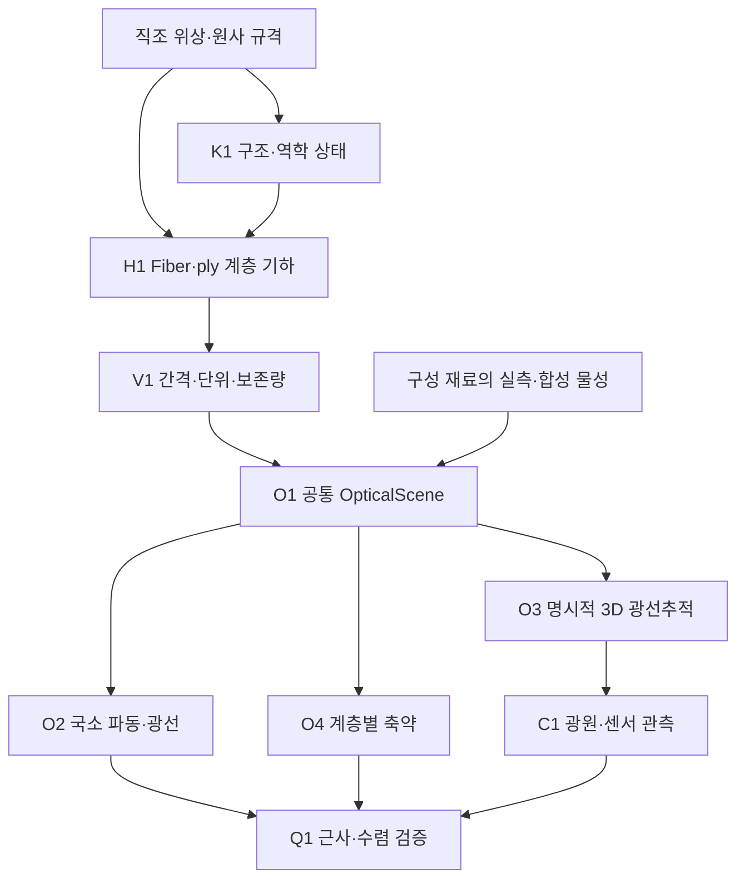

# 연구헌장: 직물 외관 재현을 위한 다중 규모 광학 모델링과 메타광학 계측

**Multiscale Textile Appearance Modeling and Meta-Optical Sensing**

작성·정리: 2026-10-11. 이 문서는 **현재 대화에서 확인된 연구 의도와 선택을 요구사항·모듈·검증 기준으로 연결**한다. 전체 연구의 목적은 이 문서, 구체적인 수학·알고리즘·실험은 [연구 설계](RESEARCH_DESIGN_KO.md), 실제 구현과 데이터 계약은 [아키텍처](ARCHITECTURE.md), 수행한 일은 [작업 로그](WORK_LOG.md)에 둔다.

저장소: [Phill-lms/textile-appearance-research](https://github.com/Phill-lms/textile-appearance-research). 이전 `Textile Optics Engine`은 구현 엔진의 이름이었다. 현재 제목은 엔진에 더해 계측·역추정·외관 표현·실물 검증까지 포함하는 연구 범위를 나타낸다. **제목에 메타광학이 있다는 사실은 메타표면의 우위가 입증됐다는 뜻이 아니다.**

## 1. 해결할 문제와 최종 산출물

의류의 제품 사진을 보고 예상한 재질감이 실물을 보았을 때와 달라지는 문제를 다룬다. 목표는 **직물의 구조와 광학 반응을 근거로 현재 제품을 복원하고, 다른 조명·시점·확대율·역광에서의 외관을 예측해 사용자가 실물을 더 잘 판단하도록 하는 것**이다.

연구의 최종 산출물은 다음 네 가지가 서로 검증되는 체계다.

1. **직물 상태 표현:** 섬유·ply·원사·직조·원단 패치의 구조, 광학 물성, 필요한 역학 상태와 불확실성.
2. **순방향 엔진:** 그 상태에서 반사·투과·산란·필요한 회절을 계산하고 실제 계측기의 관측을 예측하는 모델.
3. **계측·역추정 방법:** 관측으로부터 미관측 외관을 예측하는 데 충분한 상태를 추정하고, 추가 측정의 가치를 평가하는 방법.
4. **검증 가능한 사용자 표현:** 확대·조명 회전·역광 전환 등을 같은 화면 조건에서 제공하고 실제 시편 판단의 개선을 측정하는 표현.

시각적으로 비슷한 여러 구조가 같은 측정을 설명할 수 있다. 따라서 모든 내부 파라미터나 제조 이력을 유일하게 알아내는 것을 기본 성공 조건으로 두지 않는다. 관심 있는 외관 예측의 오차와 불확실성이 줄어드는지를 먼저 평가한다.

### 외관과 촉감의 목표를 분리한다

| 사용자가 알고 싶은 것 | 이번 연구에서 다룰 관측·표현 | 별도로 필요한 기준 |
| --- | --- | --- |
| 직조·실·잔털의 미세 텍스처 | 실제 scale의 고해상도 구조, 위치별 명암·방향 변화 | 현미경/매크로 기하와 MTF·sampling 교정 |
| 색 | 광원 스펙트럼에 따른 반사·투과 radiance와 색 관측 | 광원·카메라·화면 교정, 필요할 때 실측 분광값 |
| 방향성 광택 | 하이라이트의 위치·폭·강도·이동 | 조명·관찰각을 바꾼 기준 관측 |
| 보송함·매끈함으로 보이는 외관 | 잔털·표면 방향·산란이 만드는 시각적 단서 | 외관 판단과 실제 시편 비교 |
| 비침 | 정면/역광, 공극·섬유 투과·가림의 구분 | 반사·투과 경로와 광량·배경 조건 |
| 굽힘·드레이프의 모습 | 통제된 변형에서 구조와 외관 변화 | 힘·장력·중력·경계조건 및 변형 관측 |
| 마찰·압축감·접촉 냉감 | 속성별 후속 연구 | 마찰·압축·열 접촉 등 직접 기준 측정 |

광학 입력만으로 모든 촉감을 정확히 예측한다는 주장을 하지 않는다. 재질명 분류, 시각적 외관 예측, 기계·열적 촉감 추정은 서로 다른 목표이며 각각 기준 데이터가 필요하다.

## 2. 대화에서 나온 질문과 연구 요구사항

아래 표는 연구 방향이 엔진 개발 과정에서 바뀌거나 빠지지 않도록 추적하는 기준이다.

| 대화의 요청·문제의식 | 유지할 결정 | 연결 모듈 | 검증 또는 완료 기준 |
| --- | --- | --- | --- |
| 제품 사진의 텍스처·색·재질감이 실물과 다름 | 미관측 조건의 외관과 사용자의 실물 판단이 최종 목표 | R-M1, R-M6, R-M7, R-M9 | 새로운 조명·시점과 독립 시편에서 오차·판단 개선 |
| 4K 촬영으로 해결되는 것 아닌가? | 높은 공간해상도의 이득을 인정하고 강한 RGB 비교군을 둠 | R-M1, R-M5, R-M9 | 같은 scale·MTF·노출·시간·광량 조건의 비교 |
| VIS에서도 가능한가? | 눈에 보이는 외관은 VIS를 기준으로 계산·측정·검증 | R-M1, R-M2, R-M5 | 미관측 광원·각도에서 선형 영상·색·광택 정확도 |
| IR 메타표면/렌즈 전공을 연결하고 싶음 | IR은 관측 모호성을 줄이는 보조 후보로 평가 | R-IR, R-M2, R-M6 | IR을 추가한 이득이 VIS 외관 예측에도 남는지 확인 |
| 메타표면·computational imaging으로 필요한 정보를 추출 | 각도·파장·편광의 정보 가치를 먼저 분리 평가 | R-M2, R-M6, R-M9 | 동일 예산에서 기존 광학 및 RGB 대비 추가 가치 |
| 실크·코튼·큐프라·린넨·혼방의 느낌도 다룰 수 있나? | 재료 이름을 고정 광학·촉감 상수로 치환하지 않음 | H1, O1, R-M8 | 구성·구조·공정 범위와 실측 물성의 출처 확보 |
| 직조에 따른 반사·투과·산란·회절을 시뮬레이션 | 현상별 유효범위와 에너지 예산을 연결 | O2, O3, O4, C1 | 같은 구조·관측 조건의 기준 해, 수렴·보존·단위 검사 |
| 원사에서 fabric까지 디자인·시뮬레이션 | fiber–ply–yarn–weave–network–patch 계층을 명시 | H1, K1, V1, O1 | 계층 ID·단위·위상·보존량·전송 오차 검사 |
| 수학·물리·알고리즘을 엄밀히 구현하고 계속 리뷰 | 식과 구현·합성 검증·실물 검증을 단계별로 분리 | V1, Q1, R-M8, R-M9 | 독립 기준 문제, 실패 기록, 민감도·수렴·재현 증거 |
| 논문·참고문헌·후속 연구·공식 GitHub 검토 | 확인한 인용 관계·읽기 깊이·실행·재사용 여부를 기록 | 문헌 ledger, Q1 | primary source·commit·라이선스·실제 재현 범위 |
| 염색·천연염색·fading 확장 | **현재는 보류**, 이후 광학 상태/공정 모델로 별도 연결 | 후속 공정 모듈 | 공정·염료별 교정과 독립 시편 검증이 마련된 후 시작 |
| 비공개 GitHub, 설명·설계·작업 로그·버전 관리 | 연구와 구현의 변화를 모두 추적 | 저장소·manifest·문서 | tag/source/config/hash/seed/원시 결과·리뷰의 대응 |

이 표의 상태는 요구사항의 중요도를 나타낸다. 연결 모듈을 표에 적었다는 것만으로 구현이나 실측 검증이 끝났다고 표시하지 않는다.

## 3. 현재 범위와 연구의 우선순위

### 첫 실험 범위

작은 원단 패치를 사용하고, 우선 하나의 섬유 종류와 제한된 직조·원사 변수를 통제한다. 합성 실험에서는 geometry와 물성의 출처를 `synthetic`으로 표시하며 실제 원단 이름을 붙이지 않는다. 실측으로 넘어갈 때는 관찰한 재질의 범위와 변동을 기록한다.

첫 외관 지표는 **새 조명에서의 하이라이트 위치·폭·강도, 직조 대비, 비침, 선형 radiance와 교정된 색 오차**다. 어떤 지표를 주목표로 삼는지에 따라 필요한 관측이 달라진다. 방향성 광택이 문제면 다중조명/각도 관측을, 광원 변경에 따른 색이 문제면 분광 관측을 우선 대조하고, 편광·IR은 그 자체의 모델과 교정이 마련된 뒤 추가한다.

### 단계별 완료의 의미

| 단계 | 완료했다고 말할 수 있는 근거 | 그 단계만으로 성립하지 않는 주장 |
| --- | --- | --- |
| 코드 구현 | 명시된 API·모델이 실행되고 계약을 검사 | 실제 원단의 정확성 |
| 합성 수치 검증 | 독립 기준·보존·단위·수렴·재현 결과 | 실측 데이터로의 일반화 |
| 실측 외관 검증 | 독립 원단·미관측 조건에서 예측 오차 감소 | 추가 채널 또는 메타표면의 필요성 |
| 추가 관측 검증 | 강한 RGB와 같은 예산에서 목표 오차 감소 | 소자를 메타표면으로 구현할 장점 |
| 메타광학 시스템 검증 | 효율·혼선·부피·시간을 포함한 전체 비교 | 촉감 전체·제조 공정의 유일한 추정 |
| 사용자 검증 | 같은 표현 조건에서 시편 판단 개선 | 모든 화면·모든 의류에 대한 완전한 전달 |

코드 릴리스와 전체 연구의 완료는 서로 다른 상태다. 릴리스에는 그 버전이 통과한 단계만 기록한다.

## 4. 전체 연구 모듈과 구현 모듈의 대응

앞선 대화의 M1, M2, M4–M9 계측·재현 역할을 **R-M1, R-M2, R-M4–R-M9**로 유지한다. 이 대화에서 역할이 확정되지 않은 M3은 추정해서 채우지 않는다. IR 보조 경로는 이번 정리에서 **R-IR**로 별도 명명한다.

v0.1 PDF의 M1–M9는 Maxwell, ray, 각도 축약, 기하, renderer, aperture, camera, meta pupil, detector를 뜻했던 **과거 소프트웨어 모듈 번호**다. 그 문서의 의미와 이력을 변경하지 않는다. 새 소프트웨어 인터페이스는 H1/K1/V1/O1–O4/C1/Q1을 사용한다.

| 연구 모듈 | 입력 → 출력 | 현재 대응과 상태 | 완료를 판단할 검증 |
| --- | --- | --- | --- |
| **R-M1 고해상도 RGB** | 원단 + 통제된 조명 → 공간 구조·선형 RGB | `camera.py`, 렌더 rig는 합성 기반. 실물 캡처·강한 다중조명 RGB 비교군은 준비 대상 | 물체 scale·MTF·노출·noise·색 교정, 재촬영 안정성 |
| **R-M2 추가 관측 / 메타광학** | 각도·파장·편광 반응 → 유한 detector 채널 | `angular_measurement.py`, `meta_optics.py`의 이상적 진단 보존. 최종 외부 광학계는 미제작 | 기존 광학으로 정보 이득 검증 후 실측 throughput·crosstalk·시스템 예산 비교 |
| **R-IR 보조 적외선** | 선택한 대역·소자·검출 조건 → IR 관측 | 공통 spectrum 표현에 연결할 설계 경로. IR 전용 실측 재료 데이터와 sensing 이득 미검증 | VIS+IR 대 VIS-only의 목표 오차, 분리된 모델·실물 검증 |
| **R-M4 통제된 변형** | 원단·힘·경계·자세 → 변형 관측 | K1은 합성 유효 원사의 높이 평형. 실측 굽힘·장력·드레이프는 별도 | 기준 힘·변위, 반복성, 물질좌표·변형 법칙·경계 민감도 |
| **R-M5 교정·정합** | 여러 관측 + 기준값 → 공통 좌표·단위·불확실성 | O1의 단위·identity와 C1의 관측자 적분 구현. 실제 광학계의 정합은 후속 | 같은 패치 위치, source/camera/sensor/polarization calibration, 오차 전파 |
| **R-M6 구조·광학 추정** | 교정 관측 + forward model → 예측 가능한 상태·불확실성 | H/K/O/C가 순방향 기반. inverse fitting·관측 최적화는 미구현 연구 설계 | held-out 외관 오차, 식별성·nuisance·모델 오차·독립 시편 |
| **R-M7 사용자 표현** | 추정 상태 + 표시 조건 → 확대·재조명·역광 보기 | 수치 결과와 표시용 그림 구현. 교정된 상호작용 UI·지각 검증은 후속 | baseline과 같은 화면·톤·조작, 실제 scale·표시 gamut의 기록 |
| **R-M8 기준 측정** | 실제 시편 → 구조·분광 R/T·방향 반응·필요한 물성 | synthetic/literature/measured 출처 필드 제공. 실제 원단 데이터는 미확보 | 반복 측정·장비 noise·상태 기록·별도 평가용 시편 확보 |
| **R-M9 독립 검증** | 모델·실험·원시 결과 → 오차·기여 판단 | V1/Q1·독립 리뷰·전체 테스트·run manifest 구현. 실물/사용자 검증은 후속 | 학습 누출 방지, 수렴·반증 대조군, 동일 예산, 실물 판단 개선 |

### 순방향 엔진은 R-M6의 물리적 기반이다

위 그림은 공통 입력과 검증 관계를 나타낸다. 국소 2D Maxwell 결과, 3D fiber 경로 추적, SGGX 투영 통계는 현재 서로 다른 계산이다. 공통 scene에서 시작한다고 해서 하나의 완성된 ray–wave fabric BSDF가 되는 것은 아니다.

## 5. 계층 설계에서 보존할 정보

| 계층 | 표현할 것 | 상위 계층으로 올릴 때 확인할 것 |
| --- | --- | --- |
| **구성 재료** | 파장별 광학 물성, 필요할 때 이방성·표면 산란; 역학 물성은 별도 | 출처·온도/습도/상태 범위·단위·측정 불확실성 |
| **Fiber** | 단면, 중심선, 재료 ID, material coordinate, local frame | 길이·부피·strain·회전·sampling·자기/상호 접촉의 계산 범위 |
| **Ply** | fiber packing, 꼬임, migration, 잔털 분포 | 구성 섬유의 identity·방향·차폐·strain 전달과 평균 오차 |
| **Yarn** | ply 배치·꼬임, 유효 단면·장력·굽힘 상태 | ply 간 상대 이동, 단면 압착, local wave 적용 가능성 |
| **Weave / crossing** | 위아래 순서, float, 연결성, pitch, 층 구조 | 제조 topology와 기하/기계적 가능성의 구분 |
| **Network / unit cell** | 원사 네트워크·경계·주기 조건·접촉 | phase closure·연결·질량·장력과 작은 패치의 대표성 |
| **Fabric patch** | 공간적으로 변하는 상태와 다중 산란·가림 | footprint·각도·파장에 따른 축약 오차와 실제 광학 반응 |
| **Fabric surface / garment** | 거시 곡률·주름·seams·중력·drape | 표면 변형과 미시 섬유의 material map, scale 간 유효범위 |

현재 `ply`는 fiber 묶음의 부모, `yarn`은 하나 이상의 ply를 묶는 부모라는 **계산용 정의**다. 실제 방적·필라멘트·복합 원사가 항상 이 단순 tree에 들어맞는다고 가정하지 않는다. Knit·multilayer·3D weave 등에는 연결성이 명시된 추가 schema가 필요하다. [Weavecraft](https://www.antequ.net/assets/projects/weavecraft/weavecraft.pdf), [Leaf et al.](https://graphics.stanford.edu/projects/yarnsim/)는 위상과 기계적 배치의 구분을 검토하는 주요 근거다.

실크·코튼·큐프라·린넨이라는 이름은 실측·재료 메타데이터로 기록할 수 있다. 이름만으로 광학 상수나 굽힘 강성을 유일하게 정하지 않는다. 혼방도 부피·질량·섬유 개수 중 어떤 분율인지 선언하고, 유효 매질 근사를 쓸 때는 그 적용 조건을 별도로 검증한다. 현재 개별 재료 ID를 보존하는 방식은 그 비교의 출발점이다.

## 6. 광학·계측 설계의 핵심 조건

반사·투과는 빛이 어느 쪽으로 나오는지에 관한 출력 구분이고, 산란·회절은 전파·상호작용을 설명하는 방식이다. 따라서 같은 에너지를 서로 독립적인 보너스 효과처럼 더하지 않는다. 소스의 크기·스펙트럼·coherence, 섬유와 공극의 크기·불규칙성, detector의 유한 각도·픽셀을 선언한 뒤 모델을 연결한다.

[Yu et al.의 ray–wave 연구](https://doi.org/10.1145/3763359)는 평균 광선 응답, 파동에 민감한 개별 구조의 변화, 공극·ply 가장자리의 회절을 구분해 참고한다. 현재 구현이 그 전체 shading model과 동등하다고 주장하지 않는다. [기존 ray–wave 검토](../notes/ray_wave_literature.md)에 실제 읽기·코드 확인 범위가 있다.

메타광학 측정은 공간·각도·파장·편광 정보를 원하는 채널로 분배할 수 있는 후보다. 구현 설계에서는 다음 조건을 연구 변수로 다룬다.

- 같은 패치의 RGB 구조와 추가 관측 사이의 공간 정합.
- 패치 크기와 각도 분해능, 수광 étendue, slit·beam splitter·relay의 광량 손실.
- 파장·각도·편광 사이의 혼선과 calibration 안정성.
- detector의 픽셀 수·QE·read/shot noise·노출 시간·saturation.
- 실제 meta-element의 대역·효율·제작 오차와 보유 IR 공정에서 VIS로 옮길 때의 비용.
- 렌즈·격자·편광자 기반 구현 대비 **전체 시스템**의 크기·시간·광량·예측 정확도.

패치 평균 반응을 얻었다면 개별 실·잔털의 위치를 측정했다고 취급하지 않는다. 위치별 구조는 R-M1과 연결하고, 어느 영역의 평균 상태를 추정했는지 R-M5/R-M6에 남긴다.

## 7. 기여 후보와 반증 가능한 실험

### 7.1 현재 가장 가까운 질문

> **원사 구조의 변화와 섬유 고유 산란·흡수 변화가 강한 RGB 관측에서 서로 모방하는 조건은 무엇인가? 그 모호성을 줄이는 소수의 관측이 미관측 외관 예측을 개선하며, 모델 오차와 새로운 원단에서도 유효한가?**

방향별 광학 반응의 민감도가 크다는 사실만으로 파라미터 식별이 좋아지는 것은 아니다. 다른 구조·물성·광원 파라미터가 같은 변화를 만들 수 있는지 함께 계산한다. Nuisance를 고려한 Jacobian·정보량 설계는 [연구 설계 §7](RESEARCH_DESIGN_KO.md#7-가장-유망한-다음-연구-질문)에 있으며, v0.3에서는 미구현 가설이다.

### 7.2 진행 단계와 중단 조건

| 단계 | 비교할 것 | 다음 단계로 갈 근거 | 이득이 없거나 불안정할 때 |
| --- | --- | --- | --- |
| **A. Forward 기반** | 원사 재생성 vs 물질좌표 운반, coarse vs fine, local vs explicit reference | 관심 외관 차이가 수치·모델 오차와 구분되고 유효범위가 명확함 | geometry/물성/근사를 먼저 수정 |
| **B. 실측 기준** | 합성 예측 vs 보정된 작은 실물 패치 | 독립 조건에서 예측 오차와 noise floor를 설명 | 실측 물성·구조·광원 모델을 재검토 |
| **C. 정보의 가치** | 강한 다중조명 RGB, +각도, +R/T, +분광, 필요시 +편광/IR | 같은 예산에서 주목표 오차·불확실성이 감소 | 유용하지 않은 채널을 제외하고 더 단순한 촬영법 유지 |
| **D. 측정의 선택** | 균등 채널 vs 목표에 맞춘 채널, 맞는 모델 vs 틀린 모델 | 독립 시편·모델 불일치에도 이득이 남음 | 모델 특유의 artifact를 이용했는지 분석 |
| **E. 광학 구현** | 선택한 관측의 기존 광학 vs 메타광학 구현 | 실제 효율·혼선을 포함한 시스템 장점 | 메타표면을 필수 요소로 주장하지 않음 |
| **F. 사용자 전달** | 동일 화면·조작의 RGB 기반 결과 vs 새 결과 | 실물 시편 매칭 또는 광택·비침 판단 개선 | 표시·지각 지표와 관측 목표의 연결을 재검토 |

시편 단위로 학습·평가를 분리하고 같은 원단의 인접 패치를 서로 다른 독립 재료로 취급하지 않는다. 획득 시간·입사/검출 광량·공간해상도·검출기 예산 중 실제로 맞춘 조건을 기록한다. 단일 조건에서의 fit, 더 많은 parameter, 더 많은 광자를 사용한 결과만으로 새 측정의 가치를 주장하지 않는다.

### 7.3 독창성의 경계

직물의 R/T capture에는 [Tang et al.](https://arxiv.org/abs/2406.19398), fiber-level inverse에는 [Li et al.](https://www.rendering-zixuan.com/paper_pages/FiberFabric/), 설계·생성에는 [FabricGen](https://lxtyin.ac.cn/projects/fabricgen/)이 직접 연결된다. SGGX와 직물 fitting에도 [Heitz et al.](https://research.nvidia.com/labs/rtr/publication/heitz2015sggx/), [SpongeCake](https://wangningbei.github.io/2022/SpongeCake.html), [Yang et al.](https://doi.org/10.26599/CVM.2025.9450445)의 선행연구가 있다.

따라서 “RGB + 메타표면 + 재질 복원”, “SGGX를 직물에 적용”, “fiber부터 fabric까지 렌더”라는 구성 자체를 새 기여로 두지 않는다. **특정 실패 조건, 보존해야 하는 물리 정보, 동일 예산에서 줄어든 미관측 오차, 제작 가능한 시스템 이점**으로 기여를 좁혀 검증한다. 새로운 기여인지의 판단도 선행연구와 실험이 쌓이면 갱신한다.

## 8. 현재 확보한 근거와 v0.4의 위치

**검증된 v0.3.0**에는 명시적 계층 기하, 유효 원사 높이 평형, optical scene, 제한된 국소 2D wave/ray, 개별 fiber 3D path tracing, 계층 투영 통계, CIE 관측과 runner가 있다. 전체 239개 테스트와 536회 실제 분광 렌더링은 [해당 릴리스](https://github.com/Phill-lms/textile-appearance-research/releases/tag/v0.3.0), [보고서](../report/fabric_engine_v3_report_ko.pdf), [태그에 고정한 검증](https://github.com/Phill-lms/textile-appearance-research/blob/v0.3.0/data/final_test_summary.json)에서 확인한다.

v0.3의 평형 후 fiber는 새 부모 곡선 위에 재생성된다. 따라서 source ID가 같더라도 같은 material point가 이동한 결과가 아니다. **v0.4는 기준 물질좌표·부모 대응·frame 운반을 명시하고 동일 섬유를 따라 구조와 광학 정보를 전달하는 연결을 구현했다.** 일정 반지름과 선분 부피 proxy 보존 모드를 구분하며, 후자는 현재 광학 adapter로의 export를 거부한다. 자유로운 material twist나 constituent stress의 평형을 푼 것으로 표시하지 않는다.

42개 fiber의 8,106개 지점을 추적했으며, 전체 길이 +0.044224% 속에 선분 strain 약 −14~+14%가 상쇄됨을 진단했다. 세 상태·세 조명·세 파장·네 seed의 108회 렌더링을 수행했으나 추적 방식이 기존 재생성보다 실물 외관에 정확하다는 증거는 얻지 않았다. 상세 검증과 최종 전체 테스트는 [v0.4 실행 기록](RELEASE_V0_4.md)에 연결한다. 기존 v0.3의 239개 테스트와 536회 렌더링을 새 코드를 검증한 횟수로 재사용하지 않는다. 이 연결이 full 3D contact mechanics, 실측 물성의 정확성, fabric ray–wave BSDF, RGB 대비 관측 이득까지 자동으로 완료하는 것은 아니다.

## 9. 문헌·실험·버전 기록 규칙

문헌은 첨부 PDF와 공개 primary source를 기준으로 검토하고, 확인한 참고·피인용 관계를 관련 연구와 구분한다. 읽은 범위, 공식 GitHub의 commit·라이선스, 코드 확인·실행·재사용 여부를 [문헌 ledger](../notes/literature_engine_v3.md)에 남긴다. 논문을 인용했다는 사실과 원 저자의 모든 결과를 재현했다는 주장은 별개다.

각 실험은 source commit/hash, 입력 config/hash, geometry·material provenance, 실제 명령, mesh·spp·파장·각도 예산, seed, raw linear arrays, 불확실성·오차 진단을 함께 기록한다. 표시용 PNG와 수치 분석용 radiance를 구분한다. 실패한 실험·리뷰 지적은 원인과 수정에 연결하고 과거 증거를 새 실행처럼 덮어쓰지 않는다.

연구 제목·README는 현재 방향을 설명하고, 과거 tag·commit·보고서는 해당 시점의 이름과 결과를 보존한다. 소프트웨어 사용은 [CITATION.cff](../CITATION.cff)의 정확한 snapshot을, 원 논문 방법 사용은 원 논문을 함께 인용한다. **프로토타입 릴리스 완료, 추가 개발 진행, 실물 검증 완료를 문서·채팅에서 분리해 표현**한다.
