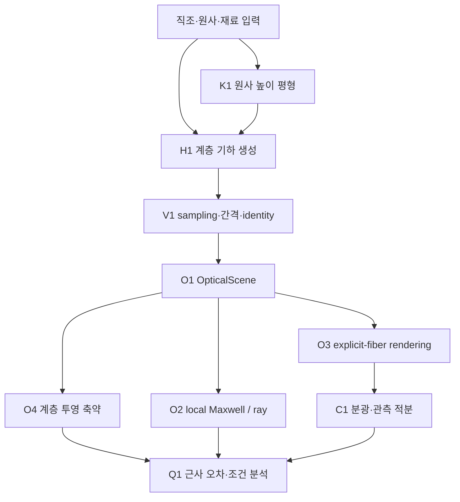
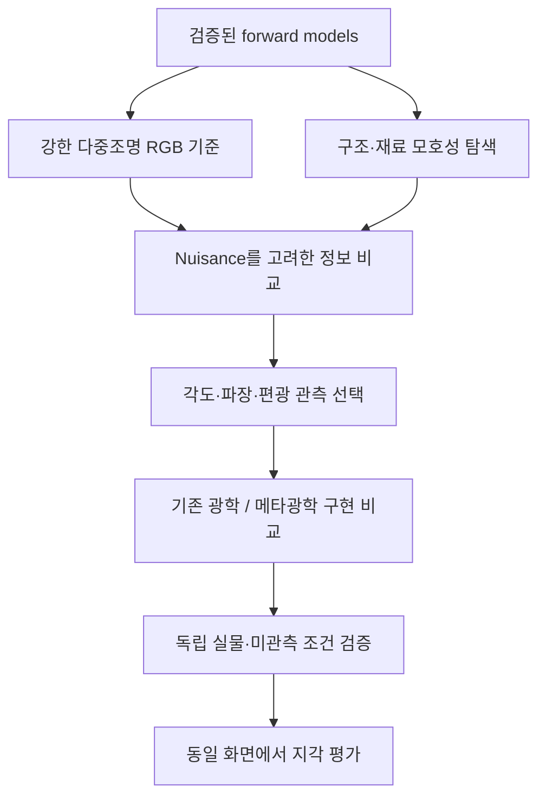

# 연구 설계: 직물 외관 재현을 위한 다중 규모 광학 모델링과 메타광학 계측

**Multiscale Textile Appearance Modeling and Meta-Optical Sensing**

연구 설계 갱신: 2026-10-11. 구현은 v0.3의 원사 평형·분광 관측에서 **v0.4의 물질좌표 운반과 광학 비교**로 확장했다. 각 버전의 실제 검증 범위는 [v0.3](RELEASE_V0_3.md), [v0.4](RELEASE_V0_4.md)에 분리한다. 연구 의도와 대화의 요구사항은 [연구헌장](RESEARCH_CHARTER_KO.md), 실행 결과는 [README](../README.md), 인터페이스·단위·수학은 [아키텍처](ARCHITECTURE.md), 원문 확인과 선행연구의 관계는 [v3 문헌 검토](../notes/literature_engine_v3.md)에 있다. 이 문서는 **전체 연구 목표**, **실제로 구현·실행한 범위**, **다음에 검증할 가설**을 구분한다. 염색·퇴색은 후속 과제로 미뤘다.

## 1. 연구 목적을 다시 고정한다

사용자가 해결하려는 문제는 **온라인 제품 사진에서 예상한 옷의 재질감과 실제 원단을 보았을 때의 차이**다. 최종 출력은 단지 실처럼 보이는 고해상도 이미지가 아니라, 확대 scale·조명·시점·역광을 바꾸었을 때 실제 시편의 반응과 맞는 원단 표현이다. 그 표현은 현재 제품을 재현하면서 어떤 구조·광학 변수가 외관을 결정하는지 설명할 수 있어야 한다.

4K 또는 더 높은 해상도로 촬영하는 것은 유효한 해결 수단이다. 실·잔털·직조를 분해하지 못하는 것이 주된 원인이면 광학 MTF, sampling, 조명 및 noise를 개선하는 것이 직접적이다. 다만 고해상도 정지 사진도 한 조건의 관측이다. 이 연구에서는 해상도의 이득과 다른 조명·시점의 반응을 알아내는 이득을 각각 평가한다.

| 오차 | 질문 | 공정한 비교 기준 |
| --- | --- | --- |
| 공간 표현 오차 | 실제 미세 구조를 렌즈·pixel·noise 때문에 놓치는가? | 잘 교정된 고해상도 RGB, 같은 피사체 scale·MTF·노출 |
| 조건 변화 예측 오차 | 현재 사진에 맞는 표현이 다른 조명·역광에서도 맞는가? | 강한 다중조명 RGB, 미관측 조명·각도에서의 선형 영상 |
| 모델 축약 오차 | fiber를 yarn·fabric 표현으로 줄일 때 어떤 반응을 잃는가? | 같은 명시적 기하·재료·관측계의 기준 계산 |
| 실물 전달 오차 | 시뮬레이션이 맞아도 화면·상호작용이 사람의 판단을 바꾸는가? | 동일 display·노출·조작 방식, 실제 시편과의 비교 |

전체 연구 목적은 다음과 같다.

> **실제 원단의 구조와 광학 상태를 관측에서 추정하여 현재 외관을 복원하고 새로운 조명·시점의 외관을 예측한다. Fiber–ply–yarn–weave–fabric 계층의 순방향 엔진으로 구조·재료 모호성을 분석하고, 강한 RGB 기준이 남기는 오차를 줄이는 관측을 검증한 뒤 그 관측에 맞는 외부 메타광학을 설계한다. 최종적으로 같은 화면 조건에서 실물 원단에 대한 판단이 개선되는지 평가한다.**

v0.3의 직접 성과는 이 목적의 기반인 **원사 높이 평형 → 섬유 재구성 → 광학 축약 오차 및 실제 분광 관측**의 실행 가능한 연결이다. 실측 원단 inverse fitting, 다중조명 RGB 대비 정보 이득, 제작한 메타표면의 성능 및 사용자 지각 개선은 이번 결과에 포함하지 않는다.

### 1.1 연구 방향을 유지하는 결정

| 결정 | 이 설계에 반영하는 방법 |
| --- | --- |
| 공간 텍스처·색·광택·비침을 구분 | 평가 지표와 필요한 관측을 속성별로 지정하고 한 지표의 개선을 모든 재질감으로 확대하지 않는다. |
| 고해상도 촬영을 강한 기준으로 둠 | RGB 해상도뿐 아니라 scale·MTF·노출·다중조명·교정을 맞추고, 추가 채널의 시간·광량을 함께 계산한다. |
| VIS 기준, IR은 정보 가치에 따른 보조 경로 | IR 재료 분류나 반응 차이가 VIS 외관의 예측 오차를 줄이는지 독립적으로 검증한다. |
| 각도·파장·편광은 목표에 따라 선택 | 방향성 광택과 광원 변경 시 색 오차를 같은 문제로 묶지 않고 ablation한다. |
| 실크·코튼·큐프라·린넨·혼방은 실측 보정이 필요 | 재료명·섬유 구조·원사/직조·가공·물성을 별도 변수로 남긴다. |
| 촉감은 속성별 후속 연구 | 시각적인 보송함과 마찰·압축감·접촉 냉감의 기준 측정을 분리한다. |
| 염색·fading은 보류 | 현재 입력은 원단 상태와 그 물성이다. 새로운 공정 결과를 예측하는 모듈은 이번 실행 범위에 넣지 않는다. |
| 연구의 완료와 소프트웨어 릴리스를 구분 | 합성 수치 검증, 실물 외관 검증, 채널 이득, 메타광학 시스템 이득을 각각 기록한다. |

첫 논문의 주목표는 작은 패치의 미관측 조건에서 **방향성 광택과 직조 대비**를 얼마나 정확히 예측하는지로 좁힐 수 있다. 비침·광원 변경 시 색은 각각 R/T·분광 채널의 가치가 있는지 평가하는 대조 축이다. 어떤 축을 최종 주목표로 채택할지는 강한 RGB 비교군과 실측 pilot의 잔여 오차를 보고 결정한다.

## 2. 왜 형상 생성과 역학·광학을 나누는가

직조 draft는 어떤 원사가 위에 있는지 정하지만, 원사가 어디까지 휘는지 유일하게 정하지 않는다. 같은 draft에서도 장력·굽힘 강성·끝 경계가 바뀌면 경사와 위사의 crimp 배분이 바뀔 수 있다. 그 결과 fiber 방향·가림·투과 경로가 달라질 수 있다. [Weavecraft](https://www.antequ.net/assets/projects/weavecraft/weavecraft.pdf)와 [Leaf의 periodic yarn-level cloth](https://graphics.stanford.edu/projects/yarnsim/assets/interactive_design_of_periodic_yarn_level_cloth_patterns.pdf)가 이 구분의 근거다.

또한 기하가 상세하다는 이유만으로 광학이 정확해지지는 않는다. 실제 단면·광학 상수·표면 산란이 잘못되면 개별 fiber를 렌더링해도 실측을 놓칠 수 있다. 반대로 검증된 aggregate 모델이면 모든 fiber를 그릴 필요가 없는 관측 조건도 있을 수 있다. [SGGX](https://research.nvidia.com/sites/default/files/pubs/2015-08_The-SGGX-microflake/sggx.pdf), [SpongeCake](https://wangningbei.github.io/2022/SpongeCake_files/paper_SpongeCake.pdf), [Yang의 SGGX fitting](https://doi.org/10.26599/CVM.2025.9450445)은 축약 표현의 선행연구다.

따라서 하나의 거대한 모델에서 모든 오차를 흡수하게 하기보다, 각 계층에서 보존하는 물리량·버리는 정보·검증 기준을 정한다. 현재 구현은 원 논문의 완전 재현이 아니며, 논문의 실제 사용 범위와 공식 코드 확인 여부는 [문헌 ledger](../notes/literature_engine_v3.md)에 남겼다.

## 3. Low → high 계층 설계

Ply라는 용어는 방적 단사 하나 또는 여러 섬유의 묶음을 뜻하는 등 문맥에 따라 달라질 수 있다. 이 엔진에서는 **fiber 묶음의 부모가 ply이고, 하나 이상의 ply를 꼬아 배치하는 부모가 yarn**이라는 계산용 정의를 고정했다. 일반 직물 제조의 모든 구조가 이 tree와 일치한다고 가정하지 않는다.

| 수준 | 설계·상태 변수 | 자식에게 전달하는 정보 | 현재 구현과 다음 확장 |
| --- | --- | --- | --- |
| Constituent material | `n(λ)+iκ(λ)`, source/status; 역학 `EA`, `B`는 별도 | 광학 spectrum 및 역학 입력의 출처 | 합성 scalar index·흡수. 이방성·실측 constitutive law는 후속 |
| Fiber | 중심선·반지름·재료·부모 ID | 위치·접선·실제 호길이·단면 | 일정 반지름 원형 polyline. 단면 비원형·표면 잔털 통계는 후속 |
| Ply | fiber packing·offset·fiber twist·migration | local frame과 fiber 배치 | 명시적 fiber 묶음. ply 자체의 응력·fiber sliding은 미계산 |
| Yarn | ply 수·배치·ply twist·envelope | 부모 중심선과 호길이 twist | 명시적 multi-ply. v3에서 유효 yarn 높이 평형을 계산 |
| Crossing / draft | 경·위사 위아래 순서·pitch·float | crossing 제약과 track index | 직사각형 single-layer binary draft. multilayer stack·knit connectivity는 후속 |
| Yarn network | 경계·rest length·강성·clearance | 초기 또는 축소 평형 원사 트랙 | 고정 평면 경로·높이 DOF. 3D rod·압착·접촉마찰은 후속 |
| Fabric patch | 유한 범위·위치별 물질·microgeometry | `OpticalScene`과 관측 영역 | 실제 explicit-fiber path tracing, 투영 통계, 분광 관측 |
| Fabric surface / garment | 거시 곡률·주름·경계·seams·중력 | 표면과 미시구조 사이 변형 map | 전체 의류 drape와 material-coordinate 운반은 후속 |
| Observation / display | 광원 스펙트럼·방향·크기, sensor/display 응답 | 관측 영상·추정값·사용자 표현 | 합성 rig와 CIE 적분. 실물 camera/display calibration은 후속 |

실크·코튼·큐프라·린넨은 버튼 하나에 대응하는 고정 appearance가 아니다. 섬유의 단면·직경·표면, 원사의 꼬임·잔털, 직조, 가공 상태가 함께 입력되어야 한다. 현재 엔진은 이런 변수를 분리할 구조를 제공하지만 실제 재료별 정확도는 측정하지 않았다. Blend를 넣을 때는 fiber별 material ID를 유지하며, 근거 없이 평균 굴절률로 바꾸지 않는다.

### Weavecraft와의 호환 경계

현재 draft는 `row = weft`, `column = warp`, **1 = warp over**다. 검토한 Weavecraft/Leaf card 표현은 **1 = weft over**여서 importer에 명시적 bit 반전이 필요하다. 축 이름만 교환하면 같은 위상을 얻지 못한다. 현재 `transposed()`의 family 교환은 `1 - matrix.T`다. [문헌의 호환성 검토](../notes/literature_engine_v3.md#41-weavecraft-provides-a-topology-lesson-not-a-ready-optical-solver).

Weavecraft의 3D blocks는 여러 원사의 ordered stack, 빈 위치, 연결·경계 규칙을 갖는다. 이를 확장하려면 별도 topology schema가 필요하다. Binary matrix의 z값 하나를 더하는 방식으로 3D block 지원을 주장하지 않는다.

## 4. 전체 연구 모듈과 현재 실행 관계

앞선 대화의 계측·재현 모듈 번호는 **R-M1, R-M2, R-M4–R-M9**로 표시한다. v0.1 PDF에서 사용한 M1–M9는 다른 소프트웨어 모듈 번호이며 그 의미를 바꾸지 않는다. 대화에서 역할이 확정되지 않은 M3은 임의로 복원하지 않고, 새 IR 확장을 **R-IR**로 구분한다. 전체 입력·출력·상태·완료 조건은 [연구헌장 §4](RESEARCH_CHARTER_KO.md#4-전체-연구-모듈과-구현-모듈의-대응)를 따른다.

| 연구 역할 | 유지하는 모듈 | 현재 소프트웨어와의 관계 |
| --- | --- | --- |
| 공간 구조와 강한 RGB 기준 | R-M1 | camera·renderer의 합성 관측 기반; 실물 촬영은 후속 |
| 추가 광학 정보와 보조 IR | R-M2, R-IR | 각도 검출·이상적 meta pupil 진단을 관측 설계로 확장 |
| 변형과 기준 물성 | R-M4, R-M8 | K1의 유효 역학을 실측 구조·장력·굽힘에 연결할 경로 |
| 공통 좌표·단위·관측 교정 | R-M5 | O1·C1의 scene/spectrum identity를 실제 장비로 확장 |
| 구조·광학 상태 추정 | R-M6 | 아래 H/K/O/C 순방향 엔진이 기반; inverse fitting은 후속 |
| 사용자에게 전달되는 외관 | R-M7 | 표시용 그림에서 교정된 확대·재조명·역광 표현으로 확장 |
| 독립 실물·수치·지각 검증 | R-M9 | V1·Q1·테스트·리뷰를 실물 held-out 비교와 연결 |

다음 그림은 **현재 순방향 소프트웨어**의 데이터 경로다. 전체 연구의 실물 계측·역추정·사용자 평가까지 구현됐다는 뜻은 아니다.

| 모듈 | 입력 → 출력 | v0.3의 실제 상태 | 다음 gate |
| --- | --- | --- | --- |
| H1 계층 기하 | fiber/ply/yarn/draft → explicit fibers | 5개 v2 예제와 v3 평형 연결; 부모 호길이 twist·RMF·bounded irregularity | 실측 기하 분포·비원형 단면·material-coordinate 운반 |
| K1 원사 평형 | 유효 `EA,B,r`, 경계·draft → yarn heights | convex 인장·작은 기울기 굽힘, analytic derivatives, 보수적 envelope 제약 | finite-rotation rod와 비교 후 3D·contact 확장 |
| V1 검증 | geometry·equilibrium → diagnostics | 다른 fiber clearance, sampling, 결과 문제/height hash와 재계산 KKT | self-contact, 실제 변형 보존량, optical 민감도 |
| O1 공통 scene | geometry + spectrum → scene identity | mm/nm·복소 index·재료 ID·source/status | 새 단면·anisotropy의 엄격한 schema/adapter |
| O2 local 기준 | 유효 단면 → 2D wave/ray | 평행 원형 bundle만 허용; 같은 geometry의 실제 계산 유지 | twisted 3D fiber의 wave-validity model |
| O3 3D 광학 | explicit fibers + rig → scalar radiance | 실제 fiber hair path tracing, 파장별 material 갱신 | 실측 scattering·편광·wave correction과 기준 비교 |
| O4 계층 축약 | 같은 scene + 공통 V → `g(ω)`, SGGX fits | 1/2/6/6 그룹의 held-out projected-area 오차 | aggregate BSDF·다중 산란·공간 density와 실제 영상 비교 |
| C1 분광 관측 | 파장별 radiance + SPD·CIE → XYZ | 536회 fiber 렌더, 4 seed pairing, 25/12.5 nm 일부 수렴 | 실제 source/camera/display, 그리드·noise 예산 수렴 |
| Q1 근사 분석 | 공통 입력의 여러 표현 → 오차 분해 | geometry·통계·MC·일부 파장 차이를 별도 보고 | model mismatch·독립 원단·미관측 조건 |

다음 개발 흐름은 관측을 선택하고 실제 원단으로 검증하는 것이다. 이 부분은 아직 구현·입증되지 않은 연구 단계다.

## 5. 현재 구현의 수학적 수준

### 5.1 기하 생성과 평형 계산

v2의 `G(θ_G)`는 prescribed crossing crimp와 local-frame sweep으로 fiber를 생성한다. v3는 선택적으로 원사 높이 `z*`를 다음 문제에서 계산한다.

\[
z^* = \arg\min_{Az\ge b}
\left[\sum_k\frac{EA_k}{2\ell_{0,k}}(\ell_k-\ell_{0,k})^2
+\sum_{yarn}\frac{B}{2h^3}\|D_2z\|^2\right],
\]

\[
\ell_k=\sqrt{h^2+(\Delta z_k)^2},\qquad \ell_{0,k}=rh,\quad 0<r\le1.
\]

저장 에너지는 같은 flat grid의 상수 stretching energy를 뺀 값이다. 제약은 crossing 순서, 최대 기울기, 원사 envelope 간격이다. 유한 패치 끝은 높이 고정·회전 자유다. [유도와 algorithm](../notes/weave_mechanics_v3.md).

이 모델은 **reduced quasi-static yarn-height equilibrium**이다. [DER](https://www.cs.columbia.edu/cg/pdfs/143-rods.pdf)의 full 3D framed rod, twisting energy, 접촉압·마찰, 단면 압착, transverse sliding, garment drape를 구현한 것은 아니다. 작은 기울기 bending 근사의 크기는 따로 기록한다. Optical pair에서 edge slope 기반 `(1+L²)^(5/2)-1`은 약 18.06%로, 더 정교한 기하 모델과 비교할 이유가 남는다. 이 수치는 해의 위치나 실제 원단 전체에 대한 error bound가 아니다.

Fiber는 평형 yarn 위에 새로 생성한다. ID를 유지하더라도 material-coordinate 변형이 아니다. 광학 pair의 전체 cylinder-volume proxy는 +0.04424%, warp/weft fiber 길이는 각각 −0.57358%/+0.66206% 변한다. 따라서 전후 optical 차이를 접선 하나의 변화로 귀속하지 않는다.

### 5.2 광학 축약의 기준

공통 부피 `V`에서 계산하는 방향 통계는

\[
g(\omega)=\frac1V\sum_j2r_jL_j\sqrt{1-(t_j\cdot\omega)^2}.
\]

이를 `sqrt(ωᵀSω)`로 맞추며, 그룹별 예측을 더한다. `g`는 비차폐 원통 옆면의 투영 면적 밀도이고 끝면·joint 중복·공간 상관·가림·multiple scattering이 없다. 따라서 낮은 fitting error를 낮은 BSDF/영상 error로 해석할 수 없다.

실제로 같은 접선 이차 모멘트 `diag(1/2,1/2,0)`를 가진 두 분포 `{e_x,e_y}`와 `{(e_x+e_y)/√2,(e_x−e_y)/√2}`는 x 방향 정규화 투영이 **0.5와 1/√2**로 다르다. 이 반례는 표현을 고를 때 버린 고차 방향 정보를 확인하는 기준이다. 두 원단이 고해상도 RGB에서 구별되지 않는다는 실험은 아니다. [수치 반례·독립 리뷰](../notes/review_engine_v3.md).

### 5.3 Optical transport와 관측

계층 기하 `G`, 물질 `θ_M`, 광원 `L_i`가 주어지면 공통 forward 표기는

\[
L_o=\mathcal T_{G,\theta_M}[L_i]
\]

다. 현재 실제 backend는 3D incoherent fiber path tracing, 유효 단면의 2D Maxwell, 2D power-ray다. 같은 scene에서 시작하지만 서로 다른 물리량·정규화·유효범위를 갖는다. Local wave cross-section을 정규화 없이 fabric BRDF로 옮기거나 직접광·회절·ray power를 중복해서 더하지 않는다. [Yu ray–wave의 실제 역할 분리](https://blaire9989.github.io/assets/3_RayWaveFabric/project.html)도 이 경계를 없애 주는 단순 합산식은 아니다.

v3에서는 실제 파장별 scalar radiance를 공식 CIE observer와 Planck source로 적분한다. 6500 K Planck를 D65라고 부르지 않으며 절대 휘도·실물 화면 교정을 주장하지 않는다. 새 광학 모듈은 raw spectra와 선형 XYZ를 남겨 관측자·표시를 바꾸어도 원래 정보를 보존한다.

## 6. 이번 실험이 실제로 보여 준 것

| 항목 | 실제 결과 | 가능한 해석 | 금지할 확대 해석 |
| --- | --- | --- | --- |
| 42-fiber 평직의 원사 평형 | excess energy −70.05%; warp crimp 0.7000→0.1225%, weft 0.7000→1.3667% | 선언한 유효 강성·경계에서 crimp 배분 변화 | 실물 장력/굽힘을 측정 없이 예측 |
| Multi-ply 연결 | 84 fibers, 2 plies/yarn, 10,752 segments | 부모 평형을 multi-ply 기하에 전달 가능 | ply/fiber 내부 응력 전달이나 slipping 해결 |
| Mechanical mesh | 4→8 RMS 0.6200 μm, 8→16 RMS 0.1768 μm | 관찰된 높이 수렴 | 실제 원단·광학 영상의 절대 오차 상한 |
| SGGX 1→2 family | 초기 RMSE 3.5727→0.2198%; 평형 3.5788→0.2984% | 이 기하의 경·위 방향 통계 구분이 유용 | 같은 수치의 BSDF·사진 정확도 개선 |
| Yarn/ply 세분화 | 2→6 그룹에서 추가 개선 없음 | 더 복잡한 계층이 이 fixture에는 불필요할 수 있음 | 모든 원단에서 ply가 불필요함; fixture는 1 ply/yarn |
| 6500 K 반사 azimuth 0/90° | 평균 Y +37.04%/−32.37%; paired 구간 각각 0 제외 | 이 관측계에서 상태 변화가 방향별로 반대 부호 | 구조를 유일하게 복원하거나 실제 RGB 대비 이득 확인 |
| 같은 source의 투과 45° | +0.64%, paired 95% 구간이 0 포함 | 현재 MC 예산에서 변화 미분리 | 투과 정보가 원래 쓸모없음 |
| 실제 25/12.5 nm 비교 | 한 반사 방향에서 XYZ 0.170–0.363% 차이 | 해당 설정의 추가 파장 검산 | 모든 source·direction의 분광 수렴 인증 |

역학·광학 결과는 각각 [mechanics manifest](../data/mechanics_v3/experiment_manifest.json), [optical metrics](../data/optical_v3/optical_scale_metrics.json)와 원래 arrays에 대응한다. 표의 광학 구간은 **4개 seed의 Monte Carlo uncertainty**다. 픽셀·파장을 독립 표본으로 늘리지 않았고, 실물·모델·교정 uncertainty는 포함하지 않는다. 현재 최종 suite의 test 수와 pass/fail은 [통합 기록](../data/final_test_summary.json)을 기준으로 한다.

## 7. 가장 유망한 다음 연구 질문

> **강한 다중조명 RGB에서 남는 ‘원사 crimp·방향 변화’와 ‘섬유 고유 산란·흡수 변화’의 모호성을, 적은 각도·분광 관측으로 줄일 수 있는가? 그리고 그 이득이 다른 기하·광학 근사를 써도 유지되는가?**

이 질문은 제품 외관 예측과 메타광학 연구를 연결한다. 목표를 실크/코튼 이름 분류 하나로 두면 구조·가공·조명의 confound가 숨을 수 있다. 우선 미관측 조건의 하이라이트·비침·선형 색 오차를 줄이는 데 충분한 상태를 추정한다.

현재 반사 두 방향의 opposite-sign 변화는 후보 관측을 정할 실마리다. 다만 두 상태만 비교했으므로 다른 roughness·흡수·조명 강도 변화가 같은 관측을 만들 수 있는지는 아직 계산하지 않았다. 이를 확인해야 채널의 정보 가치를 주장할 수 있다.

### 7.1 큰 민감도보다 모호성을 제거한 정보가 중요하다

구조 파라미터를 `θ_g`, nuisance를 `θ_n`이라 하고, noise로 whiten한 local Jacobian을 `J_g,J_n`이라 하자. Nuisance가 모방할 수 있는 변화 방향을 제거한 정보는

\[
F_{g\mid n}=J_g^T(I-J_nJ_n^+)J_g
\]

로 진단할 수 있다. 이는 가정한 local Gaussian noise 모델의 선형 근사이며 global uniqueness를 보장하지 않는다. Rank가 부족한 경우 pseudo-inverse를 사용하고, parameter scaling·prior와 noise covariance를 함께 명시해야 한다.

추가 관측은 raw derivative가 큰 채널보다, nuisance를 제거한 뒤 관심 구조 또는 미관측 외관의 uncertainty를 줄이는 채널이어야 한다. 이 식과 channel optimization은 **v3의 미구현 연구 설계**다. 실제 sensor response·shot/read noise로 검증한 후 사용할 예정이다.

### 7.2 메타표면의 역할

외부 광학계의 구현 가능한 응답을 `h_m(λ,ω)`라 하면 이상화 관측은

\[
y_m=\iint h_m(\lambda,\omega)L(\lambda,\omega;\theta)\,d\lambda\,d\omega+\epsilon_m
\]

로 쓸 수 있다. 실제 설계에서는 수광 étendue, 효율, 검출 QE·pixel·광자 에너지, 공간 정합, stray light·crosstalk를 포함해야 한다. 부호가 있는 계산 가중치와 수동 광학 intensity channel을 혼동하지 않는다. 편광까지 포함할 때는 scalar kernel 대신 Jones/Mueller 및 검출 계약이 필요하다.

VIS는 사용자에게 보여 줄 외관의 기준 대역이다. IR은 기존 연구 공정·검출기를 활용할 수 있는 보조 후보지만, IR 채널이 줄이는 불확실성이 VIS 외관 예측에 도움이 되는지 확인해야 한다. IR 재료 분류만 성공했다고 VIS 광택·색이나 촉감 전체를 알아냈다고 결론내리지 않는다.

## 8. 실험을 확장할 순서와 판정 기준

### A. 구조·역학의 유효범위를 먼저 측정한다

원형 fiber와 합성 index를 유지한 상태에서 `EA`, `B`, `r`, pitch, draft를 별도 축으로 바꾼다. 동일 시편의 small-slope 해와 finite-rotation rod 해를 비교하고, boundary와 volume/length 변화의 기여를 분리한다. V4는 같은 reference 물질좌표를 운반하는 일정 반지름 상태와 기존 재생성을 비교했다. 선분 부피 proxy 보존 상태는 별도 가변 반지름 adapter가 없어 아직 렌더하지 않는다. 이를 같은 실제 질량을 갖는 변형의 광학 비교라고 표시하지 않는다.

**v0.4 물질좌표 연결의 검증 기준:** 기준 geometry와 material labels를 고정하고 변형 map의 입력·출력을 구분한다. Identity map, rigid motion, 단순 stretch 등의 독립 기준을 먼저 검사한다. 새로운 위치만 얻었다고 길이·질량·twist가 모두 보존됐다고 표시하지 않고, 선택한 constitutive response가 어떤 양을 보존하고 어떤 strain·단면 변화를 허용하는지 기록한다. Fiber/ply/yarn ID와 기준 sampling의 대응, round-trip 오차, 재생성 대조군, 서로 다른 섬유 사이의 간격과 광학 exporter의 형상 근사를 함께 평가한다.

이 연결은 원사 부모 곡선에서 자식 섬유로 상태를 전달하는 모듈이다. 그것만으로 fiber 내부 응력·마찰·접촉압·단면 압착을 풀었다고 취급하지 않는다. Renderer가 허용하는 원형 또는 원뿔형 단면으로 변환할 때는 변형 geometry와 전달 geometry의 차이도 별도 오차로 남긴다.

V4 실행에서 42개 fiber의 전체 길이 변화는 +0.044224%였지만 국소 선분 strain은 약 −14~+14%, reference-length 가중 RMS는 1.7282%였다. 이 값은 stress-free 기준의 실물 탄성 strain이 아니라 선언한 map의 진단이다. 세 파장 광학 비교의 9개 pointwise 구간 중 8개가 0을 포함하므로 재생성보다 외관 정확도가 개선됐다는 결론을 내리지 않는다. 다음 검증은 material correspondence 유지에 더해 국소 신장·단면·물리적 twist와 sampling의 오차를 줄이는 것이다.

계속 진행할 근거는 KKT 하나가 아니라 높이·접선·간격·경계 민감도와 optical response의 수렴이다. 현재 8→16 mesh 차이가 광학 효과보다 작은지 아직 paired rendering으로 확인하지 않았으므로, 작은 외관 차이를 추론할 때는 이 gate를 먼저 통과해야 한다.

### B. 계층 축약을 실제 외관으로 검증한다

두 plies 이상의 광학 fixture와 서로 다른 ply twist·packing을 추가한다. 전체/family/yarn/ply 방향 mixture의 geometry 통계뿐 아니라, albedo·phase·spatial density·가림을 포함한 aggregate transport를 구현한 뒤 **같은 명시적 fiber reference**와 비교한다. 동일 budget과 held-out 조명·footprint를 사용한다.

직접 비교할 것은 projected-area 오차, 방향별 radiance, 하이라이트 위치·폭·강도, 역광 대비 및 시간/메모리다. Aggregate 모델의 parameter fitting에는 쓰지 않은 방향·구조를 남긴다. 더 많은 parameter가 training fit만 개선하면 계층을 확장할 이유가 충분하지 않다. Yang 등의 prior art와 비교할 구체적 역할도 이 단계에서 정한다.

### C. 관측 선택은 강한 RGB와 nuisance 대조군을 둔다

초기 parameter family는 crimp·warp/weft 배분, roughness, 흡수, source scale처럼 서로 optical response를 모방할 수 있는 축으로 제한한다. 후보 채널은 기존 고해상도 다중조명 RGB, 추가 출사각, 반사/투과, 소수 파장 순으로 ablation한다. 편광은 그 자체의 forward/측정 교정이 생겼을 때 추가한다.

같은 촬영 시간, 총 입사/검출 광자, 공간해상도·pixel 수를 어떤 방식으로 맞췄는지 명시한다. 한 channel의 SNR을 그대로 유지하면서 전체 광량만 늘려 놓은 비교는 분리 보고한다. Kinematic model에서 최적화한 채널을 relaxed model 또는 다른 roughness model에서 평가하여 model artifact를 선택한 것은 아닌지 검사한다.

### D. 실물의 작은 패치에서 외관 목표를 검증한다

처음에는 섬유 한 종류와 제한된 원사·직조 범위로 시작한다. 확대 구조, 실제 조명 geometry/spectrum, front/back lighting, 선형 camera response를 기록한다. 역학을 fitting할 경우 별도 yarn 굽힘·장력 데이터와 경계조건이 필요하다. Optical index와 유효 stiffness를 서로 대신 추정하지 않는다.

추정용·평가용 split은 원단 시편 단위로 한다. 같은 원단의 인접 패치가 양쪽에 들어간 결과를 새로운 원단 일반화라고 쓰지 않는다. 실제로 측정에 사용하지 않은 조명·시점·source SPD를 평가에 남긴다. 목표별 metric은 분광/선형 radiance, 하이라이트·비침, 교정된 색차이며, 각 metric의 noise floor를 같이 보고한다.

### E. 메타광학과 사용자 표현을 각각 검증한다

선택된 측정은 먼저 렌즈·격자·편광자 등 기존 광학으로 구현한다. 그 결과에서 메타표면의 설계 목표를 정한다. 비교 항목은 전체 시스템 부피·부품 수, 효율·crosstalk, 획득 시간, 동일 예산의 외관 예측 오차다. Relay·mount·detector를 제외한 소자 두께만으로 system advantage를 주장하지 않는다.

사람에게 보여 줄 때는 baseline과 새 측정 결과의 display·노출·상호작용을 같게 한다. 조명 회전, 역광 전환, 실제 scale의 확대를 제공하고 시편 매칭 또는 광택·비침 판단을 비교한다. 현재 optics가 직접 설명할 수 있는 외관을 먼저 다룬다. 마찰·압축·접촉 냉감 등 촉감은 각 property의 기준 측정이 생긴 후 별도 과제로 확장한다.

## 9. 기여를 어떻게 정직하게 표현할 것인가

현재는 연구용 엔진과 검증 가능한 합성 실험 체계를 구축했다. 다음과 같은 문장은 현재 근거에 맞는다.

- 선언된 축소 역학 모델에서 원사 crimp가 바뀌고, 같은 관측계의 실제 fiber 반사 영상이 방향별로 다르게 변했다.
- 한 SGGX로 합치는 것과 경·위사 분포를 남기는 것의 projected-area 오차를 같은 기하에서 비교했다.
- 구조·광학 연결의 단위, identity, geometric clearance, MC·파장 오차를 추적할 수 있다.

“SGGX textile rendering 최초”, “Weavecraft/DER 완전 재현”, “실크·코튼을 완벽 재현”, “메타표면으로 RGB의 한계를 해결”은 현재 증거로 뒷받침하지 않는다. 선행연구에는 강한 direct overlap이 있고, 실물·관측 가치·소자 장점은 각각 독립적인 성공 조건이다.

새 논문으로 좁힐 후보는 **구조·광학 모델 오차를 견디는 관측 선택** 또는 **물리적으로 선언된 기하 변화에서 외관 축약의 유효범위를 정량화하는 것**이다. 어느 쪽이 강한 결과를 내는지 다음 실험으로 판단한다. 두 방향을 무조건 한 논문에 합치기보다 실험의 반증 가능성을 유지한다.

## 10. 작업 log·버전·재현 규칙

각 run에는 source commit/hash, config, material/elasticity source/status, spectrum·rig, seed, 실제 mesh/spp/wavelength budget, diagnostics, raw linear arrays, 표시용 그림을 함께 저장한다. `run_engine_v3.py`는 실행한 stage와 생략한 render를 구분하고 새 출력 폴더를 사용한다. 기존 evidence를 읽어 검산하는 `verify`와 실제 새 시뮬레이션은 로그에서 구별한다.

독립 리뷰에서 발견한 결함·실패도 [review](../notes/review_engine_v3.md)와 [작업 로그](WORK_LOG.md)에 기록한다. v0.1/v0.2의 결과는 해당 버전의 역사적 증거로 보존하고, 새 source에 의해 자동으로 다시 실행된 것처럼 표시하지 않는다. 현재 최종 test summary는 현재 통합 실행의 결과이고, 각 재현 run의 summary는 그 run의 증거다.
