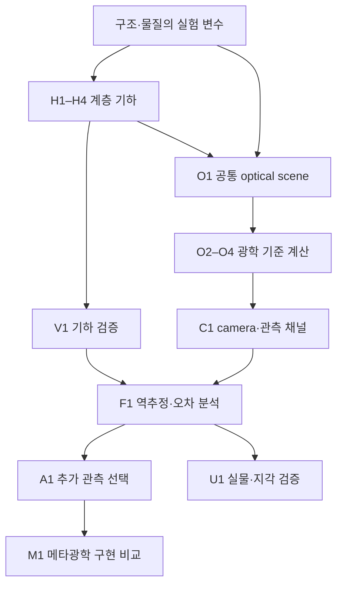

# 연구 설계: 미시구조에서 관찰 가능한 원단 외관까지

버전: 0.2.0 연구 설계. 작성일: 2026-10-11. 구현과 실제 결과는 [README](../README.md), 수식·코드의 세부 계약은 [아키텍처](ARCHITECTURE.md), 근거 문헌은 [문헌 검토](../notes/literature_engine_v2.md)에 연결한다.

## 1. 사용자가 해결하려는 문제

원래 목표는 **온라인 제품 사진을 보고 예상한 옷의 재질감과 실제 원단을 봤을 때의 차이를 줄이는 것**이다. 최종적으로는 확대했을 때의 직조, 조명을 움직였을 때의 광택, 역광의 비침, 관찰 방향에 따른 변화가 실제와 일치하는 표현을 원한다. 제품의 현재 상태를 설명하고 다른 조건에서의 외관을 예측할 수 있어야 한다.

4K 촬영은 유효한 방법이다. 공간적으로 작은 실·무늬를 분해하지 못하는 문제가 지배적이라면, 광학계와 sampling을 개선하는 것이 직접적인 해결책이다. 다만 같은 고해상도 사진도 하나의 조명·관찰 조건에서 얻은 샘플이다. 그 사진만으로 다른 방향의 하이라이트, 얇은 천의 투과, 조명 스펙트럼 변화에 대한 반응이 모두 정해지는 것은 아니다.

따라서 연구에서는 두 오차를 나누어 측정한다.

- **공간 표현 오차:** 실제 미시구조를 해상도, MTF, 픽셀 적분, noise 때문에 구별하지 못하는 정도.
- **조건 변화 예측 오차:** 한 조건에서 비슷하게 보이는 다른 구조·재료가 미관측 조명·각도·역광에서 달라지는 정도.

이 구분은 고해상도 촬영과 추가 광학 채널을 공정하게 비교하기 위한 것이다. 첫 비교군은 좋은 RGB 촬영이며, 단순히 pixel 수가 적은 약한 비교군을 이기는 것으로 연구의 가치를 판단하지 않는다.

## 2. 업데이트한 연구 목적

> **실제 섬유·원사 계층을 보존하는 forward model을 만들고, 원단 외관의 예측 오차를 일으키는 구조·광학 변수와 필요한 관측을 규명한다. 검증된 추가 관측을 효율적으로 얻는 경우에 메타광학을 설계한다.**

현재 v0.2.0의 직접 목표는 이 전체 연구의 기반인 **기하와 광학 엔진 사이의 검증 가능한 연결**이다. 가능한 미시기하를 만들고, 같은 입력이 광선·파동·렌더링에 어떤 의미로 전달되는지 명확히 했다. 합성 원단을 실측 원단처럼 보이게 만드는 inverse fitting이나 사용자 지각 개선은 아직 검증 단계에 도달하지 않았다.

현 단계의 결과를 논문 기여로 표현하려면 “metasurface를 사용한 원단 완전 재현”이 아니라, **계층적 미시구조와 광학 모델 간의 근사 오차·유효범위를 드러내는 실험 체계**로 좁혀야 한다. 기존 연구와 겹치는 단순 구성 자체를 독창성으로 주장하지 않는다.

## 3. 계층별로 무엇을 설명하는가

| 수준 | 상태 변수 | 외관과 연결될 가능성이 있는 정보 | 현재 상태 |
| --- | --- | --- | --- |
| Constituent material | 복소 굴절률, 흡수, 분산, 이방성 | 파장별 흡수·표면 반사·편광 반응 | 합성 scalar `n+iκ` 스펙트럼 |
| Fiber | 중심선, 반지름, 단면, 표면·재료 ID | 개별 산란·반사·굴절, 파동 간섭의 구조 | 원형·일정 반지름 polyline |
| Ply | fiber packing, fiber twist, migration | 섬유 방향 분포, 내부 다중 경로 | 명시적 fiber 묶음, bounded 변화 |
| Yarn | ply 수·배치·twist, envelope | 원사 수준의 방향성·차폐·공극 | 명시적 multi-ply |
| Crossing / repeat | warp/weft 순서, pitch, crimp | float 길이, 상·하층 가시성, 비침 | 직사각형 single-layer binary draft |
| Fabric patch | 반복 범위, 불균일성, 조명/시점 | 반사·투과 영상, 위치별 직조 대비 | 유한 평면 패치, 실제 path tracing |
| Garment / observation | 거시적 곡률·주름, 조명, camera/display | 제품 전체의 입체감과 사용자 판단 | 후속 계층; 기존 카메라 모형만 별도 구현 |

이 표는 물리적으로 필요한 계층과 현재의 구현 수준을 함께 보여준다. Polymer chemistry나 제조 공정을 현재 `material_id` 하나가 대신 해결하지는 않는다. Blend는 각 fiber의 재료 라벨을 보존하며, 임의 평균 굴절률을 숨겨 넣지 않는다.

실크·코튼·큐프라·린넨에 따른 외관을 다루려면 실제 단면·직경·꼬임·잔털·광학 상수와 가공 상태를 확보해야 한다. 재료명과 직조명은 다르다. 같은 섬유라도 원사 구조와 직조가 달라질 수 있고, 같은 직조라도 구성 물질과 마감이 달라질 수 있다. 현재 예제는 이 변수들을 분리해 넣을 수 있는 데이터 구조를 준비한 단계다.

## 4. 모듈화한 연구 흐름

| 모듈 | 연구 역할 | 구현 여부 / 다음 입력 |
| --- | --- | --- |
| H1 Fiber/Ply | 최소 기하 단위와 내부 배열 | 구현; 실측 단면·migration 통계는 후속 |
| H2 Yarn | multi-ply와 두 수준의 twist | 구현; 장력·압착 모델은 후속 |
| H3 Draft | 직조 위상과 반복 구조 | 구현; 3D weave blocks·knitting은 후속 |
| H4 Fabric | crossing 위치와 finite patch | 구현; 실제 거시 곡면·옷 drape는 후속 |
| V1 Geometry validation | sampling과 충돌·기하 전송 검사 | 구현; 자기접촉·힘 평형은 후속 |
| O1 OpticalScene | geometry/material/units/provenance 경계 | 구현 |
| O2 Wave reference | eligible local 평행 원통의 Maxwell 해 | 구현; full 3D Maxwell은 후속 |
| O3 Ray reference | 같은 local 원통의 incoherent transport | 구현; 약흡수 real-Fresnel 근사 명시 |
| O4 3D rendering | 명시적 fiber의 반사/투과 path tracing | 구현; spectral color 통합은 후속 |
| C1 Camera | MTF·pixel·noise와 측정 채널 | v0.1 모듈; 새 inverse task와 결합은 후속 |
| F1 Inference | 미관측 조건 외관 예측과 모호성 분석 | 후속; 현재는 forward 결과·통계 |
| A1 Measurement | 각도·파장·편광 정보의 추가 가치 | v0.1에 두 고정 모형의 이상적 검출 실험; 실제 원단 식별은 후속 |
| M1 Metaoptics | 정보 선택을 광학 소자로 구현 | 이상적 pupil baseline만 구현; 실제 소자 성능 검증은 후속 |
| U1 Validation | 실물 시편과 사람이 보는 이득 | 후속 |

이 문서의 H/O/C/F/A/M/U 번호는 연구 개발 흐름을 설명하기 위한 것이다. 이전 대화의 RGB 측정, 메타광학 측정, 교정·정합, 특성 추정, 사용자 표현이라는 목표는 그대로 유지하되, 이번 구현에서는 **측정 이전에 필요한 forward simulation**을 독립 모듈로 구체화했다.

## 5. 수학적으로 분리할 세 층

### 5.1 구조 생성

기하 변수 \(\theta_G\)를 받아 `G(θG)`가 fiber 경로·반지름·부모 라벨을 생성한다. 현재의 `G`는 C2 crossing interpolation과 local-frame sweep이다. 힘·마찰·장력으로부터 equilibrium을 구하는 모델은 아니다. 현재 생성기의 수식과 sampling 조건은 [hierarchy_design.md](../notes/hierarchy_design.md)에 있다.

가장 중요한 설계 선택은 twist를 전역 z좌표가 아니라 **각 부모 경로의 실제 호길이**에 적용하는 것이다. 같은 signed turns/mm라도 ply가 꼬여 길어지면 fiber의 누적 회전 수가 바뀐다. geometry→optics에서 이런 계층 정보를 평균내 없애지 않는다.

### 5.2 광학 forward model

물질 변수 \(\theta_M\), geometry \(G\), illumination \(L_i\)에 대한 관측 가능한 출사 광량을

\[
L_o=\mathcal T_{G,\theta_M}[L_i]
\]

로 표시할 수 있다. 이 표기는 앞으로 비교할 transport model의 공통 입출력을 뜻한다. 현재 실제 backend는 3D incoherent path tracing, local 2D coherent Maxwell, local 2D power-ray로 나뉘며, 서로의 물리량을 자동으로 동치 취급하지 않는다.

국소 파동 계산에서 얻는 길이 단위 산란 단면적, 유한 beam의 power fraction, 특정 camera의 radiance는 서로 다른 양이다. aggregate scattering model을 추가할 때는 어떤 양을 어떤 정규화로 연결했는지 식과 단위로 보여야 한다. 파동과 광선 결과를 단순히 더해 전체 에너지가 보존되는 것처럼 만드는 방식은 허용하지 않는다.

### 5.3 측정 모델과 추정 목표

미래의 radiometrically calibrated 측정에서는 기대 전자 수를 개념적으로

\[
\mu_{kc}=t\int QE_{kc}(\lambda)\frac{\lambda}{hc}
\,\mathcal H_{k,\lambda}[L_o]\,d\lambda
\]

로 둘 수 있다. \(\mathcal H\)에는 pupil, 광학 전달, pixel 면적·입체각, 검출 채널이 포함된다. \(k\)는 측정 조건, \(c\)는 채널이며, \(t\)는 노출 시간이다. 이 식 전체의 실제 장비 교정은 아직 구현되지 않았고, 기존 camera/meta 모듈은 지정된 광자 예산과 이상적 전달 모형을 다룬다.

역추정은 모든 미시 fiber를 유일하게 알아내는 것을 기본 목표로 잡지 않는다. 제한된 관측에서 **미관측 조건의 외관을 충분히 정확하게 예측하는 상태 변수 또는 분포**를 구하는 문제로 정의한다. 추정값뿐 아니라 다른 구조가 비슷한 측정을 만드는 모호성도 평가해야 한다.

## 6. 검증할 가설과 반증 조건

| 가설 | 비교할 것 | 지지하는 결과 | 반증되면 바꿀 방향 |
| --- | --- | --- | --- |
| H-A: 사진 해상도 외의 관측이 필요하다 | 고해상도 RGB와 multi-angle / R-T / spectral 추가 | 독립 원단·미관측 조건 외관 오차 감소 | RGB만으로 충분한 대상은 추가 광학 개발 범위에서 제외 |
| H-B: 미시구조를 더 세분화할 가치가 있다 | 평균 ply/yarn 모델과 explicit fiber reference | 특정 tilt·packing·광원 조건에서 오차와 원인을 설명 | coarse 모델이 충분한 영역에서는 계산을 단순화 |
| H-C: 정보 효율적 채널을 찾을 수 있다 | 균일 채널, 최적화 채널, 강한 RGB 기준 | 같은 시간·pixel·photon 예산에서 오차 감소 | 채널 최적화 대신 획득 예산이나 장비 제약을 재정의 |
| H-D: 메타광학이 구현상 이득을 준다 | 실제 metaelement와 렌즈·격자·편광자 대조군 | 전체 시스템 부피·시간·효율·정확도의 설득력 있는 개선 | 기존 광학 구현을 기준 장치로 유지 |

이 표는 앞으로의 판정 기준이다. 현재 v0.2.0이 H-A~H-D를 실측으로 입증했다는 의미는 아니다.

## 7. 다음 실험의 권장 범위

### 단계 A — 같은 구조에서 근사의 유효범위를 찾는다

먼저 원형 scalar dielectric fiber를 유지하고, radius, packing, fiber/ply twist, illumination angular width를 바꾼다. Geometry perturbation, 광원 평균, 편광을 한 번에 섞지 않고 각 축을 분리한다. 기준 geometry와 material은 모두 저장하고, 단순화한 모델이 동일한 입력으로 무엇을 보존하는지 기록한다.

관심 값은 파장·각도별 산란 분포, backward/forward power, 흡수, 하이라이트 폭과 위치, 직조 대비다. Coherent wave와 incoherent ray 비교에서는 forward interference와 직접광의 정의를 먼저 고정한다. 작은 에너지 residual만으로 multipole truncation이나 angular sampling 수렴이 충분하다고 결론내리지 않는다.

현재 7-fiber calibration, strict/local slice 진단, 기존 geometry-matched wave/ray 계산이 이 단계의 출발점이다. 2D reduction에서 탈락하는 twisted yarn은 geometry를 조용히 평평하게 만드는 대신, 어느 tilt/curvature 범위에서 근사 kernel을 검증해야 하는지 알려주는 사례로 사용한다.

### 단계 B — 실제 원단의 소규모 기준 데이터를 만든다

섬유·원사 종류를 좁힌 패치부터 시작한다. 교정된 확대 RGB, 조명 방향별 반사, 역광·투과, 필요한 경우 분광 데이터를 확보한다. 픽셀당 실제 길이, illumination 위치/크기/스펙트럼, 노출·white balance·카메라 응답을 기록한다. 알려진 데이터 범위 안에서 먼저 geometry와 optical fitting을 나누어 평가한다.

학습/추정용 패치와 평가용 패치는 실물 원단 단위로 분리한다. 같은 원단의 인접 패치가 양쪽에 섞여 원단 일반화처럼 보이지 않게 한다. 측정에 사용하지 않은 광원 방향·관찰각·파장 조건을 평가에 남긴다.

### 단계 C — 측정과 metaelement를 공동 설계한다

각도·파장·편광 중 어떤 정보가 남은 오차를 줄였는지 분리한다. 여러 채널을 추가해 좋아졌다는 결과만으로 각 채널의 필요성을 판단하지 않는다. 센서 pixel 수, 노출/입사광량, 수집 효율, scan 횟수를 포함한 acquisition budget을 맞춘다.

메타표면은 필요한 채널이 확인된 뒤 그 관측 연산자를 구현하는 후보로 둔다. 실제 효율, stray light, wavelength/angle crosstalk, 제작 오차, relay와 mount까지 포함해 기존 광학과 비교한다. 현재 `meta_optics.py`의 이상적 pupil과 가정 효율은 이 장비 비교를 대신하지 못한다.

VIS는 보여줄 외관을 직접 검증하는 기준 대역으로 둔다. IR은 보유 공정·검출기와 맞는 장점이 있지만, 추가 파장 측정이 어떤 불확실성을 줄이는지 먼저 확인한다. IR로 구분되는 물질 특성이 VIS의 광택·색이나 사람이 느끼는 모든 촉감으로 자동 연결된다고 가정하지 않는다.

### 단계 D — 사용자에게 전달되는 이득을 평가한다

새 측정의 결과와 baseline을 같은 display·노출·interaction 방식으로 보여준다. 조명을 회전시키는 짧은 영상, front/backlight 전환, 확대 scale 표시처럼 실제 검증할 단서를 일관되게 제공한다. 하이라이트/비침 판단 또는 실물 시편 매칭이 개선되는지 본다.

촉감은 별도 property를 정한 후 확장한다. 굽힘·압축·마찰·접촉 냉감은 서로 다른 기준 측정과 모델이 필요하다. 현재의 optical pipeline에서 “보송하게 보인다”는 평가가 모든 촉각 물성을 예측한다는 뜻이 되지 않도록 한다.

## 8. v0.2.0에서 확인한 것과 아직 주장할 수 없는 것

현재 확인한 것은 명시적 multi-ply 생성, bounded irregularity, continuous different-fiber clearance, sampling refinement, ID·단위·material 보존, eligible slice의 실제 Maxwell/ray 실행, 3D multi-material path tracing이다. 구체적 5-case 수치, 98-fiber export, 독립 similarity 검사는 [README](../README.md)와 [리뷰](../notes/review_engine_v2.md)에 기록되어 있다.

현재 주장할 수 없는 것은 실제 원단의 완전 재현, 실물 material 식별 정확도, 방적/제직 공정 예측, metaelement의 필요성과 성능 우위, 사람의 촉감 예측이다. 이것들은 명시적인 입력·비교군·held-out 조건·판정 metric이 있는 다음 단계의 연구 질문으로 남겼다.

## 9. 실험 기록 규칙

각 결과는 다음 항목을 함께 남긴다.

1. 소스 commit/tag와 실행 환경.
2. `FabricSpec`, 재료 spectrum의 source/status, illumination·camera 조건.
3. 입력/출력 hash, seed, 실제 채택된 sampling, solver truncation·quadrature·ray/spp budget.
4. 에너지·수렴·기하 유효성 결과와 실패한 경우의 diagnostics.
5. 정량 비교용 선형 배열 및 표시용 그림.
6. 비교군과 통제한 변수, 새로 바꾼 변수, 아직 검증하지 않은 외삽 조건.

실험 설계를 바꾸었으면 이전 결과를 같은 이름의 성과로 이어 붙이지 않는다. 버전별 입력과 source를 함께 보존하고, 변경 이유를 [작업 로그](WORK_LOG.md)에 남긴다.
