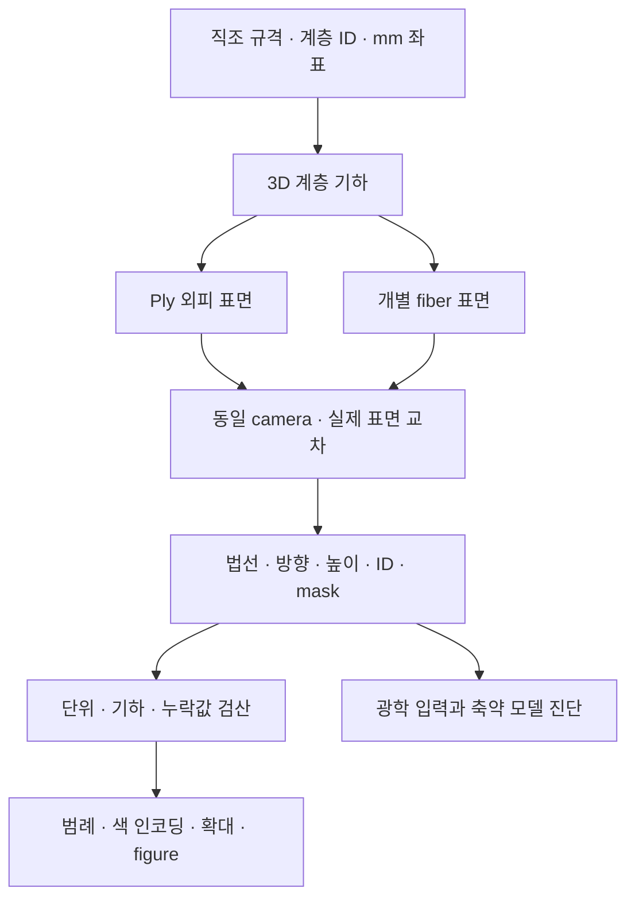

# 직물 구조맵과 논문용 figure의 설계

## 목적

사용자가 첨부한 FabricGen Figure 5처럼 **같은 직물 구조의 normal·orientation·height를 나란히 보여주고, 그 그림을 원시 3D 데이터에서 다시 생성할 수 있게 한다.** 실크나 코튼의 색을 임의로 정하는 작업이 아니라, 우리 엔진이 실제로 생성한 표면과 방향을 검토하는 모듈이다. 색 범례, 실제 길이 단위, 계층별 차이, 원시 배열과 출처를 함께 제공한다.

이 모듈은 연구의 순방향 엔진과 광학 입력 사이에 놓인다. Fiber–ply–yarn–weave 계층이 의도한 대로 생성됐는지 확인하고, 광학 모델의 표면 법선·방향·차폐 입력을 검토하는 데 쓴다. 구조맵의 색은 실제 제품 색 또는 측정한 반사율이 아니다.

## 참고 그림에서 가져온 정의

FabricGen §3의 식 (1)은 UV 위치에 대해 surface normal, tangent/orientation, relative height를 정의한다. §5.1과 Figure 5는 curved-helix ply에서 얻은 미세 구조를 보여준다. 논문의 fiber orientation은 ply orientation을 normal 주변으로 twist angle ψ만큼 회전한 값이다. [원문 §3·§5.1·Figure 5](https://arxiv.org/html/2603.07240v1), [사용자 첨부 원본](../references/user_provided/fabricgen_figure5_reference.png).

우리 모듈은 저장된 **명시적 3D 표면의 첫 광선 교차점**에서 데이터를 읽는다. Orientation은 해당 표면을 만든 ply 또는 fiber 중심선의 방향이다. 이 값을 논문의 ψ 회전으로 정의한 fiber tangent와 같은 것으로 표시하지 않는다. 색 인코딩과 height의 기준도 아래에 직접 선언한다. 논문과 같은 세 가지 데이터의 표현 형식이며, Figure 5의 설정·픽셀·전체 생성 방법을 그대로 재현했다는 주장은 하지 않는다.

## 데이터 흐름

## 두 표면 수준

**Ply 외피**는 여러 fiber가 차지하는 영역을 매끈한 관으로 대표한다. 각 ply의 위치·꼬임·직조 상하 관계를 보기 좋게 확인할 수 있지만 내부 공극을 채운 기하적 대체물이다. 이 외피의 반사·투과를 실제 다공성 fiber 집합의 결과로 해석하지 않는다.

**Explicit fiber 표면**은 실제로 생성된 각 fiber의 중심선·반지름과 ID를 보존한다. 가는 섬유 사이의 공극과 서로 가리는 관계가 드러난다. 현재의 원형 단면·표면 표본화·선택한 합성 설계라는 모델 범위는 그대로 적용된다. 실제 원단의 단면·접촉·잔털을 측정한 결과는 아니다.

같은 시점·물리적 crop·높이 범위를 사용해 두 수준을 나란히 보여준다. 기존 검증용 basket의 간격은 유지하고, 촘촘한 시각화 예제는 별도 규격과 파일로 기록한다. 원래 검증 시편의 물리 치수를 화면에서만 바꿔 숨기지 않는다.

## 수학과 표시 계약

### Normal

단위 표면 법선 n=(nx,ny,nz)의 진단 색은 각 성분을 선형 변환한

`RGB = 0.5 * (n + 1)`

이다. 좌표는 world frame의 X/Y/Z이며 Z는 고정된 세계좌표의 높이 축이다. +Z와 개별 삼각형의 바깥쪽 법선은 같은 의미가 아니며, 구현은 geometric normal을 카메라 방향으로 뒤집지 않는다. 색 자체는 데이터 인코딩이다. 조명·재질에 의한 명암이나 제품의 실제 색을 곱하지 않는다. 실제 triangle의 geometric normal을 기준값으로 남기고, 보간된 smooth normal을 표시할 경우 별도 필드·표시 이름을 사용한다. 작은 silhouette 픽셀의 혼합 색을 단일 실제 표면 법선으로 해석하지 않는다.

### Orientation

원시 3D 단위 방향 t는 보존한다. 화면의 무방향 축은

`theta = atan2(ty, tx) mod pi`

로 표시한다. Fiber의 축은 t와 −t가 같은 방향을 뜻하므로 0°와 180°가 이어지는 색 범례와 화살촉 없는 선분을 사용한다. XY 투영이 거의 0인 곳에서는 방위각이 정의되지 않으므로 방향 표시를 제외해야 한다. 2D 그림은 out-of-plane tilt를 모두 표현하지 못하므로 원시 3D 벡터를 광학 입력으로 유지한다.

중심선 방향은 일반적인 curved/tapered surface에서 법선과 정확히 직교하지 않을 수 있다. Surface BSDF에서 접평면 방향이 필요하면

`t_parallel = normalize(t - n * dot(n, t))`

를 별도로 구하고, 투영 길이가 0인 경우를 처리해야 한다. Cap에서 중심선 방향과 normal이 평행한 경우도 구분한다. 중심선 tangent와 투영한 surface tangent를 같은 배열 이름으로 덮어쓰지 않는다.

### Height

Height는 **가시 표면 교차점의 world Z 좌표**를 사용한다. 원시 단위는 mm이고 그림은 µm로 바꾼다. 카메라에서 표면까지의 depth와 원단 기준면에서의 높이는 서로 다른 값이다. 패널마다 자동으로 0–1 재정규화하지 않고, 비교하는 표면 수준에는 공통 높이 범위를 쓴다. 배경은 유효 mask로 구분하며, 표면이 없다는 의미를 높이 0으로 대체하지 않는다.

### ID, mask, coverage

Fiber·ply·yarn·material의 정수 ID를 보존한다. 두 물체가 겹친 pixel은 카메라에 가까운 가시 표면에 대응한다. Material ID는 범주형이며 주변 ID를 평균내 새 재료 번호를 만들지 않는다.

Pixel 중심의 교차점 데이터와 여러 subpixel 광선으로 얻은 coverage를 분리한다. Figure의 가장자리는 subpixel별 인코딩 색을 합성해 부드럽게 만들 수 있지만, 그 색 평균을 다시 물리량 한 개로 역변환한 것을 ground truth로 사용하지 않는다. Raw 배열의 invalid mask와 figure 배경색은 각각 기록한다.

## Figure 구성 원칙

1. **원문과 같은 세 패널:** normal, 무방향 orientation, height. 모든 패널은 같은 영역을 본다.
2. **계층 비교:** ply 외피와 개별 fiber를 같은 조건에 두어 공극·표면 방향의 생략 효과를 보여준다.
3. **확대와 범례:** 확대할 영역은 원래 그림에 표시하고, 길이 scale bar·높이 범위·방향 색상 범례를 붙인다.
4. **출판 파일:** PNG는 바로 보기, PDF/SVG는 글자·축·범례의 벡터 보존에 사용한다. 지도 자체는 샘플링된 raster이며 SVG로 저장했다고 원래 데이터 해상도가 증가하는 것은 아니다.
5. **정량 자료와 구분:** map의 표시 해상도와 v0.5 radiance 실험의 64×64·64 spp를 혼동하지 않는다. 이 모듈의 표면 교차 질의는 새로운 반사·투과 radiance 실험 횟수로 세지 않는다.

## 검증과 재현

알려진 법선·높이를 가진 평면, 원기둥 방향, 앞뒤 표면의 차폐, 저장·재로드를 검사한다. 실제 산출물에서는 normal/tangent 단위 길이, hit mask·finite 값, ID 범위, 카메라 좌표와 hit 위치, 동일 crop·height range를 확인한다. Producer와 분리된 검산에서는 파일 해시뿐 아니라 배열의 의미도 대조한다.

실행 규격, source geometry와 생성 스크립트의 hash, camera·해상도·표면 분할, 색 변환·height 범위, 원시 배열과 output ledger를 함께 남긴다. 이후 새로운 원단·조명·시점의 연구 그림에도 같은 표시 계약을 적용할 수 있다.

## 원래 연구와의 연결

Normal map은 경계 반사·굴절의 방향을, orientation map은 섬유의 방향성 산란 입력을, height와 mask는 차폐·공극 구조를 검토하는 데 도움을 준다. 다만 위에서 내려다본 첫 표면의 세 맵만으로 두께·뒷면·내부 다중 경로·분광 물성·파동 간섭을 모두 표현할 수는 없다. 전체 반사·투과 시뮬레이션에는 원래 3D 구조와 재료·광원·검출 모델을 함께 사용한다.

이 figure 모듈의 성과는 **시뮬레이터가 만든 구조를 데이터로 검사하고 논문 형식으로 전달할 수 있는 것**이다. 사용자에게 제품의 실제 느낌을 더 정확하게 전달했는지는 원단 측정, 새로운 조명·시점의 검증, 강한 RGB 비교군과 사용자 평가로 따로 판단한다.
