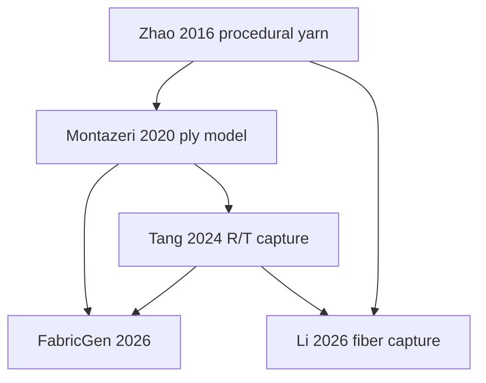

# Literature and design audit for the hierarchy engine, v2

Review date: 2026-10-11. Dyeing, fading, tactile prediction, inverse material identification, and metasurface fabrication are deferred. This note records a **scoped citation graph**, not an exhaustive review of textile research. Links are to primary papers, author/project pages, or official source repositories. A paper being discussed does not mean its code was executed or its results were reproduced.

## 1. Research purpose and present implementation boundary

The research objective remains to reduce the difference between a product image and the appearance of the actual fabric under different illumination and viewing directions. The useful intermediate object is a traceable microstructure model: geometry and material assignments whose optical consequences can be measured, simulated, compared, and eventually inferred from observations.

The engine therefore keeps separate records for **fiber, ply, yarn, weave draft, finite fabric patch, and optical scene**. A plain weave describes crossing order; it does not by itself determine the fibers, contact forces, cross-sectional deformation, scattering law, or dye absorption. Likewise, labels such as cotton or silk are not complete numerical optical models. Constituent labels and the source/status of each optical spectrum must remain explicit.

The v2 implementation is a deterministic, explicit, geometric reference model with audited adapters. It is not a reproduction of FabricGen's learned generator, Weavecraft's mechanics, TexGen's engineering feature set, or the complete Yu et al. ray–wave shader. The intended progression is:

1. Define and validate controlled microgeometry.
2. Preserve exactly what is represented when transferring it to each optical solver.
3. Quantify the approximation introduced by each transfer or aggregation.
4. Compare appearance predictions and measurement designs using the same geometry, material assumptions, and budgets.

This order makes a later metasurface question concrete: which additional angular, spectral, or polarization channels resolve an observed ambiguity left by a strong RGB baseline? The present code prepares the forward model and provenance needed for that experiment; it does not establish that a metasurface is necessary.

## 2. Reading and source-audit status

| Source | What was actually inspected | Status in this repository |
| --- | --- | --- |
| **FabricGen**, Tang et al., CVPR 2026 | All 10 pages of the user-attached paper; procedural geometry/rendering sections of the official supplementary; project and dataset links | Design reference. No LLM, diffusion training, dataset download, or author implementation executed |
| **Woven Fabric Capture with a Reflection-Transmission Photo Pair**, Tang et al., SIGGRAPH 2024 | All 13 pages of attached arXiv v3, including supplementary; official repository metadata/README; optical collaborator inspected the implementation at a pinned commit | Reference and source audit. ASGGX, inverse fitting, and the neural initializer are not implemented in this bridge |
| **A Practical Ply-Based Appearance Model**, Montazeri et al., 2020 | Primary paper introduction and geometry/representation sections 3.1–3.3 | Mathematical and architectural reference; not a full method reproduction |
| **Neural inverse procedural modeling of knitting yarns from images**, Trunz et al., arXiv 2023 | Primary paper introduction/related work and procedural generation sections 3.1–3.3 | Recursive-frame/migration/flyaway reference; no inverse network or Blender pipeline executed |
| **Fiber-level Woven Fabric Capture**, Li et al. | Primary arXiv introduction, related work and reconstruction model; current author publication page | Forward citation and inverse-model scope reference; no reconstruction pipeline executed |
| **A Multi-scale Yarn Appearance Model with Fiber Details**, Khattar et al. | Primary preprint introduction and multi-scale representation discussion; publisher metadata | Future aggregation/LOD reference; not an implemented backend |
| **Weavecraft**, Wu et al., 2020 | Primary project/author descriptions and indexed paper description | Full PDF could not be read through the available reader because of its size. No claim of a full-paper review or source reproduction |
| **Fitting Procedural Yarn Models**, Zhao et al., 2016 | Primary CT-cloth project, author publication page, code/data link, and its role in later primary papers | Full PDF exceeded the available reader size; code/data archive was not downloaded or license-audited. No claim that its fitted stochastic model is reproduced |
| **TexGen** | Official project metadata, README citations, source directory, `Core/Yarn.h` and the weave interface | Architecture/license audit only; TexGen was not imported, compiled, or vendored |
| Other papers below | Explicitly identified as project/metadata or selected-section review | Citation-graph context, not evidence of implementation equivalence |

The FabricGen attachment is the CVPR paper, not the 15-page online supplementary. The Tang attachment is arXiv v3 dated July 8, 2024. Both attached PDFs were read from the supplied files; model pages were also visually checked to resolve equation layout.

## 3. Citation graph that matters for this engine

Solid arrows below mean a citation relationship checked in the reviewed primary text. The engineering-design branch is conceptually related and is not asserted to be a complete citation genealogy.

Two related design lines should be kept visible alongside this appearance graph: **TexGen/Weavecraft/periodic yarn mechanics** for topology, engineering geometry and deformation, and **on-the-fly fiber rendering/multi-scale yarn shading** for scalable optical evaluation. The current work connects their data requirements without claiming to implement all of their algorithms.

## 4. Lessons from the two attached papers

### 4.1 FabricGen: an implicit appearance representation

FabricGen separates macro-scale albedo generation from procedural woven microstructure. Its main geometric query is a UV-domain field

\[
F=\{n(p),t(p),h(p)\},\qquad p=(x,y),
\]

where the returned normal, tangent and height describe yarn/ply appearance. The paper's implicit ply helix uses \(\phi(u)=\phi_0+uR\alpha\), with \(u\) an arc parameter and \(R\) a curvature radius. Its coordinate sliding is a Perlin-driven query warp. The supplementary represents flyaway appearance as an additional stochastic orientation layer and uses a diffuse approximation plus height-based occlusion for part of the transport. These are rendering choices, not a mechanical fiber contact solution. [Paper/project](https://lxtyin.ac.cn/projects/fabricgen/), [supplementary](https://lxtyin.ac.cn/projects/fabricgen/static/pdfs/CVPR26_FabricGen_suppl_revised.pdf).

**Adopt here:** separate draft semantics, geometry, macro color and scattering; expose deterministic geometry parameters; preserve anisotropic tangents; provide an eventual aggregate representation that can be compared to an explicit reference.

**Do not infer:** an LLM-generated draft certifies loom feasibility; UV warping moves actual fibers in equilibrium; a stochastic flyaway layer gives the positions of individual hairs; or the proposed explicit hierarchy is FabricGen's original implementation.

FabricGen trains a weave-language component on 1,142 drafts and a macro-texture component on 600 selected images. These training systems and their assets are not required for a controlled forward simulator. Current v2 arbitrary binary drafts are user-specified and validated deterministically; learned generation remains a possible client of the draft API.

### 4.2 Tang 2024: reflection and transmission need distinct information

The attached paper models both physical yarn layers at each surface location. Its surface model separates single scattering, approximate multiple scattering, and diffuse reflection/transmission contributions:

\[
f=f_s+f_m+f_d^{r,t}.
\]

The ASGGX term summarizes multiple scattering. The straight-through gap contribution is a directional delta and is not a broad scattering lobe. The paper's effective-thickness modulation

\[
T_{\rm eff}=T\,[S_{\min}+(1-\mu)(1-S_{\min})]
\]

uses an empirical compression coordinate and pattern-dependent constants; this is not a measurement of mechanical tension or thickness in millimeters. Its Gaussian filtering of a photograph accounts for its capture setup and is not an electromagnetic diffraction calculation. [Paper](https://arxiv.org/abs/2406.19398), [official code](https://github.com/lxtyin/FabricBTDF-Recovery).

The useful finding for this project is that front appearance alone can leave bottom-layer and transmission behavior poorly constrained. The bridge consequently retains both yarn families, individual materials and explicit gap geometry. It does not turn an orientation tensor into an ASGGX fit or equate a geometric path length with a fitted optical depth.

The original method also uses a neural initializer and an iterative inverse fit. None is part of the present bridge. Its limitations concerning flyaways, yarn variation/sliding and unseen patterns are reasons to keep those variables explicit in test scenes, not evidence that the new geometric model has already solved real-fabric capture.

## 5. Hierarchical geometry contract and mathematics

### 5.1 Draft topology is a separate layer

Let \(W_{ij}\in\{0,1\}\) describe weft pick \(i\) crossing warp end \(j\); one means warp above weft. A rectangular repeat, negative-index periodic lookup, maximal cyclic floats and unbound yarns are handled before drawing fibers. Exchanging families requires \(W'=1-W^T\), rather than transposition alone.

A binary lift plan can be factored by grouping identical columns. This constructs an exact threading/lift-plan representation; it does not optimize a treadle tie-up or establish finite-thickness/manufacturing feasibility. Weavecraft's multi-layer blocks require richer ordering and connectivity than a single binary crossing table. [Weavecraft author page](https://www.antequ.net/), [project](https://www.cs.cornell.edu/projects/weavecraft/).

### 5.2 Yarn paths and contact assumptions

For a planar yarn, a useful form is

\[
C_i(s)=s\hat t_i+o_i\hat b_i+h_i(s)\hat z.
\]

Montazeri et al. use periodic centerline optimization with slope and crossing penalties. Their discussion identifies a practical issue: correct over/under order can still produce the wrong slope distribution and hence the wrong highlights. [Primary paper, §3.1](https://projects.shuangz.com/practical_cloth-sa20/practical_cloth-sa20-ld.pdf).

The present engine chooses a simpler, auditable construction. Between crossing heights \(h_0,h_1\),

\[
h(u)=h_0+(h_1-h_0)(10u^3-15u^4+6u^5),\quad u\in[0,1].
\]

This interpolation is monotone between its endpoint heights and has zero first and second derivatives at both endpoints. It supplies a prescribed \(C^2\) path, not an elastic equilibrium. Lateral waviness uses an independently parameterized compact \(C^2\) bump that vanishes at crossings, retaining the draft's anchor positions.

Reference-section separation is only a precheck. Bent/twisted tubes at different arclengths can intersect despite safe equal-section offsets, so the actual generated polyline segments require a global capsule clearance audit. Current audit scope is explicitly different-fiber separation; self-contact and deformation mechanics require additional methods.

### 5.3 Recursive local-frame sweeps

A child curve is generated in a rotation-minimizing frame of its parent:

\[
c(s)=C(s)+q_1(s)n_1(s)+q_2(s)n_2(s),\qquad
n_2=\hat t\times n_1.
\]

For a fixed offset \(q_0\) with radial displacement \(\delta r(s)\), its local coordinates are

\[
q(s)=R\!\left(2\pi\tau\ell(s)+\phi\right)
\left(1+\frac{\delta r(s)}{\|q_0\|}\right)q_0.
\]

Here \(\tau\) is signed turns **per millimeter of the parent curve's measured arclength** \(\ell\). Ply twist is measured along the yarn; fiber twist is measured along its own ply. Positive twist is a right-handed rotation about the forward tangent. A central fiber has no radial migration direction.

The local-frame recursion is consistent with the procedural hierarchy discussed by Trunz et al.; their method also distinguishes procedural construction from simulating the physical twisting process. The present implementation independently uses transported frames and explicit unit/handedness rules. [Primary paper, §3](https://arxiv.org/html/2303.00154v1).

Sampling is part of the model: parent twist/migration phase steps, fiber segment lengths and changes of tangent are bounded and reported. A stand-alone yarn built on caller-supplied samples cannot promise that those samples resolve a rapid twist. A periodic weave draft does not make all nested fiber phases periodic; v2 exports a finite padded patch and explicitly reports that the complete microgeometry is not certified tileable.

### 5.4 Migration and flyaway scope

The independent migration family used here is

\[
r_i(s)=r_{i0}+A_i\cos\!\left(2\pi\ell(s)/P_i+\phi_i\right),
\qquad 0\le A_i<r_{i0}.
\]

This supplies controlled radial variation with deterministic phases. It is not a CT-fitted model of radial population exchange. A sufficient equal-section separation bound is

\[
\|q_i-q_j\|-A_i-A_j-B_i-B_j-a_i-a_j>0,
\]

where \(a_i\) is fiber radius and \(B_i\) bounds any additional loop excursion. Global curve clearance still has to be checked. The bound is deliberately conservative and can reject geometries that would be valid for particular correlated phases.

An optional loop is a compact outward displacement of an existing curve, with shape \(64u^3(1-u)^3\) on \([0,1]\). It does not duplicate a fiber object. Nevertheless, it changes centerline length and represented cylinder volume: it is not a mass-conserving rearrangement, staple breakage model, or measured hairiness distribution. The richer regular/loop/hair distinctions and CT fitting in Zhao et al. provide the future calibration target. [Primary project and code/data link](https://www.cs.cornell.edu/projects/ctcloth/).

### 5.5 Cross-sections and blends

TexGen demonstrates the value of a separate section policy, interpolation policy, repeat representation and master/slave geometry hierarchy. Its interface also supports cross-section families beyond circles. [Official repository](https://github.com/louisepb/TexGen).

Current v2 explicit fibers are circular and constant-radius. This limitation is enforced at supported optical adapters. A flattened arrangement of circular fibers is different from flattening each fiber's cross-section. A blend retains material IDs per fiber; no composition-weighted refractive index is silently assigned. Elliptical/irregular cross-sections, birefringence, realistic cotton convolution and measured silk/cupra spectra need their own representation and validation before claiming material-specific predictive accuracy.

## 6. Optical integration contract

### 6.1 Provenance and unit conversion

The versioned optical scene stores fiber IDs and parents, actual curve basis, circular radius, geometry units in mm, vacuum wavelengths in nm, a background refractive index and per-material passive scalar spectra. Source and data status distinguish synthetic constants from measured or literature values.

For the \(\exp(-i\omega t)\) convention and \(n+i\kappa\),

\[
\mu_a(\lambda)=\frac{4\pi\kappa(\lambda)}{\lambda},
\qquad I(L)=I(0)e^{-\mu_aL}.
\]

The wavelength and path-length units must agree. The current ray adapter uses real-index Fresnel coefficients plus Beer absorption and rejects absorption outside its declared weak-absorption threshold. The wave adapter supplies the host-medium wavelength and relative complex index. These two adapters therefore share material data while exposing their different physics.

### 6.2 Geometry transfer and 2D validity

The Mitsuba hair adapter uses separate groups for each material/radius pair and an explicitly chosen displacement tolerance when replacing an interpolating polyline by cubic B-spline control data. Its centerline error bound alone is not a tube-contact certificate; the experiment combines it with source clearance and control/radius float32 quantization bounds to assess the exported geometry. Radius-normalized absorption in the inspected Mitsuba hair shader is mapped as \(\sigma_{a,\rm shader}=\mu_a a\); simply inserting a coefficient in inverse millimeters would be incorrect. The existing source audit is retained in this repository's render notes and reference notice.

A cross-section of a straight circular fiber tilted by angle \(\beta\) from the slice normal is elliptical, with semiaxes \(a\) and \(a/|\cos\beta|\). The exact 2D circular-cylinder solver therefore accepts a strict parallel local bundle or an explicitly labeled approximate local reduction, with diagnostic tilt, curvature and support checks. A failed fiber must not be silently omitted to create an apparently valid bundle.

Neither adapter establishes global 3D wave propagation through a woven patch. Yu et al.'s ray–wave framework motivates preserving a geometry-matched route between ray ensemble behavior and wave-sensitive structure, but the earlier restricted 2D wave, ray and aperture modules do not reproduce that complete shader. [User-specified paper/project](https://blaire9989.github.io/assets/3_RayWaveFabric/project.html).

### 6.3 Aggregation is an explicit future model

The bridge reports descriptive tangent moments,

\[
Q_L=\frac{\sum_j L_jt_jt_j^T}{\sum_jL_j},\qquad
Q_V=\frac{\sum_j\pi a_j^2L_jt_jt_j^T}{\sum_j\pi a_j^2L_j},
\]

and the unoccluded lateral-cylinder projected-area sum

\[
A_{\rm lateral}(\omega)=\sum_j2a_jL_j\sqrt{1-(t_j\cdot\omega)^2}.
\]

These are exact statistics of the represented straight segments. They are not the projected union area, opacity, extinction coefficient, SGGX matrix, BSDF or BTF. Joints, occlusion, spatial correlations and multiple scattering are not included in this sum. The geometric tensor alone cannot predict the different optical effects of the same fiber arrangement with different absorption or surface roughness.

Montazeri's ply model, Zhu's hierarchical shader and Khattar's multi-scale yarn model offer candidate aggregate backends. Their approximations should be fit and assessed against a shared explicit-fiber reference before being promoted to the primary prediction engine. [Montazeri project](https://shuangz.com/projects/practical_cloth-sa20/), [Zhu official project](https://research.nvidia.com/labs/rtr/publication/weidlich2023hierarchical/), [Khattar preprint](https://arxiv.org/html/2401.12724v1).

## 7. Source and license audit

The table distinguishes verified code from a project page or an unexamined download. License findings are provenance for reuse decisions; this work independently implements its mathematical geometry/bridge and does not vendor these sources.

| Work | Verified official code/data route | License/status checked | Action here |
| --- | --- | --- | --- |
| Tang 2024 | [lxtyin/FabricBTDF-Recovery](https://github.com/lxtyin/FabricBTDF-Recovery) | GPL-3.0 repository; optical source review pinned to `67150eeca9f28b85f8fe21d40d888d34bd4d3b25` | Inspect equations/implementation; no ASGGX code copied |
| FabricGen 2026 | [Official project](https://lxtyin.ac.cn/projects/fabricgen/), [dataset](https://huggingface.co/datasets/llxtyin/FabricGen-CVPR26) | Project exposes paper/supplement/dataset/video; no method-code link verified in checked official routes | Link only; no dataset or weights imported. Website-template GitHub is not the method source |
| TexGen | [louisepb/TexGen](https://github.com/louisepb/TexGen) | Repository metadata GPL-2.0; inspected source headers GPL-2.0-or-later | Independent interface design; no copying/importing/building |
| Weavecraft | [Cornell](https://www.cs.cornell.edu/projects/weavecraft/), [author](https://www.antequ.net/) | No official method repository/license verified | Link and scope comparison only |
| Zhao 2016 | [Author-linked code/data ZIP](https://projects.shuangz.com/procyarn-sg16/code_data_v2.zip) | Archive availability linked by author; contents/license not inspected | No reuse or archive committed |
| Leaf 2018 | [Official project/pattern data](https://graphics.stanford.edu/projects/yarnsim/) | Project offers pattern/control-point data; no algorithm source license verified | No files imported |
| Trunz procedural yarn inverse model | [Primary preprint](https://arxiv.org/abs/2303.00154) | No official method repository verified in the checked routes | Independently implement local-frame geometry concepts |
| Li fiber capture | [Author project](https://www.rendering-zixuan.com/paper_pages/FiberFabric/) | Paper/arXiv/DOI links verified; no method repository verified | Literature reference only |
| Yu ray–wave | [Author project](https://blaire9989.github.io/assets/3_RayWaveFabric/project.html) | No public method source verified in checked official links | Restricted independent reference modules, with explicit reproduction limits |

The repository called `eddie1101/Weavecraft` was inspected through the GitHub connector and describes a Minecraft mod. It is unrelated and must not be treated as the paper's code. The textile-engineering TexGen repository is likewise distinct from newer machine-learning texture projects with the same name.

Only the user's supplied paper attachments may be archived by the parent project. This review adds links and independently written notes, not third-party paper PDFs, unexamined ZIPs, weights or datasets. Existing vendored renderer reference files retain their own notice; this note does not change those terms.

## 8. Additions relative to the v1 baseline

| Concern | v1 baseline in this workspace | v2 direction implemented or prepared |
| --- | --- | --- |
| Topology | Three named square weave patterns | Validated rectangular binary drafts, configurable families, cyclic float diagnostics, lift-plan round trip |
| Fiber hierarchy | Shared procedural configuration and positional arrays | Explicit fiber/ply/yarn records and stable parent/material IDs |
| Crossings | Prescribed cubic smoothstep crimp | Prescribed quintic `C2` crimp, independent warp/weft pitch and crimp allocation |
| Irregularity | Small geometric jitter | Bounded radial migration and optional existing-fiber loop excursions with declared scope |
| Sampling | User resolution/convergence checks | Reported segment, turn and parent-phase refinement gates for fabric generation |
| Geometry basis | B-spline controls used by the renderer | Polyline reference distinguished from B-spline export, with a smoothing budget |
| Material mapping | Shared renderer parameters | Per-fiber spectra and material/radius-specific shader groups |
| Wave/ray input | Hand-built cross-sectional test bundles | Scene-hashed local slices with strict circular/parallel validity diagnostics |
| Aggregation | Geometry/render outputs | Length/volume tangent moments and explicitly unoccluded area statistics, not an asserted BSDF |
| Provenance | Configuration/experiment outputs | Versioned hierarchy and optical-scene schemas, numerical hashes and source/status labels |

Actual correctness findings and executed tests are recorded separately in `review_engine_v2.md`. A feature in this table is not a claim of measured-fabric validation.

## 9. Primary bibliography and reading depth

1. **Tang, Y.; Luo, D.; Wang, Z.; Ling, X.; Yang, J.; Wang, B.** *FabricGen: Microstructure-Aware Woven Fabric Generation.* CVPR 2026, pp. 34333–34342. [Author project](https://lxtyin.ac.cn/projects/fabricgen/); [arXiv:2603.07240](https://arxiv.org/abs/2603.07240). **Attached main paper fully read; selected supplementary sections read.**
2. **Tang, Y.; Li, Z.; Hašan, M.; Yang, J.; Wang, B.** *Woven Fabric Capture with a Reflection-Transmission Photo Pair.* SIGGRAPH 2024 Conference Papers. [DOI 10.1145/3641519.3657410](https://doi.org/10.1145/3641519.3657410); [arXiv:2406.19398v3](https://arxiv.org/abs/2406.19398v3). **Attached main and supplementary fully read.**
3. **Wu, R.; Zhang, J. X.; Leaf, J.; Hua, X.; Qu, A.; Harvey, C.; Holtzman, E.; Ko, J.; Hagan, B.; James, D.; Guimbretière, F.; Marschner, S.** *Weavecraft: An Interactive Design and Simulation Tool for 3D Weaving.* ACM TOG 39(6), Article 210, 2020. [DOI 10.1145/3414685.3417865](https://doi.org/10.1145/3414685.3417865); [author publication](https://graphics.stanford.edu/~djames/publication/weavecraft-an-interactive-design-and-simulation-tool-for-3d-weaving/). **Primary project descriptions; full PDF access limited.**
4. **Brown, L. P.; Long, A. C.** *Modelling the geometry of textile reinforcements for composites: TexGen.* 2021. [DOI 10.1016/B978-0-12-819005-0.00008-3](https://doi.org/10.1016/B978-0-12-819005-0.00008-3). Earlier software paper: **Lin, H.; Brown, L. P.; Long, A. C.**, *Modelling and Simulating Textile Structures using TexGen*, Advanced Materials Research 331, 44–47, 2011. [Official README/source](https://github.com/louisepb/TexGen); [software release DOI](https://doi.org/10.5281/zenodo.8221491). **Official software citations and source interfaces inspected; chapters not fully read.**
5. **Zhao, S.; Luan, F.; Bala, K.** *Fitting Procedural Yarn Models for Realistic Cloth Rendering.* ACM TOG 35(4), Article 51, 2016. [DOI 10.1145/2897824.2925932](https://doi.org/10.1145/2897824.2925932); [CT cloth project](https://www.cs.cornell.edu/projects/ctcloth/). **Primary project/code-data route; full PDF access limited.**
6. **Trunz, E.; Klein, J.; Müller, J.; Bode, L.; Sarlette, R.; Weinmann, M.; Klein, R.** *Neural inverse procedural modeling of knitting yarns from images.* [arXiv:2303.00154](https://arxiv.org/abs/2303.00154), 2023 preprint. **Procedural generation sections read; this entry does not assert a checked final-publication DOI.**
7. **Montazeri, Z.; Gammelmark, S. B.; Zhao, S.; Jensen, H. W.** *A Practical Ply-Based Appearance Model of Woven Fabrics.* ACM TOG 39(6), Article 251, 2020. [DOI 10.1145/3414685.3417777](https://doi.org/10.1145/3414685.3417777); [project](https://shuangz.com/projects/practical_cloth-sa20/); [readable primary PDF](https://projects.shuangz.com/practical_cloth-sa20/practical_cloth-sa20-ld.pdf). **Geometry and representation sections read.**
8. **Leaf, J.; Wu, R.; Schweickart, E.; James, D. L.; Marschner, S.** *Interactive Design of Periodic Yarn-Level Cloth Patterns.* ACM TOG 37(6), Article 202, 2018. [DOI 10.1145/3272127.3275105](https://doi.org/10.1145/3272127.3275105); [official project](https://graphics.stanford.edu/projects/yarnsim/). **Primary project and data descriptions.**
9. **Wu, K.; Yuksel, C.** *Real-time Fiber-level Cloth Rendering.* I3D 2017. [DOI 10.1145/3023368.3023372](https://doi.org/10.1145/3023368.3023372); [author project with the later TVCG version](https://kuiwuchn.github.io/rtfr.html). **Project-level review of on-the-fly fibers and LOD; no renderer run.**
10. **Luan, F.; Zhao, S.; Bala, K.** *Fiber-Level On-the-Fly Procedural Textiles.* Computer Graphics Forum 36(4), 2017. [Author publications and paper link](https://shuangz.com/publications/). **Primary abstract/project-level reference; full paper not read in this pass.**
11. **Khungurn, P.; Schroeder, D.; Zhao, S.; Bala, K.; Marschner, S.** *Matching Real Fabrics with Micro-Appearance Models.* ACM TOG 35(1), Article 1; online publication 2015. [DOI 10.1145/2818648](https://doi.org/10.1145/2818648); [author publications](https://shuangz.com/publications/). **Primary publication description: measured microgeometry alone does not determine a suitable scattering model.**
12. **Zhao, S.; Jakob, W.; Marschner, S.; Bala, K.** *Building Volumetric Appearance Models of Fabric using Micro CT Imaging.* ACM TOG 30(4), 2011. *Structure-Aware Synthesis for Predictive Woven Fabric Appearance.* ACM TOG 31(4), 2012. [Primary CT-cloth project](https://www.cs.cornell.edu/projects/ctcloth/); [author publications](https://shuangz.com/publications/). **Primary project descriptions; foundational volumetric capture/synthesis branch.**
13. **Zhu, J.; Montazeri, Z.; Aubry, J.-M.; Yan, L.-Q.; Weidlich, A.** *A Practical and Hierarchical Yarn-based Shading Model for Cloth.* Computer Graphics Forum 42(4), 2023. [DOI 10.1111/cgf.14894](https://doi.org/10.1111/cgf.14894); [official NVIDIA project](https://research.nvidia.com/labs/rtr/publication/weidlich2023hierarchical/). **Primary project overview; hierarchical optical aggregation reference.**
14. **Li, Z.; Shen, P.; Sun, H.; Zhang, Z.; Guo, Y.; Liu, L.; Yan, L.-Q.; Marschner, S.; Hašan, M.; Wang, B.** *Fiber-level Woven Fabric Capture from a Single Microscopic Image.* ACM TOG 45(5), Article 175, 2026. [DOI 10.1145/3816036](https://doi.org/10.1145/3816036); [author project](https://www.rendering-zixuan.com/paper_pages/FiberFabric/); [earlier arXiv:2409.06368](https://arxiv.org/abs/2409.06368). **Selected model/related-work sections read. Earlier preprint used “Single Photo” in its title. Fitted plausible microgeometry is not unique recovery of every true fiber.**
15. **Khattar, A.; Zhu, J.; Padovani, E.; Aubry, J.-M.; Droske, M.; Yan, L.-Q.; Montazeri, Z.** *A Multi-scale Yarn Appearance Model with Fiber Details.* Computational Visual Media 12(1), 203–219, 2026. [DOI 10.26599/CVM.2025.9450440](https://doi.org/10.26599/CVM.2025.9450440); [arXiv:2401.12724](https://arxiv.org/abs/2401.12724). **Selected representation/aggregation discussion and publisher metadata.**
16. **Yu, Y.; Walter, B.; Marschner, S.; Weidlich, A.** *Realistic Cloth Rendering with a Ray-Wave Hybrid Shading Model.* 2025. [DOI 10.1145/3763359](https://doi.org/10.1145/3763359); [author project](https://blaire9989.github.io/assets/3_RayWaveFabric/project.html). **User-selected anchor; relation to v1 documented in `ray_wave_literature.md`. Project revisited in this pass; no new claim of a full-source reproduction.**

## 10. What still has to be demonstrated

The first quantitative target should be a controlled family of small fabric patches with fixed numerical optical constants and systematically changed draft, twist, migration and radius/material assignment. Necessary tests are analytic limits, convergence, invariance, energy behavior in the supported optical solvers, and traceable geometry transfer. A pleasing image is not a sufficient test.

Measured validation then requires representative fiber/yarn cross-sections and multi-illumination reflection/transmission data with calibrated scale and spectra. Geometry fitting, optical fitting and appearance evaluation should use separate held-out conditions. Strong multi-light RGB remains the first measurement baseline; additional channels and a fabricated metaelement must earn their place by reducing a defined held-out error under a stated acquisition budget.

Longer-term mechanics, circular-to-elliptical fiber optics, measured material dispersion/birefringence, contact deformation, statistically calibrated hairiness, global 3D wave transport and real-fabric inverse fitting remain independent research modules. Their interfaces can be prepared now; their predictive validity cannot be supplied by a geometric demo.
