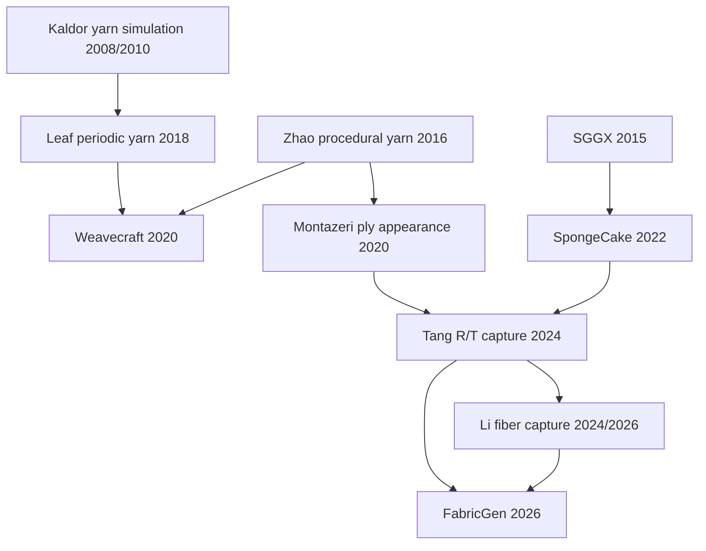

# Literature, physical scope, and research hypotheses for v0.3

Review date: 2026-10-11. This extends [the v0.2 literature audit](literature_engine_v2.md); it does not replace its source and license records. The repeated user attachments are byte-identical to the earlier FabricGen and Tang reflection-transmission PDFs. Their contents were already reviewed in v0.2. Dyeing, fading, tactile prediction, sensor fabrication, and metasurface fabrication remain outside this implementation.

## 1. What question is this version intended to answer?

The eventual objective is to reduce the difference between the apparent material in a product image and the fabric seen under other illumination/viewing conditions. v0.3 addresses a narrower prerequisite:

> If the yarn geometry is changed by a declared mechanical relaxation, what information survives fiber-to-ply-to-yarn-to-fabric reduction, what information is lost, and how does the explicit optical response change?

This is a forward-model study. It does not establish an inverse reconstruction method, superiority over a strong RGB acquisition baseline, or the necessity of a metasurface. The upgrade supplies independently checkable mechanics, geometry transfer, aggregate optical statistics, and spectral observations with which those later questions can be posed.

The important separation is between (a) topology, (b) geometry, (c) constitutive mechanical behavior, (d) local light scattering, (e) multiple scattering/visibility, and (f) camera/display observation. A correct weave draft is not a mechanical equilibrium. A mechanical equilibrium of effective yarns is not a constituent-fiber strain solution. A fitted directional extinction prior is not a complete cloth BSDF. Keeping these boundaries explicit avoids improving an image while losing the physical meaning of the parameters.

## 2. Primary-source review ledger

Large author PDFs that exceeded the web reader's size limit were successfully obtained from their public author URLs and inspected locally. They are temporary research-reading files, not new repository-vendored assets. The hashes below identify exactly which source versions were inspected.

| Source | Primary route | Inspected scope | Use in v0.3 |
| --- | --- | --- | --- |
| Wu et al., **Weavecraft** (TOG 2020, DOI 10.1145/3414685.3417865) | [Author PDF](https://www.antequ.net/assets/projects/weavecraft/weavecraft.pdf); [Cornell project](https://www.cs.cornell.edu/projects/weavecraft/) | Complete 16-page text available; technical §§2-6, §8, and Appendix A reviewed; §5.1 equation visually checked | Stack/topology semantics, distinction between schematic geometry and relaxation, boundary/rest-length requirements |
| Leaf et al., **Interactive Design of Periodic Yarn-Level Cloth Patterns** (TOG 2018, DOI 10.1145/3272127.3275105) | [Stanford project](https://graphics.stanford.edu/projects/yarnsim/); [PDF](https://graphics.stanford.edu/projects/yarnsim/assets/interactive_design_of_periodic_yarn_level_cloth_patterns.pdf) | §§3-6 and Appendices A-D; selected results and limitations | Periodic simulation contracts, effective yarn energies, stiffness/length similarity, source model for Weavecraft |
| Bergou et al., **Discrete Elastic Rods** (TOG 2008, DOI 10.1145/1360612.1360662) | [Columbia project](https://www.cs.columbia.edu/cg/rods/index.html); [PDF](https://www.cs.columbia.edu/cg/pdfs/143-rods.pdf) | §§3-4 on curve/frame energies and discrete representation; selected validation discussion | Identify which parts a reduced height-only beam model does and does not include |
| Heitz et al., **The SGGX Microflake Distribution** (TOG 2015) | [NVIDIA project](https://research.nvidia.com/labs/rtr/publication/heitz2015sggx/); [author PDF](https://research.nvidia.com/sites/default/files/pubs/2015-08_The-SGGX-microflake/sggx.pdf) | §§3-5, projected-area parameterization, fitting/filtering discussion; equation layout checked | Correct normalization, units, reciprocity and limits of tensor aggregation |
| Wang et al., **SpongeCake** (TOG 42(1), 2022/2023) | [Author project](https://wangningbei.github.io/2022/SpongeCake.html); [author preprint PDF](https://wangningbei.github.io/2022/SpongeCake_files/paper_SpongeCake.pdf) | §§3-4 for layer/phase/single-scattering assumptions; multiple-scattering overview | Distinguish an analytic microflake layer from actual fibers and refractive interfaces |
| Montazeri et al., **A Practical Ply-Based Appearance Model of Woven Fabrics** (TOG 2020) | [Primary PDF](https://projects.shuangz.com/practical_cloth-sa20/practical_cloth-sa20-ld.pdf) | v0.2 technical review of §§3.1-3.3 retained | Correct crossing order does not guarantee the correct slope distribution or highlights |
| Tang et al., **Woven Fabric Capture with a Reflection-Transmission Photo Pair** (SIGGRAPH 2024) | User PDF; [official code](https://github.com/lxtyin/FabricBTDF-Recovery); [arXiv](https://arxiv.org/abs/2406.19398) | v0.2 full-paper/supplement review; official code audit retained | R/T ambiguity and distinction between fitted optical depth and physical yarn dimensions |
| Tang et al., **FabricGen** (CVPR 2026) | User PDF; [author project](https://lxtyin.ac.cn/projects/fabricgen/); [primary HTML](https://arxiv.org/html/2603.07240v1) | v0.2 full attachment review; bibliography/citation relation checked again | Implicit microstructure appearance is a different representation from explicit mechanical fibers |
| Li et al., **Fiber-level Woven Fabric Capture** (2024 preprint; TOG 2026 DOI 10.1145/3816036) | [Current author page](https://www.rendering-zixuan.com/paper_pages/FiberFabric/); [2024 primary text](https://arxiv.org/html/2409.06368v1) | §2.2 and explicit forward citations rechecked; current publication metadata verified | Relevant later work; explicitly proposes fiber-level reflection/transmission combination |
| Yang et al., **Real-time Woven Fabric Rendering Using SGGX Fitting** (CVM 12(1):159-171, 2026) | [Publisher page](https://www.sciopen.com/article/10.26599/CVM.2025.9450445?issn=2096-0433) | Publisher abstract, publication dates and license; full publisher PDF was not obtained | Direct prior overlap for yarn-scale SGGX/footprint fitting; not claimed as an implemented reproduction |
| Yu et al., **Realistic Cloth Rendering with a Ray-Wave Hybrid Shading Model** (TOG 2025, DOI 10.1145/3763359) | [Official project](https://blaire9989.github.io/assets/3_RayWaveFabric/project.html) | Earlier project review retained; primary project description rechecked | Mean ray response, wave-sensitive instance variation, and aperture diffraction are distinct components |
| Li et al., **PureSample** (SIGGRAPH 2026) | [Official project](https://www.rendering-zixuan.com/paper_pages/PureSample/) | Author abstract/method overview only | Related learned aggregation route; no verified direct citation relation to FabricGen is asserted |

### Downloaded reading-file provenance

| File identity | Pages | Bytes | SHA-256 |
| --- | ---: | ---: | --- |
| Weavecraft author PDF | 16 | 45,625,686 | `83450e39434eb4f4ee153ee2f285f2404b879435e6927266c24224a09ce1060f` |
| Leaf 2018 author PDF | 15 | 25,111,116 | `b2e2353d74d3b425ce82b1b62f38d7ddeb44448b76cac6fbabed918e80307e12` |
| Discrete Elastic Rods author PDF | 12 | 3,043,141 | `d632c7b908d2b618102a2402653ba9ee789a871be279a01210a80f58346c4710` |
| SGGX author PDF | 11 | 15,946,880 | `9de6f9b17b2f23daa986a9447feff65c6b46a30415b8b52fc91694eea37f30a3` |
| SpongeCake author preprint PDF | 17 | 89,429,799 | `e30847de996e3ea77111fb018018d5c1dcbe3a2e847114c5a4aca92775652680` |

The SpongeCake download is an author preprint with a placeholder DOI, not a claim that the final journal article has 17 pages. Publication metadata is taken from the author project page. All downloaded PDFs retain their respective authors'/publishers' rights.

## 3. Backward and forward citation graph

The following relations were checked in the relevant primary texts. Arrows mean **is cited by**, not implementation equivalence or a claim of an exhaustive genealogy.

The Li paper's §2.2 explicitly discusses Tang's reflection/transmission acquisition and suggests combining it with fiber-level recovery. FabricGen's bibliography contains Tang 2024 as reference 19 and Li's 2024 preprint as reference 10. These are verified forward connections from the attached Tang paper.

As of this scoped search on 2026-10-11, **no independent later paper citing FabricGen was verified in a primary bibliography**. Search results containing the name included paper listings, dataset cards and secondary summaries; these are not a verified forward research lineage. PureSample and the 2026 SGGX fitting paper are related research, not automatically FabricGen successors. In particular, the SGGX fitting paper lists acceptance in June 2024 despite its February 2026 issue date, so publication year alone does not establish its dependence on Tang 2024 or FabricGen.

## 4. What the mechanics literature changes in our design

### 4.1 Weavecraft provides a topology lesson, not a ready optical solver

Weavecraft's block is an array of ordered stacks of warp/weft IDs, with optional empty slots. It supports assembly, stenciling and weft wraparound. Each relevant row/column yarn must occur once per stack. Its simulation follows a GPU spline-rod approach from Leaf, including effective stretching, bending and collision forces. Warp rest lengths can be updated toward a prescribed stretch ratio; periodic or frozen boundaries prevent indefinite shrinkage. Its limitations explicitly include cross-section deformation. [Weavecraft, §§4-5 and §8](https://www.antequ.net/assets/projects/weavecraft/weavecraft.pdf).

**Interoperability trap:** Weavecraft/Leaf card images use **1 = weft above warp**, while this repository's `WeaveDraft` uses **1 = warp above weft**. An importer must invert the bits or declare a conversion; renaming axes alone is insufficient. Our binary draft remains a single-layer orthogonal topology model. A future multilayer API needs stack order, persistent yarn IDs, connectivity and side-boundary conditions, not simply another height parameter.

### 4.2 Why v0.3 uses a reduced convex model

Full rods require centerline and material-frame evolution, preferred strains, contact and boundary conditions. DER explicitly couples bending/twist through adapted frames and holonomy. It is therefore inaccurate to call a height-only beam a full DER implementation. [Bergou et al., §4](https://www.cs.columbia.edu/cg/pdfs/143-rods.pdf).

v0.3 deliberately fixes each yarn's projected track and solves only height values. For projected interval length \(h\), height jump \(d\), and rest length \(\ell_0\le h\), let

\[
\ell(d)=\sqrt{h^2+d^2},\qquad
E_s(d)=\frac{EA}{2\ell_0}\big[(\ell(d)-\ell_0)^2-(h-\ell_0)^2\big].
\]

Subtracting the flat pretension energy changes no force. Direct differentiation gives

\[
E_s'(d)=\frac{EA}{\ell_0}\left(1-\frac{\ell_0}{\ell}\right)d,
\qquad
E_s''(d)=\frac{EA}{\ell_0}\left(1-\frac{\ell_0h^2}{\ell^3}\right)\ge0.
\]

The inequality follows from \(\ell\ge h\ge\ell_0\). It explains the code's rejection of compressive rest-length inputs. The bending term is the explicitly small-slope expression

\[
E_b=\frac{B}{2h^3}\|D_2z\|^2.
\]

This is a finite-dimensional convex beam model. It permits global numerical optimality checks for its declared feasible set, unlike an unqualified claim of solving general nonconvex yarn contact. Its synthetic effective stiffnesses must later be calibrated mechanically. They are not derivable from scalar optical refractive index or a material name.

Leaf's periodic simulator and its radius/length similarity construction are valuable references for parameter consistency. The actual simulation there includes different energies, spline sampling and dynamic damping, so its stiffness transformation rules cannot simply be copied into this reduced model. [Leaf et al., §§3,5-6 and Appendices B-D](https://graphics.stanford.edu/projects/yarnsim/assets/interactive_design_of_periodic_yarn_level_cloth_patterns.pdf).

### 4.3 A crossing constraint must imply a three-dimensional distance bound

Consider a warp and weft crossing, whose vertical separation is \(D\). If their height functions have Lipschitz constants \(L_w,L_f\), an arbitrary pair of points at projected displacements \(u,v\) satisfies

\[
D\le |\Delta z|+L_w|u|+L_f|v|
\le\sqrt{1+L_w^2+L_f^2}\,
\sqrt{\Delta z^2+u^2+v^2}.
\]

Therefore their centerline distance is at least

\[
d_{\min}\ge\frac{D}{\sqrt{1+L_w^2+L_f^2}}.
\]

Using only the crossing's vertical height as Euclidean clearance is false for sloped yarns. The implemented linear slope/crossing inequalities use this conservative bound; parallel-track separation has a separate pitch bound. These are geometric envelope inequalities, not pressure, friction, contact-area or yarn-flattening laws. Subsequent explicit fibers still require their own different-fiber clearance audit, particularly inside the same parent yarn.

### 4.4 The regeneration boundary is physically significant

The fiber hierarchy is regenerated along the selected yarn centerlines. Preserving IDs and using the same material spectra is useful for comparison, but does not by itself conserve constituent material coordinates. If the parent arc length changes while twist is specified per current arc length, total fiber length and represented cylindrical volume may change. v0.3 records this and reports `fiber_material_points_conserved=False`.

A physically advected fiber model would need an independent material coordinate, deformation/stretch map, cross-section response and twist transport. Until that exists, an initial/relaxed optical pair is a comparison of two declared geometries produced by the same generator. Its image difference can include changes in length/coverage as well as tangent distribution. Reporting all of these observables is necessary to avoid over-attributing a rendered difference to one mechanism.

## 5. What the optics literature changes in our design

### 5.1 Projected area is useful, but it is not a fabric BSDF

For line elements of length \(\ell_j\), radius \(r_j\), tangent \(t_j\), within a declared averaging volume \(V\), the new module computes

\[
\eta(\omega)=\frac1V\sum_j2r_j\ell_j\sqrt{1-(t_j\cdot\omega)^2}.
\]

This has units mm\(^{-1}\), is exactly additive across hierarchy groups when they share the same \(V\), and scales as \(1/a\) when all lengths scale by \(a\) and volume by \(a^3\). It excludes endcaps, joints, overlap of projected silhouettes, occlusion, spatial correlations and wave coherence. It is an unoccluded line-element encounter prior, not a measured extinction coefficient or opacity.

SGGX provides an SPD parameterization \(\sigma_S(\omega)=\sqrt{\omega^TS\omega}\) with an area-weighted normal density. Its normal density need not integrate to one; its visible projected normalization and attenuation-weighted reciprocity are the relevant constraints. SGGX's own paper distinguishes the parameter matrix from its covariance and describes approximation errors in filtering. [Heitz et al., §§3-5](https://research.nvidia.com/sites/default/files/pubs/2015-08_The-SGGX-microflake/sggx.pdf).

The new fitter targets \(\eta(\omega)\) directly, and reports held-out directional error. Its \(S\) has units mm\(^{-2}\). An identifiability check now rejects angular sets whose six-column quadratic design has rank below six; many repeated measurements in one direction do not identify a three-dimensional tensor. A positive-definite floor regularizes the aligned-fiber singular limit and must remain visible in diagnostics.

### 5.2 Layers and explicit fibers are alternative approximations

SpongeCake treats layers as volumetric scattering media without reflecting/refracting interfaces between them. This enables its analytic single-scattering expression; its multiple-scattering component uses an additional approximation. Optical thickness combines density and layer thickness, so those cannot generally be identified independently from that representation alone. [SpongeCake, §§3-4](https://wangningbei.github.io/2022/SpongeCake_files/paper_SpongeCake.pdf).

Tang's captured surface model and FabricGen's procedural fields use related appearance abstractions. The present SGGX prior does not substitute those models for explicit dielectric fibers. It contains neither their fitted multiple scattering nor actual fiber refraction. The explicit-fiber renderer remains the comparison path; a full macro-scale BSDF requires additional visibility/transport integration and separate validation.

### 5.3 Fitting SGGX at fabric scales is already prior art

Yang et al. precompute yarn-segment normal distributions for different query sizes, fit several SGGX functions, and aggregate segments intersecting a pixel footprint. This is a direct precedent for multi-scale textile SGGX fitting. The distinction here is an auditable fit to a geometric projected-area prior together with mechanical geometry changes, not a claim of inventing SGGX level-of-detail rendering. Only the publisher abstract/metadata were reviewed for this work; its full implementation was not reproduced. [Publisher](https://www.sciopen.com/article/10.26599/CVM.2025.9450445?issn=2096-0433).

PureSample provides a separate, learned route from sampled microgeometry light paths to a material distribution and directional albedo. It is a related future backend, not something implemented by fitting six SGGX coefficients. [Official project](https://www.rendering-zixuan.com/paper_pages/PureSample/).

Yu et al.'s hybrid method separates ensemble-average ray response, wave-calibrated instance variation and aperture diffraction. A geometric tensor fit cannot replace all three. Our retained 2D bundle solver remains restricted to eligible local parallel cylinder sections; none of the v0.3 work promotes it to a complete 3D wave fabric solver. [Official project](https://blaire9989.github.io/assets/3_RayWaveFabric/project.html).

## 6. A concrete mathematical ambiguity and its measurement consequence

Consider two equal-weight tangent populations:

\[
\mathcal A=\{e_x,e_y\},\qquad
\mathcal B=\{(e_x+e_y)/\sqrt2,(e_x-e_y)/\sqrt2\}.
\]

Both have the same second moment \(Q=\operatorname{diag}(1/2,1/2,0)\). Nevertheless, with equal total line-element weight, their normalized directional projected areas along \(e_x\) are respectively

\[
\eta_{\mathcal A}(e_x)=\tfrac12,
\qquad \eta_{\mathcal B}(e_x)=\tfrac1{\sqrt2}.
\]

The difference is 0.20710678 in this normalization, or 41.42% relative to the first value. At 45 degrees the values exchange. This independently implemented counterexample shows why a second-moment tensor alone does not determine the nonlinear response. It is **not** a claim that these two explicit geometries are indistinguishable in a high-resolution RGB image.

There is a related aggregation trap. For two SGGX matrices,

\[
\sqrt{\omega^T(aS_1+(1-a)S_2)\omega}
\ge a\sqrt{\omega^TS_1\omega}+(1-a)\sqrt{\omega^TS_2\omega}.
\]

An SPD matrix average is mathematically valid, but generally gives an RMS-type projected response rather than the exact linear mixture. Our test uses diagonal matrices with exchanged small/large axes to make the difference analytic. Grouped fits must therefore be summed as directional predictions under the declared model, and their error assessed; one cannot assume that averaging matrices conserves the exact encounter rate.

### Proposed sensing hypothesis, not a completed experiment

The promising hypothesis is that a small set of angular or angular-spectral measurements can distinguish **geometrical slope/crimp changes** from **intrinsic fiber roughness/absorption changes** when a specified RGB baseline cannot. Existing literature already motivates microscopic capture and R/T combinations, so the research contribution needs a concrete ambiguity, measurement budget, error reduction and an implementable optical encoding.

Let \(\theta_g\) describe selected geometry parameters and \(\theta_n\) nuisance variables such as brightness, absorption and surface roughness. For whitened local Jacobians \(J_g,J_n\), the information left for geometry after accounting for nuisance variation is

\[
F_{g\mid n}=J_g^T\left(I-J_nJ_n^+\right)J_g.
\]

This expression uses the Moore-Penrose inverse and presumes a specified local Gaussian noise model; it is a design diagnostic, not a guarantee of global inverse uniqueness. Additional channels are useful when they increase the smallest relevant eigenvalue or reduce uncertainty in the desired appearance prediction after this nuisance projection. A large raw response derivative alone is insufficient if it can be reproduced by changing nuisance parameters.

For an external optical encoder with realizable response \(h_m(\lambda,\omega)\),

\[
y_m=\iint h_m(\lambda,\omega)L(\lambda,\omega;\theta)
\,d\omega\,d\lambda+\epsilon_m.
\]

The same existing detector can measure these coded channels. Before metasurface fabrication, the channel benefit must survive: photon/count/time limits; real optical throughput and crosstalk; a strong multi-light RGB baseline; disjoint fabric samples; and deliberately mismatched geometric/transport models. Optimizing measurements only on an overly smooth kinematic generator risks selecting channels that exploit model artifacts. Comparing kinematic and relaxed explicit geometry is a first way to expose that risk.

No v0.3 result yet establishes the Fisher-information benefit, real-sample accuracy, a metasurface geometry, or complete material recognition. The mathematical ambiguity, regression tests, and paired simulation infrastructure are the achieved prerequisites.

## 7. Code and reuse status

The new mechanics and optical scale modules are independently implemented. Existing official-code audits remain in [v0.2 provenance](literature_engine_v2.md): `lxtyin/FabricBTDF-Recovery` was inspected at commit `67150eeca9f28b85f8fe21d40d888d34bd4d3b25` with GPL-3.0, and TexGen headers/architecture were inspected with GPL-2.0-or-later notices. Those implementations were not copied into the new modules.

The reviewed FabricGen author page links papers, supplementary material, dataset and video; no method-code repository was verified there. Website-template GitHub links are not method source. The reviewed Weavecraft and Leaf project pages do not establish an open-source implementation license. Leaf's pattern/control-point dataset is separately linked, but it was not downloaded or reused here. Namesake Minecraft/furniture repositories are unrelated.

Mitsuba's pinned microflake conventions and the CIE observer data have their own version/source notices in the optical module/report. Reading source code or a paper is not evidence that an author's complete method or trained network has been run. All numerical claims for v0.3 should instead be traced to this repository's actual test logs and experiment output, summarized in [the independent review](review_engine_v3.md).
