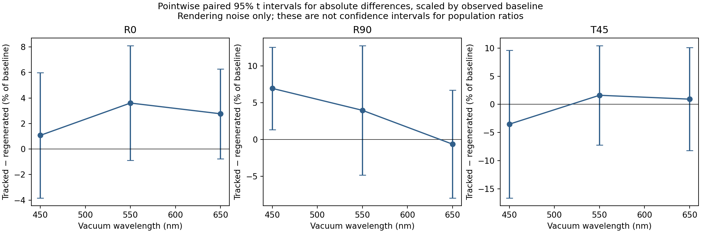
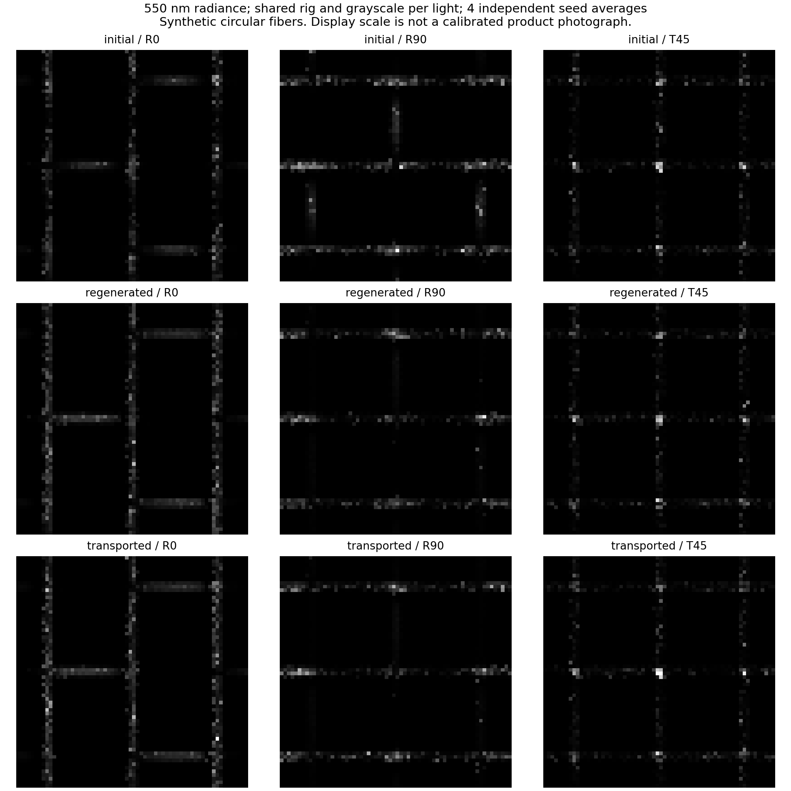

# v0.4 실험: 물질좌표를 유지한 섬유 운반과 광학 관측

**연구:** 직물 외관 재현을 위한 다중 규모 광학 모델링과 메타광학 계측  
**English:** Multiscale Textile Appearance Modeling and Meta-Optical Sensing  
**실험·검증 상태:** 2026-10-11에 최종 **108회 monochromatic 렌더를 실제 완료**했다. 전체 실험 driver 시간은 19.681초이며 시작·종료 시 input/source hash가 동일했다. 현재 소스의 **전체 297개 테스트가 통과**했고 저장된 raw 자료의 독립 재검산도 통과했다. [최종 실험](../data/material_transport_v4/experiment_manifest.json), [전체 테스트](../data/final_test_summary.json), [최종 artifact 검산](../data/validation_v4/final_artifact_audit/run_manifest.json).  
**기준 구현:** [material_transport.py](../textile_sim/material_transport.py), [구현 테스트](../tests/test_material_transport.py), [독립 테스트](../tests/test_material_transport_review.py), [독립 리뷰](review_material_transport_v4.md).

## 1. 질문과 v0.3과의 차이

연구의 최종 목적은 촬영한 원단과 실물을 보았을 때의 외관 차이를 줄이는 것이다. 이를 위한 순방향 비교에서는 **같은 표본의 상태를 이동시키는 계산**과 **같은 제조 파라미터로 새 기하를 생성하는 계산**을 구분해야 한다.

v0.3은 높이 평형으로 얻은 새로운 원사 경로 위에 ply와 fiber를 다시 생성했다. 꼬임과 불규칙성은 현재 부모 호길이를 기준으로 평가되므로, 부모 길이가 바뀌면 기준 fiber의 어느 점이 어디로 갔는지 정의되지 않는다. 같은 fiber ID나 같은 정점 수만으로 물질점 대응이 생기지는 않는다. [v0.3 재생성의 경계](weave_mechanics_v3.md).

v0.4는 최초 fiber·ply·yarn 기하에 기준 좌표와 부모 대응을 한 번 지정하고, **그 기준에서 각 상태를 다시 평가하는 framed kinematic map**을 구현한다. 이 변경으로 임의의 현재 호길이에서 위상을 재시작하는 차이를 분리할 수 있다. 실제 섬유의 응력·접촉·마찰로부터 변형을 푸는 방법은 아직 아니다.

이 실험의 기준은 저장된 **관측/생성 초기 pose**다. 응력이 없는 자연 길이·rest curvature 상태를 측정하거나 추정한 것이 아니다. 아래 strain은 해당 기준 형상에 대한 기하 변화이며 재료 constitutive strain의 실측값으로 취급하지 않는다.

이번 실험은 다음을 묻는다.

> 같은 초기 원단과 같은 최종 원사 경로를 사용했을 때, 현재 호길이로 재생성한 fiber와 기준 물질좌표를 유지해 운반한 fiber는 기하·길이·방향 분포·광학 관측에서 얼마나 다른가?

`transported`가 `regenerated`보다 실물에 가깝다고 먼저 가정하지 않는다. 두 경로의 차이를 수치적으로 설명하고, 추가 물리 가정과 실측 데이터가 필요한 부분을 드러내는 실험이다.

## 2. 기준 좌표와 부모 대응

Fiber 정점의 기준 위치를 \(X_i\), 최초 fiber 호길이를 \(S_i\), 그 정점이 붙어 있는 **별도의 부모 좌표**를 \(\xi_i\)라 한다. 다음 두 좌표를 혼용하지 않는다.

- \(S_i\): 최초 fiber 자체의 호길이. 길이·stretch·strain을 계산할 때 기준으로 유지한다.
- \(\xi_i\): 해당 정점을 parent curve에 부착하는 좌표. Ply에 대한 fiber의 대응과 yarn에 대한 ply의 대응이 각각 존재한다.

`bind_material_reference()`는 현재 계층 생성기의 **공유 정점 순서**를 사용한다. 호출자가 `correspondence="shared_vertex_indices"`를 명시해야 하며, yarn·ply·fiber가 해당 공유 sampling을 갖는지 검사한다. 서로 독립적으로 resampling한 곡선이나 scan에 대해 정점 수가 우연히 같다는 이유로 이 대응을 적용할 수 없다. 외부 geometry의 물리적 대응은 별도로 정해야 한다.

최종 부모 경로는 새 점 개수를 가질 수 있지만, 각 점의 좌표를 **최초 부모의 물질좌표**로 제공해야 한다. 범위의 양 끝과 reference yarn ID가 일치해야 하며, 좌표는 0에서 시작해 엄격히 증가한다. 현재 길이를 새 label로 전달하거나 부족한 범위를 자동으로 외삽하지 않는다. 내부 label의 물리적 타당성은 호출자가 지정하는 모델의 일부다.

## 3. Framed transport의 수학

### 3.1 전체 local offset을 유지한다

Reference parent 중심선을 \(p_0(\xi)\), 그 frame을 \(B_0(\xi)\in SO(3)\)라 하면 기준 local offset은

\[
q_i=B_0(\xi_i)^T\big[X_i-p_0(\xi_i)\big]
\]

이다. 최종 parent와 frame \(p_1,B_1\)을 지정하면

\[
x_i=p_1(\xi_i)+B_1(\xi_i)q_i
\]

로 이동시킨다. \(q_i\)의 tangent 성분까지 포함한 **3개 성분을 모두 보존**한다. 표본화된 parent의 법평면으로 단순히 다시 투영하면 축방향 offset이 사라져 identity와 역변환이 깨질 수 있다.

동일한 label의 두 frame이 orthonormal이면 한 단계의 변환은

\[
x_i-p_1=B_1 B_0^T(X_i-p_0)
\]

이며 반대 변환으로 표본점을 복구할 수 있다. 이것은 **지정한 frame과 label에서의 대수적인 역변환**이다. 전체 곡선 공간에서의 비자기교차, 변형 이력의 가역성, contact dynamics의 역학적 가역성을 뜻하지 않는다.

### 3.2 Yarn → ply → fiber의 재귀

먼저 yarn의 frame map으로 reference ply의 점을 옮긴다. 옮겨진 ply의 초기 director는 parent의 proper rotation으로 운반한 뒤, 새 ply 접선으로 최소 회전 정렬한다. 개념적으로

\[
d_{p,1}=\operatorname{Align}(R_y t_{p,0},t_{p,1})R_y d_{p,0},
\qquad R_y=B_{y,1}B_{y,0}^T
\]

를 사용하고 정규화·수치적 직교화를 적용한다. 이 새 ply frame을 사용해 reference fiber를 이동시킨다.

두 상태에서 parent normal을 각 ply 법평면에 독립적으로 투영하면 접선 경사의 변화에 따른 추가 회전이 들어갈 수 있다. 따라서 초기 방향을 매 상태의 전역 축에서 새로 고르지 않는다. 접선이 반대 방향인 최소 회전은 축을 유일하게 정하지 못하므로 현재 구현은 해당 모호성을 거부한다. 수식과 독립 반례는 [review §2](review_material_transport_v4.md#2-mathematical-contract-and-independent-derivations)에 있다.

### 3.3 Frame·보간·twist의 범위

`FramedCurve`는 double-reflection rotation-minimizing frame(RMF)을 계산한다. 위치는 material coordinate에 대해 선형 보간하고 방향은 인접 frame 사이의 최단 \(SO(3)\) 경로로 보간한다. Yarn의 초기 reference/target director를 입력으로 받는다. 닫혔거나 거의 닫힌 parent, 모호한 half-turn frame 구간, 퇴화한 점·director, 범위 밖 query는 거부한다.

RMF는 기하 frame이다. 물체가 가한 torque에 따라 정해지는 일반적인 material twist field는 별도 자유도다. 이 구현은 최초 꼬임의 표본점 위상을 유지할 수 있지만 **일반적인 꼬임 strain이나 torque 평형을 풀지 않는다**. [Wang et al., RMF](https://doi.org/10.1145/1330511.1330513), [Bergou et al., DER](https://www.cs.columbia.edu/cg/pdfs/143-rods.pdf).

RMF 논문의 수렴 차수를 이 파이프라인 전체의 수렴 차수로 옮기지 않는다. 현재 위치 보간은 선형이고 tangent도 표본으로부터 구하므로 별도 refinement가 필요하다. 독립 테스트의 원호-binormal 예제에서는 analytic chord sagitta를 기준으로 위치 보간 오차를 검증한다.

## 4. 길이·strain·부피 proxy

각 fiber 선분에 대해

\[
\ell_{0,e}=S_{i+1}-S_i,\qquad
\ell_e=\|x_{i+1}-x_i\|,\qquad
\lambda_e=\frac{\ell_e}{\ell_{0,e}}
\]

를 저장한다. Engineering strain은 \(\lambda_e-1\), log strain은 \(\log\lambda_e\)다. 이 값은 현재 기하에서 계산한 변형량이며 응력에 대한 constitutive law를 제공하지 않는다. \(\lambda_e>0\)의 유한 값을 요구하고, 섬유 비신장성 \(\lambda_e=1\)을 강제하지 않는다.

| `radius_mode` | 반지름 규칙 | 보존·보고하는 양 | 현재 광학 전달 |
| --- | --- | --- | --- |
| `constant_reference` | \(r_e=r_0\) | 기준 fiber label을 유지하고 실제 길이·원통 부피 proxy 변화를 보고 | `to_hierarchy()` 허용. 새 기하의 clearance·export 검사가 필요 |
| `incompressible_segments` | \(r_e=r_0/\sqrt{\lambda_e}\) | 각 선분의 \(\pi r_e^2\ell_e=\pi r_0^2\ell_{0,e}\)를 보존 | **차단**. 현재 constant-radius optical API에 자동 평균 반지름을 넣지 않음 |

여기서 부피는

\[
V_{\mathrm{proxy}}=\sum_e\pi r_e^2\ell_e
\]

로 정의한 **직선 원통 선분의 합계**다. 곡선 tube의 joint·끝단·겹침·단면 변형, 전체 3D deformation gradient와 밀도장을 계산하지 않는다. `incompressible_segments`라는 API 이름도 이 이산 proxy에 대한 규칙으로 읽어야 한다. 밀도를 추가 가정하지 않은 상태에서 실제 질량 보존이라고 부르지 않는다.

두 mode는 같은 중심선 운반을 사용하므로 정점 위치가 같고 반지름·부피 장부만 달라진다. **이번 108회 광학 비교의 transported 상태는 `constant_reference`**다. Proxy 보존 mode는 수치 진단으로 계산했으며 해당 상태의 optical export가 실제 차단되는지도 검사했다.

## 5. 독립적으로 검사할 수 있는 기준 문제

### 5.1 Helix의 축방향 stretch

직선 parent와 기준 helical fiber를

\[
p_0(S)=(0,0,S),\qquad
X(S)=(a\cos kS,a\sin kS,S)
\]

로 두자. Parent에 축방향 배율 \(\Lambda\)를 적용하면 현재 map은

\[
x(S)=(a\cos kS,a\sin kS,\Lambda S)
\]

를 만든다. Material label에서의 위상은 \(kS\)로 유지되고, 현재 parent 길이당 turns는 \(k/(2\pi\Lambda)\)가 된다. 현재 호길이에 같은 turns/mm를 다시 적용하는 재생성은 \(k\Lambda S\)를 사용하므로 다른 물질점 위상이다.

Reference 축방향 간격이 \(\Delta S\)인 선분의 정확한 polyline stretch는

\[
\lambda_e=
\sqrt{\frac{4a^2\sin^2(k\Delta S/2)+\Lambda^2\Delta S^2}
{4a^2\sin^2(k\Delta S/2)+\Delta S^2}}
\]

다. 연속 미분 길이로 대체하지 않고 이 식을 독립 oracle로 비교한다.

### 5.2 Objectivity·보간·자료 무결성

| 기준 | 확인할 것 | 제한된 해석 |
| --- | --- | --- |
| Identity | 모든 기준 점·label·부모 ID·반지름이 그대로 유지 | 일반적인 실제 변형을 보장하지 않음 |
| 공동 강체 변환 | 위치와 director를 같은 proper rotation/translation으로 옮기면 출력도 같이 변환 | Director를 전역 축에서 새로 선택하는 다른 입력은 같은 실험이 아님 |
| Frame gauge 변경 | reference/target의 동시 기준 frame 변경으로 같은 물리 map 유지 | target director만 바꾸면 다른 회전 상태이며 출력이 달라져야 함 |
| 다른 target mesh | 명시한 reference label에 맞춰 같은 자식 정점 유지 | 같은 정점 수나 보간만으로 실제 correspondence를 발견하지 않음 |
| 원호 위치 보간 | analytic sagitta와 비교, 세분화 시 오차 감소 | 전체 pipeline의 일률적인 고차 수렴 주장으로 확대하지 않음 |
| 단위 배율 | 길이·반지름은 \(a\), 부피는 \(a^3\), stretch는 불변 | 근거 없는 물성 scaling 법칙을 의미하지 않음 |
| Hash·immutable data | caller의 배열/metadata 변경, 잘못된 parent·reference·radius mode를 거부 | 측정 데이터의 진위를 암호학적으로 인증하는 기능이 아님 |
| Export 상태 | 과거 clearance·mechanics claim을 새 형상에 상속하지 않음 | 별도 검사를 수행하기 전 새 형상의 비관통을 주장하지 않음 |

이 표는 구현·독립 테스트의 검사 범위다. 최종 suite에는 구현 17개, 독립 수학 18개, artifact 검증 7개, runner 16개의 **신규 검사 58개**가 포함돼 있다. 기존 239개와 합친 297개가 모두 통과했고 소스별 hash를 남겼다. [최종 검증 summary](../data/final_test_summary.json).

## 6. API와 저장 계약

아래는 호출 구조 예시다. `geometry`, reference/target yarn director, 최종 yarn 점들은 별도로 지정한 입력이며, 임의의 두 scan 사이 대응을 자동 추정하는 예제가 아니다.

```python
from textile_sim.material_transport import (
    bind_material_reference,
    transport_material_reference,
    save_material_transport,
)
from textile_sim.hierarchy import audit_clearance

reference = bind_material_reference(
    geometry,
    yarn_initial_normals=reference_yarn_normals,
    correspondence="shared_vertex_indices",
)

# 이 예제에서는 target yarn의 각 점이 reference yarn과 같은 label을 가진다.
# 다른 sampling이면 실제 target knot마다 reference label을 명시해야 한다.
target_labels = {
    key: curve.material_coordinates_mm
    for key, curve in reference.yarns.items()
}
state = transport_material_reference(
    reference,
    deformed_yarns,
    yarn_initial_normals=target_yarn_normals,
    deformed_parent_coordinates_mm=target_labels,
    radius_mode="constant_reference",
)
save_material_transport("scratch_runs/transport_state", state)

optical_geometry = state.to_hierarchy()
clearance = audit_clearance(optical_geometry)
if not clearance["certified_separated"]:
    raise RuntimeError(clearance)
# 위 검사 후 OpticalScene과 기존 exporter로 전달한다.
```

현재 schema는 `textile.material_transport/4.0`이다. Raw 데이터는 pickle을 사용하지 않는 NPZ에, array layout·기준 spec·metadata·단위·summary·NPZ SHA-256은 JSON에 기록한다. Reference/state hash는 좌표·frame·material label·부모 대응·반지름 규칙을 연결한다. 저장 경로의 같은 산출물이 이미 있으면 덮어쓰지 않는다.

기본 저장 배열은 reference/current fiber 위치, 기준 fiber·parent 좌표, current 호길이, segment stretch·strain·radius·부피이며, reference/current yarn·ply의 위치·좌표·frame·initial director도 보존한다. 평균 그림만 남겨 물질좌표 정보가 없어지지 않도록 한다.

직접 `MaterialTransportState`를 구성할 때도 선언한 map으로 ply·fiber 위치와 director를 다시 계산해 일치 여부를 확인한다. 합계 길이나 부피가 우연히 같다는 이유로 다른 형상을 같은 운반 결과로 받아들이지 않는다.

## 7. 실제 광학 실험의 구성

### 7.1 세 상태를 분리한다

| 상태 | 기하를 얻는 방법 | 비교 의미 |
| --- | --- | --- |
| **initial** | 기준 원사·ply·fiber 기하 | 모든 비교의 기준 |
| **regenerated** | 같은 최종 원사 경로 위에서 v0.3 generator를 재평가 | 현재 호길이 기반 꼬임·배치 재생성의 결과 |
| **transported** | 같은 최종 원사 경로에서 reference label·offset 운반, `constant_reference` | 선언된 kinematic map의 결과; 실제 부피·질량 보존 가정은 포함하지 않음 |

Reference와 regenerated의 fiber ID가 같아도 정점별 물질 대응을 주장하지 않는다. Reference와 transported는 binding 때 선언한 정점 label을 유지한다. 세 상태의 광학 재료·관측 rig·노출·픽셀·렌더 budget은 같게 하고, geometry와 exporter 오차는 상태별로 기록한다.

입력은 v0.3의 `data/mechanics_v3/optical_pair/{initial,relaxed}`다. 각 원사에 193개 점이 있고, initial/relaxed 부모의 **같은 index에서 XY가 정확히 일치**하는 fixed-track height graph인지 검사했다. 이 index에 reference 물질좌표를 부착하는 것은 prescribed no-slip 가정이다. Reference/target yarn의 시작 director는 모두 `(0,0,1)`로 지정했고 torque 평형을 계산하지 않았다.

### 7.2 실행 수와 관측량

**3상태 × 3조명 × 3파장 × 4개 독립 seed = 108회**의 monochromatic 렌더를 완료했다. 실제 실행은 `run_material_transport_experiments.py`, 출력은 `data/material_transport_v4/`다.

| 설정 | 실제 사용 값 |
| --- | --- |
| Geometry | 6 yarns, 6 plies, 42 fibers, 8,106 vertices, 8,064 segments |
| 파장 | Vacuum 450, 550, 650 nm |
| 영상·샘플 | 64×64 pixels, 32 spp |
| 독립 seed | 9,203 / 22,782 / 36,361 / 49,940 |
| R0 | Reflection, elevation 40°, azimuth 0° |
| R90 | Reflection, elevation 40°, azimuth 90° |
| T45 | Transmission, elevation 55°, azimuth 45°, source의 z방향 반전 |
| View·source | Orthographic 정면 view(elevation 90°), 직사각 광원 angular half-width 7° |
| 관측 영역 | 세 상태의 공통 union bounds, `width_fraction=0.68` |
| 공통 투영 통계 부피 | 0.07196821724 mm³ |
| 기타 광학 조건 | `RenderConfig` 기본 roughness 0.18/0.20, ambient 0, path depth −1 및 rr depth 8 |
| 물성 | v0.3 `synthetic_materials()`의 두 합성 스펙트럼, 각 파장의 실제 값으로 갱신 |

여기서 elevation은 **XY 평면으로부터의 고도**이며 표면 법선으로부터의 입사각과 다르다. T45의 source는 같은 azimuth에서 아래쪽에 놓인다. 재료 굴절률·흡수는 scene의 파장별 구성 물성을 사용하며 표의 rig 기본값과 혼용하지 않는다. 모든 설정과 source/input hash는 [manifest](../data/material_transport_v4/experiment_manifest.json), [optical metrics](../data/material_transport_v4/optics/optical_metrics.json)에 있다.

3개 파장만 계산한 영상을 RGB 채널이나 실제 원단 색으로 해석하지 않는다. 여기서는 **단색광 radiance와 그 기하 민감도**를 비교한다. v0.3의 17파장/부분 33파장 CIE 적분과 목적·예산이 다른 실험이다. 실제 재료나 광원으로 보정되지 않은 색감·재질감을 주장하지 않는다.

각 조명·파장·seed에서 기록한 관측량은 같은 관측 영역의 평균 선형 radiance다. 표시용 tone mapping을 거치기 전 데이터에서 계산했다. 기본 driver가 보고한 contrast는 다음 두 종류다.

1. `transported − initial`: 선언한 물질좌표 운반으로 생긴 전체 기하 효과.
2. `transported − regenerated`: 같은 최종 원사 경로에서 두 fiber 전달 방법의 차이.

두 번째 contrast를 “추적 방법의 실물 정확도 개선”이라고 부르지 않는다. 실측·다른 물리 모델과 비교하기 전에는 두 선언된 기하 모델의 차이다. `regenerated − initial`도 raw 배열에서 계산할 수 있지만 기본 metrics의 별도 contrast로 추가했다고 기록하지 않는다.

### 7.3 Paired seed 통계

관측 조건 하나에서 두 상태의 영상 평균을 \(\bar L_{a,s},\bar L_{b,s}\)라 하면 seed별 차이는

\[
\Delta_s=\bar L_{a,s}-\bar L_{b,s}
\]

로 계산한다. 4개 seed에서의 평균 차이와 paired t 구간

\[
\bar\Delta\;\pm\;t_{0.975,3}\frac{s_\Delta}{\sqrt4}
\]

을 보고한다. 픽셀·파장을 독립 표본처럼 늘리지 않는다. 동일 seed를 사용하더라도 기하가 바뀌면 빛의 경로는 달라질 수 있으며, 이 통계는 Monte Carlo 반복 오차에 대한 진단이다. 실제 원단·구조/물성 모델·관측 교정의 불확실성은 별도다. 네 seed의 정규성 가정과 여러 contrast를 보는 점도 해석 범위에 포함한다.

상대 변화는 분모인 기준 평균 radiance가 충분히 0에서 떨어졌을 때 함께 보고한다. 작거나 불안정한 분모에서는 절대 차이와 noise floor를 우선한다. 구간이 0을 포함하면 현재 budget에서 변화가 분리되지 않았다고 기록한다.

**그림의 백분율 축은 절대 차이와 그 구간을 관측된 baseline 평균으로 나눈 표시다.** 분모의 추정 불확실성을 전파한 모집단 radiance 비율의 신뢰구간은 아니다. 통계 판정은 절대 paired 차이의 구간을 기준으로 하며, 표에는 상대 변화와 절대 구간을 서로 다른 열로 둔다.

## 8. 실험 완료 gate와 기록할 제한

| Gate | 필요한 증거 | 미통과 시 처리 |
| --- | --- | --- |
| Reference/target 계약 | ID·좌표 domain·초기 director·shared-index 선언, source hash | 다른 map으로 임의 relabel하지 않고 실패 원인 기록 |
| 독립 transport 검증 | Identity·강체 운동·helix·부피 proxy·보간·자료 오용 검사 | 실패한 모델/구현 조건을 고친 뒤 해당 gate 재검사 |
| 세 상태의 기하 검사 | fiber 수·sampling·길이·부피·접선·새 clearance | Reference의 과거 certificate를 복사해 통과 처리하지 않음 |
| Optical export | radius mode, curve/float32 변위, scene/input hash | Variable-radius proxy mode는 현재 차단, 실패 상태의 렌더를 성과로 쓰지 않음 |
| 실제 렌더 기록 | 각 조건·seed의 성공 여부·원시 배열·실행 횟수 | 계획 횟수와 완료 횟수 분리, 부분 실패의 미확인 수는 0으로 추정하지 않음 |
| 결과 재계산 | 원시 배열에서 contrast·통계를 독립 계산 | 표시 그림의 눈대중 차이로 물리 효과 확정하지 않음 |
| 전체 검증 | 당시 source hash와 전체 테스트 로그 | v0.3 테스트 수를 새 코드의 검증 수치로 재사용하지 않음 |

현재 미해결 범위는 full 3D rod/contact·slip·압착, 실제 material twist evolution, 전역 injectivity·self-contact, 실물 물성 보정, variable-radius optical adapter, coherent 3D wave fabric transport, 강한 RGB 대비 추가 관측의 이득이다. 염색·퇴색은 계속 보류한다.

## 9. 실제 결과

### 9.1 전체 변화량은 작아도 국소 strain은 작지 않다

| 측정량 | 실제 값 |
| --- | ---: |
| Identity map의 최대 정점 오차 | 4.34×10⁻¹⁸ mm |
| Reference 총 fiber 길이 | 40.6111653145 mm |
| Regenerated 총 fiber 길이 | 40.6291324807 mm |
| Transported 총 fiber 길이 | 40.6291253596 mm |
| Transported 총 길이·constant-radius 부피 proxy 변화 | +0.0442244% |
| 경사 길이·부피 proxy 변화 | −0.5733227% |
| 위사 길이·부피 proxy 변화 | +0.6617715% |
| Segment engineering strain 최소 / 최대 | −14.03198% / +14.12013% |
| Reference 길이 가중 engineering strain RMS | 1.72821% |
| Regenerated–transported 정점 RMS / 최대 차이 | 0.0773440 / 0.208708 µm |
| 두 기하의 segment 접선각 RMS / 최대 차이 | 0.0157390° / 0.0389854° |
| `incompressible_segments` 선분 부피 proxy 최대 상대 오차 | 6.66×10⁻¹⁶ |

가장 중요한 결과는 **서로 반대인 변형이 합계에서 상쇄될 수 있다는 점**이다. 전체 길이·부피 proxy 변화 +0.044%만 보았다면 놓쳤을 국소적인 압축·신장 약 ±14%가 기록됐다. 이것은 reference 표본 사이의 기하 변화이며, 실제 섬유가 그러한 strain을 감당한다거나 물리적으로 타당한 접촉 평형이라는 근거가 아니다. Parent/fiber sampling, frame interpolation, 비신장·slip·strain law를 다음에 검증해야 할 이유다. [기하 metrics](../data/material_transport_v4/geometry_metrics.json).


### 9.2 새 기하의 간격·광학 전송 검사

| 상태 | Polyline의 다른 fiber 간격 하한 | Spline·float32 전송 오차를 차감한 하한 |
| --- | ---: | ---: |
| initial | 2.983631 µm | 2.835378 µm |
| regenerated | 2.945380 µm | 2.597588 µm |
| transported | 2.945386 µm | 2.597543 µm |

새로운 세 상태를 각각 검사했고, reference의 과거 clearance 기록을 transported 형상에 복사해서 통과시키지 않았다. 두 fiber 모두의 spline·좌표·반지름 float32 변위 예산을 차감했다. 이 값은 다른 fiber의 constant-radius curve에 대한 기하 진단이며 자기접촉·접촉력·영상 오차 bound가 아니다. [Export budgets](../data/material_transport_v4/optics/optical_metrics.json).

### 9.3 Transported와 regenerated의 광학 차이는 대부분 분리되지 않았다

다음은 **transported − regenerated**의 결과다. 상대 변화의 분모는 해당 조건의 regenerated 평균 radiance이고, 구간은 **절대 radiance 차이**의 pointwise paired 95% t 구간이다.

| 조명 | 파장 | 평균 radiance 상대 변화 | 절대 Δradiance의 95% 구간 | 0 포함 |
| --- | ---: | ---: | --- | --- |
| R0 | 450 nm | +1.07% | [−0.000707, +0.001100] | 포함 |
| R0 | 550 nm | +3.60% | [−0.000211, +0.001907] | 포함 |
| R0 | 650 nm | +2.76% | [−0.000165, +0.001373] | 포함 |
| R90 | 450 nm | +6.94% | [+0.000166, +0.001569] | 제외 |
| R90 | 550 nm | +3.96% | [−0.000544, +0.001434] | 포함 |
| R90 | 650 nm | −0.64% | [−0.000669, +0.000562] | 포함 |
| T45 | 450 nm | −3.52% | [−0.001335, +0.000771] | 포함 |
| T45 | 550 nm | +1.61% | [−0.000689, +0.000997] | 포함 |
| T45 | 650 nm | +0.92% | [−0.000672, +0.000823] | 포함 |

**9조건 중 8조건에서 0을 포함**한다. R90/450 nm 한 조건의 양의 구간은 여러 조건에 대한 동시 신뢰구간이나 다중비교 보정을 적용한 결과가 아니다. 4개 seed와 현재 spp에서 발견한 pointwise 수치이며, 전체적인 외관 개선·광학 모형의 정확성·실물 fidelity의 증거로 해석하지 않는다.

두 기하의 정점 차이가 이 fixture에서 작다는 결과와 함께 보면, 이번 버전의 성과는 **새 추적 상태의 정체성과 국소 변형을 기록할 수 있게 된 것**이다. 기존 재생성보다 실물 외관을 더 정확히 예측한다는 결론은 아직 얻지 못했다.



### 9.4 Initial에서 transported로의 구조 변화

550 nm의 초기 대비 변화는 다음과 같다.

| 조명 | 평균 radiance 상대 변화 | 절대 Δradiance의 95% 구간 |
| --- | ---: | --- |
| R0 | +45.82% | [+0.005357, +0.009972] |
| R90 | −32.18% | [−0.006155, −0.004939] |
| T45 | +2.82% | [−0.001085, +0.001618] |

반사 두 방향에서는 부호가 다른 변화가 계산되고 투과 변화는 이 budget에서 분리되지 않았다. 이 수치는 **단일 550 nm radiance**이며 v0.3의 6500 K Planck/CIE Y 변화와 같은 관측량이 아니다. 구간은 렌더링 반복 오차만 포함한다. 물질좌표 운반의 실제 정확도나 메타광학 채널의 추가 가치를 이 표로 입증하지 않는다.



### 9.5 계층별 투영 통계

같은 union 부피를 사용한 비차폐 원통 측면 투영 통계의 held-out RMSE는 다음과 같다. 96개 fitting 방향과 별도의 1,200개 평가 방향을 사용했다.

| 표현 | initial | regenerated | transported |
| --- | ---: | ---: | ---: |
| 전체 SGGX 1개 | 3.572725% | 3.578803% | 3.578789% |
| 경사·위사별 2개 | 0.219756% | 0.298412% | 0.298449% |
| 원사별 6개 | 0.219756% | 0.298971% | 0.299007% |

두 최종 기하의 투영 축약 오차도 비슷했다. 이 optical fixture는 ply가 yarn당 하나이므로 ply별 표는 yarn별 표와 같은 분할이다. 통계 fitting을 fabric BSDF나 영상의 정확성으로 해석하지 않는다. [투영 fits와 raw arrays](../data/material_transport_v4/optics/optical_metrics.json).

## 10. 실행·재현·남은 검증

최종 driver는 **2026-10-11 13:36:24.185987–13:36:43.867250 UTC**에 실행됐고 총 **19.681288638초**를 기록했다. Manifest의 `actual_render_count=108`, `status=passed`, input/source unchanged가 확인됐다. `spectral_radiance.npz`의 SHA-256은 `7ad3703951ca475ac733a33cbf3354f2437cc589b88bbb7b605dee5df63269ea`다. 이 시간은 기하·저장·그림·렌더를 포함한 driver 시간이며 GPU benchmark나 모든 환경의 실행 시간을 뜻하지 않는다.

### 10.1 Pilot과 최종 실행을 독립 표본으로 합치지 않는다

앞서 실행한 pilot도 108회였고 28.534초를 기록했다. 리뷰 후 그림의 seed 수 표기를 실제 입력에 연결하고, strain histogram이 고정 범위 밖의 값을 숨기지 않도록 바꾸고, 구간의 백분율 표시 의미를 명확히 한 뒤 최종 108회를 재실행했다. **Pilot과 최종 radiance 배열은 byte 단위로 같고 seed도 같으므로 독립 표본이 8개로 증가한 것이 아니다.** 최종 결과의 통계 표본은 여전히 4개 seed다.

개발 중 수행한 렌더 호출은 pilot 108회와 최종 108회를 합쳐 216회지만, 이번 연구 결과의 canonical 실험 구성은 108회다. [Pilot checkpoint](../data/validation_v4/pilot_checkpoint/checkpoint.json)는 최종 데이터와 byte가 같은 29개 파일의 경로·hash를 공유하고, 달라진 그림 2개·metrics 1개와 원래 producer manifest·driver source의 정확한 hash를 보존한다. 보고서의 수치는 최종 canonical 경로에서 읽었다.

### 10.2 재현 명령

```bash
# 새로운 폴더에서 같은 합성 실험을 실행
OPENBLAS_NUM_THREADS=1 OMP_NUM_THREADS=1 \
  python run_material_transport_experiments.py \
  --output scratch_runs/v4_transport

# 실제 렌더를 생략하고 기하·부피 proxy·광학 export까지 확인
python run_material_transport_experiments.py --no-render \
  --output scratch_runs/v4_transport_no_render

# Unified runner: 저장된 최종 실험의 독립 검산
python run_engine_v4.py --stages verify \
  --output scratch_runs/v4_audit

# Unified runner: 새 experiment → verify → tests
OPENBLAS_NUM_THREADS=1 OMP_NUM_THREADS=1 \
  python run_engine_v4.py --output scratch_runs/v4_full
```

Driver의 기본 출력은 `data/material_transport_v4`이고 기존 결과를 덮어쓰지 않는다. 보존된 기준 결과가 있는 저장소에서는 위처럼 새 출력 경로를 지정한다. 시작 시 numerical source·입력 파일 hash를 기록하고 종료 시 drift를 확인한다. 렌더 중간에는 완료한 state/light batch를 checkpoint하며 확인하지 못한 부분 렌더 수를 0으로 추정하지 않는다.

### 10.3 실제 검증 기록

| 검증 | 실제 완료 결과 | 근거 |
| --- | --- | --- |
| 전체 suite | **297 tests, 0 failures/errors/skips**, 19.256124534초 | [summary](../data/final_test_summary.json), [log](../data/final_tests.log) |
| 저장소 밖에서 unified no-render 실행 | 새 experiment 6.790314초 → verify 4.062942초, 전체 10.877308초, 새 렌더 0회 | [no-render manifest](../data/validation_v4/no_render_integration/run_manifest.json) |
| 최종 canonical raw 자료 재검산 | **passed**, 저장된 108회 확인·새 렌더 0회, 전체 runner 3.594144초 | [final audit manifest](../data/validation_v4/final_artifact_audit/run_manifest.json) |
| 최종 artifact의 의미 검증 | Reference/state hash, material label·frame·운반 pose, 길이·strain·반지름·proxy, scene/curve·새 clearance, 투영 오차·seed 통계 재계산 | [verification summary](../data/validation_v4/final_artifact_audit/verification/verification_summary.json) |

두 unified 실행 모두 input/source drift가 없었다. No-render 재현은 geometry·통계·export를 새로 계산했고, final audit는 기존 raw 결과를 읽어 검산한 것이므로 후자를 새 108회 렌더로 세지 않는다. `--no-render`는 experiment의 새 광학 렌더를 생략하는 옵션이며 별도로 tests를 선택했을 때 작은 renderer 통합 검사까지 생략한다는 뜻은 아니다.

Artifact 검증의 7개 회귀 검사 중 5개는 **자료를 변조한 뒤 file hash·producer ledger까지 다시 계산한 입력**을 사용했다. 거짓 strain, improper frame, nonfinite radiance, 만들어 낸 paired 구간, 빠진 material label을 각각 거부했다. 파일 checksum 일치만으로 물리적·수치적 일관성을 인정하지 않는 검증이다. [Artifact tests](../tests/test_material_transport_artifacts_v4.py), [독립 리뷰](review_material_transport_v4.md).

이 검사들은 선언한 모델과 저장된 계산의 일관성을 뒷받침한다. 실물 fidelity·fiber constitutive response·추가 계측의 정보 이득은 별도 연구다. 연구 전체의 목적은 [연구헌장](../docs/RESEARCH_CHARTER_KO.md), 릴리스 변경은 [v0.4 설명](../docs/RELEASE_V0_4.md), 실제 GitHub 게시 tag·commit·tree의 확인은 [작업 로그](../docs/WORK_LOG.md)에 연결한다.
