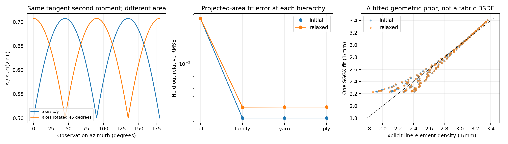
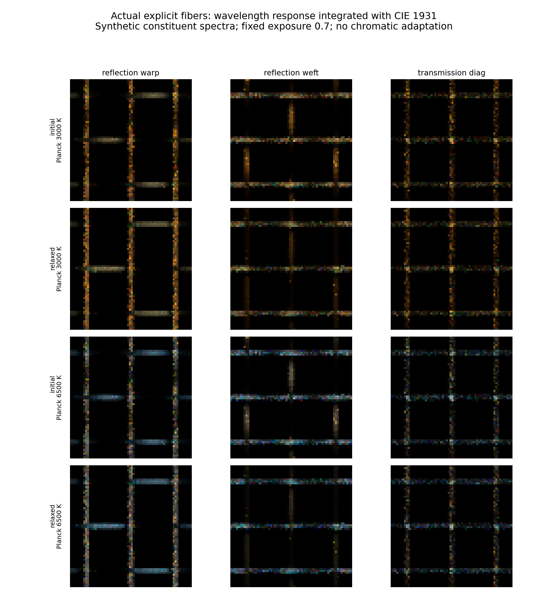
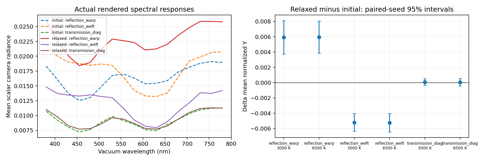

# Optical scale v3 — 계층 구조의 광학 축약과 실제 분광 관측

작성일: 2026-10-11. 염색·퇴색은 제외했다. 이 문서는 `textile_sim/optical_lod.py`,
`run_multiscale_optics_v3.py`와 실제 생성된 `data/optical_v3/`를 설명한다.

## 1. 이번 버전이 해결하는 연결 문제

v2는 개별 섬유를 유지하는 `OpticalScene`과 2D Maxwell/ray, Mitsuba 연결을
제공했다. v3는 다음 두 질문을 계산 가능한 대상으로 만들었다.

1. **fiber → ply → yarn → fabric에서 방향 정보를 합칠 때 무엇이 사라지는가?**
   개별 선분의 투영 면적을 기준값으로 두고, 전체를 한 SGGX로 맞추는 경우와
   경·위사/원사/ply를 따로 보존하는 경우의 오차를 비교한다.
2. **실제로 평형 계산한 원사 기하의 변화가 광학 관측에 나타나는가?**
   같은 섬유 ID·반지름·재료·관측계를 유지하고, 초기 및 평형 원사 트랙 위에
   재구성한 섬유를 여러 파장과 조명에서 실제로 path trace한다. 분광 복사휘도
   응답을 CIE 관측자와 광원 스펙트럼으로 적분해 관측값을 얻는다.

전자는 **모델의 공간·각도 정보를 축약하는 문제**, 후자는 **빛과 관측자의 파장
응답을 적분하는 문제**다. 두 축약을 같은 것으로 취급하지 않는다. 이번에
SGGX로 렌더링한 천을 개별 섬유 결과와 비교한 것은 아니다. SGGX의 소광 사전
모형과 위상함수 수학을 준비했으며, 외관 계산의 기준은 끝까지 실제 섬유다.

## 2. 어떤 문헌을 어떻게 연결했는가

| 1차 자료 | 확인한 내용과 이번 역할 |
|---|---|
| [Heitz et al. 2015, The SGGX Microflake Distribution](https://research.nvidia.com/sites/default/files/pubs/2015-08_The-SGGX-microflake/sggx.pdf) | §4–5의 투영 면적, SPD 표현, 비정규화 normal density, visible-normal 및 phase normalization을 확인했다. 공식을 독립 구현했다. |
| [Wang et al. 2022, SpongeCake](https://doi.org/10.1145/3546940) | §3의 방향 의존 소광, 소광 가중 reciprocity, 위상함수 정의를 확인했다. 이 정의와 천의 BSDF·다중 산란 모델을 구분한다. |
| [Tang et al. 2024, reflection–transmission capture](https://arxiv.org/abs/2406.19398) | 사용자 PDF와 v2 source audit을 이어받았다. 경·위사의 두 층과 반사·투과를 별도 관측해야 한다는 설계 근거다. ASGGX와 inverse fitting을 재현하지 않았다. |
| [FabricGen 2026](https://lxtyin.ac.cn/projects/fabricgen/) | 사용자가 제공한 논문의 원사/ply 방향과 계층 표현을 연결한다. 암묵 UV 기하·학습 생성기를 개별 섬유 역학으로 오해하지 않는다. |
| [Yu et al. 2025, ray–wave fabric](https://blaire9989.github.io/assets/3_RayWaveFabric/project.html) | 파동과 광선의 역할을 분리한다. 본 v3 분광 영상은 광선 모델의 파장별 매개변수 계산이며, ray–wave shader의 완전 재현이 아니다. |
| [Yang et al. 2026, Real-time woven fabric rendering using SGGX fitting](https://doi.org/10.26599/CVM.2025.9450445) | footprint에 따른 원사 NDF를 여러 SGGX로 맞추는 직접 관련 선행연구다. ‘직물에 SGGX를 적용했다’거나 ‘계층별 fitting을 했다’ 자체를 새로운 기여로 주장하지 않는다. |
| [Mitsuba 3.9.1 microflake.h](https://github.com/mitsuba-renderer/mitsuba3/blob/v3.9.1/include/mitsuba/render/microflake.h) | 설치된 pinned 헤더의 projected area와 normal density를 확인했다. 기존 hair BSDF와 서로 다른 모델임을 유지했다. |
| [CIE 2019 관측자 데이터](https://doi.org/10.25039/CIE.DS.xvudnb9b) | 공식 1 nm CSV의 SHA-256을 대조했다. 원본과 metadata, CC BY-SA 4.0 출처를 `data/optical_v3/cie/`에 보존했다. |

수학을 참고한 것과 논문 전체 시스템을 실행한 것은 다르다. 이번 실행 대상은
새로 작성한 투영·관측 모듈, 기존 개별 섬유 렌더러, 실제 v3 역학 출력이다.

## 3. 투영 면적에서 SGGX로 가는 정확한 계약

### 3.1 개별 섬유의 기준량

반지름 \(r_j\), 길이 \(L_j\), 단위 접선 \(t_j\)인 원통형 선분의 옆면 투영
면적을 합산한다. 모든 계층에 **동일한 명시적 평균 부피 \(V\)**를 사용한다.

\[
g(\omega)=\frac1V\sum_j 2r_jL_j
\sqrt{1-(t_j\cdot\omega)^2},\qquad [g]=\mathrm{mm}^{-1}.
\]

따라서 그룹을 나누더라도 \(g_{\rm all}=\sum_k g_k\)가 성립한다. 원사마다 별도
bounding volume을 쓰고 그 값을 단순 합산하면 이 성질을 잃으므로 그렇게 하지
않았다. 이번 평균 부피는 초기·평형 기하를 모두 포함하는 공통 bounding box다.

이 양에는 끝면, 선분 연결부의 중복, 가림, 실제 섬유 사이의 공간 상관,
다중 산란, 회절이 없다. 따라서 **실제 천의 투영 면적 합집합, 투과율,
측정된 소광계수 또는 BSDF가 아니다.** 독립 충돌을 가정하는 균질화 모델로
확장할 때 검토할 수 있는 기하적 소광 사전량이다.

### 3.2 접선 공분산이 충분하지 않다는 반례

같은 길이와 반지름을 가진 두 방향 집합을 비교하자.

\[
\mathcal T_A=\{e_x,e_y\},\qquad
\mathcal T_B=\{(e_x+e_y)/\sqrt2,(e_x-e_y)/\sqrt2\}.
\]

두 집합 모두 접선의 이차 모멘트는
\(Q=\operatorname{diag}(1/2,1/2,0)\)다. 하지만 \(\omega=e_x\)에서
\(\sum2rL\)로 정규화한 투영 면적은 **0.5와 \(1/\sqrt2\)**다. 제곱근을
포함한 방향 함수는 이차 모멘트만으로 결정되지 않는다.

이것은 기하 표현의 비유일성을 보이는 반례다. 일반 RGB의 식별 불가능성,
측정 채널의 최적성, 메타표면의 우수성을 입증하는 실험으로 바꾸어 읽으면 안 된다.

### 3.3 SPD fitting과 식별 조건

\[
\hat g_S(\omega)=\sqrt{\omega^T S\omega},\qquad S\succ0,
\]

\[
\min_S\sum_iw_i[\hat g_S(\omega_i)-g(\omega_i)]^2.
\]

코드는 log-Cholesky 좌표로 SPD를 유지하고, 제곱 투영값의 선형 least squares를
초기값에만 사용한다. 최종 최적화 대상은 \(g^2\)가 아닌 \(g\)다.
SGGX normal-shape와 density scale을 한 행렬에 흡수했으므로 이 구현의 \(S\)는
\(\mathrm{mm}^{-2}\) 단위다. SpongeCake의 무차원 shape \(S\)와 별도
\(\rho\,[\mathrm{mm}^{-1}]\) convention과 혼용하지 않아야 한다.

각도 설계 행렬
\([x^2,y^2,z^2,2xy,2xz,2yz]\)의 rank가 6 미만이면 fitting을 거절한다.
같은 방향을 여러 번 관측해 잔차가 작아져도 여섯 계수가 식별되는 것은 아니기
때문이다. 독립 리뷰에서 이 누락을 발견하고 수정했다. 수치적인 SPD floor와
training residual, held-out residual, condition number도 저장한다.

### 3.4 정규화와 reciprocity

\[
D_S(m)=\frac{1}{\pi\sqrt{\det S}\,(m^TS^{-1}m)^2}.
\]

\(D\)는 구면 전체에서 적분이 1인 확률밀도가 아니다. 올바른 정규화는

\[
\int_{S^2}(\omega_i\cdot m)_+D(m)\,dm=\sigma(\omega_i),
\qquad
D_{\omega_i}(m)=\frac{(\omega_i\cdot m)_+D(m)}{\sigma(\omega_i)}.
\]

이상적인 양면 반사 microflake의 위상함수는

\[
p(\omega_o|\omega_i)=\frac{D(h)}{4\sigma(\omega_i)},\quad
h=\frac{\omega_i+\omega_o}{\|\omega_i+\omega_o\|}.
\]

방향은 두 개 모두 산란점에서 바깥쪽을 향하는 convention이다. 이 위상함수는
단위 albedo에 대해 적분 1이며,

\[
\sigma(\omega_i)p(\omega_o|\omega_i)
=\sigma(\omega_o)p(\omega_i|\omega_o)
\]

를 만족한다. 단순히 \(p_{io}=p_{oi}\)라고 검사하면 이방성 소광을 잘못 다룬다.
그룹들을 앞으로 위상함수 mixture로 확장한다면 입사 방향마다
\(\sigma_k(\omega_i)/\sum_j\sigma_j(\omega_i)\)로 가중해야 한다.
현재 cloth 렌더러는 이 위상함수 대신 기존 dielectric-fiber hair BCSDF를 사용한다.

## 4. 실제 섬유에서 분광 관측까지

### 4.1 초기/평형 원단 쌍

`data/mechanics_v3/optical_pair/`에서 실제로 생성한 3×3 plain patch를 읽었다.
두 상태 모두 42개 섬유, 8,064개 선분, 6개 원사, 원사당 1 ply와 7개 섬유다.
반지름은 3 μm이며 재료 ID와 부모 관계가 동일한지 검사했다.

평형 후 섬유는 바뀐 원사 트랙 위에 다시 구성됐다. 그 결과
\(\sum\pi r^2L\) 부피 proxy가 **+0.04424%** 변했다. 경사 섬유 길이는
**−0.57358%**, 위사 섬유 길이는 **+0.66206%**여서 작은 총량 변화가 계열별
재분배의 부재를 뜻하지 않는다. 이 비교는 정확히
질량을 보존한 동일 섬유의 변형 실험이 아니다. 단순한 밝기 변화를 전부
접선 분포 하나에 귀속시키지 않는다.

Spline export의 최대 변위와 float32 저장 오차를 원본 서로 다른 섬유 간격
하한에서 차감했다.

| 상태 | 원본 간격 하한 | Export 후 간격 하한 |
|---|---:|---:|
| 초기 | 2.98363 μm | 2.83538 μm |
| 평형 | 2.94538 μm | 2.59759 μm |

이 계산은 서로 다른 섬유가 export 때문에 겹치지 않는다는 보수적인 검사다.
같은 섬유의 self-contact 또는 **영상 오차의 수치 상한**을 보장하지 않는다.

### 4.2 파장별 실제 경로 추적

반사 조명 두 방향(고도 40°, 방위각 0°/90°), 투과 조명 한 방향(고도 55°,
방위각 45°)을 사용했다. 두 상태의 camera·light world transform, source
radiance, pixel size와 노출은 동일하다. 출력은 64×64, 매 렌더 32 spp이고
독립 seed 4개를 썼다.

380–780 nm를 25 nm 간격의 **17개 실제 파장**으로 계산했다. 각 파장마다
재료별 \(n(\lambda),\kappa(\lambda)\)로부터

\[
\mu_a=\frac{4\pi\kappa}{\lambda_0},\qquad
\eta_{\rm shader}=n/n_{\rm background},\qquad
\sigma_{a,\rm shader}=\mu_a r
\]

를 갱신했다. 3.9.1 hair shader의 radius normalization은 v2에서 확인한
계약을 유지한다. Cached scene의 파장 매개변수를 갱신한 결과가 동일 파장의
새 export/새 scene을 만든 결과와 같은 seed에서 일치하는 실제 renderer
테스트도 추가했다.

이것은 `llvm_ad_rgb`를 **monochromatic scalar solver**로 반복 사용한 것이다.
각 호출의 세 RGB 채널이 동일한지도 검사한다. 이후 파장별 복사휘도에서
색을 계산하므로, 원래 RGB 세 채널을 가상 파장으로 간주한 방식은 아니다.
광선 모델이므로 회절·간섭·편광은 포함하지 않는다. 재료는 모두 합성 예제다.

### 4.3 CIE 관측자와 광원 적분

실제 렌더링한 스칼라 응답 \(R_x(\lambda_i)\)를 파장 사이에서 선형 보간하고,
공식 CIE 1931 2° 관측자의 1 nm 데이터와 광원 \(E\)를 사용한다.

\[
\begin{bmatrix}X\\Y\\Z\end{bmatrix}_x
=\frac{\int_{380}^{780} R_x(\lambda)E(\lambda)
   [\bar x,\bar y,\bar z]^T\,d\lambda}
 {\int_{380}^{780}E(\lambda)\bar y(\lambda)\,d\lambda}.
\]

광원은 3000 K 및 6500 K **Planck 스펙트럼**이다. 6500 K 흑체를 D65라고
부르지 않는다. 단위 스칼라 응답의 Y를 1로 정규화했으며 절대 cd/m² 측정이
아니다. D65 기준 sRGB primary matrix와 고정 노출 0.7로 표시하되 chromatic
adaptation은 하지 않았다. 원래 선형 XYZ와 원래 파장별 영상은 따로 보존했다.

380–780 nm 밖의 광원×photopic weight는 각 광원의 전체 CIE 360–830 nm
적분 대비 약 4.1–4.5×10⁻⁶다. 이는 **광원·관측자 weight의 범위 절단량**이지,
알 수 없는 대상 분광 응답까지 포함한 색 오차 상한은 아니다.

### 4.4 오차와 관측량을 분리했다

같은 seed를 파장과 기하 상태 사이에서 짝지었다. 픽셀을 독립 표본으로 세지
않고, **각 seed의 영상 평균 XYZ를 적분한 뒤** 4개 seed의 차이에 Student-t
95% 구간을 적용했다. 이 구간은 Monte Carlo 재현성만 나타낸다. 모델 근사,
실제 원단 변동, 재료 상수 불확실성은 포함하지 않는다.

실제 조명 rectangle의 중심 irradiance를 별도의 100×100 Gauss–Legendre 면적
적분으로 계산하고, 반사율 0.4 Lambertian reference의 실제 path trace와
비교했다. 상대 차이는 **0.178%**였다. 중심점과 중심 2×2 pixel block의 차이,
MC noise가 남는다.

## 5. 실제 결과

### 5.1 방향 정보의 계층별 보존

96개 방향으로 fitting하고 겹치지 않는 1,200개 방향에서 오차를 계산했다.
아래 값은 **동일한 합성 기하의 방향 보간/축약 오차**이며 새로운 원단에 대한
일반화 정확도나 외관 영상 오차가 아니다.

| SGGX를 보존하는 수준 | 초기 상대 RMSE | 평형 상대 RMSE |
|---|---:|---:|
| 전체 원단 1개 | 3.5727% | 3.5788% |
| 경사·위사 2개 | 0.2198% | 0.2984% |
| 원사 6개 | 0.2198% | 0.2990% |
| ply 6개 | 0.2198% | 0.2990% |

이 fixture에서는 경·위사를 나누는 단계의 효과가 컸다. 원사마다 다시 나눠도
개선되지 않았으며, 평형에서는 아주 조금 더 나빴다. 각 그룹을 독립 fitting한
오차가 전체 합에서 상쇄/누적될 수 있으므로 계층을 세밀하게 만들수록 전체
오차가 반드시 단조 감소하지 않는다. 원사당 1 ply이므로 yarn과 ply 행은 같은
분할이다. 이를 독립적인 ply-level 개선으로 주장하지 않는다.



### 5.2 평형 기하가 조명별로 다른 관측 변화를 만든다

6500 K Planck 관측에서 초기 대비 평형의 영상 평균 Y 변화는 다음과 같다.

| 조명 | 상대 평균 Y 변화 | ΔY의 seed-paired 95% 구간 |
|---|---:|---:|
| 반사, 방위각 0° | +37.04% | +0.00383 ~ +0.00805 |
| 반사, 방위각 90° | −32.37% | −0.00645 ~ −0.00403 |
| 투과, 방위각 45° | +0.64% | −0.00042 ~ +0.00053 |

반사 두 방향은 이 설정에서 다른 부호의 변화를 보였다. 투과의 작은 변화는
seed 반복 불확실성과 구분되지 않는다. ‘모든 채널에서 좋아졌다’거나 실제
제품 외관을 완전히 예측했다는 결론을 내리지 않는다.

25 nm 계산에 포함된 파장만 골라 만든 50 nm 결과의 상대 XYZ 차이는
**0.716–1.465%**였다. 첫 반사 조명에서 두 상태 모두 실제 중간 파장을 추가하여
12.5 nm 결과를 계산했고, 25 nm 대비 차이는 **0.170–0.363%**였다.
12.5 nm도 참값은 아니며, 이 차이에는 파장에 따라 달라지는 MC noise가 남는다.

총 **536회의 실제 개별 섬유 렌더링**을 수행했다. 기본 관측 408회와 추가
12.5 nm 파장 128회다. Lambertian radiometric benchmark는 별도 1회다.
각 이미지의 모양과 반응을 가상의 texture image로 생성하지 않았다.





## 6. 검증·파일·확장 지점

`tests/test_optical_lod.py`의 **20개 테스트**가 통과했다. 원통의 해석적 투영
면적, 계층 합산, 회전 공변성, 길이 단위 scaling, 선분 subdivision 불변성,
SGGX의 visible/phase 정규화, 소광 가중 reciprocity, 정확한 SPD의 복원,
실제 renderer 파장 갱신 일치, 공식 CIE hash/기준 행, Planck peak, 분광 적분
수렴, seed-paired 통계를 포함한다. 별도의 독립 리뷰 테스트는 동일 Q 반례와
식별 불충분 fitting을 검사한다.

```bash
python run_weave_mechanics_experiments.py --out data/mechanics_v3 --figures figures/mechanics_v3
python run_multiscale_optics_v3.py
python -m unittest tests.test_optical_lod -v
```

기본 원본 파일은 `data/optical_v3/optical_scale_metrics.json`이다. 입력 scene,
계층별 fitting matrix, 학습/평가 방향, 각 파장/seed의 원래 스칼라 radiance
배열, CIE 원본, 관측 가중치 정의, finite-source benchmark와 source hash를
보존한다. 실행 도중 광학 소스 파일이 바뀌면 최종 성공으로 기록하지 않는다.

후속 모듈은 다음 계약 위에서 연결해야 한다.

- **재료 교정:** 실제 원단의 복소 스펙트럼·단면·roughness를 측정하고 fixture의
  synthetic spectrum을 교체한다. 이름만 silk/cotton으로 바꾸지 않는다.
- **공간 축약:** 같은 기하로 SGGX mixture의 위상함수·albedo·가림·비균질
  density를 검증한다. 투영 면적 오차가 작다는 이유로 외관 오차가 작다고
  가정하지 않는다.
- **전체 의류:** 표면의 평행 이동·회전·곡률 및 실제 fiber 재배치를 보존하는
  연결이 필요하다. 3×3 finite patch를 무조건 반복 타일로 만들지 않는다.
- **파동 연결:** 현재 2D 원통 산란과 실제 3D fiber BCSDF 사이에 별도의
  averaging/validity model이 필요하다. v3가 그 연결을 자동 해결하지 않는다.
- **메타광학 계측:** 실제 광학 모델의 Jacobian과 측정 잡음을 사용해 좋은
  다중조명 RGB 대비 추가 관측의 가치를 평가한다. 현재 결과는 어떤 광학
  변화에 민감한 관측을 설계할지 탐색할 forward model이며, 메타표면의 필요성
  또는 성능 우위를 입증하지 않는다.
