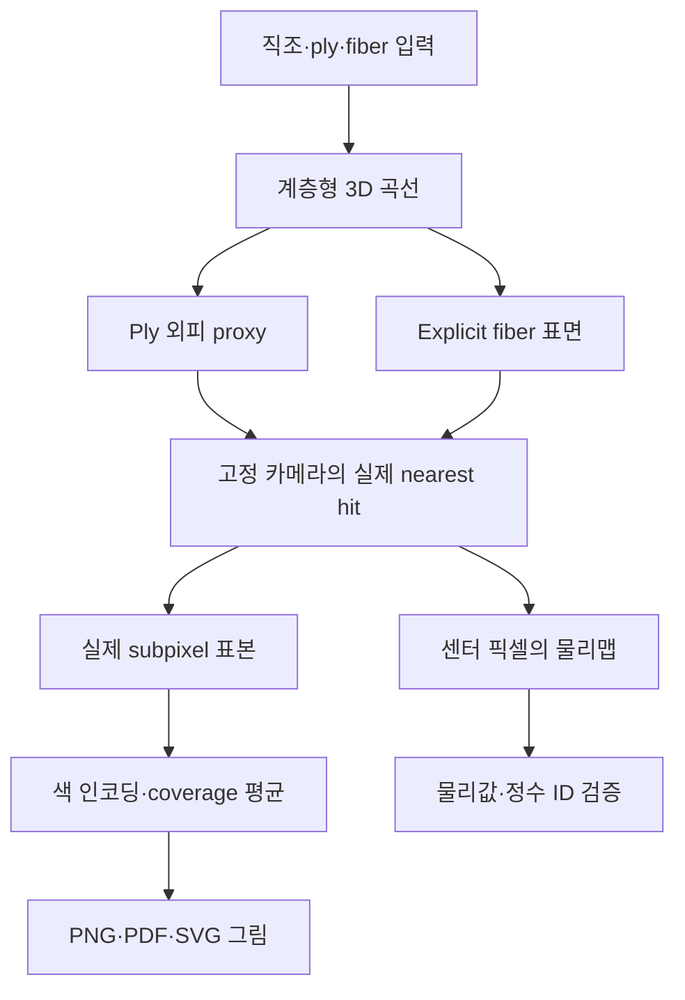

# v0.5.1 — 실제 기하에서 생성한 직물 구조맵과 논문용 그림

## 1. 이번 작업의 목적

사용자가 첨부한 normal / orientation / height 삼분할 그림처럼, **우리 엔진이 실제로 생성한 원단 구조를 설명할 수 있는 정량적 그림**을 만든다. 각 픽셀은 카메라 광선이 계산된 표면과 만나는 지점에서 나온다. 이미지 생성 모델이나 수작업으로 그린 섬유 무늬를 사용하지 않는다.

이 그림은 원단의 물리적 외관을 완성했다는 증거가 아니라, 현재 기하 모델을 검사하고 광학 엔진에 전달할 정보를 확인하는 데이터 제품이다. 법선·섬유 방향·높이·재료 ID를 분리하면 직조·꼬임·계층 표현이 의도대로 연결됐는지 점검할 수 있다. v0.5의 광학 결과와 샘플 수는 변경하지 않는다.

주요 결과는 다음 세 종류다.

| 그림 | 입력과 표현 | 확인할 내용 |
|---|---|---|
| `fabric_structure_triptych` | 기존 3 × 2 basket 입력의 ply-envelope proxy | 전체 직조 순서와 ply 꼬임, 법선·방향·높이의 대응 |
| `fabric_structure_hierarchy` | 같은 교차부의 ply 외피와 explicit fibers, 2행 × 3열 | 같은 카메라와 길이 배율에서 두 기하 표현의 차이 |
| `fabric_structure_material_detail` | explicit fibers의 정수 material ID, 전체/확대, 확대 법선 | 섬유별 입력 ID가 계층과 공간 위치를 따라 유지되는지 |

조밀한 별도 demonstration 입력은 `figures/structure_v5_1/compact/`에 따로 표시한다. 기존 basket 입력이나 v0.5 실험을 이 입력으로 대체하지 않는다.

이 compact 입력은 **2 × 2 basket grouping**에 yarn당 3 plies를 사용한다. `3-ply`는 ply 개수이며 `3 × 2` 직조 grouping과 다른 의미다. compact에도 같은 카메라의 ply/fiber 비교와 fiber ID 그림을 별도 생성한다.

## 2. 첨부 그림과 원 논문의 정의

첨부 이미지는 **Tang et al., FabricGen: Microstructure-Aware Woven Fabric Generation, CVPR 2026, Figure 5**다. 제공된 main PDF의 5쪽, 인쇄 페이지 34337에서 확인했다. 별도로 제공된 `2406.19398v3`는 *Woven Fabric Capture with a Reflection-Transmission Photo Pair*이며, 첨부 삼분할 그림의 출처는 아니다.

FabricGen §3 Eq. (1)은 UV 위치의 미세 구조를 `F = {n(p), t(p), h(p)}`로 표현한다. §5.1에서는 곡선 yarn centerline 주변의 ply helix를 사용하며, fiber orientation을 ply orientation에 twist angle ψ를 적용해 얻는다. 논문의 법선·방향·높이는 procedural yarn-space에서 정의하는 분석적 장이다. 우리는 명시적 3D 표면의 교차 지점에서 같은 종류의 장을 추출한다.

| 항목 | FabricGen 정의 | 이번 구현 |
|---|---|---|
| Normal | yarn-space의 분석적 normal 식 | 실제 삼각형의 outward geometric normal |
| Orientation | ply orientation을 normal 주위로 ψ만큼 회전시킨 fiber orientation | 해당 표현 단계의 ply 또는 fiber centerline tangent를 barycentric interpolation 후 정규화 |
| Height | yarn/ply 위치에서 계산하는 procedural height field | 동일한 nearest hit의 world z 좌표, 단위 mm |
| 표면 표현 | UV 기반 procedural microstructure | 원래 계층형 곡선을 RMF로 sweep한 closed triangle tubes |

따라서 ply 그림의 tangent를 논문의 ψ-회전 fiber orientation이라고 부르지 않는다. 삼각형 geometric normal과 analytic normal도 같은 계산이라고 주장하지 않는다. 첨부 그림은 패널 구성의 참고 자료이며, 새 그림의 모든 수치와 색은 우리 입력과 계산 결과에서 나온다.

추가로 공식 Supplementary §1.4 / Eqs. (8)–(17)의 curved helix 유도를 확인했다. 이 절은 ply centerline, 그 미분인 ply orientation, ψ 회전과 normal/height의 관계를 설명한다. 단순한 방향 벡터를 복사하는 것과 내부 fiber twist까지 표현하는 것이 다른 단계라는 설계 판단에 참고했다. main PDF의 Figure 5 caption은 상세 파라미터를 supplement로 안내하지만, 이번 원단 입력을 원문 사례에 맞춰 fitting하지 않았다.

### 실제 확인한 1차 자료

1. [FabricGen — 공식 CVPR PDF](https://openaccess.thecvf.com/content/CVPR2026/papers/Tang_FabricGen_Microstructure-Aware_Woven_Fabric_Generation_CVPR_2026_paper.pdf). 제공된 파일 SHA256: `46664335279f8d5e517c306c0bdc5d8a1b5cf8e2ac045e05cd507eeeb8b696fb`. 직접 확인 범위: §3, §5.1, Figure 5 및 관련 설명.
2. [FabricGen — 저자 프로젝트](https://lxtyin.ac.cn/projects/fabricgen/). 2026-10-11에 Paper / Supplementary / Dataset / Video 링크를 확인했다. footer의 GitHub 링크는 웹사이트 템플릿이며 FabricGen 구현 코드가 아니다. 현재 확인한 페이지에서 자체 구현 저장소 링크는 확인되지 않았다.
3. [FabricGen — 공식 supplementary](https://lxtyin.ac.cn/projects/fabricgen/static/pdfs/CVPR26_FabricGen_suppl_revised.pdf). 직접 확인 범위: parameter tables, §1.2 렌더링 연결, §1.4 curved helix 유도. 다른 모든 실험을 재현했다는 뜻은 아니다.
4. [FabricGen — 저자 데이터셋](https://huggingface.co/datasets/llxtyin/FabricGen-CVPR26). 프로젝트의 Dataset 링크에서 주소를 확인했으며, 이 구조맵 계산에는 데이터셋 이미지를 사용하지 않았다.
5. [Woven Fabric Capture with a Reflection-Transmission Photo Pair](https://doi.org/10.1145/3641519.3657410), [arXiv 2406.19398](https://arxiv.org/abs/2406.19398). 제공된 v3 파일 SHA256: `15cb20b1b9953c0cb760945e0f033f9e1ca0a450838d9a8746d2a4f6396dde5e`. 관련 normal/orientation 및 geometry 설명을 대조했다.

## 3. 계산 경로와 모듈 분리



`visualization/structure_maps.py`는 표면 생성과 교차 계산을 담당한다. `visualization/render_structure_figures.py`는 원시 데이터에 명시된 색 인코딩을 적용하고 논문용 패널·범례·길이 눈금을 배치한다. `visualization/render_compact_structure_figure.py`는 별도 조밀한 입력의 네 맵과 세 그림 계열을 같은 데이터 계약으로 생성한다. `visualization/finalize_structure_figures.py`는 보존된 표시 배열로 완성한 그림을 메모리에서 직렬화·검증한 뒤 최종 파일로 발행한다. 기존 `textile_sim`의 수치 모듈은 수정하지 않았다.

두 종류의 표면은 **서로 다른 기하 표현**이다. ply-envelope는 여러 fiber centerline과 반경을 바탕으로 만드는 node-ball 외피 proxy이다. 곡선이 휘고 기울어진 경우 모든 자식 표면을 엄밀히 둘러싼다고 보장하지 않으며, 내부 공극이나 섬유별 물질 부피를 보존하는 solid도 아니다. 실제 fiber 표면은 각 fiber centerline과 자신의 반경을 사용한다. 두 그림의 차이를 단순한 해상도 차이라고 해석하지 않는다.

## 4. 카메라와 물리 좌표

길이 단위는 mm다. 카메라는 world +Z에서 −Z를 바라보는 orthographic camera이고, 화면 오른쪽은 +X, 위쪽은 +Y다. 배열의 첫 행은 가장 큰 world Y에 대응한다. `imshow`에서는 `origin='upper'`와 실제 `(xmin,xmax,ymin,ymax)` extent를 함께 사용한다.

가로 W, 세로 H인 이미지의 센터 광선 좌표는 다음과 같다.

\[
x_j=x_{\min}+(j+\tfrac12)\frac{x_{\max}-x_{\min}}{W},\qquad
y_i=y_{\max}-(i+\tfrac12)\frac{y_{\max}-y_{\min}}{H}.
\]

개별 광선의 nearest triangle hit에서 위치·법선·tangent·ID를 함께 읽는다. 따라서 서로 다른 표면 위치의 height와 normal을 임의로 섞지 않는다. 원본 전체 crop은 입력된 yarn 개수와 pitch로 정한다. 확대 crop은 정해진 중앙 warp/weft 교차점에 중심을 두며 영상 내용을 보고 유리한 영역을 자동 탐색하지 않는다.

가로 픽셀 수를 기준으로 세로 픽셀 수를 물리 aspect ratio에 맞춰 정수 반올림한다. 패널의 실제 aspect는 extent로 고정하므로 기하를 화면 비율에 맞춰 늘리지 않는다. x/y pixel pitch의 작은 차이는 camera metadata에 남는다.

## 5. 맵별 인코딩

### 5.1 Normal

원시 `world_normal`은 실제 삼각형의 unit geometric normal이다. RGB 데이터는

\[
\mathbf c_n=\frac{\mathbf n+\mathbf 1}{2}
\]

로 정의하고 X/Y/Z를 각각 R/G/B에 대응시킨다. gamma, tone mapping, 조명, AO 또는 표면 재질을 적용하지 않는다. 이 RGB는 부호가 있는 벡터를 보여주는 좌표 인코딩이며, 원단의 실제 색이나 radiance가 아니다.

`world_smooth_normal`도 원시 파일에 보존하지만 primary panel에는 사용하지 않는다. smooth normal은 barycentric interpolation을 이용한 표시용 장이며 실제 삼각형 경계 normal과 구분된다.

### 5.2 Orientation

해당 계층의 centerline tangent를 world XY에 투영하여

\[
\theta=\operatorname{atan2}(t_y,t_x)\bmod\pi
\]

를 사용한다. 방향은 화살표가 없는 축이므로 t와 −t가 같은 색을 갖는다. 평면 투영의 크기가 `1e-8`보다 작으면 방향을 임의로 만들지 않고 undefined mask와 회색 `[0.45,0.45,0.45]`로 표시한다. 기본 그림에서는 그런 유효 hit가 발견되지 않았다.

색은 `twilight_shifted`를 1/4주기 이동한 2048-entry cyclic LUT이다. 정확한 정의는 `base_colormap((arange(2048)/2048 + 0.25) mod 1)`이며, 데이터와 범례가 같은 LUT를 사용한다. 이 phase 선택은 0°와 90°가 모두 밝은 배경과 구분되도록 하기 위한 표시상의 선택이다. 물리 방향이나 θ를 바꾸지 않는다.

확대 비교 그림의 짧은 선분은 유효한 센터 tangent에서 추출한 headless glyph다. glyph의 표본 픽셀, world 위치, θ와 선분 길이는 figure manifest에 기록한다.

### 5.3 Height

`height_mm`은 nearest hit의 world z이다. 그림에서는 `z * 1000`으로 µm로 표시한다. 기존 basket의 네 맵은 동일한 **[−70,70] µm** 범위를 사용한다. 첫 ply surface의 bounds를 10 µm 간격으로 바깥쪽 반올림하여 범위를 선언한 뒤, 다음 표현 단계가 이 범위를 벗어나면 계산을 거부한다. 각 패널의 최솟값과 최댓값으로 따로 대비를 늘리지 않는다.

모든 유효 supersample이 선언된 범위 안에 있는지 검사한다. 표면 뒤에 가려진 더 낮은 구조가 어떤 표현에서 보이는 현상은 실제 visibility 차이로 남으며, 보기 좋게 지우거나 같은 높이로 맞추지 않는다.

### 5.4 Material ID와 miss

Material ID는 입력 spec에 지정한 `synthetic_A`, `synthetic_B` 같은 범주이다. 표시용 파랑/주황은 해당 정수 ID의 색이며, 실제 염색 색상이나 예측한 화학 조성이 아니다. categorical 패널은 센터 정수 ID를 그대로 사용한다. 여러 subpixel의 색을 평균한 뒤 새로운 ID를 복원하지 않는다.

Ply proxy에 재료가 하나로 지정되지 않은 경우 해당 material index는 −1로 남는다. 이런 inapplicable ID와 no-hit을 `valid_mask`로 구별한다. float 맵의 no-hit은 NaN, 정수 맵은 −1이다. 실제 빈 공간과 유효한 어두운 height가 구분되도록 빈 공간은 연한 중성 배경으로 나타낸다.

## 6. 안티앨리어싱과 원시 데이터의 구분

각 이미지 픽셀에 2 × 2 regular subpixel center를 사용한다. 이는 실제 기하에 다시 쏜 광선이며 무작위 replicate가 아니다. 센터의 물리맵은 독립적으로 보존한다.

Coverage는 이 카메라에서 보이는 표면의 **2D 투영 점유 비율**이다. 이 값을 3D 공극률이나 fiber volume fraction이라고 해석하지 않는다.

각 subpixel의 맵을 먼저 RGB로 변환한 다음 coverage를 계산한다. `a_k`를 hit 여부, `c_k`를 그 RGB라고 하면,

\[
\alpha=\frac1N\sum_k a_k,\qquad
\overline{\mathbf c}=\frac{\sum_k a_k\mathbf c_k}{\sum_k a_k}
\]

이다. `alpha=0`에서는 RGB도 0으로 저장한다. 파일의 값은 일반적인 **straight RGBA**다. 배경 B에 합성하면

\[
\alpha\overline{\mathbf c}+(1-\alpha)\mathbf B
=\frac1N\sum_k[a_k\mathbf c_k+(1-a_k)\mathbf B]
\]

가 되어야 한다. premultiplied RGB를 그대로 straight alpha 이미지로 저장할 때 생기는 coverage²의 어두운 경계 오류를 이 식과 독립 검산으로 확인한다.

평균된 normal RGB를 다시 unit normal이라고 부르지 않는다. 평균된 orientation 색도 단일한 방향 측정값이 아니다. 물리값을 이용하는 후속 알고리즘은 센터 raw map 또는 보존한 실제 subpixel 맵을 읽어야 한다.

## 7. 저장 파일과 재현

각 map 폴더에 다음 파일이 있다.

| 파일 | 내용 |
|---|---|
| `structure_maps.npz` | 센터 위치, 법선, 표시용 smooth normal, tangent, height, 거리, 정수 ID, hit/coverage |
| `structure_maps.json` | 실제 기하와 source hash, 표면/카메라/ID lookup, 단위, 광선 수, float32 관련 정보 |
| `display_sources.npz` | 실제 SS hit mask, normal, tangent, height. AA 독립 재계산용 최소 원자료 |
| `display_rgba.npz` | normal/orientation/height/material의 straight RGBA, 센터 θ와 undefined mask |

`figures/structure_v5_1/figure_manifest.json`은 네 input map, 각 파일 SHA256, 배열 dtype/shape/semantic hash, 색과 카메라 계약, 패널별 source/extent, 길이 눈금, glyph와 PNG/PDF/SVG hash를 연결한다. 조밀한 사례는 `compact/figure_manifest.json`에 별도로 기록한다. NPZ는 임시 파일에 쓴 뒤 CRC와 모든 배열의 round-trip을 검사하고 atomic rename한다.

전체 재현은 원자료 덮어쓰기 방지 검사가 있으므로 **아직 존재하지 않는 출력 경로**를 사용한다. 다음 명령들은 저장된 연구 결과를 그대로 둔 채 새 실행 결과를 만든다.

```bash
python -m visualization.render_structure_figures \
  --data-dir scratch_runs/reproduce_structure_v5_1/canonical/data \
  --figure-dir scratch_runs/reproduce_structure_v5_1/canonical/figures \
  --resolution 640 --supersample 2 --radial-segments 64

python -m visualization.render_compact_structure_figure \
  --spec examples/visualization/compact_three_ply_basket.json \
  --data-dir scratch_runs/reproduce_structure_v5_1/compact/data \
  --figure-dir scratch_runs/reproduce_structure_v5_1/compact/figures \
  --resolution 640 --supersample 2 --radial-segments 64

python -m visualization.finalize_structure_figures \
  --manifest scratch_runs/reproduce_structure_v5_1/canonical/figures/figure_manifest.json \
  --manifest scratch_runs/reproduce_structure_v5_1/compact/figures/figure_manifest.json \
  --audit-directory scratch_runs/reproduce_structure_v5_1/publication
```

보존된 두 사례의 표시 배열만으로 최종 그림을 다시 발행하려면 다음 명령을 사용한다. 기하를 다시 trace하거나 맵의 색을 다시 계산하지 않는다. 새 audit 경로에 직전 generation manifest를 먼저 보존한 뒤, 해당 manifest가 가리키는 그림 파일과 figure manifest를 갱신한다. audit 경로를 재사용하여 다른 입력 이력을 덮어쓰는 동작은 거부한다.

```bash
python -m visualization.finalize_structure_figures \
  --audit-directory scratch_runs/structure_republication_v5_1
```

최초 실행의 `data/validation_v5_1/figure_finalization/`은 역사 기록이므로 새 실행의 audit 경로로 재사용하지 않는다. frozen producer의 `--replot-from` 기능도 남아 있지만, 출판용 최종 저장은 메모리 직렬화 finalizer를 사용한다. display NPZ의 파일 hash와 모든 배열 hash를 확인하며, 최초 계산 source와 후속 출판 source의 역할은 manifest에서 구별한다.

표시 연산과 파일 발행의 작은 독립 oracle:

```bash
python -m unittest discover -s tests -p test_structure_figures_v5_1.py -v
python -m unittest discover -s tests -p test_structure_figure_publication_v5_1.py -v
```

## 8. 실제 생성 결과와 검증 기록

두 입력은 같은 관측 알고리즘을 사용하지만 원단 구조가 다르다. 두 사례의 coverage 차이를 모델 정확도 향상이라고 해석하지 않는다.

| 항목 | 원래 basket 사례 | 별도 compact 사례 |
|---|---:|---:|
| Basket grouping | 3 × 2 | 2 × 2 |
| Yarn / ply / fiber 개수 | 10 / 30 / 210 | 16 / 48 / 336 |
| 전체 camera crop | 1.08 × 0.80 mm | 0.64 × 0.64 mm |
| 확대 camera crop | 0.22 × 0.22 mm | 0.16 × 0.16 mm |
| Ply proxy triangle 수 | 1,072,896 | 2,660,352 |
| Explicit fiber triangle 수 | 7,510,272 | 18,622,464 |
| 공통 height 범위 | [−70,70] µm | [−60,60] µm |
| 보존한 맵 | 전체/확대 × 두 표현, 4개 | 전체/확대 × 두 표현, 4개 |
| 저장 맵 생성의 primary ray query | 7,129,600 | 8,192,000 |
| 최초 최종 원자료 생성 시간 | 87.825 s | 157.706 s |

위 시간은 이 실행 환경의 기하 구성·맵·파일 생성 실행 기록이며, 광학 렌더러의 속도 비교값이 아니다. 두 사례 모두 radial segments 64와 2 × 2 subpixel 표본을 사용했다. 원래 전체 맵은 640 × 474 px, 나머지는 640 × 640 px이다. 합계 **15,321,600회**는 보존된 여덟 맵을 생성한 실제 primary ray query 수이고, 별도 독립 analytic oracle의 **594회**는 이 수와 분리해서 기록한다. v0.5.1에서 radiance light-transport render를 추가로 실행한 횟수는 **0회**다.

| 사례 | 범위 | 표현 | SS coverage | 관측 height 최솟값–최댓값 (µm) |
|---|---|---|---:|---:|
| 원래 basket | 전체 | Ply proxy | 41.1982% | −56.5253–64.9962 |
| 원래 basket | 전체 | Explicit fiber | 39.2858% | −62.5757–64.8875 |
| 원래 basket | 확대 | Ply proxy | 33.9384% | −56.4208–64.7606 |
| 원래 basket | 확대 | Explicit fiber | 32.1613% | −62.5435–64.6136 |
| Compact | 전체 | Ply proxy | 74.2178% | −41.0992–50.9958 |
| Compact | 전체 | Explicit fiber | 71.6590% | −46.7589–50.9770 |
| Compact | 확대 | Ply proxy | 73.2551% | −41.6005–50.9918 |
| Compact | 확대 | Explicit fiber | 70.2852% | −46.7861–50.9800 |

이 수치는 두 최종 figure manifest의 `statistics`와 보존된 표본에서 확인했다. 여덟 맵 모두 선언한 height 범위를 넘는 표본은 0개이고, 유효 hit 중 XY 투영 방향을 정의할 수 없는 표본도 0개였다. 이는 현재 두 입력에 대한 관측이며, arbitrary fabric에서 undefined orientation이 발생하지 않는다는 보장은 아니다. 별도 compact 입력의 선택 근거와 서로 다른 곡선의 clearance 검사는 `examples/visualization/compact_three_ply_basket_design_audit.json`에 있다. self-contact나 실제 힘 평형까지 검증한 사례는 아니다.

### 8.1 독립 검산

`visualization/review_structure_figures.py`는 producer의 색 처리 함수를 호출하지 않고 원시 표본에서 normal / headless orientation / height RGB와 straight alpha를 다시 계산한다. 두 사례 모두 **PASS**이며, 각각 4 maps, 104 arrays, 12개 NPZ의 CRC, 9개 그림 파일을 확인했다. raw 물리값과 표시 색을 구분하고, 단위·카메라·ID·길이 눈금·glyph 및 출판 전후 provenance도 검사했다. 저장된 원래 fiber 배열을 다시 생성하여 같은 geometry hash가 나오는지까지 검증한 것은 아니다.

- 원래 사례: `data/validation_v5_1/independent_review/verification_summary.json`.
- 별도 compact: `data/validation_v5_1/compact_review/verification_summary.json`.
- 평면·기울어진 표면·가림 관계의 594 query oracle: `data/validation_v5_1/independent_review/analytic_oracles.json`.
- 최종 전체 unittest: **425개, failures 0, errors 0, skipped 0**, 24.814 s. 실행 전후 87개 source hash가 동일하다. 기록: `data/validation_v5_1/final_suite/test_summary.json` 및 `tests.log`.

425는 프로젝트 전체 회귀 검사 수다. 실제 직물 시편 수나 독립 광학 실험 반복 수가 아니다. finalizer 추가 이전의 422개 검사는 `data/validation_v5_1/pre_publication_suite/`에 이전 실행 기록으로 보존했다.

### 8.2 그림 파일의 거부와 최종 발행

그림 검산 중 직접 경로에 저장된 PDF 두 개와 SVG 한 개에서 기록한 hash와 실제 바이트가 다르고 파일이 잘린 사례를 발견했다. 거부 당시 manifest와 파일을 `data/validation_v5_1/rejected_figure_serialization/`에 보존했다. 원인은 확정하지 않았으며, 이 문제 때문에 정상 원자료를 변경하거나 기하를 다시 trace하지 않았다.

최종 발행은 새로운 `visualization/finalize_structure_figures.py`로 수행했다. 원래 세 producer와 원시/표시 배열은 고정한 상태에서 다음을 확인했다.

1. 두 기존 composer의 exporter alias를 실행 중에만 교체하고, 저장된 RGBA 배열을 배치한다.
2. PNG/PDF/SVG를 각각 `BytesIO`에서 완성한다. PNG는 전체 decode, SVG는 XML parse, PDF는 header와 terminal EOF를 확인한다.
3. 두 사례의 18개 파일이 메모리에서 모두 검증된 후 임시 파일에 쓰고 flush / fsync / replace한다. 저장 직후와 전체 발행 후 exact-byte readback을 한다.
4. 기존 generation manifest의 전체 바이트를 별도 보존한다. 최초 `input_maps`와 `producer_sources_sha256`는 변경하지 않고, 출판 단계 source hash·serialization 방식·layout 수정은 `publication_finalization`에 추가한다.

최종 18개 파일의 발행은 15.418 s에 완료했다. Compact triptych의 설명 문장만 패널 제목 아래 겹침을 피하도록 maps 아래 여백으로 이동했다. 물리 crop·맵 값·범례·색 함수는 변경하지 않았다. 이 위치 변경은 manifest의 `layout_adjustments`에 기록했다.

별도 환경 QA에서 PyMuPDF를 이용해 **6개 PDF 모두 1페이지 parse와 페이지 rasterization**을 수행했고, PNG 6개 decode와 SVG 6개 XML parse 및 최종 파일 hash도 통과했다. PyMuPDF는 이 QA 환경에서만 사용했으며 프로젝트의 새로운 필수 runtime dependency로 추가하지 않았다. 최종 compact hero, 원래/compact hierarchy의 PDF raster를 직접 열어 범례·패널·subtitle 배치도 확인했다.

근거는 `data/validation_v5_1/figure_finalization/publication_checks.json`과 `page_container_qa.json`이다. 같은 폴더의 `canonical_input_generation_manifest.json`, `compact_input_generation_manifest.json`은 발행 직전 이력을 보존한다. 미참조 중간 triptych는 quarantine에 보존하고 최종 manifest에서 제외했다. 파일 목록을 다시 검사했을 때 같은 중간 파일이 보인 사실과 보존본 대조 후 제거한 기록은 `post_finalization_inventory_observation.json`에 남겼다. 최종 배포 대상은 디렉터리 전체가 아니라 두 manifest에 지정된 **세 그림 계열 × 세 형식 × 두 사례 = 18개 파일**이다.

## 9. 확인한 범위와 다음 연결

표시 oracle은 normal의 축/감마 오류, t/−t의 headless 표현, vertical tangent의 undefined 처리, alpha 합성, all-miss 값, height clipping 거부, 정수 material ID 보존, 실제 단위의 scale bar, NPZ CRC/round-trip을 확인한다. 실제 AOV의 원자료는 별도 리뷰어가 producer의 색 처리 함수를 호출하지 않고 SS→RGBA를 다시 계산한다. 평면·기울어진 표면·frontmost hit에 대한 기하 oracle은 구조맵 모듈의 독립 검증에서 다룬다.

이 그림만으로 광학 산란, 회절, 투과, 재질감 지각이 검증되지는 않는다. 특히 top-down height/normal map은 가려진 내부와 뒤쪽 표면을 포함하지 않는 2.5D 관측이다. 전체 3D 섬유 구조와 실제 광학 상태를 단일 RGB 맵으로 대체할 수 없다.

광학 엔진과의 유용한 연결점은 공통 geometry hash, 원사/ply/fiber ID, 방향과 material assignment다. 같은 구조를 사용해 광학 계산의 glint/하이라이트 위치가 어떤 섬유와 법선에서 나왔는지 추적할 기반이 된다. 이번 작업은 그 데이터 경로와 시각적 검사 가능성을 구현한다. 새로운 optical accuracy나 실제 원단 일치도를 주장하려면 기존 v0.5의 수치 오차 문제와 독립 물리 시편 검증을 계속 해결해야 한다.
