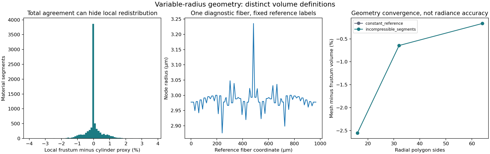
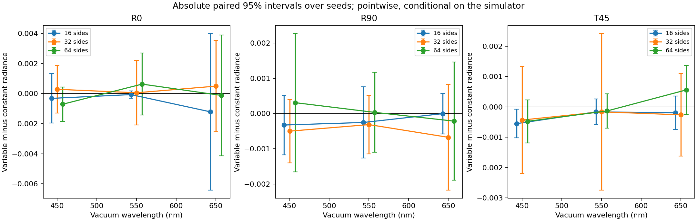

# v0.5: 동일 섬유의 가변 단면을 닫힌 표면 광학으로 연결

## 1. 이 단계가 전체 연구에서 해결하는 문제

이 연구의 목표는 의류의 **시각적 재질감을 실물과 가깝게 전달**하는 것이다. 현재 단계에서는 그 목표의 기반인 fiber → ply → yarn → weave → fabric 순방향 모델을 검증한다. 실제 원단을 측정하거나 메타표면을 제작한 단계는 아니다. 염색·퇴색은 보류한다.

v0.4에서는 같은 섬유의 물질좌표를 변형 전후에 추적하고 선분별 신장을 계산했다. `incompressible_segments`는 선분 원기둥 부피 proxy가 보존되도록 반지름을 바꾸지만, 기존 광학 adapter는 일정 반지름만 허용했다. 따라서 그 상태를 평균 반지름으로 바꾸어 몰래 렌더하지 않고 export를 거부했다.

v0.5는 **선분 반지름 → 연속 node 반지름 → 닫힌 삼각형 표면 → 경계 반사·굴절과 내부 흡수**의 새 경로를 구현한다. 연구 질문은 다음과 같다.

> 같은 물질점·중심선·재료·조명에서 반지름 모델을 바꿀 때 광학 반응이 얼마나 달라지는가? 그 차이를 표면 분할 오차와 Monte Carlo 잡음에서 분리할 수 있는가?

비교 자체가 가능해진 것과, 그 차이를 실제 물리 효과로 해석할 수 있는 것은 다른 검증 항목이다. 원단 간 분류 성능이나 실물 재현 정확도의 개선을 이번 합성 실험으로 주장하지 않는다.

## 2. 왜 기존 curve에 medium을 붙이지 않았는가

Mitsuba 3.9.1의 공식 문서·고정 commit 소스를 확인하고 실제 ray intersection을 검사했다. B-spline curve는 control point마다 반지름을 받을 수 있지만 backface를 항상 제거한다. 내부에서 바깥으로 나오는 교차가 필요한 dielectric + interior medium 경계로 그대로 쓰면, 닫힌 체적을 통과한 것으로 계산할 근거가 사라진다. 또한 기존 hair BCSDF의 흡수 parameter는 실제 mm 경로에 직접 곱하는 계수와 의미가 다르다.

관련 근거와 source blob SHA는 [광학 소스 감사](variable_radius_optics_source_audit_v5.md)에 있다. [공식 shapes 문서](https://mitsuba.readthedocs.io/en/v3.9.1/src/generated/plugins_shapes.html), [media 문서](https://mitsuba.readthedocs.io/en/v3.9.1/src/generated/plugins_media.html), [BSDF 문서](https://mitsuba.readthedocs.io/en/v3.9.1/src/generated/plugins_bsdfs.html), [integrator 문서](https://mitsuba.readthedocs.io/en/v3.9.1/src/generated/plugins_integrators.html)를 함께 사용했다.

이번에는 각 섬유를 cap이 있는 닫힌 삼각형 표면으로 만들고, 실제 face normal로 반사·굴절을 계산하는 별도의 baseline을 선택했다. **v0.4 hair 결과와 v0.5 mesh 결과의 차이를 반지름 효과로 해석하지 않는다.** v0.5 내부의 두 반지름 상태에 같은 optical model을 적용한다.

Yu 등의 [Ray–Wave Hybrid Shading Model](https://doi.org/10.1145/3763359)은 전체 연구의 직접 선행연구다. 이번 구현은 그 논문의 ray–wave 결합 전체를 복제한 것이 아니다. 기존의 2D 국소 Maxwell 해와 이번 3D 경계·흡수 경로는 별개로 검증하며, fabric 수준 결합에는 광로·정규화·coherence·차폐·다중 산란과 중복 에너지 방지 계약이 추가로 필요하다. 관련 원문과 후속 연구의 확인 깊이는 [v3 문헌 ledger](literature_engine_v3.md)에 남아 있다.

## 3. 물질좌표와 반지름의 수학

저장한 reference 선분 길이를 \(\ell_{0,e}\), 같은 물질점들의 현재 길이를 \(\ell_e\)라고 하자. v0.4가 계산한 기하학적 신장은

\[
\lambda_e=\frac{\ell_e}{\ell_{0,e}},\qquad
r_e^{\mathrm{seg}}=\frac{r_{0,e}}{\sqrt{\lambda_e}}
\]

이다. 이것은 선언한 correspondence와 운동학에 따른 값이며, 실제 fiber 응력 평형이나 stress-free reference에서 측정한 탄성 strain이 아니다.

단면을 선분마다 불연속 원기둥으로 두면 접합부가 광학 경계로 남는다. 따라서 v0.5는 node의 단면적을 인접 선분 길이로 가중한다.

\[
\widetilde r_i^2=
\frac{\ell_{i-1}(r_{i-1}^{\mathrm{seg}})^2+
      \ell_i(r_i^{\mathrm{seg}})^2}
     {\ell_{i-1}+\ell_i}.
\]

끝 node에는 인접한 선분 반지름을 쓴다. 선분 안에서 반지름을 선형 보간하면 straight-frustum 적분은

\[
V_e^{\mathrm{frustum}}
=\frac{\pi\ell_e}{3}\big(r_e^2+r_er_{e+1}+r_{e+1}^2\big).
\]

이것이 섬유 전체에서 원래 선분 proxy의 합과 같도록 섬유마다 한 번의 scale을 적용한다.

\[
q=\sqrt{\frac{\sum_e\pi\ell_e(r_e^{\mathrm{seg}})^2}
 {\sum_e\pi\ell_e(\widetilde r_e^2+
                  \widetilde r_e\widetilde r_{e+1}+
                  \widetilde r_{e+1}^2)/3}},
\qquad r_i=q\widetilde r_i.
\]

이 규칙은 하나의 명시적 기하 재구성이다. 데이터에서 유일하게 결정되는 실제 단면 법칙으로 주장하지 않는다. **섬유 전체 적분을 맞춰도 각 물질 선분의 부피가 보존되지는 않는다.** 각 선분의 재분배 오차도 별도 배열로 저장한다.

### 반드시 구분하는 세 부피

| 양 | 정의 | 보존·검증의 의미 |
| --- | --- | --- |
| 선분 원기둥 proxy | \(\sum_e\pi\ell_e(r_e^{\rm seg})^2\) | v0.4의 선분별 반지름 법칙이 보존하는 값 |
| 연속 반지름 frustum 적분 | \(\sum_eV_e^{\rm frustum}\) | v0.5의 global scale이 섬유별 합계만 맞추는 값 |
| 닫힌 삼각형 mesh 부피 | \(\frac16\sum_f\mathbf a_f\cdot(\mathbf b_f\times\mathbf c_f)\) | 실제 굽은 ring 연결과 cap으로 만든 다면체의 signed volume |

마지막 값은 자동으로 앞의 값과 같지 않으며, 이를 맞추기 위해 mesh를 다시 부풀리지 않는다. 순수한 반지름 모델 효과에 부피 보정이라는 다른 변화를 더하지 않기 위해 실제 차이를 보고한다. 부호 있는 부피가 양수라는 사실만으로 self-intersection 부재를 인증할 수는 없다.

## 4. 표면 생성·교차·단위 계약

Rotation-minimizing frame으로 원형 node ring을 만들고 인접 ring 사이에 삼각형을 연결한다. 끝에는 cap을 둔다. 초기 normal seed를 그대로 저장하고 재사용한다. 이미 투영한 seed를 다시 투영해 저장하면 round-trip에서 부동소수점 차이가 누적될 수 있어, 독립 리뷰에서 실제 42개 섬유를 이용해 이 문제를 수정했다.

다음 검사를 optical scene 생성 전에 수행한다.

- 모든 edge의 두 face가 반대 방향으로 만나는 closed oriented topology.
- 유한 좌표, 양의 면적, outward winding과 positive signed volume.
- float64 → float32 변환 후 삼각형 붕괴·방향 반전·부피 변화.
- 저장한 mesh와 실제 renderer vertex/index buffer의 hash.
- 최대 node radius로 감싼 capsule 사이의 다른-fiber 간격. 실제 triangle은 endpoint ball의 convex hull 안에 있으므로 이 envelope는 보수적인 포함 관계를 준다.

다른 fiber의 남은 간격에서는 두 mesh의 최대 float32 좌표 오차를 차감한다. **동일 fiber의 비인접 부분끼리 만나는 self-contact는 이 검사에 포함하지 않는다.** Cap·ring 연결의 교차 없는 물리적 체적, 실제 접촉·압착·마찰은 별도 검증 대상이다.

길이는 mm, 파장은 vacuum nm이다. scalar material spectrum의 \(n(\lambda),\kappa(\lambda)\)에서

\[
\mu_a(\lambda)=\frac{4\pi\kappa(\lambda)}{\lambda_{\rm nm}\,10^{-6}}
\quad[\mathrm{mm}^{-1}]
\]

를 계산한다. 경계는 실수 \(n\)의 dielectric Fresnel, 내부는 \(\sigma_t=\mu_a\), albedo 0의 pure absorption이며 `volpath`로 적분한다. \(\kappa/n\le0.01\) gate는 복소 굴절률의 경계 Fresnel 보정을 생략하는 현재 근사의 범위다. 실측 정확도를 보증하는 일반 오차 bound는 아니다.

원형 단면의 material twist, 복굴절, 비원형 단면, 표면 roughness, 잔털의 실제 측정 통계, 파동 간섭·회절은 이번 경계 모델에서 추정하지 않는다. 기존 `RenderConfig`의 hair roughness·legacy absorption·exposure 값은 이 model에 적용하지 않으며 metadata에 명시한다.

## 5. 실험 구성과 통계

입력은 보존된 [v0.3 optical pair](../data/mechanics_v3/optical_pair)다. 42 fibers의 같은 material labels를 relaxed 부모 곡선으로 운반한 후, 두 상태의 **중심선과 label이 byte까지 같은지** 검사한다. 비교하는 것은 `constant_reference`와 `incompressible_segments`에서 재구성한 단면이다.

| 제어 항목 | 값 |
| --- | --- |
| 상태 | 두 radius state, 동일 중심선·물질점·재료 배치 |
| 원주 분할 | 16, 32, 64각형 |
| 광원 | R0: 반사 elevation 40°/azimuth 0°; R90: 40°/90°; T45: 투과 55°/45° |
| 광원·시점 크기 | 7° angular half-width 면광원, 동일 union bounds의 orthographic rig |
| 파장 | 450, 550, 650 nm의 독립 scalar 계산 |
| 렌더 | 64×64, 64 spp, seed 5723·22840·39957·57074 |
| 계획한 실제 render 호출 | 3 분할 × 2 상태 × 3 조명 × 3 파장 × 4 seeds = 216 |

재료 A/B는 기존의 알려진 합성 spectrum이다. 실크·코튼 등의 이름을 붙이지 않는다. RGB backend의 세 채널이 같은 단색 값을 복제하는지 확인한 뒤 첫 채널을 저장한다. RGB 채널·픽셀·파장을 독립 반복 수로 세지 않는다. 세 파장으로 CIE 색 정확도를 주장하지 않는다.

각 seed 영상의 pixel mean을 하나의 관측으로 쓴다. 같은 seed끼리의 절대 radiance 차이 \(d_k\)에 대해

\[
\bar d\pm t_{1-\alpha/2,\,K-1}
\frac{s_d}{\sqrt K},\qquad K=4
\]

를 보고한다. Pointwise 95% 구간과 함께, 최고 원주 분할의 radius 비교 9조건은 Bonferroni family-wise 95% 구간도 저장한다. 인접 분할 refinement는 전체 36조건을 한 family로 다룬다. 적은 seed의 Student-t 근사이며, caustic의 heavy-tail이나 실물·모델·교정 불확실성을 해결한 것으로 보지 않는다.

상대 변화율은 저장한 baseline 평균으로 나눈 **point estimate**다. baseline이 0이면 `null`이며 분모를 작은 상수로 대체하지 않는다. 이 비율을 모집단 상대 변화율의 신뢰구간으로 표시하지 않는다.

## 6. 실행 결과

최종 216회는 2026-10-11 UTC에 **202.188323초** 동안 실행했다. 아홉 NPZ의 ZIP CRC와 nested checksum, 77개 출력 파일, source/input 변화를 확인했다. 독립 verifier는 252개 fiber mesh, 54개 scene metadata, 216개 scalar 영상을 다시 검사했다. 원본 네 파일로 reference와 두 radius state도 재구성했다.

| 기하 항목 | 실제 값 | 해석 |
| --- | --- | --- |
| 추적하는 물질점 | 42 fibers · 8,106 vertices · 8,064 segments | 두 상태의 중심선·labels 동일 |
| 가변 node radius | 2.808323–3.235533 μm | 초기 일정 반지름 3 μm에서 재구성 |
| 섬유별 frustum 총량 상대 오차 | 최대 4.44×10⁻¹⁶ | global scale의 기하 적분 일치 |
| 선분별 재분배 오차 | −3.96381%~+3.80001% | 국소 부피 보존을 강제하지 않은 결과 |
| 국소 절대 재분배 오차 99백분위 | 1.74383% | 실제 질량·압축 물성 오차로 환산하지 않음 |
| mesh/frustum 차이, 16 / 32 / 64각형 | 약 −2.55389% / −0.64480% / −0.16407% | 원주 분할에 따른 실제 닫힌 mesh의 부피 차이 |

최고 분할의 평균 radiance 변화율은 다음과 같다. 모든 구간은 simulator 조건부 Monte Carlo 반복에 관한 값이다.

| 조명 | 450 nm | 550 nm | 650 nm | 판정 |
| --- | ---: | ---: | ---: | --- |
| R0 | −3.895% | +2.073% | −0.400% | 3조건 모두 pointwise·Bonferroni 구간에 0 포함 |
| R90 | +2.646% | +0.327% | −2.751% | 3조건 모두 pointwise·Bonferroni 구간에 0 포함 |
| T45 | −18.456% | −3.885% | +27.412% | 3조건 모두 pointwise·Bonferroni 구간에 0 포함 |

**현재 4-seed·64-spp 예산에서는 최고 분할의 반지름 효과를 명확히 분리하지 못했다.** 특히 T45의 큰 상대 변화율은 작은 baseline과 잡음의 영향을 받으므로 검출된 물리 효과로 해석하면 안 된다. 또한 단지 구간에 0이 있다는 이유로 두 모델이 물리적으로 동등하다고 결론 내릴 수도 없다.

반면 32→64각형으로 표면을 세분화할 때 R0 평균은 두 상태·세 파장에서 **약 25.70~31.56% 감소**했다. 이 여섯 변화의 pointwise 95% 구간은 0을 포함하지 않는다. 전체 refinement 36조건에 대한 Bonferroni 구간에서는 16→32/R0/450 nm의 두 상태만 0을 제외했다. 최고 분할의 잔여 변화가 없다는 결론은 어느 쪽에서도 정당화되지 않는다.





원시 자료는 [geometry_metrics.json](../data/variable_radius_v5/geometry_metrics.json), [optical_metrics.json](../data/variable_radius_v5/optics/optical_metrics.json), [spectral_radiance.npz](../data/variable_radius_v5/optics/spectral_radiance.npz)에 있다. 최종 NPZ SHA-256은 `7e677abb8d777bab68044033de22d114a279be11b79cc239af8afe18cf4f1728`이다. 거부했던 첫 실행과 최종 원시 radiance 배열은 byte까지 같지만, 최종에서는 실제 저장 mesh도 무결성 검사를 통과했다. 두 실행을 8 seeds 또는 추가 독립 관측으로 합산하지 않는다.

## 7. 부피 수렴과 광학 수렴의 차이

직선 원형 tube를 \(N\)각형으로 근사할 때 부피 비율은

\[
\frac{V_N}{V_\infty}=\frac{N\sin(2\pi/N)}{2\pi}=1-O(N^{-2})
\]

이다. 그러나 원형 표면 normal의 각도 bin 절반은 \(\pi/N\)으로 줄어든다. 16·32·64각형에서는 각각 11.25°·5.625°·2.8125°다. Specular 경로는 작은 normal 차이에도 바뀔 수 있으므로 **mesh 부피 오차가 작아졌다는 이유만으로 광택이 수렴했다고 판단할 수 없다.** 이번 분할 비교는 바로 그 차이를 실험하기 위한 것이다.

이는 metasurface 관측 설계에도 영향을 준다. 순방향 모델의 원주 분할·경계 offset 오차가 목표 효과보다 크면, 측정 최적화가 원단 대신 수치 오차를 구분하는 채널을 선택할 위험이 있다. 따라서 high-resolution RGB를 넘는 추가 정보의 가치를 평가하기 전에, 목표 contrast보다 작은 수치 오차를 확보하는 단계가 필요하다. 이것은 이번 결과에 근거한 연구 설계상의 추론이다.

## 8. 물리 oracle와 renderer 길이 척도

별도의 32회 기준 렌더로 Beer–Lambert 다섯 optical depth, 흡수 없는 dielectric furnace, 8배 길이 상사, taper를 검사했다. 모든 사전 지정 oracle guard를 통과했지만, 8배 상사와 1배 기준의 작은 차이는 paired seed에서 분리됐다. 설치 header와 실제 `spawn_ray`를 조사해 표면 offset에 길이와 함께 변하지 않는 상수 항이 있음을 확인했다.

이 offset의 기본 척도는 mm scene에서 약 0.0894 μm다. 반지름 수 μm인 fiber에서는 별도 감도 검증이 필요하다. [물리 oracle 보고서](volume_optics_validation_v5.md), [원시 oracle 결과](../data/validation_v5/volume_physics/validation_metrics.json), [실제 ray offset 감사](../data/validation_v5/ray_offset_audit/ray_offset_audit.json)를 참조한다. 별도 길이 상사 실험은 원래 geometry와 absorption을 함께 바꾸어 동일한 이상적 optical depth를 유지하며, 물리적으로 다른 섬유를 측정한 것으로 계산하지 않는다.

## 9. 재현·무결성·독립 검산

```bash
python run_engine_v5.py --dry-run

# 보존된 216개 영상을 raw array에서 검산; 새 실험 render 0회
python run_engine_v5.py --stages verify --output scratch_runs/v5_audit

# 새 기하 생성과 원본 material-state 재구성까지 검증; 새 render 0회
python run_engine_v5.py --stages experiment verify --no-render \
  --output scratch_runs/v5_geometry

# 새 216회와 검산·전체 suite
OPENBLAS_NUM_THREADS=1 OMP_NUM_THREADS=1 \
  python run_engine_v5.py --output scratch_runs/v5_full

# 광학 oracle 32회; 새 출력 위치 사용
OPENBLAS_NUM_THREADS=1 OMP_NUM_THREADS=1 \
  python run_volume_optics_validation_v5.py --output scratch_runs/v5_physics
```

`--no-render`는 experiment render를 생략한다. 함께 선택한 tests의 작은 renderer 검사까지 생략하지는 않는다. 기존 폴더를 덮어쓰지 않고 source·input hash를 시작과 종료 시 대조한다. Verify-only는 기본 mechanics 원본이 있으면 그 네 파일까지 재구성하며, custom 데이터에서 원본이 없으면 내부 검산만 수행했다는 상태를 명시한다. `--source-input`으로 지정한 원본을 읽을 수 없으면 조용히 생략하지 않는다.

[독립 verifier](../verify_variable_radius_artifacts_v5.py)는 producer driver와 renderer 모듈을 import하지 않고 저장 배열·geometry·scene metadata·통계를 검산한다. 원본 pair의 물질좌표 재구성에는 공통 v0.4 core를 사용하므로, 그 부분이 완전히 독립적인 두 번째 물질 운반 solver인 것은 아니다. 원시 radiance를 다시 읽어 평균·구간·seed 조합을 계산하며, hash를 다시 맞춘 잘못된 반지름·vertex·NaN·통계·중복 record도 거부한다. 검산한 저장 영상 수를 새 render 수에 더하지 않는다.

첫 216회 실행 후 하나의 mesh NPZ가 ZIP central directory를 잃은 것을 독립 검산에서 발견했다. 앞서 기록한 nested hash와 이후 파일 hash가 달랐지만, 최종 outer ledger는 불완전한 파일을 그대로 해시해 `passed`로 기록했다. 원인은 확정하지 못했다. 원래 자료와 소스를 [거부 기록](../data/validation_v5/serialization_rejection_216/rejection_audit.json)에 보존하고, NPZ를 메모리에서 완성한 후 flush/fsync·atomic replacement·readback을 수행하며 마지막에 모든 ZIP CRC와 nested checksum을 확인하도록 보완했다. 최종 자료는 이 수정 이후 전체 실험을 다시 실행한 것이다. 첫 실행을 독립 표본 증가로 합산하지 않는다.

개별 unit test가 실제 원단의 정답을 보증하지는 않는다. 소프트웨어 검증, 수치 수렴, 실측 validation, 사용자 지각 평가를 각각 별도의 단계로 유지한다. 최종 완료 범위와 GitHub snapshot은 [v0.5 릴리스 설명](../docs/RELEASE_V0_5.md)에서 확인한다.
