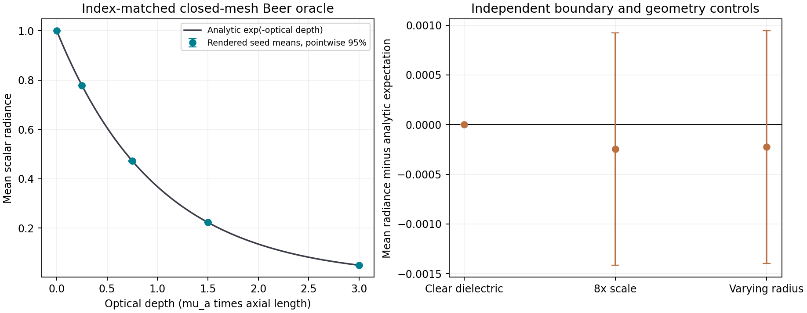

# v0.5 closed-volume optics: 독립 물리 oracle와 수치 한계

## 검증 결과

`data/validation_v5/volume_physics/`에서 **8조건 × 4 seeds = 실제 32회** 렌더링했다. 모든 사전에 지정한 광학 oracle 오차 guard를 통과했고, 실행 전후 producer source hash가 일치했다. 이 결과는 알려진 합성 geometry·광학 상수로 구성한 기준 문제의 검증이다.

- Runtime: Mitsuba 3.9.1 / `llvm_ad_rgb`.
- 파장: 550 nm의 scalar 파라미터. RGB 3채널은 같은 scalar의 복제이며 분광 적분이 아니다.
- 각 이미지: 16 × 16 pixels, 2,048 samples/pixel.
- Seeds: 1187, 9781, 23417, 45751.
- 총 실제 camera paths: 16,777,216. RGB 채널을 3배의 독립 표본으로 세지 않는다.
- 실행 시간: 9.465649273초.
- Raw 이미지: `scalar_radiance.npz`, 축 순서 `case, seed, y, x, replicated_scalar_channel`.
- Raw NPZ SHA-256: `37655778302494fa866abde59522f75fe2d1846d7ab0139de4efb1e2fa9de159`.
- Manifest SHA-256: `1dd3309ca598e2e9b0b4677e91fcf3de8f34ca37529cf158d978f4c7f8edbd6c`.

실행 파일은 [run_volume_optics_validation_v5.py](../run_volume_optics_validation_v5.py), 원시 자료·장면·통계는 [validation_metrics.json](../data/validation_v5/volume_physics/validation_metrics.json), 변경 여부는 [experiment_manifest.json](../data/validation_v5/volume_physics/experiment_manifest.json)에 있다.

## 1. 해석적 기준 문제

중심선이 직선이고 양 끝이 닫힌 32각형 tube를 사용했다. 기본 길이는 1 mm, 반지름은 0.2 mm다. Orthographic 카메라는 축 방향으로 보고, film footprint 전체가 모든 단면의 내접원 안에 있도록 검사했다. 따라서 index-matched \(n=1\) 조건에서는 각 광선이 평행한 두 cap을 지나며 이상적인 내부 광로는 정확히 길이 \(L\)이다.

흡수계수 \(\mu_a\)를 적용한 해석적 radiance는

\[
I/I_0=\exp(-\mu_aL)=\exp(-\tau).
\]

단색 \(\kappa\)는 알려진 \(\mu_a\)로부터 변환해 주고, renderer가 다시 계산하는 \(\sigma_t\)가 inverse mm의 같은 계수인지 확인한다. 광학 상수는 실제 실크·코튼 등으로 이름 붙이지 않았다.

| 조건 | 해석적 radiance | 4-seed 평균 | 해석값 대비 상대 차이 |
|---|---:|---:|---:|
| Beer, \(\tau=0\) | 1.0000000000 | 1.0000000000 | 0% |
| Beer, \(\tau=0.25\) | 0.7788007831 | 0.7783831954 | −0.053619% |
| Beer, \(\tau=0.75\) | 0.4723665527 | 0.4721412659 | −0.047693% |
| Beer, \(\tau=1.5\) | 0.2231301601 | 0.2230000465 | −0.058313% |
| Beer, \(\tau=3\) | 0.0497870684 | 0.0495762825 | −0.423375% |
| 흡수 없는 \(n=1.55\) dielectric furnace | 1.0000000000 | 1.0000000736 | +0.00000736% |
| 길이·반지름 8배, \(\mu_a\) 1/8, \(\tau=0.75\) | 0.4723665527 | 0.4721193258 | −0.052338% |
| 같은 길이·흡수의 가변 반지름, \(\tau=0.75\) | 0.4723665527 | 0.4721412659 | −0.047693% |

가변 반지름 조건 역시 중심선은 직선이다. Source segment radii는 0.2, 0.3, 0.15, 0.25 mm이고, v0.5의 명시적인 node-area 재구성 규칙을 통과시켰다. 모든 카메라 경로가 내부에 머무르므로 이 조건의 Beer 기대값이 같은 것이며, 일반적인 굴절·측면 관찰에서 반지름이 무관하다는 결론은 아니다.

Furnace 조건은 \(n=1.55\), 흡수 0의 닫힌 물체를 radiance 1의 상수 환경에 놓았다. 축 방향 cap 문제에서 Fresnel 반사·굴절을 거쳐도 관측값이 1에 돌아오는지 검사한다. `max_depth=64`, `rr_depth=128`로 이 작은 oracle에서는 Russian roulette를 사용하지 않았다. 다른 방향의 복잡한 caustics나 일반 원단의 전체 각도별 에너지 보존을 대체하지 않는다.

## 2. 통계 구간과 pass guard를 구분

각 조건의 독립 반복은 네 개 seed의 이미지 평균이다. 표시한 95% 구간은 이 평균 네 개에 대한 Student-t 구간이며, Monte Carlo noise만 포함하고 다중비교 보정을 하지 않았다.

Pass/fail은 모든 95% 구간이 해석값을 포함해야 한다는 기준으로 정하지 않았다. Index-matched pure absorption의 camera sample은 Beer 확률로 살아남는 Bernoulli 관측으로 볼 수 있으므로, 구현 오류를 잡는 guard는 다음으로 미리 지정했다.

\[
\left|\bar I-e^{-\tau}\right|
\leq 6\sqrt{\frac{p(1-p)}{N_{\rm paths}}}+10^{-4},
\qquad p=e^{-\tau}.
\]

이것은 보고용 신뢰구간이 아니며, \(10^{-4}\)는 부동소수점·ray offset 효과 등을 위한 선언된 절대 오차 allowance다. 모든 조건이 이 guard를 통과했다. 다섯 Beer 조건의 95% seed 구간에는 각각 해석값이 들어갔다. Furnace는 약 \(7.36\times10^{-8}\)의 수치 차이가 좁은 seed 구간보다 커서 1이 구간 밖에 있었으며, 이를 숨기거나 통계 구간을 사후 확대하지 않았다.



## 3. 정확한 단위 상사가 깨지는 renderer 수치 척도 발견

길이를 8배, 흡수계수를 1/8로 바꾼 조건은 기하 mesh volume이 정확히 512배가 되고, 이상적인 optical depth가 같다. 그러나 동일 seed끼리 뺀 실제 평균 차이는

\[
\Delta I_{8\times-1\times}=-2.19400390\times10^{-5},
\]

95% paired-seed 구간은

\[
[-3.13756757\times10^{-5},\;-1.25044023\times10^{-5}]
\]

로 0을 포함하지 않았다. 따라서 이번 결과를 **정확한 unit-scale invariance 증명**으로 표현할 수 없다. 각 조건이 넓은 물리 oracle guard를 통과하는 것과, 두 조건의 작은 차이를 paired seeds로 검출하는 것은 양립한다.

이 차이에 대해 pinned source와 실제 ray 생성 과정을 추가 조사했다. 설치된 `interaction.h`의 surface-ray 시작점은 다음 형태로 이동한다.

\[
\mathbf p_{\rm ray}
=\mathbf p\pm\epsilon_{\rm ray}
(1+\|\mathbf p\|_\infty)\,\mathbf n.
\]

`math.h`의 \(\epsilon_{\rm ray}\)는 Dr.Jit의 float32 `Epsilon` 값 \(2^{-24}\)의 1,500배다. 설치된 runtime의 `dr.epsilon(mi.Float)`도 `5.960464477539063e-08`로 확인했다. 이는 `numpy.finfo(float32).eps`인 \(2^{-23}\)과 구분해야 한다. 이 affine offset에는 좌표와 함께 스케일되지 않는 상수 1이 있으므로, 이상적인 길이 상사가 정확히 유지되지 않는다. [Pinned interaction.h](https://github.com/mitsuba-renderer/mitsuba3/blob/478e193a183c21723f4a8251afc3ad29a8da4c5e/include/mitsuba/render/interaction.h), [Pinned math.h](https://github.com/mitsuba-renderer/mitsuba3/blob/478e193a183c21723f4a8251afc3ad29a8da4c5e/include/mitsuba/core/math.h).

설치된 두 header와 이 commit의 source bytes가 일치하는 것을 대조했다.

| Header | Git blob SHA-1 | 설치 파일 SHA-256 |
|---|---|---|
| `render/interaction.h` | `5cbfe114d04349fce5349e145ccb31eeb77cbe7b` | `77a5a8b50f586a388b940642046696ae012fc9606b8bb6bc5f308e817ebac60b` |
| `core/math.h` | `fd3d2076153482379240f4299970eb94cb28a77e` | `297f0ca1dbbdf21171de0eca978647d422fe9fc739e48c54aac757fb6e730cb0` |

실제 surface interaction에서 내부 ray를 `spawn_ray`로 만들고 반대 cap까지 다시 교차시켰다. 이 검사는 영상 렌더 횟수에 포함하지 않는다. 측정된 내부 길이에 Beer 식을 적용한 8배−1배 차이는 약 \(-2.77\times10^{-5}\)로, 위 관측 paired 구간 안에 있다. **원래 단위 mapping이 틀린 것이 아니라 ray offset이 물리적 내부 경로를 짧게 만드는 효과와 일치**한다. 이 원인 검사는 이번 단순 cap geometry에 한정되며, 모든 영상 오차의 원인을 하나로 확정하지 않는다.

Micrometer 섬유에서는 이 문제가 더 중요할 수 있다. Scene 단위를 mm로 쓸 때 \(\epsilon_{\rm ray}\)의 기본 척도는 약 \(8.94\times10^{-5}\) mm = 0.0894 μm다. 반지름 수 μm에 대해서는 무시할 수 없는 비율이므로, v0.5 원단 실험에서 작은 광학 차이를 물리 효과로 강하게 해석하기 전에 **렌더링 단위·좌표 원점·경계 offset의 민감도**를 따로 확인해야 한다. 단위를 크게 바꾸는 것만으로 위치 비례 항까지 사라지는 것은 아니다.

## 4. 독립 tests와 해석 범위

[tests/test_volume_optics.py](../tests/test_volume_optics.py)는 19개 검사로 구성했다. 단위와 spectral interpolation, index matching, 강한 흡수 gate, float32 export·닫힌 topology·winding, 내부 출사, 실제 geometric normal, config/bounds/material-ID 거부, scene/metadata 무결성, Beer·furnace·단위 변화 oracle를 포함한다.

19개 단독 테스트 실행은 모두 통과했다. 코드 검토에서 발견한 metadata 변조 및 다른 scene의 valid metadata 혼용 가능성은 root 구현에서 scene handle binding·재해시로 수정했다. 비정수 `max_depth=-1.0`의 sentinel 우회도 거부하도록 수정했다. 최초 normal 검사에서는 API에 `vertex_normals` key가 없어야 한다고 가정했지만, 실제 Mitsuba는 disabled 상태에도 길이 0 buffer를 노출했다. 지금은 길이 0, `has_vertex_normals()==False`, 실제 `sh_frame.n==geometric face normal`을 함께 검사한다.

단독 테스트 결과는 전체 저장소 테스트 수를 대신하지 않는다. 최종 전체 suite 결과는 root의 release 검증 기록을 따른다. 개발 중 12×12, 128 spp로 실행한 별도 32회 pilot은 `scratch_runs/volume_physics_v5_pilot/`에 남아 있고, 이 문서의 통계는 canonical 16×16, 2,048 spp의 네 seed만 사용한다.

## Appendix: 실제 ray offset 감사 재현

아래 코드는 배포된 geometry fixture를 재생성하여 entry surface → `spawn_ray` → exit surface를 질의한다. 원시값과 소스 hash를 별도 `data/validation_v5/ray_offset_audit/`에 저장한다. Canonical 32-render manifest는 변경하지 않는다.

```python
from pathlib import Path
from datetime import datetime, timezone
import hashlib
import json
import numpy as np
import run_volume_optics_validation_v5 as producer
from textile_sim.optical_scene import MaterialSpectrum
from textile_sim.render import RenderConfig, get_mitsuba
from textile_sim.volume_optics import build_volume_scene

root = Path(producer.__file__).resolve().parent
rows = []
mi = get_mitsuba()
cfg = RenderConfig(mode="furnace", resolution=8, spp=1,
                   width_fraction=.3, max_depth=64, rr_depth=128)
for name, scale in (("cylinder", 1.), ("scaled_cylinder", 8.)):
    mesh = producer.build_fixture(name)
    material = MaterialSpectrum.from_absorption(
        "oracle", (450., 550., 650.), 1., .75/scale,
        "synthetic ray-offset numerical audit")
    scene, meta = build_volume_scene([mesh], [material], 550., cfg)
    ray = mi.Ray3f(mi.Point3f(.03*scale, .02*scale, 2*scale),
                  mi.Vector3f(0., 0., -1.))
    entry = scene.ray_intersect(ray)
    inside_ray = entry.spawn_ray(mi.Vector3f(0., 0., -1.))
    exit_hit = scene.ray_intersect(inside_ray)
    assert bool(np.asarray(entry.is_valid())[0])
    assert bool(np.asarray(exit_hit.is_valid())[0])
    length = float(np.asarray(exit_hit.t)[0])
    rows.append({"length_scale": scale,
                 "scene_sha256": meta["scene_sha256"],
                 "entry_position": np.asarray(entry.p).ravel().astype(float).tolist(),
                 "spawned_ray_origin": np.asarray(inside_ray.o).ravel().astype(float).tolist(),
                 "measured_internal_path_mm": length,
                 "absorption_per_mm": .75/scale,
                 "expected_using_measured_path": float(np.exp(-.75/scale*length))})
output = root/"data/validation_v5/ray_offset_audit"
output.mkdir(parents=True, exist_ok=True)
path = output/"ray_offset_audit.json"
if path.exists():
    raise FileExistsError("ray-offset audit output already exists")
document = root/"notes/volume_optics_validation_v5.md"
code = document.read_text().split("```python\n", 1)[1].split("\n```", 1)[0]
result = {"schema": "textile.volume_optics_ray_offset_audit/5.0",
          "created_utc": datetime.now(timezone.utc).isoformat(),
          "runtime": {"mitsuba": mi.__version__, "variant": mi.variant()},
          "producer_source_sha256": producer.source_hashes(),
          "appendix_source_sha256": hashlib.sha256(code.encode()).hexdigest(),
          "actual_render_calls": 0, "actual_intersection_queries": 4,
          "rows": rows,
          "predicted_scaled_minus_baseline": rows[1]["expected_using_measured_path"]-rows[0]["expected_using_measured_path"]}
path.write_text(json.dumps(result, indent=2, allow_nan=False)+"\n")
print(json.dumps(result, indent=2))
```
