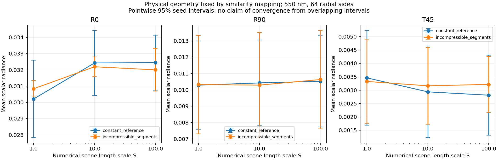

# v0.5 Numerical scene-scale sensitivity of the closed-volume optical baseline

## Result and interpretation

The additional **72-render experiment completed**, and an independent audit reproduced its statistics, geometry/material similarity mapping, file identities, and correspondence to the main experiment.

The current result **does not establish optical convergence with respect to scene scale**. The change from scale 10 to scale 100 is smaller in several point estimates, but all six corresponding seed-level difference intervals include zero and are too wide to establish equivalence. A radius effect is also unresolved at every tested scale. This is an unresolved numerical/Monte Carlo accuracy issue, not evidence that the physical radius effect is absent.

This study was prompted by an actual analytic-oracle finding: the nominally scale-invariant Beer experiment had a small nonzero paired change when its coordinates were enlarged eightfold and absorption was divided by eight. The installed Mitsuba ray-origin offset contains an absolute coordinate term. The earlier source audit and direct entry/exit ray measurements are in [volume_optics_validation_v5.md](volume_optics_validation_v5.md). The present experiment tests the actual 42-fiber woven geometry rather than assuming the millimeter-scale oracle settles the much smaller fiber interfaces.

## 1. Controlled numerical experiment

The physical input is the same synthetic woven sample used in the main v0.5 study. The two radius states share their target centerlines. Both states use the same profile reconstruction and closed triangle-tube algorithm.

| Item | Value |
|---|---|
| Numerical length scales | \(S=1,10,100\) |
| Radius states | constant_reference, incompressible_segments |
| Mesh resolution | 64 radial sides; 42 fibers per state |
| Wavelength | 550 nm |
| Lighting | R0, R90 reflection; T45 transmission |
| Camera/image | Same normalized crop and direction; 64 × 64 scalar pixels |
| Budget per render | 64 samples per pixel |
| Seeds per condition | 5723, 22840, 39957, 57074 |
| Actual render calls | \(3\times2\times3\times4=72\) |
| Runtime | 196.183671 s, including mesh construction and output work |
| Renderer | Mitsuba 3.9.1, llvm_ad_rgb; scalar gray-channel experiment |
| Surface/volume model | Real dielectric Fresnel on geometric triangle normals; homogeneous pure absorption; volpath |
| Surface roughness, diffraction, polarization | Not implemented in this baseline |

The numerical mapping is

\[
\mathbf{x}_S=S\mathbf{x},\quad r_S=Sr,\quad
\mu_{a,S}=\frac{\mu_a}{S},\quad n_S=n.
\]

Consequently, for the ideal geometric-optics model,

\[
\tau_S=\int\mu_{a,S}\,d\ell_S
=\int\frac{\mu_a}{S}S\,d\ell=\tau .
\]

Camera distance, film width, light dimensions/distance, and common scene bounds are scaled by \(S\). View/light directions, emitter radiance, material assignments, refractive indices, seeds, and all render settings remain the same. The light's solid angle and normalized framing therefore remain the same in the ideal model.

**The stored “mm” fields in the derived scenes represent numerical proxies.** Original physical-mm profiles and physical material spectra are preserved in inputs/; physical millimeters equal a derived coordinate divided by \(S\). To reuse the frozen API without changing it, the driver supplies \(\kappa_S=\kappa/S\), which produces the required inverse scaling of \(\mu_a=4\pi\kappa/\lambda\). This is not a change in a measured textile. The mapping preserves this **real-index Fresnel plus absorption** ray model; it would not preserve a complex-index Fresnel or Maxwell model at fixed wavelength.

The source implementation was kept frozen. This experiment changes inputs through a separate driver, not ray epsilon or the optical engine. Fixed renderer numerical constants and default clipping distances were not all scaled; the chosen camera/object configurations remain within the clipping range. This experiment tests the resulting numerical similarity, not an assertion that every internal renderer calculation is invariant.

## 2. Raw measurements

The following are means over four seed-level image means. They are scalar radiance values, not measured reflectance or colorimetric RGB.

| Radius state | Scale | R0 | R90 | T45 |
|---|---:|---:|---:|---:|
| Constant | 1 | 0.0302136632 | 0.0102910646 | 0.00346015047 |
| Constant | 10 | 0.0324277529 | 0.0104299741 | 0.00293651782 |
| Constant | 100 | 0.0324413547 | 0.0105273401 | 0.00281194723 |
| Variable | 1 | 0.0308399588 | 0.0103246782 | 0.00332571219 |
| Variable | 10 | 0.0321933803 | 0.0102943002 | 0.00316277374 |
| Variable | 100 | 0.0320033775 | 0.0106343035 | 0.00321507096 |

The graph uses **pointwise 95% Student-t intervals on seed means**. Its error bars are not a convergence test.

These intervals assume independent, approximately Gaussian seed-level estimators. With only four seeds, their distributional shape and coverage have not been validated. “95%” below denotes nominal model-based coverage; Bonferroni adjustment cannot repair inaccurate individual-interval coverage. The same seeds across conditions allow paired contrasts, while pixels are not counted as independent experimental replicates.

### Scale 10 → 100

Differences below are paired by seed. The percentage is the difference of means divided by the scale-10 mean. Intervals are for the **absolute radiance difference**, not for the population percentage ratio.

| State / light | Relative point change | Absolute mean difference | Pointwise 95% interval | Family-adjusted interval |
|---|---:|---:|---|---|
| Constant / R0 | +0.0419% | +0.00001360 | [−0.00093091, +0.00095812] | [−0.00269590, +0.00272311] |
| Constant / R90 | +0.9335% | +0.00009737 | [−0.00052283, +0.00071756] | [−0.00168177, +0.00187650] |
| Constant / T45 | −4.2421% | −0.00012457 | [−0.00052101, +0.00027187] | [−0.00126182, +0.00101268] |
| Variable / R0 | −0.5902% | −0.00019000 | [−0.00158946, +0.00120945] | [−0.00420459, +0.00382458] |
| Variable / R90 | +3.3028% | +0.00034000 | [−0.00075974, +0.00143974] | [−0.00281479, +0.00349480] |
| Variable / T45 | +1.6535% | +0.00005230 | [−0.00049025, +0.00059485] | [−0.00150410, +0.00160869] |

The scale family contains all three scale pairs × two radius states × three lights = **18 contrasts**. Its two-sided Bonferroni intervals use \(t_{1-0.05/(2\cdot18),3}\). All 18 adjusted intervals include zero. The current budget therefore does not establish a nonzero scale bias at family-wise 95% confidence, and it also does not establish a sufficiently small bias.

There are useful warning signals in the point estimates. For example, constant-radius T45 decreases **18.7334%** from scale 1 to 100. Its absolute difference is −0.000648203, with pointwise 95% interval [−0.000954938, −0.000341469], while its 18-contrast adjusted interval [−0.001528124, +0.000231718] includes zero. Constant T45 at scale 1→10 and variable R0 at scale 1→10 are the other two pointwise nonzero scale contrasts. These are sensitivity observations, not a selectively reported family-wise detection.

### Radius effect at each scale

Here “radius effect” means variable minus constant under otherwise matched geometry/model/configuration. It does not compare the v0.4 hair BSDF to the new dielectric-volume model.

| Light | Scale 1 | Scale 10 | Scale 100 |
|---|---:|---:|---:|
| R0 | +2.0729% | −0.7228% | −1.3501% |
| R90 | +0.3266% | −1.3008% | +1.0161% |
| T45 | −3.8853% | +7.7049% | +14.3361% |

The primary radius family is the three lights at the largest scale. Its intervals are:

| Light at scale 100 | Absolute variable − constant | Three-contrast adjusted interval |
|---|---:|---|
| R0 | −0.000437977 | [−0.001879743, +0.001003788] |
| R90 | +0.000106963 | [−0.001782813, +0.001996740] |
| T45 | +0.000403124 | [−0.000420066, +0.001226313] |

All three primary intervals include zero. In fact, all nine radius contrasts include zero even pointwise. The change in the radius contrast between numerical scales also remains unresolved: all nine radius-by-scale interaction intervals include zero, pointwise and after their nine-contrast adjustment. The T45 percentage changes sign between scale 1 and the larger scales, but this is not enough to claim a physically established sign reversal or a stable positive effect.

## 3. Independent verification of the similarity mapping

The independent saved-data audit is:

- [verification_summary.json](../data/validation_v5/independent_scale_audit/verification_summary.json)
- [Executable audit source in Markdown](volume_scale_sensitivity_v5_audit.md)

It imported no producer statistical or hashing helpers for the raw-data checks. It independently checked:

- 42 producer-listed output files against SHA-256 and byte count.
- Nine NPZ archives with full ZIP CRC checks.
- Seven frozen source files, before/after experiment and again after the audit.
- All six preserved inputs. The five profile/material files exactly match the final accepted main experiment. The archived metrics input was used only for bounds/configuration/seeds; those fields exactly match the final main experiment.
- 18 scene semantic hashes and 72 scene/seed/raw-image bindings.
- All 252 mesh instances: actual saved float32 vertex arrays, uint32 triangle arrays, their semantic hashes, and scene metadata references.
- Physical ring centers and radii reconstructed directly from saved float32 vertices against the original physical profile arrays.
- Independent signed-volume calculations after translating each mesh near its local origin.
- Every supplied wavelength, real index, and inverse-scaled absorption table; camera/light geometry and unchanged radiance/directions.
- All 72 raw seed means and 36 statistical contrasts with direct arithmetic and Student-t quantiles. The maximum interval discrepancy from the producer is \(1.735\times10^{-18}\).
- Three fresh two-fiber backend scene constructions, one at each scale, to inspect actual Mitsuba medium parameters, dielectric eta, vertices, and triangles. These are **API reconstructions, not additional renders**.

The audit passed 2,839 recorded checks. This count reports the scope of the integrity audit; it is not a number of independent scientific observations.

### Actual float32 geometry

Across the 252 saved meshes:

- The maximum physical ring-center error is \(8.2271\times10^{-9}\) mm.
- The maximum physical ring-radius error is \(1.5076\times10^{-8}\) mm.
- The maximum physical vertex-coordinate difference from the scale-1 buffers is \(3.5763\times10^{-8}\) mm.
- The largest relative change in normalized float32 mesh volume is \(8.3833\times10^{-7}\).

Triangle indices are identical across scales. These figures show that the geometry is mapped as intended to float32 accuracy; they do not bound radiance error near visibility or refraction discontinuities.

### Actual material values in reconstructed Mitsuba scenes

The two synthetic materials retain their real refractive indices. Actual float32 backend values are:

| Scale | Material A sigma_t | Material B sigma_t | Albedo |
|---:|---:|---:|---:|
| 1 | 12.8105402 | 28.3814259 | 0 |
| 10 | 1.28105402 | 2.83814263 | 0 |
| 100 | 0.128105402 | 0.283814251 | 0 |

Eta is 1.52991736 for A and 1.62487602 for B at every scale. The largest relative sigma rounding discrepancy against the intended double-precision value is \(4.0234\times10^{-8}\). Actual vertex and triangle buffers in the six reconstructed fiber instances exactly match their corresponding saved buffers.

The original historical scene objects are not retained. Their identity is represented by the immutable source/input ledger, saved geometry, scene metadata, and raw-output bindings. The reconstruction above separately verifies the current frozen API's actual behavior.

## 4. Relationship to the main experiment and accounting

The scale-1 branch repeats exactly the main experiment's **N64 / 550 nm / two states / three lights / four seeds** conditions. All **24 raw arrays are bitwise identical**, with maximum absolute pixel difference zero. Both scale-1 states' complete 84 mesh buffers are also bitwise identical to the corresponding final accepted main experiment buffers.

The three accepted experiment runs contain:

\[
216\ \text{main renders} + 32\ \text{physics-oracle renders}
+72\ \text{sensitivity renders}=320\ \text{actual render calls}.
\]

This count excludes test, pilot, and rejected runs. The 24 repeated scale-1 conditions **do not increase the independent replicate count**. We make no claim of “296 unique images”: additional byte-identical images can occur in deterministic oracle cases. Seed-level replication remains four per condition in each reported experiment.

## 5. Why scene scale is a real numerical concern

Pinned Mitsuba source uses a ray-origin displacement of the form

\[
\Delta\mathbf{o}\propto
\left(1+\|\mathbf{p}\|_\infty\right)
\,\epsilon_{\mathrm{ray}}\,\mathbf{n},
\qquad
\epsilon_{\mathrm{ray}}=1500\,\operatorname{Epsilon}_{\mathrm{Dr.Jit}}(\text{float32}).
\]

In the installed runtime, Dr.Jit's float32 Epsilon is \(2^{-24}=5.960464477539063\times10^{-8}\), half NumPy's finfo(float32).eps spacing at one. Thus \(\epsilon_{\mathrm{ray}}=8.9406967163\times10^{-5}\) scene units. If scene units are millimeters, the absolute one-term contributes approximately **0.0894 micrometers** before the position-dependent term. This is significant enough to investigate relative to micrometer-scale fibers.

After scaling coordinates by \(S\), the displacement expressed in original physical units contains

\[
\epsilon_{\mathrm{ray}}\left(\frac{1}{S}+\|\mathbf{p}_{\mathrm{physical}}\|_\infty\right).
\]

Increasing \(S\) reduces the first term but does not remove the position-dependent term. It can also change finite-precision intersections and randomized path continuation. The saved 32-render oracle and four direct entry/exit intersections provide evidence consistent with a ray-offset contribution. The present 72 images do not isolate every changed path to this cause.

Primary pinned source:

- [Mitsuba interaction.h: ray spawning and origin offset](https://github.com/mitsuba-renderer/mitsuba3/blob/478e193a183c21723f4a8251afc3ad29a8da4c5e/include/mitsuba/render/interaction.h)
- [Mitsuba math.h: RayEpsilon definition](https://github.com/mitsuba-renderer/mitsuba3/blob/478e193a183c21723f4a8251afc3ad29a8da4c5e/include/mitsuba/core/math.h)
- [Local source/ray evidence and reproducible oracle analysis](volume_optics_validation_v5.md)

## 6. Consequence for the research pipeline

The new result should constrain downstream claims. The current meshes and material bindings form an executable, audited **geometric-optics baseline**. Their existence does not establish accurate textile appearance, a converged radius effect, or the benefit of a meta-optical measurement.

Before optical conclusions or inverse-design training use these images as numerical reference data, the next targeted step should resolve a specified accuracy risk:

1. Define a practically useful tolerance on absolute radiance/appearance error and a separate minimum detectable radius effect. Equivalence requires an interval inside such a tolerance, not merely an interval containing zero.
2. Increase the independent seed and/or path budget on the few unresolved canonical contrasts, especially the transmission geometry, until the interval can distinguish the tolerance from the effect of interest.
3. Isolate ray spawning with a controlled origin/epsilon or double-precision strategy and rerun the already defined similarity/Beer checks. Any implementation change needs a new source ledger; none was silently applied here.
4. Revisit radial polygon convergence after controlling those numerical effects. A flat-facet dielectric tube changes its surface-normal distribution with radial resolution even when its volume error is small.
5. Only then use this baseline to separate scalar geometry effects from roughness, birefringence, polarization, or wave-optical effects in more advanced models.

These are planned decision gates, not completed results. The present sensitivity study is complete at its declared budget and is retained because it exposes an unresolved accuracy limit rather than hiding it.

## Reproducibility identities

| Artifact | SHA-256 |
|---|---|
| 72-render experiment manifest | aa0e5c1f17fcddab518629a23e5fe0271a11fe306c5cd27aab41634dcfa24f7e |
| 72-render raw NPZ | d00c0c8ea87d9b6d66f78d47fe08e1a44ea53504cb2332af02abbea267d39eea |
| Sensitivity driver | 230cdece4455d2013648d534d45e16cc8bca51c66bdd5fc86237fac7abe3da6c |
| Frozen volume adapter | 7df5e6dec3167f519e5cfcda576b3c96f03034f7969e32dcb35f51316d32053e |
| Frozen variable-radius geometry | 811d72412723f1b4dbd51644aaf0e7ff0cb96a9e6500f3b022424161c44fb9e4 |
| Independent audit summary | e13aa268300215627ec6036f63f53b8ae8850f232dad95dbcd5879b978f429ce |
| Executed independent audit code block | 26e49497a0370d87b35e16f16e2fc2659cd5469755d8c16e20aab834aabec3c3 |

To reproduce the producer, choose a **new output directory**:

~~~
OPENBLAS_NUM_THREADS=1 OMP_NUM_THREADS=1 python run_volume_scale_sensitivity_v5.py \
  --input-run data/variable_radius_v5 \
  --output scratch_runs/new_scale_sensitivity \
  --resolution 64 --spp 64
~~~

The archived run read its immutable copied input snapshot. Reproduction from the final accepted main directory uses the same profiles, materials, bounds, configurations, and seeds, while a freshly copied metrics file has different archival execution metadata. File and scene provenance hashes therefore need not match every original archive hash even when the numerical inputs and images do.
