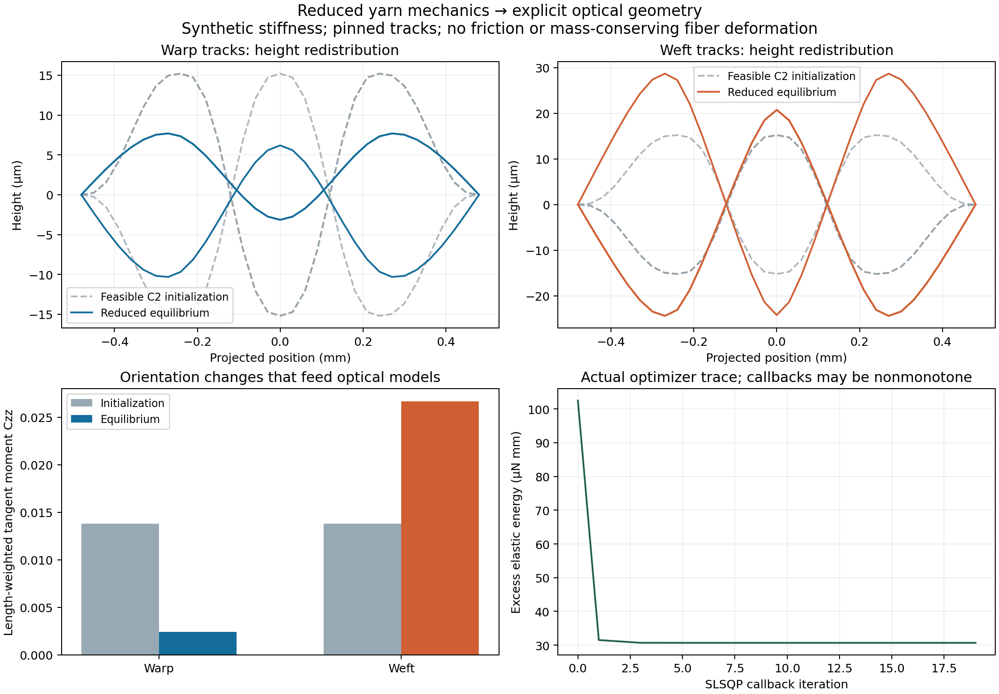
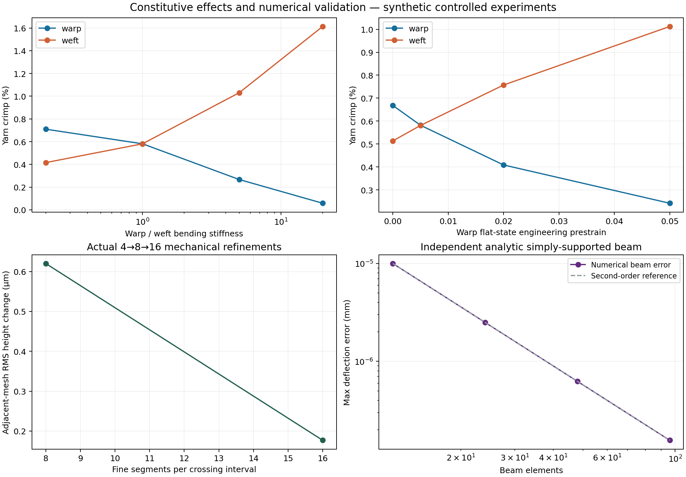

# v3: 장력·굽힘 평형을 거쳐 광학 기하를 만드는 축소 원사 모델

작성: 2026-10-11. 코드: `textile_sim/weave_mechanics.py`.
이 문서의 수치와 그림은 실제 실행한 `data/mechanics_v3/` 결과에 대응한다.
실물의 장력·탄성·단면을 측정해 보정한 결과는 아니다. 염색·퇴색은 제외한다.

## 1. 이번 확장에서 해결하는 질문

v2에서는 직조 draft가 정한 위아래 순서를 C2 crimp 곡선으로 연결했다. 이 방법은
명시적 fiber → ply → yarn → fabric 계층을 생성하지만, 경사와 위사의 장력·굽힘
강성이 다를 때 **어느 원사가 더 굽어지는지** 결정하지 않는다. 같은 교차 순서를
만족하는 곡선이 많고, 그 곡선들은 서로 다른 섬유 방향 분포와 광학 응답을 가질 수 있다.

v3는 다음 좁은 문제를 실제로 푼다.

> 경·위사의 평면상 경로와 끝점 위치가 고정된 유한 패치에서, 인장 영역의 원사
> 축방향 탄성에너지와 작은 기울기 굽힘에너지를 최소화한다. 위아래 교차 순서와
> 보수적 원사 envelope 간격을 제약으로 유지한 뒤, 기존 fiber/ply 계층을 배치해
> 광학 엔진에 전달한다.

따라서 이 모듈은 **reduced quasi-static yarn-height equilibrium**이다. 재료 프레임의
비틀림 에너지, 마찰·접촉압, 단면 압착, 횡방향 sliding, 전체 cloth drape를 푸는
Discrete Elastic Rods/Weavecraft 재현으로 부르지 않는다.

## 2. 문헌에서 가져온 원칙과 의도적인 축소

| 1차 자료 | 실제 확인한 내용 | 이번 구현과의 관계 |
|---|---|---|
| Bergou et al., **Discrete Elastic Rods**, 2008, [저자 PDF](https://www.cs.columbia.edu/cg/pdfs/143-rods.pdf), DOI [10.1145/1360612.1360662](https://doi.org/10.1145/1360612.1360662) | §4.1의 framed-curve, 굽힘·비틀림 에너지 및 §4.2의 discrete curvature | 등방성·자연 직선 rod의 굽힘에너지에서 작은 기울기 graph 근사를 명시적으로 분리. 전체 DER 알고리즘이나 twist DOF를 구현한 것은 아님 |
| Wu et al., **Weavecraft**, 2020, [저자 PDF](https://www.antequ.net/assets/projects/weavecraft/weavecraft.pdf), DOI [10.1145/3414685.3417865](https://doi.org/10.1145/3414685.3417865) | §5, 특히 pp.7–8의 stretching/bending/collision, strain balancing, 고정·주기 경계, 서로 다른 경·위사 파라미터 | schematic weave와 평형 기하를 구분하고, 경·위사 탄성·rest length를 따로 둠. 논문의 3D block, collision force, strain balancing 업데이트는 구현하지 않음 |
| Montazeri et al., **A Practical Ply-Based Appearance Model**, 2020, [저자 PDF](https://projects.shuangz.com/practical_cloth-sa20/practical_cloth-sa20-ld.pdf) | v2 검토의 §3.1: 중심선이 교차 순서를 맞춰도 실제 slope distribution이 보장되지는 않음 | 평형 전후 tangent tensor를 광학 연결 지표로 저장 |
| FabricGen, CVPR 2026, 사용자 제공 본문 | v2 전체 본문 검토: procedural implicit microstructure와 macro appearance의 계층 분리 | 기존 explicit fiber/ply 생성기를 유지하고 yarn 중심선을 외부 평형 모듈로부터 주입 |
| Tang et al., **Woven Fabric Capture with a Reflection-Transmission Photo Pair**, 2024, 사용자 제공 arXiv v3 | v2 전체 본문·supplement와 공식 구현 검토 | R/T 모델과 물질 스펙트럼을 기하 평형과 혼동하지 않도록 연결 경계 유지 |

Weavecraft의 strain balancing은 현재 spline 길이 \(\widehat L_i\)와 설계 stretch
ratio \(S\ge1\)로 \(L_i=\widehat L_i/S\)를 업데이트한다. 이번 구현은 rest length를
초기 projected grid에서 정해 **최적화 중 고정**한다. 따라서 장력을 균일하게 맞추는
논문의 알고리즘과 같지 않다. 위 문헌의 source code를 복사하지 않고 독립 구현했다.

## 3. 변수·단위·경계조건

길이는 mm, 힘은 N, 에너지는 N·mm이다. 경사는 고정 \(x=x_j\), 위사는 고정
\(y=y_i\)에서 서로 직교하는 projected track을 따른다. 경사의 예는

\[
\mathbf c_j^w(y)=(x_j,y,z_j^w(y)),
\]

위사는 \(\mathbf c_i^f(x)=(x,y_i,z_i^f(x))\)이다. 각 track은 균일한 projected 간격
\(h\)로 분할한다. 경사와 위사의 \(h\)는 pitch가 다르면 서로 다르다.

끝점은 첫·마지막 실제 교차점에서 `padding_crossings` 만큼 밖에 위치하며 두 끝의
높이를 0으로 고정한다. 끝 회전은 고정하지 않는다. 연속체 해석은 simply-supported
경계이며, 유한 mesh에서는 아래 차분 에너지가 경계 근사를 명시적으로 정의한다.
패치가 자유롭게 전체 수축하거나 병진하는 모델이 아니며, 끝점 경계의 영향을 받는다.

`YarnElasticity`가 각 family에 제공하는 값은 다음과 같다.

| 입력 | 단위 | 의미 |
|---|---|---|
| `axial_stiffness_N` | N | 유효 \(EA\). 광학 굴절률이나 fiber radius로부터 추정하지 않음 |
| `bending_stiffness_N_mm2` | N·mm² | 유효 \(B\). 실제 원사의 섬유 sliding 효과까지 보정된 값은 아님 |
| `rest_fraction` \(r\) | 무차원 | 고정 rest segment length \(\ell_0=rh\), \(0<r\le1\) |
| `source`, `data_status` | 문자열 | synthetic / measured / literature 출처 |

평평한 기준의 engineering prestrain은 \(\epsilon_\text{flat}=1/r-1\)이다.
`rest_fraction=0.99`를 정확히 1% engineering strain으로 쓰지 않는다. 1%를 지정하려면
\(r=1/1.01\)을 사용한다. 본 실험의 값은 모두 **synthetic**이다.

## 4. 에너지, gradient, Hessian

세그먼트 높이차를 \(d=z_{k+1}-z_k\)라 하면 실제 polyline 길이는

\[
\ell=\sqrt{h^2+d^2},\qquad \ell_0=rh.
\]

원사의 축방향 에너지는 길이 변화에 대한 quadratic strain law다.

\[
E_s=\sum_k\frac{EA}{2\ell_{0,k}}(\ell_k-\ell_{0,k})^2.
\]

코드의 반환값은 같은 projected grid가 평평할 때의 상수 에너지를 뺀 **excess
energy**다. 평형과 힘을 바꾸지 않으며, 평평한 상태에서 큰 두 수를 빼는 cancellation을
피하도록 \(\ell-h=d^2/(\ell+h)\)를 사용한다.

세그먼트별 미분은 직접 다음과 같다.

\[
\frac{\partial E_s}{\partial d}
=\frac{EA}{\ell_0}\left(1-\frac{\ell_0}{\ell}\right)d,
\]

\[
\frac{\partial^2 E_s}{\partial d^2}
=\frac{EA}{\ell_0}\left(1-\frac{\ell_0h^2}{\ell^3}\right)\ge0.
\]

마지막 부등식은 \(\ell\ge h\ge\ell_0\)에서 성립한다. 그래서 `rest_fraction>1`처럼
압축·buckling을 만들 수 있는 입력을 거부한다. 압축을 조용히 인장으로 clamp하지 않는다.

작은 기울기 굽힘 에너지는

\[
E_b=\frac B2\int [z''(x)]^2dx
\approx\frac{B}{2h^3}\sum_{k=1}^{n-1}(z_{k+1}-2z_k+z_{k-1})^2.
\]

`D1`이 endpoint를 포함하는 첫 차분 행렬, `D2`가 고정 endpoint를 제거한 두 번째
차분 행렬이면

\[
\nabla E=D_1^Tq+\frac B{h^3}D_2^TD_2z,
\quad
H=D_1^T\operatorname{diag}(q')D_1+\frac B{h^3}D_2^TD_2.
\]

모든 항의 Hessian이 positive semidefinite다. 높이에 대한 제약도 linear이므로
선언한 축소 모델은 convex다. 양의 굽힘 강성과 고정 끝점을 가진 실험에서는
해의 유일성에 필요한 coercivity도 확보된다. 수치 KKT 잔차가 작다는 것은 이
**축소 모델**의 평형 근사라는 뜻이며 실제 원단 모델의 정확성을 증명하지 않는다.

### 작은 기울기 근사의 크기

부드러운 planar graph에 대한 등방성 elastica 에너지의 적분항은

\[
\kappa^2 ds=\frac{[z''(x)]^2}{(1+[z'(x)]^2)^{5/2}}dx.
\]

따라서 작은 기울기 항은 고정된 같은 graph에서 상대 factor
\((1+L^2)^{5/2}-1\) 만큼 커질 수 있다. 이것을 진단값으로 저장하지만,
**현재 finite-difference 에너지, 최적화된 위치, 실제 원단의 전체 오차 bound로
해석하면 안 된다.** 현재 polyline edge slope를 부드러운 graph slope의 대용으로
사용한 근사 크기 지표다. 광학 pair의 최대 edge slope는 0.26206이고 이 factor는
약 18.06%다. 더 작은 기울기 실험 또는 finite-rotation rod 모델과의 비교가 필요하다.

## 5. 교차 순서만 검사하지 않는 보수적 envelope 제약

원사 envelope radius가 \(R_w,R_f\), 요구하는 표면 gap이 \(g\)라 하자.
수직 교차점 높이 차이를 단순히 \(R_w+R_f+g\)로 주면, 기울어진 원사들이 교차점
옆에서 더 가까워질 수 있다. 이를 막기 위해 모든 segment에

\[
|z^w_{k+1}-z^w_k|\le L_wh_w,
\qquad |z^f_{k+1}-z^f_k|\le L_fh_f
\]

를 적용하고 각 crossing에

\[
\sigma_{ij}[z^w_j(y_i)-z^f_i(x_j)]\ge D,
\quad
D=(R_w+R_f+g)\sqrt{1+L_w^2+L_f^2}
\]

를 준다. \(\sigma_{ij}=+1\)은 warp-over, −1은 warp-under다. 현재 API는 두 family에
같은 `max_slope`를 쓰지만 아래 증명은 서로 다른 두 값에서도 성립한다.

교차점에서 각각 \(u,v\)만큼 떨어진 두 중심선 점의 수직 차이를 \(\Delta z\)라 하자.
Lipschitz 부등식과 Cauchy–Schwarz에서

\[
D\le |\Delta z|+L_w|u|+L_f|v|
\le\sqrt{1+L_w^2+L_f^2}\sqrt{u^2+v^2+(\Delta z)^2}.
\]

따라서 모든 점에서 중심선 간격은 \(D/\sqrt{1+L_w^2+L_f^2}\) 이상이다. 원사
envelope를 차감하면 표면 gap \(g\)가 남는다. 서로 평행한 같은 family는 고정
transverse pitch \(p\) 때문에 중심선 간격이 항상 \(p\) 이상이므로
\(p\ge2R+g\)를 사전 검사한다.

이는 마찰 없는 실제 원사 접촉 면적·압력 계산이 아니다. **접근을 허용하지 않는
보수적 선형 제약**이며, 물리적으로 가능하지만 이 bound로는 허용되지 않는 치밀한
배치도 있다. Lagrange multiplier는 이 이상화 제약의 reaction이고 실제 접촉압이 아니다.

진단 함수에 infeasible 높이를 주면 configured slope bound는 invalid로 표시하고
configured gap은 null로 반환한다. 실제 family별 edge slope를 써서 계산한 별도 bound를
함께 제공한다. 검사 실패한 입력에 기존 configured gap을 붙여 false certificate를
만들지 않도록 독립 리뷰에서 수정했다.

## 6. 실제 수치 알고리즘과 독립 평형 검사

1. Draft와 반지름·간격에서 linear constraint matrix \(Az\ge b\)를 조립한다.
2. 교차점의 높이를 family share로 나눈 C2 함수의 샘플에서 시작한다. 실제 polyline
   edge slope와 crossing constraint를 검사하고 infeasible initialization은 거부한다.
3. 초기 Hessian의 Cholesky를 이용한 가역적인 좌표변환으로 conditioning을 개선한다.
   에너지에 artificial regularization을 넣지 않는다. Cholesky가 불가능한 허용 입력에는
   identity scaling을 사용한다.
4. analytic gradient와 linear inequalities로 SciPy SLSQP를 실행한다.
5. 활성 제약을 다시 찾고 nonnegative least squares로 \(\lambda\ge0\)를 계산한다.
   \(\|\nabla E-A^T\lambda\|_\infty\), \(\|\lambda\odot(Az-b)\|_\infty\),
   constraint violation, 초기 대비 에너지 감소를 **독립적으로** 검사한다.

힘·에너지의 상대 잔차는 node 개수와 무관한 물리 scale을 쓴다. 모든 stiffness를
\(c>0\) 배 하면 geometry는 같고 힘·에너지는 \(c\) 배다. 길이를 \(a\) 배하면서
\(B\to a^2B\), \(EA\)는 유지하면 height는 \(a\) 배, energy는 \(a\) 배다. 이 두
similarity를 수치 테스트했다. 현재 dense Hessian/constraint formulation은 작은
검증 패치에 맞춘 reference solver다. 전체 옷이나 수십만 yarn의 scale을 목표로 한
sparse/dynamic solver를 구현한 것은 아니다.

### 리뷰에서 찾아 수정한 결과-문제 혼용

처음에는 `WeaveEquilibrium`의 저장된 diagnostic을 export가 신뢰했다. 그러면 같은
크기의 다른 stiffness problem에 해를 넣거나 height만 바꿔도 과거의 평형 certificate가
붙을 수 있었다. 현재는

- 전체 problem/spec SHA-256과 solved height SHA-256을 결과에 결합하고,
- export에서 두 hash를 확인하며,
- 현재 problem과 현재 height로 KKT·feasibility·energy를 다시 계산하고,
- mutable diagnostic dictionary 대신 재계산 결과를 metadata에 넣는다.

기존 optical pair 좌표·파일은 이미 유효했으므로 optical collaborator와 공유한 파일을
변경하지 않았다. `optical_pair/equilibrium_binding_audit.json`에 해당 높이의 현재
독립 검사와 네 geometry 파일의 hash를 추가했다.

## 7. Fiber–ply–yarn–fabric–optics 연결 계약

```python
problem = ReducedWeaveProblem(spec)
result = solve_equilibrium(problem)

before = build_relaxed_hierarchy(
    problem, result.initial_heights_mm, warp_yarn, weft_yarn,
    subdivisions=6,
)
after = build_relaxed_hierarchy(
    problem, result, warp_yarn, weft_yarn,
    subdivisions=6,
)

clearance = audit_clearance(after)
scene = from_hierarchy(after, materials)
```

`build_relaxed_hierarchy()`는 v2의 public `build_yarn()`을 사용한다. 따라서 부모
실제 호길이 twist, RMF, multi-ply, material/fiber/ply/yarn ID를 보존한다. 추가
subdivision은 **같은 mechanical polyline** 위의 점을 늘린다. 조용히 spline으로
바꾸지 않는다. 렌더러에 가는 spline 오차는 기존 optical exporter가 별도 계산한다.

중요한 구분: 각 yarn centerline을 바꾼 후 같은 반지름과 현재 부모 호길이당 twist로
fiber를 새로 배치한다. **동일한 fiber material point의 질량·strain·twist를 보존하는
변형이 아니다.** 전후 섬유 ID는 같은 구성원을 나타내는 대응 label이며 material
좌표 대응을 증명하지 않는다. 모든 geometry에 `fiber_material_points_conserved=False`를
기록하고 fiber length 및 \(\sum\pi r^2L\) volume proxy 변화를 보고한다.

## 8. 실제 실행 결과

### 8.1 광학 전달용 plain pair

3×3 crossing patch, 각 yarn 1 ply × 7 fibers: **42 fibers, 8,064 segments**.
모든 반지름 3 μm, pitch 0.24 mm. `synthetic_A`는 warp, `synthetic_B`는 weft.
경사의 \(B=2\times10^{-5}\), 위사의 \(B=2\times10^{-6}\) N·mm²;
\(EA=0.02\) N, \(r_w=0.985,r_f=0.995\).

| 양 | Feasible 초기 곡선 | 축소 모델 평형 |
|---|---:|---:|
| Excess energy, N·mm | 1.0247762×10⁻⁴ | 3.0691507×10⁻⁵ |
| Warp yarn crimp | 0.700048% | 0.122466% |
| Weft yarn crimp | 0.700048% | 1.366730% |
| Warp \(C_{zz}\) | 0.0137874 | 0.00244383 |
| Weft \(C_{zz}\) | 0.0137874 | 0.0267008 |
| Explicit fiber 전체 길이, mm | 40.6111653 | 40.6291325 |
| Cylinder-volume proxy, mm³ | 0.00114825365 | 0.00114876166 |
| 서로 다른 fiber capsule 최소 간격 하한 | 2.98363 μm | 2.94538 μm |

최종 energy 감소는 **70.0505%**, 최대 constraint violation은 약
\(4.51\times10^{-17}\) mm, stationarity infinity norm은
\(6.73\times10^{-15}\) N이었다. 이 수치는 해당 합성 예제의 solver 잔차다.

부피 proxy는 약 **0.04424% 증가**했다. 양이 작더라도 0으로 간주하지 않는다.
Optical 전후 영상 차이를 동일 질량 재료의 실제 기계 변형 효과라고 단정하지 않는다.



### 8.2 Multi-ply 실증

3×3 twill에서 각 yarn을 **2 plies × 7 fibers**로 구성해 **84 fibers, 10,752 segments**를
실제로 생성·평형 연결·clearance 검사했다. ply twist와 fiber twist의 부호를 독립적으로
주었고 두 family의 material label을 보존했다. 결과는 `data/mechanics_v3/two_ply/`다.
이 예제는 micro-hierarchy가 부모 평형을 받을 수 있음을 검증하며, ply/fiber 간의
mechanical stress transfer 자체를 계산한 것은 아니다.

### 8.3 다른 변수를 고정한 sweep

| Warp/Weft \(B\) ratio | Warp crimp | Weft crimp |
|---:|---:|---:|
| 0.2 | 0.7098% | 0.4158% |
| 1 | 0.5812% | 0.5812% |
| 5 | 0.2666% | 1.0312% |
| 20 | 0.05819% | 1.61364% |

별도 sweep은 \(B\)를 고정하고 경사의 flat-state engineering prestrain만
0%, 0.5%, 2%, 5%로 바꿨다. 0→5%에서 warp crimp는 0.6679→0.2415%,
weft crimp는 0.5133→1.0124%로 변했다. 두 sweep은 stiffness와 rest length의 효과를
분리해 보여준다. 초기 곡선의 \(z\)는 같은 설정을 유지한다.

Plain, 2/1 twill, 2×2 basket의 4×4 패치도 실제 풀었다. 에너지 감소는 각각
40.27%, 54.72%, 70.01%였지만, 이것을 어떤 직조가 물리적으로 더 우월하다는
척도로 쓰면 안 된다. 초기 곡선과 topology가 다른 최적화 문제다.

### 8.4 수렴과 analytic benchmark

광학 pair의 mechanical mesh를 crossing 간격당 4, 8, 16 segments로 실제 바꿨다.

| Mesh 비교 | 전체 track의 RMS 높이 변화 | 최대 높이 변화 | Energy 상대 변화 |
|---|---:|---:|---:|
| 4 → 8 | 0.62004 μm | 1.89312 μm | 7.4439% |
| 8 → 16 | 0.17681 μm | 0.60617 μm | 2.1331% |

이는 차분 모델의 관찰된 수렴이며 continuum 또는 실제 원단의 절대 오차 인증이 아니다.
광학 pair는 8-segment mechanical mesh를 사용한다. 후속 optical 연구에서 차이가 이
geometry discretization 오차보다 작은지 확인하려면 더 촘촘한 paired render가 필요하다.

독립 beam benchmark는 \(EA=0\), uniform load \(q\), simply-supported ends를 써서

\[
z(x)=\frac{qx(L^3-2Lx^2+x^3)}{24B}
\]

와 비교했다. 12,24,48,96 elements에서 최대 deflection 오차는
\(1.00\times10^{-5},2.50\times10^{-6},6.25\times10^{-7},1.5625\times10^{-7}\) mm로
약 2차 수렴했다. 이 load benchmark는 constitutive helper를 검증하며 현재 weave
solver API에 일반 distributed load/drape가 구현되어 있다는 뜻은 아니다.



## 9. 테스트와 재현

`tests/test_weave_mechanics.py`의 **17개** 테스트가 실제 통과했다. 주요 검사는
독립 scalar 에너지와 gradient 비교, gradient 차분과 Hessian 비교, PSD, 해석적 beam,
고정 endpoint·교차 순서, sharp Lipschitz separation 반례, energy/common-length scaling,
변경된 rest length와 crimp, 실제 mesh refinement, full fiber clearance와 OpticalScene
roundtrip이다. 독립 review agent의 별도 회귀 테스트는 해당 review 파일에서 확인한다.

```bash
OPENBLAS_NUM_THREADS=1 OMP_NUM_THREADS=1 \
  python -m unittest tests/test_weave_mechanics.py -v

# 새로운 출력 폴더에 전체 mechanics 실험을 재생성
OPENBLAS_NUM_THREADS=1 OMP_NUM_THREADS=1 \
  python run_weave_mechanics_experiments.py \
  --out scratch_runs/mechanics_v3_reproduction
```

실제로 실행해 추적한 결과는 `data/mechanics_v3/`와 `figures/mechanics_v3/`에 있다.
실행기는 시작과 끝 source/config hash가 같은지 검사하고 Python·NumPy 버전,
실행 시간, 입력 설정, 각 solution의 KKT와 optimizer trace를 저장한다.
Mitsuba·Maxwell은 이 mechanics driver가 직접 돌리지 않고 optical scale 실험이
같은 `HierarchyGeometry`를 소비한다. 코드·자료의 변경과 광학 결과의 관계를 분리해
추적하기 위한 경계다.

## 10. 이 결과가 다음 연구를 어떻게 좁히는가

가장 유용한 후속 실험은 **같은 직조 draft에서도 원사 기계 파라미터로 tangent
distribution이 달라지는 모호성**이 광학 측정에서 식별되는지 보는 것이다. 강한 RGB
baseline과 angular/spectral/polarimetric 채널을 같은 조명·광량·노이즈 조건에서 비교할
입력 family가 생겼다. 다만 지금 얻은 synthetic geometry로 실제 cotton/silk/cupra
상수를 추정할 수 있다고 주장할 수는 없다.

실물로 확장하려면 먼저 중심선·원사 envelope·경위사 장력·굽힘을 측정하고, boundary
조건을 맞춘 뒤 현재 축소 모델이 남기는 slope 오차를 평가해야 한다. 그 오차가 크면
finite-rotation curvature, 횡방향 이동, 검증된 segment contact, 단면 압착,
material-coordinate 기반 fiber 운반을 차례로 추가한다. 새 모듈은 그때마다 동일한
광학 입력 계약과 before/after provenance를 유지해야 한다.
