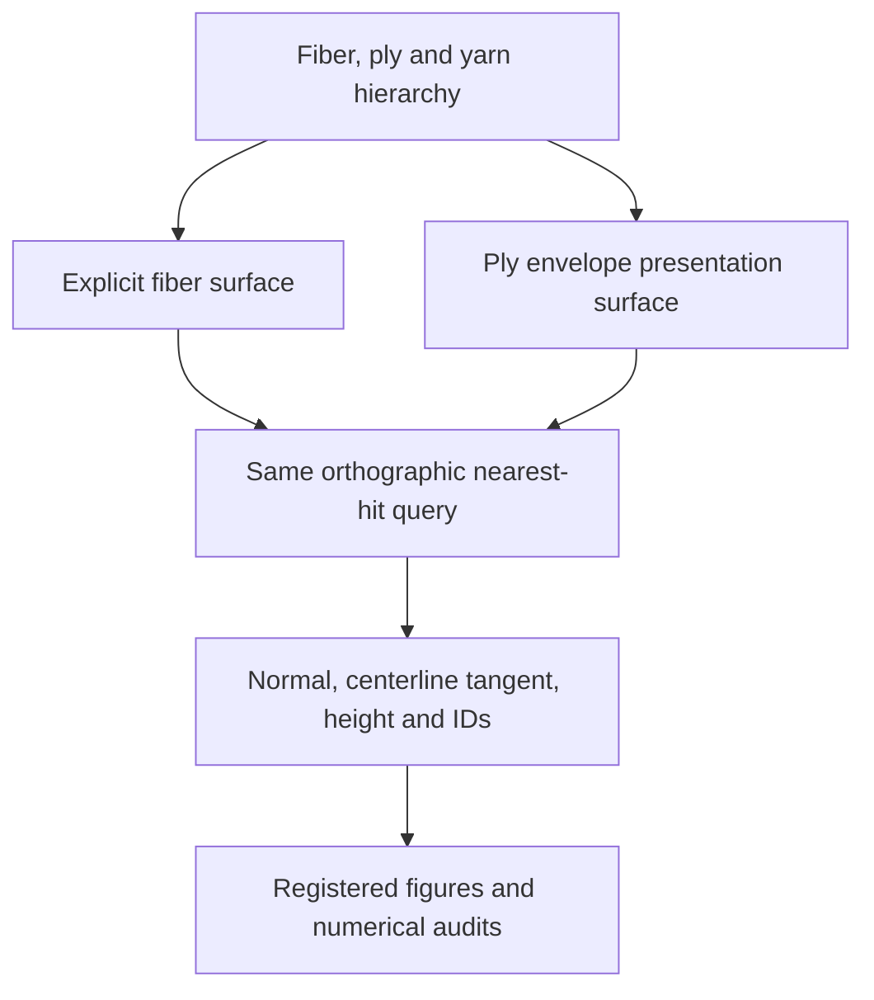

# Geometry-derived textile structure maps

`structure_maps.py` converts the existing fiber → ply → yarn → woven patch hierarchy into deterministic, spatially registered **surface normal, centerline orientation, physical height, visibility, and identity maps**. The fields come from the nearest intersection with the generated triangle surface. No illumination, material shading, exposure, or learned image generation is used to produce them.

The three-panel format is motivated by the user-provided Figure 5 showing normal/orientation/height of a 3-ply basket weave. This implementation defines its own explicit channel conventions below. The uploaded image alone does not supply the paper's supplementary parameters or its complete encoding, so the maps are not claimed as a numerical reproduction of that figure. The source reference and its scope are recorded in [the reference directory](../references/user_provided/README.md).

## Scope and connection to the optical engine

The visualization consumes the existing [`HierarchyGeometry`](../textile_sim/hierarchy.py) and [`sweep_tapered_tube`](../textile_sim/variable_radius.py) interfaces. It adds a geometry inspection path without changing the frozen v0.5 material-transport data or optical experiments.



These maps make geometric assumptions inspectable before light transport. The explicit fiber surface contains the individual modeled circular fibers and their gaps. The ply surface is a solid presentation proxy that fills the spaces between its child fibers. `synthetic_A` and `synthetic_B` remain provenance labels; they do not assign measured cotton, silk, cupra, linen, absorption, or refractive-index values. Optical response must still be evaluated by an optical adapter with a declared material model.

The raw centerline tangent is suitable for inspecting twist and hierarchy directions. A future anisotropic surface BSDF would need a separate projected direction,

\[
\mathbf t_\parallel =
\frac{\mathbf t-(\mathbf n\cdot\mathbf t)\mathbf n}
{\lVert\mathbf t-(\mathbf n\cdot\mathbf t)\mathbf n\rVert},
\]

with an explicit validity mask when the denominator is small. This projection is not performed by this module. A centerline tangent can have a component along a tapered or curved triangle's normal; at a cap it can be parallel to that normal.

## Surface construction

### Explicit fiber level

For source node positions \(\mathbf p_i\), node radii \(r_i\), and the existing rotation-minimizing frame \((\mathbf t_i,\mathbf n_i,\mathbf b_i)\), the ring vertices are

\[
\mathbf v_{ik}=\mathbf p_i+r_i
\left[\cos(2\pi k/N)\mathbf n_i+\sin(2\pi k/N)\mathbf b_i\right],
\qquad k=0,\ldots,N-1.
\]

The existing v0.5 sweep joins consecutive rings with outward-wound triangles and closes both ends. The visualization retains every source axial node. `radial_segments=64` is the figure default; changing that value changes the polygonal surface and is recorded. The primary normal belongs to that actual triangle surface, not an uncomputed smooth cylinder.

Each vertex stores its source node's **directed centerline tangent**. The renderer receives one merged triangle mesh with a face-to-object table, so primitive and hierarchy identity can be recovered at every hit. The source geometry hash includes fiber coordinates, radii and provenance, ply/yarn coordinates, source specification, declared metadata, and the polyline basis.

### Ply envelope level

For child fiber \(f\) and parent ply node \(i\), the proxy radius is

\[
R_i=\gamma\max_{f\in\text{ply}}
\left(\lVert\mathbf p_{fi}-\mathbf p_{pi}\rVert+r_{fi}\right),
\]

where `envelope_scale` is the declared positive factor \(\gamma\), normally 1. Parent and child curves must have the same stored node count. The proxy follows the parent ply centerline; its orientation map uses that centerline's tangent.

This is a node-ball radius rule. It does not assert that a sweep through curved parent frames encloses every oblique child surface between nodes. It does not preserve fiber material volume, and it fills the inter-fiber voids. Every proxy records its child fiber IDs and full child provenance. A mixed ply retains the list of source material labels and has `material_id=None`, mapped to integer −1 rather than a fabricated single material.

The metadata reports

\[
\phi_i^{\mathrm{nominal}}=\frac{\sum_f r_{fi}^2}{R_i^2}.
\]

This is a ratio of nominal circle areas at corresponding nodes. It is not a measured packing fraction or an exact oblique cross-sectional material fraction. In the original seven-fiber fixture, \(r_f=2\,\mu\mathrm m\) and \(R=8.5\,\mu\mathrm m\), giving approximately 0.3875. The solid envelope therefore has a substantially different void structure from the explicit fibers.

### Precision and topology

The generated mesh is converted explicitly from the source float64 coordinates to **float32 millimeters**, the values used by Mitsuba's ray query. Maximum vertex displacement from conversion is recorded. Degenerate triangles after conversion, invalid indices, zero/nonfinite vectors, unsupported units, and the explicit triangle-budget overflow are rejected. Stored geometry arrays use immutable bytes backing, so callers cannot re-enable writing through NumPy.

Tube summaries retain the existing v0.5 volume and edge-incidence diagnostics. Watertight edge incidence and positive signed volume do not establish the absence of self-intersections. A separate constant-radius capsule audit can bound separation between different curves; it must state its radius and exclusions. Same-curve self-contact and mechanical equilibrium are not certified by this map adapter.

## Camera and nearest-hit equations

An `OrthographicCamera` supplies an origin \(\mathbf o\), right/up/view axes \((\mathbf r,\mathbf u,\mathbf d)\), physical width \(w\), height \(h\), and resolution \((H,W)\). The axes are orthonormal and satisfy \(\mathbf r\times\mathbf u=-\mathbf d\). Pixel-center ray origins are

\[
\mathbf o_{ij}=\mathbf o+
\left(\frac{j+1/2}{W}-\frac12\right)w\mathbf r+
\left(\frac12-\frac{i+1/2}{H}\right)h\mathbf u.
\]

The float64 origin formula is cast to float32 immediately before querying the scene. Row 0 lies toward `+up`; column 0 lies toward `−right`. For the top-down helper, right is +X, up is +Y, and view is −Z. `extent_xy_mm=(xmin,xmax,ymin,ymax)` fixes a crop explicitly. A scalar resolution creates a square pixel array; a tuple `(H,W)` can preserve square physical pixels for a rectangular crop.

The closest positive ray intersection determines **all** physical fields and IDs. Height is

\[
h_{ij}=\mathbf p_{ij}\cdot(0,0,1),
\]

in world millimeters. Its zero is the world XY plane. It is neither distance from the camera nor a per-image normalized grayscale value. `ray_parameter_mm` stores the backend's \(t\); `ray_distance_mm` additionally accounts for the norm of the actual float32 ray direction. Mitsuba reconstructs the hit position through triangle interpolation, so its float32 result and an independent \(\mathbf o+t\mathbf d\) reconstruction can differ by a few units of roundoff at the scene coordinate scale.

At triangle vertices \(\mathbf v_0,\mathbf v_1,\mathbf v_2\), the primary field is the normalized, unflipped geometric normal

\[
\mathbf n_g=\frac{(\mathbf v_1-\mathbf v_0)\times(\mathbf v_2-\mathbf v_0)}
{\lVert(\mathbf v_1-\mathbf v_0)\times(\mathbf v_2-\mathbf v_0)\rVert}.
\]

`world_normal` comes from the backend's actual geometric normal and is normalized; it is not flipped toward the camera. Interpolation weights are independently calculated from the hit position and actual float32 triangle vertices in float64 arithmetic. They are not inferred from texture UVs. Small roundoff excursions outside the barycentric interval are clipped and renormalized; the maximum excursion before clipping is recorded, and an excursion above 0.002 raises an error.

The centerline tangent is

\[
\mathbf t=\frac{\sum_{k=0}^2 b_k\mathbf t_k}
{\lVert\sum_{k=0}^2 b_k\mathbf t_k\rVert}.
\]

The optional `world_smooth_normal` separately interpolates area-weighted side vertex normals. Caps retain geometric normals to keep cap/side creases distinct. That smooth field is a display interpolant and is not substituted into the primary normal panel.

## Raw map schema

`StructureMapResult.arrays` contains one pixel-center nearest hit per pixel:

| Field | Shape / dtype | Meaning on a valid center hit |
| --- | --- | --- |
| `world_normal` | H × W × 3, float32 | Actual unflipped triangle geometric normal in world XYZ |
| `world_smooth_normal` | H × W × 3, float32 | Separate normalized display normal |
| `world_tangent` | H × W × 3, float32 | Directed fiber or ply centerline tangent, according to level |
| `position_mm` | H × W × 3, float32 | Actual nearest surface position in world millimeters |
| `height_mm` | H × W, float32 | `position_mm[..., 2]` |
| `ray_parameter_mm` | H × W, float32 | Backend ray parameter, with the stored float32 direction |
| `ray_distance_mm` | H × W, float32 | Ray parameter times the actual direction norm |
| `object_index` | H × W, int32 | Owning object in the merged mesh |
| `primitive_index` | H × W, int32 | Global triangle index in the merged mesh |
| `fiber_index`, `ply_index`, `yarn_index` | H × W, int32 | Corresponding entries in source ID lookup tables |
| `material_index`, `family_index` | H × W, int32 | Source material/family labels, with no inferred properties |
| `valid_mask` | H × W, bool | Whether the pixel-center ray hit a surface |
| `coverage` | H × W, float32 | Fraction of deterministic subpixel rays that hit any surface |

Floating fields are NaN on a miss. Integer fields use −1 on a miss or when an identity is inapplicable/unknown. A valid ply-proxy hit can therefore have `fiber_index=-1` or `material_index=-1`; validity comes from `valid_mask`, not from a material index. Vector normalization is subject to float32 roundoff.

Metadata schema `textile.structure_maps/5.1` records the surface/source hashes, source specification, all ID lookup tables, complete object provenance, camera and camera hash, channel conventions, source files, Mitsuba version/variant, actual primary-ray count, zero lighting-render calls, and the precision diagnostic. The surface schema is `textile.structure_surface/5.1`.

## Supersampling and presentation

For `supersample=S>1`, the module performs a separate regular `(H*S, W*S)` subpixel-center grid. `result.supersampled` holds those physical hit fields, without a `coverage` field. Coverage is the fraction of its `S × S` hit mask within each output pixel. For S=1, center queries are reused.

The number of deterministic primary rays is

\[
N_{\mathrm{rays}}=HW\quad(S=1),\qquad
N_{\mathrm{rays}}=HW(1+S^2)\quad(S>1).
\]

There are no Monte Carlo seeds or illumination samples in this operation. A subpixel may hit a tube although the output pixel's center misses. In that case `coverage` can be positive while the center's physical attributes remain NaN/−1. The tests explicitly preserve this case.

For presentation, the composer may colorize each subpixel and box-average premultiplied color and alpha. **The resulting antialiased color is a display mixture, not a physical normal, height, or material index.** Categorical IDs are never averaged. Normal display uses the direct attribute mapping `(world_normal+1)/2`; orientation display can use the projected, headless angle `atan2(t·up,t·right) mod π`. That display makes `t` and `−t` share a hue while the raw directed tangent remains unchanged. A fixed height range and a common camera/crop must be used when comparing the two surface levels.

## API example

```python
import json
from pathlib import Path
from textile_sim.hierarchy import FabricSpec, build_hierarchy
from visualization.structure_maps import (
    build_structure_surface, make_topdown_camera,
    trace_structure_maps, save_structure_maps,
)

spec_path = Path("examples/hierarchy/basket_rectangular_three_ply.json")
geometry = build_hierarchy(FabricSpec.from_dict(json.loads(spec_path.read_text())))
surface = build_structure_surface(
    geometry, level="ply_envelope", radial_segments=64,
)
camera = make_topdown_camera(
    surface.bounds_mm, resolution=(480, 640),
    extent_xy_mm=(-0.54, 0.54, -0.4, 0.4),
)
maps = trace_structure_maps(surface, camera, supersample=2)
save_structure_maps("scratch_runs/my_structure_maps", maps)
```

For a registered comparison, construct both surfaces first, choose one camera from their union bounds, and pass the same camera to both queries. The figure composer automates this path:

```bash
python visualization/render_structure_figures.py \
  --spec examples/hierarchy/basket_rectangular_three_ply.json \
  --data-dir scratch_runs/my_structure_figures/data \
  --figure-dir scratch_runs/my_structure_figures/figures \
  --resolution 640 --supersample 2 --radial-segments 64
```

`surface_from_arrays(...)` and `OrthographicCamera(...)` expose a general triangle/camera path for plane, cylinder, occlusion, and camera-basis oracles. `HierarchyGeometry` itself is not modified. The merged acceleration structure is cached privately within the surface object to reuse it between crops.

## Saved artifact and verification contract

`save_structure_maps(folder, result)` writes `structure_maps.npz` and `structure_maps.json`. The NPZ is compressed and contains no pickle/object arrays. Both files use a temporary write, flush, fsync, and atomic replace. Existing outputs are rejected. Before the JSON is committed, the NPZ is checked for ZIP CRC integrity and full array readback identity. The JSON stores the NPZ byte SHA-256 and each array's shape, dtype, and semantic SHA-256.

`include_supersampled=True` additionally stores subpixel fields with the `sample__` prefix. By default only center fields plus coverage are stored; this reduces archive size while the composer can preserve its antialiased display arrays separately. `load_structure_maps(folder)` checks schema/units, fixed filename, byte hash, ZIP CRC, array keys, shape/dtype and hashes before returning immutable arrays. These integrity checks complement the independent physics/geometry verification; they do not by themselves prove a correct scene.

The owned focused test suite is:

```bash
OPENBLAS_NUM_THREADS=1 OMP_NUM_THREADS=1 \
  python -m unittest tests.test_structure_maps -v
```

The initial 16 tests cover analytic horizontal/tilted planes, unflipped back faces, nearest-occluder ownership, a regular polygon cylinder, independently reconstructed oblique rays, normalized tangent interpolation, center-miss/subpixel-hit coverage, deterministic repeats, source identity, mixed-material proxies, immutable data, invalid geometry/budgets, and NPZ roundtrip/corruption. The oblique-ray check uses an explicit float32 input-coordinate-scale bound; plane height and normal have separate tighter analytic checks. Final repository-wide test counts and canonical saved-figure audits belong to the release/work-log records rather than this API specification.

## Limits to carry into subsequent research

The original rectangular basket is a deliberately sparse synthetic fixture. Its 3 × 2 draft, 180/200 µm pitches, and 21 µm ply offsets are retained when visualizing that source. Changing the camera does not alter the original structure.

The separate [compact presentation specification](../examples/visualization/compact_three_ply_basket.json) uses a 2 × 2 basket draft, eight warp and eight weft yarns, 80 µm pitches, 14 µm ply offsets, +6 signed ply turns per parent-arclength millimeter, and 12 µm nominal crossing-envelope gap. It retains 2 µm fibers, seven fibers per ply, three plies per yarn, and −2.3 signed fiber turns per parent-arclength millimeter. The 0.64 × 0.64 mm visible patch contains 16 yarns, 48 plies, and 336 fibers. The build retained the existing sampling gates and refined to 48 samples per crossing: maximum segment length 3.5911 µm and maximum turn 0.09621 rad.

Its [design audit](../examples/visualization/compact_three_ply_basket_design_audit.json) records a **1 µm global lower bound on separation between different constant-radius polyline capsules**, independently for the explicit fiber curves and the ply presentation curves. The minimum evaluated candidate distances, 2.4449 and 4.1221 µm respectively, are not asserted as the global minimum because untested pairs are bounded only by the 1 µm probe threshold. Sampled radius-times-curvature maxima are 0.2205 for the fiber curves and 0.5744 for the ply curves. These diagnostics do not certify absence of same-curve self-contact or mechanical equilibrium.

The audit preserves unsuccessful design attempts. A 55 µm-pitch candidate exceeded the original sampling/refinement budget, and a 70 µm-pitch / 6 µm-gap candidate had overlapping different-fiber capsules. These cases were rejected; the sampling and separation requirements were not relaxed to obtain a denser-looking figure. The selected compact example is an additional synthetic design, not the paper's supplementary geometry or a modification of the original numerical fixture.

Increasing radial or axial samples changes geometric approximation. A clean normal image is not evidence of converged scattering, measured textile appearance, or unique material inference. The output does not add fiber roughness, cross-sectional ellipticity, birefringence, sub-fiber structure, coherent diffraction, mechanics, tactile response, or dye chemistry. Those are separate research modules, and dyeing remains deferred. Geometry maps provide an explicit input/diagnostic layer through which those later models can be connected and tested.
